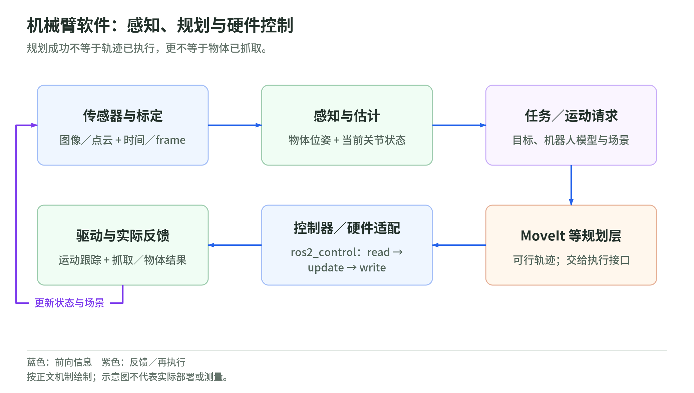

# 机器人基础与工程部署：职责核对笔记

核对截止：2026-10-27。只解释名词和信息流，不提供真实机器人操作步骤。两条流程是依据官方文档整理的典型组合，不是固定架构。

## 先分清“在哪里”和“怎样动”

坐标系是一套原点和方向约定；相机、机械臂底座、工具各有自己的坐标系。同一点换个参照，坐标数字会变。姿态是朝向，位姿是位置加朝向；说“目标位姿”必须说明相对哪个坐标系。坐标变换负责把不同参照下的描述对齐。[1]

关节是连杆之间允许转动或伸缩的连接；关节状态包含角度或位移，也可包含速度。末端是执行任务的工具，如夹爪。正运动学（FK）从关节配置算末端位姿；逆运动学（IK）从目标末端位姿找关节配置，可能无解或多解。IK有解不等于途中无碰撞。运动学讲几何关系；动力学还考虑质量、惯性、重力、摩擦和接触力，回答“这些力会怎样改变运动”。[1][3]

## 看见、估计、建图，不是同一件事

感知把传感器观测转成物体、距离或障碍等信息；状态估计结合观测与模型，判断机器人当前的位置、朝向和速度。SLAM是“同时定位与建图”，并非所有状态估计都需要建图；已有地图上的定位可以不做SLAM。Nav2要求定位系统和里程计提供地图到车体的坐标关系：里程计提供平滑的局部运动，定位系统纠正其长期漂移。[4]

## 规划决定目标，控制持续纠偏

<!-- illustration: planning-control-328b6fdaf9 -->

*图：任务、可达性、路径、轨迹与跟踪。末端可达 ≠ 整机无碰撞 ≠ 动力学可行 ≠ 任务实际成功。*
<!-- /illustration: planning-control-328b6fdaf9 -->

任务规划回答“先抓取，再搬运，再放下”；运动规划回答“各部分怎样绕过障碍”，路径加上时间安排才形成轨迹；低层控制读取实际状态，追踪位置、速度或力的参考值。规划输出不是执行完成证明。[1][3][5]

PID用当前误差、累计误差和误差变化调整输出，常用于关节跟踪，不负责选择物体或规划绕障路线。模型预测控制（MPC）利用模型预测未来一段运动，在约束内选择控制量，执行开头部分后依据新状态重算。全身控制（WBC）协调身体与四肢的目标，同时顾及接触和执行器限制。PID、MPC描述控制方法，WBC描述协调范围，三者不是必须择一的产品等级，也可以组合。[1][2]

## 软件栈和硬件之间仍有边界

ROS 2提供节点通信与任务接口，不是自动保证安全和实时性的操作系统。ros2_control连接控制器与硬件抽象，其循环是“读硬件状态→更新控制器→写硬件命令”。电机驱动器内部还可能有控制环。MoveIt整合机械臂的运动学、规划场景和轨迹执行接口，但机器人端的控制器及关节反馈须另外提供。Nav2组织导航任务、路径规划和局部跟踪；它的“控制器”通常生成底盘运动指令，不等于电机伺服。[3][4][5][6]

## 两条典型信息流

<!-- illustration: manipulator-software-00ea369fd5 -->

*图：机械臂软件：感知、规划与硬件控制。规划成功不等于轨迹已执行，更不等于物体已抓取。*
<!-- /illustration: manipulator-software-00ea369fd5 -->

机械臂pick-place：相机观测→物体位姿及坐标对齐→任务层安排抓取、搬运、放置→MoveIt结合当前关节状态与障碍生成可行轨迹→轨迹控制器→ros2_control硬件接口→驱动器。编码器等反馈返回控制器和规划场景；抓取是否成功还需夹爪或物体观测确认，不能只看命令已发送。[3][5]

移动机器人导航：目标地点→定位或SLAM、里程计提供当前位姿；传感器更新障碍表示→Nav2生成路径并局部跟踪→底盘速度指令→底盘控制器、驱动器→车轮。里程计和传感器继续回传，更新定位、障碍与后续控制；不是SLAM直接指挥电机。[4][5]

## 实时和安全是部署条件

延迟是信息或动作链路花费的时间；抖动是这些时间或调度间隔的变化。实时强调在规定截止时间内完成，不只是平均很快。工程上应按具体任务核对最坏延迟、抖动和超时，以及传感器时间戳和坐标变换是否匹配；不存在适合所有机器人的万能控制频率。[4][6]

安全边界的工程结论：规划避障和软件减速不能替代独立安全保护。应另有不依赖规划程序正常运行的急停、限位或安全控制链，并按风险设计断联、反馈失效时的保护。这里是职责划分，不是安全认证方案；不能从软件规划成功推出整机安全。[3][4][6]

## 学习检查

相机中的物体位姿能否直接交给机械臂？IK有解为何仍可能无法搬运？已知地图导航是否必须用SLAM？Nav2的控制器与电机控制器各输出什么？指令已发送、动作已完成和抓取成功，分别需要什么证据？平均延迟很小为何仍可能不满足实时要求？

## sources

按教材与官方文档集归为六组，列出实际打开的相关章节。除标明的修订日期外，统一访问日为2026-10-27；不把版权年份当作发布日期。

1. Kevin M. Lynch、Frank C. Park：《Modern Robotics》作者官方配套教材讲解，第3、4、6、8、11章。访问日：2026-10-27。入口及核验章节：
   - https://modernrobotics.northwestern.edu/nu-gm-book-resource/foundations-of-robot-motion/
   - https://modernrobotics.northwestern.edu/nu-gm-book-resource/3-3-1-homogeneous-transformation-matrices/
   - https://modernrobotics.northwestern.edu/nu-gm-book-resource/4-1-1-product-of-exponentials-formula-in-the-space-frame/
   - https://modernrobotics.northwestern.edu/nu-gm-book-resource/inverse-kinematics-of-open-chains/
   - https://modernrobotics.northwestern.edu/nu-gm-book-resource/chapter-8-1-lagrangian-formulation-of-dynamics-part-1-of-2/
   - https://modernrobotics.northwestern.edu/nu-gm-book-resource/11-4-motion-control-with-torque-or-force-inputs-part-1-of-3/
2. Russ Tedrake：MIT《Underactuated Robotics》，Highly-articulated Legged Robots。访问日：2026-10-27。课程WBC小节尚未展开，职责说明另核对该节引用的作者原论文 *An Efficiently Solvable Quadratic Program for Stabilizing Dynamic Locomotion*（课程参考文献标为2014年）。URL：
   - https://underactuated.mit.edu/humanoids.html
   - https://groups.csail.mit.edu/robotics-center/public_papers/Kuindersma13.pdf
3. MoveIt官方文档：*The move_group node*（main/Rolling）。访问日：2026-10-27。URL：https://moveit.picknik.ai/main/doc/concepts/move_group.html
4. Nav2官方文档：*Navigation Concepts*，其中的 *ROS 2*、*State Estimation*、*Navigation Servers*，及 *Using Collision Monitor*（Rolling）。访问日：2026-10-27。入口及核验章节：
   - https://docs.nav2.org/rolling/getting_started/navigation_concepts/
   - https://docs.nav2.org/rolling/getting_started/navigation_concepts/ros2/
   - https://docs.nav2.org/rolling/getting_started/navigation_concepts/state_estimation/
   - https://docs.nav2.org/rolling/getting_started/navigation_concepts/navigation_servers/
   - https://docs.nav2.org/rolling/tutorials/general_tutorials/using_collision_monitor/using_collision_monitor/
5. ros2_control官方文档：*Getting Started — Architecture*（Jazzy）。访问日：2026-10-27。URL：https://control.ros.org/jazzy/doc/getting_started/getting_started.html#architecture
6. Jackie Kay：ROS 2官方设计文档 *Introduction to Real-time Systems*。写作：2016-01；修订：2016-05；访问日：2026-10-27。URL：https://design.ros2.org/articles/realtime_background.html
