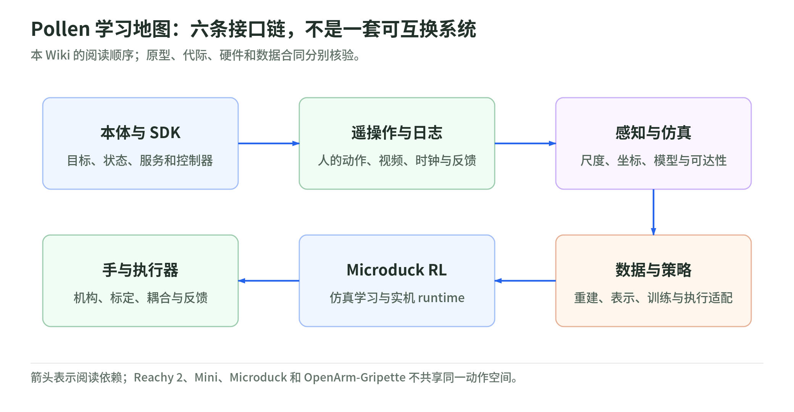
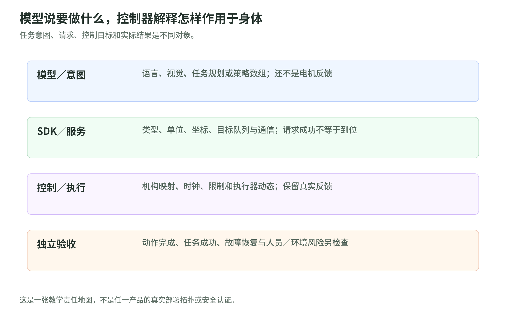

# Pollen Robotics：从开源机器人到可检验的学习闭环

研究日期：2026-11-03。[Physical AI 总入口](../README.md) · [源码快照与证据边界](sources.md)。

这个生态适合把 Physical AI 的抽象分层落到实际接口：机器人怎样接收目标，遥操作怎样留下示范，相机怎样产生空间信息，策略怎样从仿真或数据走到执行器。它不是一个“装上大模型就会做所有家务”的通用包。

本读本以 [Pollen 官方组织](https://github.com/pollen-robotics)为入口，检查选定仓库的固定源码版本，按六条学习链重新组织；不是组织全部仓库的逐行审计，也不以演示视频、star 数或开源标志代替实物验收。

## 1. 六条学习链：先问项目承担什么职责

<!-- illustration: pollen-ecosystem-map-bde484c0f1 -->

*图：Pollen 学习地图：六条接口链，不是一套可互换系统。本 Wiki 的阅读顺序；原型、代际、硬件和数据合同分别核验。*
<!-- /illustration: pollen-ecosystem-map-bde484c0f1 -->

| 想弄清的问题 | 读哪一章 | 关键仓库与机制 |
| --- | --- | --- |
| 不同机器人怎样接收动作？ | [01 本体与 SDK](robots-and-sdk.md) | Reachy 2、Reachy Mini；目标、状态、服务与控制器 |
| 人类动作怎样变成可用示范？ | [02 遥操作与日志](teleoperation-and-logging.md) | Reachy2Teleoperation、HDF5、Rerun；延迟与时间对齐 |
| 看见物体为什么不等于能抓？ | [03 感知与仿真](perception-and-simulation.md) | pollen-vision、MuJoCo 桥、QP IK；尺度、坐标与模型 |
| 手持采集器如何教会机器人？ | [04 数据与策略](data-and-policy-learning.md) | Grabette、SLAM、grabette-policy；动作表示与部署适配 |
| 小型双足怎样在仿真里学习？ | [05 Microduck 与 RL](microduck-and-rl.md) | mjlab、PPO、执行器模型、观测与 ONNX 交接 |
| 手、夹爪和关节为何不能互换？ | [06 手与执行器](hands-and-actuators.md) | AmazingHand、PincOpen、Orbita；机构、标定与反馈 |
| 没有硬件可以检查什么？ | [标准库实验与验收合同](lab.md) | 单位、空间投影、耦合运动学、时钟与过期动作 |

这里的箭头表示学习依赖，不是一套产品的统一训练步骤。Reachy 2、Reachy Mini、Microduck、OpenArm-Gripette 的动作空间、传感器和部署栈不同；知道某一个 SDK 不等于已经获得另外几种机器人的控制能力。

## 2. 三类本体与一条采集路径

| 对象 | 本次学习定位 | 不应直接推出 |
| --- | --- | --- |
| Reachy 2 | 双臂／头部／移动平台的任务与控制接口 | 与旧 Reachy SDK、Mini 或训练环境完全兼容 |
| Reachy Mini | 表达性运动、音视频与应用编排 | 具备 Reachy 2 的双臂操作空间；对话模型替代底层控制 |
| Microduck | 小型双足的动力学、RL 与实机运行交接 | 仿真高回报就证明安全行走或任意地面泛化 |
| Grabette → OpenArm-Gripette | 手持设备采集，经重建／表示适配训练与执行 | 手持轨迹已经是任意机械臂的可直接执行关节目标 |

这是本 Wiki 的学习定位，不是采购选型或产品能力排名。官方 Mini README 区分 Wireless、Lite 和仿真；Microduck RL README 则把训练环境与独立的实机 runtime 分开。系统边界必须逐项目核验。[Mini 入口](https://github.com/pollen-robotics/reachy_mini/blob/e26c6c30e723d80b1ecdaa3ace80f7e84f4d15f2/README.md) · [Microduck RL 入口](https://github.com/pollen-robotics/microduck_rl/blob/bae39f5900b318f7e87fc485c30a31213cfa14eb/README.md) · [Grabette 策略入口](https://github.com/pollen-robotics/grabette-policy/blob/c0e997b15b7b50a485577fa6d059875cfc62e849/README.md)

## 3. 为什么“模型、SDK、控制器”要分开

<!-- illustration: pollen-layer-contracts-fc6b2da1e3 -->

*图：模型说要做什么，控制器解释怎样作用于身体。任务意图、请求、控制目标和实际结果是不同对象。*
<!-- /illustration: pollen-layer-contracts-fc6b2da1e3 -->

模型可以产生行动意图或动作数组；SDK 负责把目标变成通信请求；控制器还要解释机构、单位、速率、限制与电机反馈。每一层都可能返回成功，但“请求已接受”“电机收到目标”“到达目标”“任务成功”仍是不同事件。

LLM 的“向杯子移动”不是电机命令，视觉的 bounding box 不是带标定的机器人坐标，仿真里的关节角也未必与 SDK 使用同一单位。这里沿接口拆读源代码，而不是只看顶层 demo。

与刚补充的 [Agentic-RL Lab](../../deep-learning/training/agentic-rl-lab/README.md)相比，工具 Agent 的行动多是离散调用／生成 token；双足 RL 的行动常是连续控制目标，接触、执行器响应、延迟和稳定性直接参与状态转移。两者都需要轨迹、奖励与预算合同，却不能直接移植 loss、观测或动作定义。

## 4. 对照已有 Physical AI 原理读本

| Pollen 案例 | 已有原理章节 | 新增的具体接口问题 |
| --- | --- | --- |
| SDK 与 Orbita | [状态与反馈](../advanced/chapters/01_system_model.md)、[几何](../advanced/chapters/02_robot_geometry.md) | command／state、degrees／radians、输出轴／电机轴 |
| 遥操作与 Grabette | [数据管线](../advanced/chapters/10_data_pipeline.md) | 采样时间、标定、丢帧、重建、动作 chunk |
| pollen-vision 与 IK | [感知与估计](../advanced/chapters/04_estimation_slam.md)、[规划与控制](../advanced/chapters/05_planning_control.md) | 相对深度、坐标变换、位姿不确定性与可达性 |
| Microduck RL | [强化学习](../advanced/chapters/08_rl.md)、[仿真](../advanced/chapters/11_simulation.md) | PPO、控制频率、执行器物理、随机化与 runtime |
| 抓取与策略部署 | [动力学／接触](../advanced/chapters/03_dynamics_contact.md)、[运行时](../advanced/chapters/12_runtime.md) | 滑移、限流／限速、动作有效期、恢复与独立验收 |

新读本补在原归档之外，不修改旧书的研究日期、产品数量、PDF／Word 或已有结论。代码快照日期与商品交付状态分别记录。

## 5. 仓库分类：核心实现、集成、fork、历史和原型

选定核心项目包含 SDK、server、机器人 core、遥操作、记录器、视觉包装层、仿真桥、数据／策略适配与执行器。完整快照入口见 [来源页](sources.md)；同一仓库的 Enhanced 分支也单独固定，而非视为 main 的相同硬件。

组织中的 `act-plus-plus`、`octo` 和 `MobileSAM` 在本次 GitHub 元数据中是 fork。它们分别指向 MarkFzp、octo-models、ChaoningZhang 的上游；不能因为出现在 Pollen 名下，就把 ACT、Octo、MobileSAM 称为 Pollen 原创。`pollen-vision` 的价值主要在机器人场景包装与集成，不自动改变这些模型的作者、许可证或性能证据。[ACT fork](https://github.com/pollen-robotics/act-plus-plus) · [Octo fork](https://github.com/pollen-robotics/octo) · [MobileSAM fork](https://github.com/pollen-robotics/MobileSAM)

README 可以同时包含当前代码、历史示例和未来计划。比如 `reachy2_mujoco` 自称早期原型且未功能齐全；官方 Reachy 2“学习数据记录”文档在读取日仍写着 Page in progress。不存在的教程内容不能用章节标题自行补成已提供的端到端配方。[仿真原型](https://github.com/pollen-robotics/reachy2_mujoco/blob/f6d8284e812d3b96b557e2e844d55bd09d6e3ee6/README.md) · [官方记录文档](https://docs.pollen-robotics.com/ai-with-reachy-2/autonomous-behaviors/record-data-learning-models/)

## 6. 阅读路线与执行边界

30 分钟：本页 → 01 → 03，先把请求、状态、坐标与模型职责分开。两小时：按六章顺序读，标出每条链的输入、输出、时钟与未知项。半天：只做标准库实验，选择一条上游链静态追踪，并填写验收合同。半天不是训练 Microduck 或完成硬件调试所需时间。

本次没有连接或驱动机器人，没有刷写固件、安装执行器依赖、部署机器人服务、下载模型权重／训练数据、运行 MuJoCo 或 GPU 训练，也没有采购设备或调用付费模型。实物操作必须另行确认硬件、人员、隔离与停止方案；本文不授权执行这些操作。

官方 Reachy 2 安全说明将操作者、工作区和急停责任写得很明确，并区分移动底盘的局部 LIDAR 保护与全身碰撞风险；不能把某个限位函数称为机器人全局安全证明。[官方安全指南](https://docs.pollen-robotics.com/getting-started/safety-first/safety-guidelines/)
