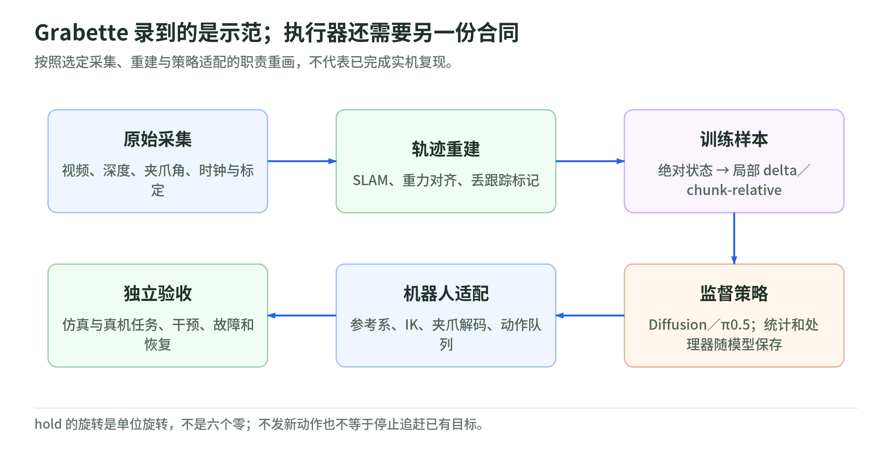

# 04 数据与策略学习：从 Grabette 示范到真实执行

研究日期：2026-11-03。[生态导读](README.md) · [固定源码与范围](sources.md)。本页按三个仓库的固定版本静态核验，不把 README 的实机案例当成本次复现结果。原始录制→可训练样本→监督策略→真实执行，是四层不同合同。

## 录到了什么，时间与标定如何解释

Grabette 录制鱼眼视频、深度相机左图与毫米深度、两个夹爪角；OAK-D SR 另有 IMU，Gemini 305 没有。`dcam_*` 可兼容旧 `oakd_*` 名称，但没有深度与内参的普通视频不能直接进入这条 SLAM 管线。鱼眼内参目前共用一份，不等于每台都已标定；`frames.json` 保存按左右手 URDF 生成的外参，包括 `T_camera_in_oak_l`，不能因文件存在便认定外参已应用。[S1：录制格式](https://github.com/pollen-robotics/grabette/blob/e82d31b772c99efbf35f16e8634844ab22e73c1b/packages/grabette/docs/data_format.md)

录制用共同起点的单调时钟；鱼眼的 BOOTTIME 纳秒先换为相对毫秒，OAK 的 `host_ms` 则取 DepthAI 已映射到主机的**采集时刻**，不是队列取出时刻。格式文档仍写 IMU“到达时映射”，应以当前代码为准。跨机器的两份单调时间不能直接相减；曝光、采集、到达与策略可用时间也不是同一个数。[S2：OAK 时间戳](https://github.com/pollen-robotics/grabette/blob/e82d31b772c99efbf35f16e8634844ab22e73c1b/packages/grabette/grabette/hardware/oakd.py#L71-L81)

postprocess 用左图的 `device_us`／`host_ms` 拟合仿射时钟，把 IMU 放到相同时间轴；旧数据缺设备时间时退回原 `host_ms`，并不自动消除延迟。左图与深度按 `seq` 配对，展开 PNG、纳秒 CSV 后交给 C++，需 FFmpeg；左图却按解码顺序取前若干帧，若中间缺深度，仍须验证图像索引没有错位，不能只看两流总数相等。[S3：转换源码](https://github.com/pollen-robotics/grabette-slam/blob/39116d865065a7b8db946f6845ecf6c07042df5f/grabette-postprocess/grabette_postprocess/convert.py)

SLAM 累积局部变换 `Tᵢ=Tᵢ₋₁ΔTᵢ`，丢跟踪时保持上一位姿并标记 `is_lost`，不是测得“手没动”。有 IMU 时由加速度与外参估计重力、转成 Z-up；无 IMU 时用固定旋转，假定起步大致水平，不是重力测量。漂移、遮挡后重获跳变及倾斜起步都会污染标签；这仍是估计轨迹，不是机器人命令记录。[S4：积分与重力对齐](https://github.com/pollen-robotics/grabette-slam/blob/39116d865065a7b8db946f6845ecf6c07042df5f/grabette-postprocess/grabette_postprocess/slam.py)

## 样本里的 action 到底是什么

传统单臂导出两路 RGB 图像和 8D `action=[位置3,旋转向量3,proximal,distal]`，单位为米、弧度。角传感器全开归零、按手别纠正符号，原始顺序是 `[distal,proximal]`，导出时交换并插值；当前 `angle_convention=positive_closing`，缺字段的旧录制按旧负向闭合约定核验，不能补成新值。README 写“下一步目标”，实际 `actions[i]` 保存**当前帧绝对状态**；缺角文件时甚至补零。最近邻图像允许选未来帧，缺鱼眼时间戳时退回均匀时间。默认元数据为 30 fps，却按轨迹行逐条写入，并未据此重采样；双臂另有角色前缀、拼接顺序和起始时差，不能直接套单臂配方。双臂缺起始时间时按零偏移处理，也不构成同步证据。教学反例：实际相隔二十与六十毫秒的两步写成等间隔索引，后续训练就可能误读速度。写入丢跟踪标记也不意味着损失函数自动屏蔽它，必须追到消费该标记的位置。[S5：真实导出合同](https://github.com/pollen-robotics/grabette-slam/blob/39116d865065a7b8db946f6845ecf6c07042df5f/grabette-postprocess/grabette_postprocess/dataset.py)

常规训练转换才生成 `Δp=Rₜᵀ(pₜ₊₁−pₜ)`、`ΔR=RₜᵀRₜ₊₁`，得到 11D 局部平移／6D 旋转／两个绝对夹爪角；不是逐项减欧拉角。6D 取旋转矩阵前两**行**。末帧、episode 边界和异常步的 hold 是零平移加 `[1,0,0,0,1,0]`，六个零不是单位旋转；夹爪不随之清零。短丢跟踪可产生近零增量，长遮挡的真实运动不能靠 hold 恢复；去尖峰和平滑阈值也不能跨频率照搬。[S6：delta 与 hold](https://github.com/pollen-robotics/grabette-policy/blob/c0e997b15b7b50a485577fa6d059875cfc62e849/policies/DiffusionPolicy/convert_dataset.py)

另有抓握投影把夹爪角换成 `(strategy,closure)`：关闭片段的目标 closure 可置 1，而观测保持实际连续值；这已改变监督语义，必须保存投影标定、改字段名并重算统计。当前解码是近端角等于闭合度乘近端行程、远端角等于策略值乘远端行程，不应照旧版极坐标解释。数字 1 不能直接作为 1 弧度发给电机。人手压住物体的示范角与舵机的位置目标相同，也不保证夹紧力相同。[S7：抓握标签转换](https://github.com/pollen-robotics/grabette-policy/blob/c0e997b15b7b50a485577fa6d059875cfc62e849/libs/grabette-dataset-tools/grabette_dataset_tools/grasp_projection_convert.py)

## 策略适配不是换一个模型名称

<!-- illustration: pollen-grabette-handoff-63f7803244 -->

*图：Grabette 录到的是示范；执行器还需要另一份合同。按照选定采集、重建与策略适配的职责重画，不代表已完成实机复现。*
<!-- /illustration: pollen-grabette-handoff-63f7803244 -->

BC 是观测到示范动作的监督学习；ACT 学动作段，VLA 加语言条件，都不替你决定绝对／增量合同。该版本的独立训练配方是 Diffusion 和 π0.5，并非已有完整 ACT 配方。通常状态只含夹爪，不喂任意 SLAM 原点。π0.5 启动器重建预处理器以采用本数据统计与配置，而非照搬底座 checkpoint 的处理流水线；还检查相对统计与 chunk 长度一致。换模型必须一起核对图像键、历史窗、归一化、padding 和任务字符串；低验证损失不能证明闭环会抓。[S8：训练适配](https://github.com/pollen-robotics/grabette-policy/blob/c0e997b15b7b50a485577fa6d059875cfc62e849/policies/Pi05/train.py)

可选 chunk-relative 默认关闭：以段首位姿为参考，表达整段局部偏移，默认仍为旋转向量 8D；执行时再把相邻偏移转成逐步 delta。README 的 6D 描述不能当默认格式。每次重规划须 `reset()`，否则会把两个不同参考系相减，制造跳跃；自定义 processor 的注册与统计也须随 checkpoint 部署。[S9：动作段合同](https://github.com/pollen-robotics/grabette-policy/blob/c0e997b15b7b50a485577fa6d059875cfc62e849/libs/grabette-chunkrel/grabette_chunkrel/chunk_relative.py)

## 从局部动作到电机

当前控制 frame 明确为 `oak_l`，而非鱼眼 `camera`。IK 内部把该目标通过固定外参转到 camera 任务；导出器没有自动套 `frames.json`。换成鱼眼位姿时，数据与控制两端都须一致变换，不能只改名字：同一次旋转在两台相隔一定距离的相机上，会伴随不同平移。[S10：FK／IK 坐标合同](https://github.com/pollen-robotics/grabette-policy/blob/c0e997b15b7b50a485577fa6d059875cfc62e849/robots/openarm/openarm_gripette_simu/openarm_gripette_simu/kinematics.py)

部署客户端消费动作队列、处理陈旧图像，并将投影夹爪值解码后另发 `SendMotorCommand`。无可用动作时异步队列不发送新命令，不等于产生了有效静止标签。示例：相同 2 mm 增量每 20 ms 或 100 ms 执行，名义速度相差五倍；不能用更长 chunk 掩盖相机历史间隔与执行频率不匹配。投影自动识别还依赖统计范围，小于 1 弧度的原始角数据可能误判，须显式核对。[S11：客户端与时序](https://github.com/pollen-robotics/grabette-policy/blob/c0e997b15b7b50a485577fa6d059875cfc62e849/robots/openarm/openarm_gripette_simu/examples/evaluate.py)

真机 `SendCartesianDelta` 在内部**目标**上累计 `p←p+RΔp、R←RΔR`，不是每步拿实测 FK 重置；再经 IK、命令关节 FK 回同步和插值送 CAN。无新动作仍追赶旧目标，hold 不等于停在当前实测位置。退化 6D 可被当无旋转，但平移保留；IK 跳变与目标超前保护会拒绝动作，API 成功也非到位确认。实机 Reset 是平滑归位，成功状态恒假，不能沿用仿真的任务成功判据；驱动还需核对度／弧度、关节符号与固件零位。[S12：真机执行合同](https://github.com/pollen-robotics/grabette-policy/blob/c0e997b15b7b50a485577fa6d059875cfc62e849/robots/openarm/openarm_gripette/openarm_gripette/grpc_server_real.py)

## 自测与复现边界

无硬件自测：相邻相同位姿应得到单位旋转 hold；转动参考系后同一局部动作应不变；episode 末帧不能连到下一段；丢跟踪保持值必须与实测静止区分。按会话分组拆分，再生成窗口，检查未来图像与标定版本泄漏。原理对照[数据管线](../advanced/chapters/10_data_pipeline.md)、[模仿与动作段](../advanced/chapters/07_imitation_generators.md)、[SLAM](../advanced/chapters/04_estimation_slam.md)。

复现清单应绑定录制设备、左右手、角零位、内外参内容、时钟拟合残差、原始时间、标签移位规则和源 episode。仅保存 URDF 名字不是冻结模型版本；仅有处理后视频也不能重新审计掉帧与时钟误差。数值往返测试还要对照真正的线协议解码器，否则错误编码器与错误解码器可以彼此“验证成功”。

上述 S1—S12 是主来源。版本还须锁定：postprocess 要求 Python ≥3.12、LeRobot ≥0.6.1 且 <0.7；Diffusion 固定 0.6.0，π0.5 固定 Git 版本，训练／推理不可混用。policy 的 Gripette 依赖另钉提交，并非本次录制仓库 HEAD；proto 一致也不证明标定一致。SLAM 基础镜像配方固定 RTAB-Map 0.23.1，Space 则从已有基础镜像重编译二进制，还依赖 FFmpeg；README 的“自包含”不消除未锁镜像 digest 的重建差异。

三仓库根许可标识 Apache-2.0，第三方及数据／权重授权另审。开源、公开入口与 API 定义都不等于在线服务可用或实机复现通过。本次未运行上游、下载数据权重、安装训练、连接机器人或调用付费服务。可接着做[标准库合同实验](lab.md)，先查单位、时钟与动作语义。
