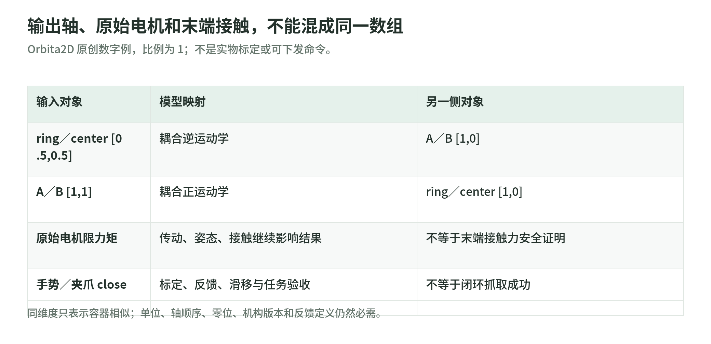

# 06 手、夹爪与 Orbita：动作最终要经过机构和反馈

研究日期：2026-11-03。[生态导读](README.md) · [来源与快照](sources.md)。

软件里都是一个数组，硬件里却可能是夹爪开合、手指电机角度、并联关节输出姿态或电流／力矩。Pollen 的手、夹爪和 Orbita 适合练习这个区别；“更多自由度”和“开源 CAD”都不是抓取可靠性的替代指标。

## 1. 三类部件，不承担同一件事

| 对象 | 机构与学习用途 | 不能混为 |
| --- | --- | --- |
| PincOpen | 两平行手指夹爪，可更换指尖；低成本设计探索 | 任意工业夹爪的强度、精度与力控能力 |
| AmazingHand | 初版四指、八个驱动自由度，手指并联机构 | 每节指骨都独立驱动、已验证灵巧操作策略 |
| Orbita2D／3D | 并联执行器及运动学／通信／控制接口 | 末端抓取器或单个电机角度数组 |

AmazingHand README 说明两节指骨联动，每根手指由两个电机驱动；初版使用 SCS0009。Enhanced 分支改用 STS3032，并调整部分机械件与标定边界。这里分别固定两份代码，不把新版电机假装是 main 示例的配置。[初版说明](https://github.com/pollen-robotics/AmazingHand/blob/3e8241074df3436a3044ced4881e3bb2133aa725/README.md) · [Enhanced 说明](https://github.com/pollen-robotics/AmazingHand/blob/31bfc548270a306829c7a3acdad19f643f53f618/AmazingHand_Enhanced/README.md)

价格、重量和性能宣传属于作者描述，本文不做实时 BOM 报价、采购推荐或独立载荷测试。更适合读的是机构选择、传感反馈和控制边界。

## 2. 初版 AmazingHand demo 是动作脚本，不是闭环抓取

Python 示例写着每个电机的中位标定偏移，按 Side 分支生成预设姿态。`Move_*` 先加偏移，再用 `deg2rad` 转换，最后写入 servo；手势名称本身没有给出接触力、滑移或抓取成功判据。[脚本实现](https://github.com/pollen-robotics/AmazingHand/blob/3e8241074df3436a3044ced4881e3bb2133aa725/PythonExample/AmazingHand_Demo.py)

特别注意：串口 controller 在模块顶层创建；**导入脚本也可能初始化设备连接**，不能把 import 当作纯只读安全检查。源码中的固定串口和 MiddlePos 是某个设置的示例，不应复制成自己的标定。

README 明确提示打印、装配和柔性结构会让实际角度偏离理论，且长时间复杂抓取尚未验证，仍需要利用反馈的更聪明控制。这是项目公开的边界，不是本 Wiki 重新测出的故障。[作者 disclaimer](https://github.com/pollen-robotics/AmazingHand/blob/3e8241074df3436a3044ced4881e3bb2133aa725/README.md)

初版 Demo 还提供 MuJoCo／Mink 的 fingertip 目标和关节映射。所读路径使用运动学配置积分，物理 `mj_step` 被注释；所以“手指在 viewer 中跟踪目标”不能据此升级成已经测试接触、抓取力和动力学鲁棒性。[仿真／运动学示例](https://github.com/pollen-robotics/AmazingHand/blob/3e8241074df3436a3044ced4881e3bb2133aa725/Demo/AHSimulation/AHSimulation/mj_mink_right.py)

## 3. PincOpen：位置控制与有限力抓取之间还有一层

README 将金属件改成可打印机构，使用 STS3215，并提出在位置控制电机上模拟限力的需求。闭合到某个角度时，若物体阻挡，位置误差仍可能推动机构用力；软件“发了 close”不是力矩闭环或安全接触。

读夹爪要保存：电机与驱动版本、开合量定义、零位／行程、传动、指尖、摩擦、反馈与停止条件。不同指尖可能改变接触与数据分布，也不应只凭同一 opening 值复用模型。

仓库提供 CAD、装配和 flash/test notebook，README 还链接外部的 pypot／LeRobot 路径；这些入口不等于所有当前软件版本都兼容。本文不执行刷写、配置电机或通电测试。[PincOpen 说明](https://github.com/pollen-robotics/PincOpen/blob/1b5a3dc83cb4eae042d535bda3765b9e12a9b8a7/README.md)

## 4. Orbita2D：输出轴不是两台电机的别名

<!-- illustration: pollen-actuator-coordinate-6813168b02 -->

*图：输出轴、原始电机和末端接触，不能混成同一数组。Orbita2D 原创数字例，比例为 1；不是实物标定或可下发命令。*
<!-- /illustration: pollen-actuator-coordinate-6813168b02 -->

源码约定电机顺序 A／B，输出顺序 ring／center；角度为 radians。模型用耦合矩阵：

$$
\begin{bmatrix}\theta_A\\\theta_B\end{bmatrix}
=
\begin{bmatrix}r_A&r_A\\r_B&-r_B\end{bmatrix}
\begin{bmatrix}q_{\mathrm{ring}}\\q_{\mathrm{center}}\end{bmatrix}.
$$

在原创教学例 $r_A=r_B=1$ 中，输出 `[0.5,0.5]` 对应电机 `[1,0]`；电机 `[1,1]` 对应输出 `[1,0]`。**维度相同不代表坐标语义相同。**比例、零位和轴顺序必须来自具体机构配置；这些数字不是某台实物的标定。[模型与单元例](https://github.com/pollen-robotics/orbita2d_control/blob/dc54f7ee24b54407d584ebee15bdb35894c206d0/orbita2d_kinematics/src/lib.rs)

## 5. Orbita3D：姿态、速度和原始电机限制分层

控制栈包含 Rust 运动学／通信、C API、Python binding、URDF 与 ROS2 hardware interface。3D 机构由几何参数定义，其倾角受到机构碰撞和奇异性限制；不能从理论 yaw 旋转能力推出整台机器人线缆、关节和任务的无限运动能力。[组件结构](https://github.com/pollen-robotics/orbita3d_control/blob/9e547d616af8487c52c5aff68792a74fbc023d79/README.md) · [机构参数](https://github.com/pollen-robotics/orbita3d_control/blob/9e547d616af8487c52c5aff68792a74fbc023d79/docs/theory/parameters.md)

Python／Rust 姿态接口的 quaternion 顺序是 `(qx,qy,qz,qw)`，电机角度为 radians。另一些仿真接口会用 `(w,x,y,z)`；四个数都“归一化”也不会替你发现排错顺序。[Python 接口](https://github.com/pollen-robotics/orbita3d_control/blob/9e547d616af8487c52c5aff68792a74fbc023d79/orbita3d_c_api/python/orbita3d/__init__.py)

`enable_torque(reset_target)` 在从未使能状态启用且选择 reset 时，先把当前电机位置设为目标，再使能。这有助于避免残留目标造成跳变，却不是碰撞与安全证明。原始电机的速度／力矩上限接口也明确不是 Orbita 输出姿态空间的直接上限；耦合映射不能省略。[控制器与限制](https://github.com/pollen-robotics/orbita3d_control/blob/9e547d616af8487c52c5aff68792a74fbc023d79/orbita3d_controller/src/lib.rs)

## 6. 开源范围与实际验收

许可也按材料分层：AmazingHand README 声明软件 Apache-2.0、机械设计 CC BY 4.0；PincOpen 的 LICENSE／README 声明 CC BY-SA 4.0。不要用组织首页的统一开源标语覆盖各个项目、模型或机械设计。本节只记录来源声明，不给法律结论。[AmazingHand 许可声明](https://github.com/pollen-robotics/AmazingHand/blob/3e8241074df3436a3044ced4881e3bb2133aa725/README.md) · [PincOpen LICENSE](https://github.com/pollen-robotics/PincOpen/blob/1b5a3dc83cb4eae042d535bda3765b9e12a9b8a7/LICENSE)

抓取验收应区分无接触轨迹、固定物体抓取、滑移／扰动、重复抓放、温升、磨损和失效恢复；每一项都要保存硬件／固件、指尖、任务、负载和停止条件。程序能读回位置或显示手势，仅证明接口链中的一部分。

相关原理：[动力学与接触](../advanced/chapters/03_dynamics_contact.md)、[控制](../advanced/chapters/05_planning_control.md)、[评测](../advanced/chapters/13_evaluation.md)。标准库只验算运动学和合同，不接触这些硬件。

## 自测

1. AmazingHand 八个驱动自由度等于八节指骨完全独立吗？答：不等于，机构约束与指骨联动仍在。
2. 输出轴 `[1,0]` 就应直接写入电机 `[1,0]` 吗？答：不应，先经过当前耦合模型。
3. 设置 raw motor torque limit 能证明接触力和抓取都安全吗？答：不能，传动、姿态、反馈、任务和独立验收仍需检查。
