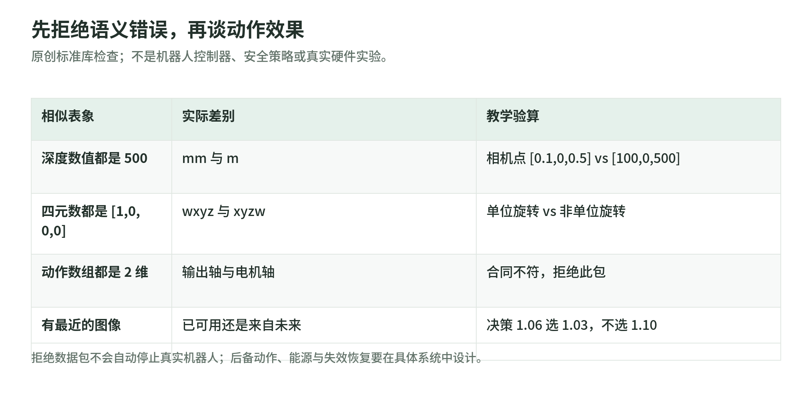

# Pollen 标准库实验：不连接机器人，也能先查清接口合同

研究日期：2026-11-03。[生态导读](README.md) · [主来源与执行边界](sources.md)。

这些是本 Wiki 的原创教学计算，只用 Python 标准库，不导入 SDK、串口、MuJoCo、模型或控制器。它们不是 Pollen 的硬件测试，也不是实机安全系统。

源码：[实验](https://github.com/IanLiYi1996/learning-wiki/blob/main/scripts/pollen_contract_lab.py) · [测试](https://github.com/IanLiYi1996/learning-wiki/blob/main/tests/test_pollen_contract_lab.py)。在本 Wiki 根目录执行：

```bash
python -B scripts/pollen_contract_lab.py
python -B -m unittest discover -s tests -p 'test_pollen_contract_lab.py'
```

## A. 深度单位：对齐 shape，还可能错一千倍

假想针孔内参 `fx=fy=500`，主点 `(320,240)`，像素 `(420,240)`，深度 `500 mm`：

```text
camera_point_m = [0.1, 0, 0.5]
```

若错误标成 `500 m`，同样代码得到 `[100,0,500]`。函数不猜单位；`relative` 或未知单位会拒绝。它不模拟畸变、遮挡、噪声、真实传感器和任何单目模型。

Pollen 的实际深度工具有固定换算和简化姿态假设，见 [03](perception-and-simulation.md)；本例不照抄硬件的缩放参数。

## B. 坐标变换：相机前方不等于世界前方

把上一个相机点绕 Z 轴转 90°，再加世界平移 `(1,0,0)`：

```text
world_point_m ≈ [1, 0.1, 0.5]
```

这里明确是 `world ← camera` 的教学变换，只实现 yaw，不是完整 SE(3) 或机器人标定工具。反方向、左右手系、旧外参都会改变结果，不能用 `4×4` 来代替这个合同。

## C. 耦合运动学：两个角度数组不一定可直接复制

按 Orbita2D 的模型顺序，教学比例 `rA=rB=1`：

| 转换 | 输入 | 输出 |
| --- | --- | --- |
| ring／center → A／B | `[0.5,0.5]` | `[1,0]` |
| A／B → ring／center | `[1,1]` | `[1,0]` |
| A／B → ring／center | `[1,-1]` | `[0,1]` |

全部单位是 radians。这些值不是任何真实机构的标定或可直接下发的运动。测试验证非单位比例的正逆往返、形状、奇异比例与非有限输入。

## D. 四元数：归一化不会告诉你顺序错了

`[1,0,0,0]` 若按 wxyz 解释，是单位旋转；转换到 xyzw 得到 `[0,0,0,1]`。若原样按 xyzw 解释，就不是单位旋转。

测试显式要求 order，拒绝零四元数和缺失维度。归一化解决模长问题，不解决坐标系、顺序和语义问题。Orbita 与仿真接口的具体顺序继续读 [06](hands-and-actuators.md)。

## E. 时间对齐：不要给策略看未来图像

同一已确认的时钟下，观测时刻 `[1.00,1.03,1.10]`，决策时刻 `1.06`，可接受年龄上限 `0.05 s`。选的是 `1.03`，年龄约 `0.03 s`，不是更近但尚未发生的 `1.10`。

```text
causal_observation = {"index": 1, "age_seconds": 0.03}
```

两个时钟名字不同会拒绝直接比較；这是要求先做时钟转换，不是证明同名时钟已经同步。真实数据还要保存曝光、传输、接收、机器人状态与动作执行时刻。

## F. 动作合同检查，不冒充急停

<!-- illustration: pollen-offline-contract-e132e5395a -->


*图：先拒绝语义错误，再谈动作效果。原创标准库检查；不是机器人控制器、安全策略或真实硬件实验。*
<!-- /illustration: pollen-offline-contract-e132e5395a -->

假设需要 `("ring","center") / rad / orbita_output / absolute_position`。送来 A／B motor 数组时，尽管 shape 同为 2，也会拒绝 names／frame 不符；过期、未使能、未来时间、degrees 或 delta 表示也分别检查。

```text
mismatched_action.accepted = false
stale_action.accepted = false
```

这个 gate **仅判断教学数据包是否符合合同，不执行动作，不让真实机器人停止，也不选择安全后备动作**。双足停更、手臂失能、重物掉落和故障恢复需要具体系统方案；不能把 Python 验证器接到电机就叫安全认证。

## G. 延迟账本：不能拿平均值当安全距离

原创常速例：速度 `0.4 m/s`，观测／计算／发送阶段延迟分别 `0.12 / 0.08 / 0.02 s`：

```text
latency_displacement_m = 0.088
```

这是 220 ms 内的常速位移估算，不是测得误差，不包含加速度、制动、抖动与接触，更不是机器人安全距离。上游的设定 Hz 也不是本例的实測频率。

## 一页复现与验收合同

| 维度 | 开始前应写清 |
| --- | --- |
| 对象／版本 | 本体、控制器、固件、SDK、模型、数据与依赖快照 |
| 几何与单位 | 关节／轴顺序、degrees／radians、米制尺度、外参和 quaternion 顺序 |
| 学习数据 | raw／重建／导出／筛选；绝对／delta／chunk-relative；任务与 train／test |
| 时间与执行 | 时钟映射、采样／接收／执行时刻、频率、有效期与缺帧策略 |
| 限制与恢复 | 使能、权限、独立停止、任务空间、载荷、监督人员与失败恢复 |
| 证据 | 仿真和实物分别验收；独立任务／扰动；成功、干预、故障与实际成本 |

本次只执行本页的标准库计算与教材验证；没有真机、仿真、感知模型、训练或付费服务运行。旧的[反馈实验](../examples/feedback_demo.py)与[数值工作簿](../advanced/examples/numerical_workbook.py)仍可独立学习。
