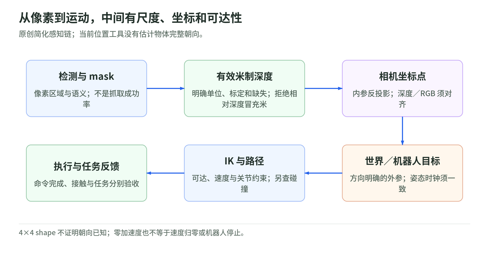
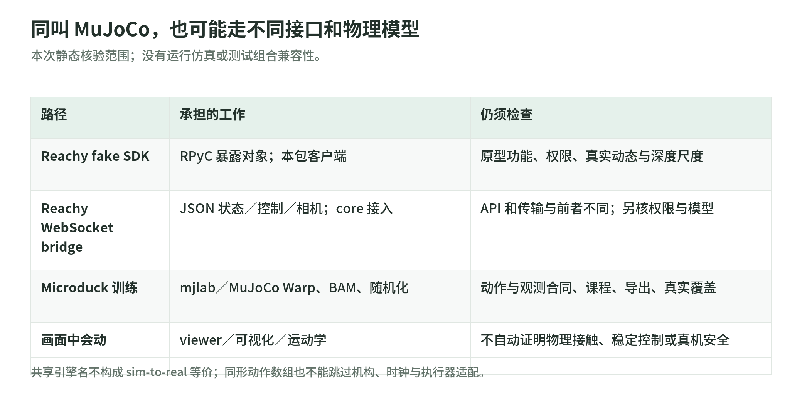

# 03 感知与仿真：从一块像素到可以执行的空间目标

研究日期：2026-11-03。[生态导读](README.md) · [固定源码与范围](sources.md)。

看见“杯子”只回答了语义问题。机器人还需要知道杯子在哪个坐标系、距离有多可信、能否到达、怎样避免碰撞。Pollen 的视觉包装层、IK 和两条 MuJoCo 接入路径，恰好把这些边界暴露出来。

## 1. pollen-vision 是集成层，不是新发明的万能视觉模型

仓库提供开放词汇检测、分割、单目深度和相机包装层。README 示例把 OWL-ViT 的检测框交给 MobileSAM 生成 mask；另有 RAM 与 Depth Anything 包装。它让使用者以统一接口串联已有模型，不代表这些基础模型都由 Pollen 训练或作者独立验证了统一性能。[项目入口](https://github.com/pollen-robotics/pollen-vision/blob/2d7cfab7c0c1090741e43ba5e3aab5acefb110f7/README.md)

理解四种输出：

- **类别与框**：像素区域里可能有什么；检测分数不是机械臂抓取成功概率。
- **Mask**：物体覆盖哪些像素；不能自动给出稳定接触点、摩擦或物体朝向。
- **相对深度**：远近结构；没有标定的尺度时，不能当作米制距离。
- **标定后的空间目标**：还需要相机内参、有效深度、相机外参和时间一致性。

`DepthAnythingWrapper` 取得 pipeline 的 depth 图，再用最大值减去原图；这里没有将其转换为实测米制深度的步骤。README 也标明非 metric。用“数值像距离”代替尺度合同，可能让抓取目标差一个数量级。[深度包装实现](https://github.com/pollen-robotics/pollen-vision/blob/2d7cfab7c0c1090741e43ba5e3aab5acefb110f7/pollen_vision/pollen_vision/vision_models/monocular_depth_estimation/depth_anything_wrapper.py)

## 2. 反投影：shape 正确不等于物理含义正确

<!-- illustration: pollen-pixel-to-action-74bc10208c -->

*图：从像素到运动，中间有尺度、坐标和可达性。原创简化感知链；当前位置工具没有估计物体完整朝向。*
<!-- /illustration: pollen-pixel-to-action-74bc10208c -->

简化针孔模型先把像素 $(u,v)$ 和已知的米制深度 $z$ 变成相机坐标：

$$
x=(u-c_x)z/f_x,\qquad y=(v-c_y)z/f_y.
$$

再用 $T_{\mathrm{world}\leftarrow\mathrm{cam}}$ 变换到世界坐标。这个方向不能任意反过来；角度、坐标轴和深度单位也不能只靠数组 shape 推断。

源码 `get_object_pose_in_world` 用 mask 区域的平均深度估位置，含固定比例换算；把旋转块设为单位阵。**它返回 4×4 pose matrix，但没有估计物体朝向**。称“取得完整 6D 抓取位姿”会夸大这个函数。空 mask、零有效深度、遮挡与多物体混合也需要在使用端另行处理。[反投影与位姿工具](https://github.com/pollen-robotics/pollen-vision/blob/2d7cfab7c0c1090741e43ba5e3aab5acefb110f7/pollen_vision/pollen_vision/utils/utils.py)

`fuse_depths` 尝试用 stereo 深度拟合单目深度；这不是免标定的“变成真值”。当前实现只过滤 NaN，缺少显式的零样本／非有限值处理，且过滤后预测再 reshape 原图，对缺失像素会产生形状风险。拟合是否有效须独立检查，不将函数存在视为精度保证。[同一工具文件](https://github.com/pollen-robotics/pollen-vision/blob/2d7cfab7c0c1090741e43ba5e3aab5acefb110f7/pollen_vision/pollen_vision/utils/utils.py)

## 3. 相机动了，外参和时钟也要跟着更新

`Perception` 在 teleop 相机分支根据当前头部方向更新相机外参，再推入对象过滤器。这个调用链说明“画面里的物体”需要与机器人姿态共同解释；它并未自动证明图像、深度和头姿严格同时采集。代码取相机数据时丢弃返回的时延／时间字段；SDK 相机 wrapper 的 RGB 与 depth 又是分别取帧。[感知循环](https://github.com/pollen-robotics/pollen-vision/blob/2d7cfab7c0c1090741e43ba5e3aab5acefb110f7/pollen_vision/pollen_vision/perception/perception.py) · [相机包装](https://github.com/pollen-robotics/pollen-vision/blob/2d7cfab7c0c1090741e43ba5e3aab5acefb110f7/pollen_vision/pollen_vision/camera_wrappers/pollen_sdk_camera/pollen_sdk_camera_wrapper.py)

另有实际模式边界：高层循环直接读取 `data["depth"]`，该 wrapper 的 teleop 分支没有填这个字段。不能从两个模块各有“teleop”字符串，就认定整条组合在这个快照已经打通。视觉研究 demo 与稳定的机器人感知服务仍隔着模式、标定、时序、异常和性能验收。

## 4. 两条 MuJoCo 路径，不是同一个 server

<!-- illustration: pollen-simulation-paths-0dc4941f11 -->

*图：同叫 MuJoCo，也可能走不同接口和物理模型。本次静态核验范围；没有运行仿真或测试组合兼容性。*
<!-- /illustration: pollen-simulation-paths-0dc4941f11 -->

| 路径 | 本地实际接口 | 阅读边界 |
| --- | --- | --- |
| `reachy2_mujoco` | RPyC 暴露仿真对象；客户端用该包的 fake SDK | README 明说早期原型、并非完整 SDK；底盘／执行器／深度还待核验 |
| `reachy2_mujoco_server` | WebSocket JSON 控制／状态／相机；配合另一条 core 接入链 | 不能将它当作上述 fake SDK 的同一个传输实现 |
| 官方 Docker 仿真入口 | 同一镜像可选 Gazebo／MuJoCo，SDK／core 组合 | 文档是安装说明，不等于本次运行或镜像内容核验 |

[fake SDK 与 server](https://github.com/pollen-robotics/reachy2_mujoco/blob/f6d8284e812d3b96b557e2e844d55bd09d6e3ee6/reachy2_mujoco/reachy2_mujoco/mujoco_server.py) · [WebSocket 实现](https://github.com/pollen-robotics/reachy2_mujoco_server/blob/a304471a9685d6a30e45f8bdb552d8db0c91ac32/reachy2_mujoco_server.py) · [官方仿真说明](https://docs.pollen-robotics.com/developing-with-reachy-2/simulation/simulation-installation/)

前一实现允许全属性访问、setattr 和 pickle，没有在所读 server 中建立认证／授权边界；不能直接暴露为公共机器人服务。后一实现也需单独检查接入权限、消息校验与资源限制。这里未部署或做完整安全审计。

fake `Joint` 把 SDK 风格目标 degrees 转成 MuJoCo 控制 radians，读取时再转回 degrees。仿真接了同名 API，不等于执行器动态已相同；README 明列系统辨识与底盘行为匹配的缺口。[关节适配](https://github.com/pollen-robotics/reachy2_mujoco/blob/f6d8284e812d3b96b557e2e844d55bd09d6e3ee6/reachy2_mujoco/reachy2_mujoco/parts/joints.py) · [原型边界](https://github.com/pollen-robotics/reachy2_mujoco/blob/f6d8284e812d3b96b557e2e844d55bd09d6e3ee6/README.md)

## 5. IK 约束有价值，却不是任务安全证明

`reachy2_qpik` 提供 acceleration／speed QP 和相关跟踪实现，处理关节运动约束与配置。加速度控制器将加速度积分成速度，按最大比例缩放超限速度，再积分关节位置、处理腕部和多圈限制。代码默认循环周期是 1/500 秒，但设定周期不是测得的硬实时保证。[控制实现](https://github.com/pollen-robotics/reachy2_qpik/blob/149948db13b108b9f4a940a5bb94f50422eadd27/src/reachy2_qpik/reachy2_acceleration_control.py)

具体异常合同也值得读：QP 异常时该函数退回零加速度，**不是将现有速度归零**；已经有速度的积分链不因此自动停止。多圈紧急分支还有命令发布，需要逐层确认真正的停机动作和硬件效果，而不能仅从“EMERGENCY STOP”日志取得保证。

不同问题分开验收：IK 能否跟踪目标；几何路径是否碰撞；控制是否稳定；接触是否可接受；整个任务是否成功。相关原理：[运动学](../advanced/chapters/02_robot_geometry.md)、[规划与控制](../advanced/chapters/05_planning_control.md)、[仿真求解](../advanced/chapters/11_simulation.md)。

## 6. 读代码与自测

最短路径：`pollen-vision` README → depth wrapper → utils → perception／camera wrapper；然后对照两条 MuJoCo README／server／Joint；最后看 QP controller 的积分、限制与异常路径。本章没有执行这些模块，也没有下载它们会加载的模型。

1. 4×4 pose 的旋转是单位阵，说明物体没有转动吗？答：不说明；此函数没有估朝向。
2. 单目 depth 图能直接作为机器人米制距离吗？答：不行，先确认尺度、标定和误差。
3. QP 失败回退零加速度，就等于机器人停止了吗？答：不等于，原速度和下游控制仍须处理。
