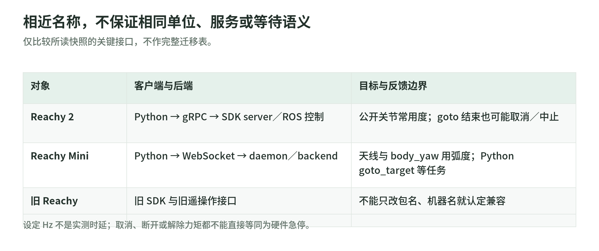

# 01 机器人与 SDK：代际、控制链与执行契约

研究日期：2026-11-03。[生态导读](README.md) · [固定源码与范围](sources.md)。本文只静态读取固定版本源码；没有连接机器人、安装依赖或运行仿真。“源码核验”指可见实现，“文档承诺”指上游说明；机械性能、实际时延及安全效果仍未知。组织名下的仓库也不能使其中 fork、论文或第三方组件自动成为组织原创。

## 先分清三条产品线

Reachy 2 的协议按部件描述双臂、头、夹爪及可选底盘、升降支架；单臂关节顺序是肩俯仰、肩侧摆、肘偏航、肘俯仰、腕滚转、腕俯仰、腕偏航。字段存在不等于每台机器都装齐，SDK 会按描述和激活状态建立部件对象。[部件协议][api-arm]、[客户端初始化][sdk]

Reachy Mini 是另一套桌面交互平台，控制头位姿、两根天线和身体偏航，并提供视听接口；不能把它当作双臂抓取平台或移动底盘。Wireless 与 Lite 的机载计算、供电和连接差异是 [README 声明][mini-readme]，不是本次硬件实测。

旧 `ReachyTeleoperation` 的 README 明确面向 Reachy 2021+；旧采集脚本导入 `reachy_sdk`，Reachy 2 脚本则导入 `reachy2_sdk`。名称相近并不保证对象树、服务协议或回放脚本兼容；本次未读取旧 Python SDK 全部实现，不能给出完整迁移表。[旧版定位][old-readme]、[旧采集接口][old-recorder]

## 一条命令到底经过谁

<!-- illustration: pollen-sdk-generations-00c808e0a4 -->

*图：相近名称，不保证相同单位、服务或等待语义。仅比较所读快照的关键接口，不作完整迁移表。*
<!-- /illustration: pollen-sdk-generations-00c808e0a4 -->

Reachy 2 的 Python SDK 是客户端，不是电机控制器：它通过 protobuf/gRPC 调用 SDK server；server 将部件命令转成 ROS 2 消息，发布 `/dynamic_joint_commands`，从 `/dynamic_joint_states` 更新反馈，并把长运动交给 ROS action。core 的 launch 装配状态路由、轨迹服务、`ros2_control` 与硬件驱动。[桥接实现][bridge]、[启动装配][core-launch]

当前客户端使用 `grpc.insecure_channel` 建立控制连接，并非内置加密认证方案。受控网络、访问权限与现场操作责任须在部署层另行交接；远程可调用接口不等于可以暴露到公共网络。这个判断来自连接实现，不是已完成的安全审计。[连接实现][sdk]

Full-kit 控制配置把位置目标交给 `ForwardCommandController`，控制管理器标称更新率为 500 Hz。这是该配置的周期，不是 Python、相机或策略的保证频率，更不是已测实时性。夹爪、天线及 Orbita 的硬件接口另有驱动；单看 SDK 返回值无法证明电机已经执行。[控制配置][controllers]

Mini 不走这条 ROS/gRPC 链：Python SDK 经 WebSocket 向 daemon 发送类型化 JSON 命令，daemon 再选择真实或模拟 backend。客户端命令发送和长任务完成有不同机制，不能套用 Reachy 2 的 `GoToId`。[Mini 客户端][mini-sdk]、[WebSocket 实现][mini-ws]

## 单位和坐标是接口的一部分

Reachy 2 的公开关节属性以度表示，发送时转为内部弧度；`goto`、FK、IK 通常默认 `degrees=True`。末端位姿是机器人参考系中的 4×4 齐次矩阵，平移以米表示；平移辅助接口定义 x 向前、y 向左、z 向上，`frame="robot"` 与 `"gripper"` 分别沿机器人轴或工具轴移动。[关节属性][joint]、[运动学与位姿][arm]

服务端手臂笛卡尔接口明确期待 torso 参考系，而底盘导航目标在里程计参考系；二者不能混称“世界坐标”。底盘公开线速度用米每秒、角速度用度每秒，协议发送前转换角单位。速度、力矩限额又是百分比，不是米每秒或牛米。[轨迹入口][server-goto]、[底盘接口][mobile]、[限额转换][server-arm]

Mini 的天线及 `body_yaw` 用弧度；`create_head_pose` 默认平移为米、欧拉角为度，只有显式 `mm=True` 才转换毫米。矩阵本身不携带单位。应同时记录变换方向、参考系、四元数顺序及关节排列，不能把 Unity 跟踪矩阵原样送入机器人。[Mini 位姿构造][mini-pose]。变换组合原理见[机构与几何](../advanced/chapters/02_robot_geometry.md)。

## command、state 与 async 不能混读

给关节 `goal_position` 赋值只更新本地待发目标；调用 `send_goal_positions()` 才发送。该属性的读取值则来自服务器反馈的目标，未必立即等于刚赋的值；`present_position` 是反馈位置。两者接近不等于接触任务成功，也不能互换成训练标签。[关节缓存][joint]

SDK 后台线程请求 100 Hz 状态流，并逐部件更新缓存。这个数字是请求频率；顺序读取多个属性不构成同一时刻的原子快照。`get_update_timestamp()` 返回最近收到的 ROS 时间，不能直接作为每个编码器的独立采样时间。[同步线程][sdk]。层间职责见[状态、观测与动作](../advanced/chapters/01_system_model.md)。

`goto` 默认 `wait=False`，提交后返回运动标识，部件有执行项和队列。更重要的是，等待函数把成功、取消、中止都视为“结束”，超时还可能只记录警告后返回。因此“调用返回”“队列清空”“目标实际到达”必须分别判断。[等待实现][wait]。通信与调度原理见[运行系统](../advanced/chapters/12_runtime.md)。

Mini 的 Python `goto_target` 则发送任务后阻塞等待，超时设为运动时长加一秒；daemon 内部才以异步方式播放轨迹。同名运动函数的同步语义不同。Mini 反馈也由后台接收线程缓存，调用 getter 不等于当场读硬件。[任务等待][mini-sdk]、[状态缓存][mini-ws]

## 越界、停止与仿真边界

错误输入并非统一截断：关节 setter 主要检查类型；IK 无解可抛异常，部分 `goto` 拒绝返回 `id=-1`。server 的 `GetJointsLimits` 在此版本返回空对象，桥接轨迹请求还设置 `safety_on=False`；这些静态事实不足以证明完整避障或安全限位。[手臂实现][arm]、[服务实现][server-arm]、[桥接轨迹][bridge]

Mini [概念文档][mini-concepts]承诺限幅，但解析运动学的可见实现是在自动身体偏航模式下调用外部 Rust 安全 IK，传入身体 ±160°、相对偏航 65°；关闭该模式走另一分支。碰撞检查默认关闭，启用依赖 Placo。不能把文档的角度范围扩大成任何姿态都能安全执行的保证。[解析 IK][mini-ik]、[backend][mini-backend]

取消轨迹只是请求，不等于硬件急停。`turn_off` 解除力矩保持，重力下可能下落；`turn_off_smoothly` 还会先运动到预设姿态，不是“立即停止”。断开客户端只关闭通信，也不能视为停机确认。[关闭与断开][sdk]、[力矩开关][server-arm]

协议区分 REAL、FAKE、GAZEBO、MUJOCO；fake 和界面虚拟机器人只能帮助检查接口或显示，物理仿真另需接触、执行器和时延模型，不能替代真机安全验证。[模式与启动][core-launch]。参见[仿真与 Sim-to-Real](../advanced/chapters/11_simulation.md)。

工程上应把目标校验、轨迹生成、反馈追踪和独立安全链分开交接；本次没有核验外部驱动及固件的全部保护分支，也没有测过制动距离、碰撞力或失联停止时间。如何设计控制层职责见[规划与控制](../advanced/chapters/05_planning_control.md)。

## 自测

1. 赋目标后立即读反馈，为何可能仍是旧值？答：本地待发缓存与服务器反馈是两条路径。
2. `wait=True` 返回能否证明成功？答：不能，取消、中止和等待超时也须辨别。
3. “500 Hz 控制＋100 Hz 状态”能否推出 10 ms 延迟？答：不能，配置周期不包含网络、排队与执行确认。

## 读代码地图

按“描述→转换→执行→反馈”阅读，不必先读生成代码：

- Reachy 2：`reachy2-sdk` 的 [reachy_sdk.py][sdk] → [parts/arm.py][arm] → [orbita/orbita_joint.py][joint] → [utils/goto_based_element.py][wait]；[setup.cfg][sdk-manifest] 可核对依赖范围。
- 协议与服务：`reachy2-sdk-api` 的 [protos/arm.proto][api-arm]；`reachy2_sdk_server` 的 [abstract_bridge_node.py][bridge]、[grpc_server/arm.py][server-arm]。
- 控制装配：`reachy2_core` 的 [reachy_bringup/launch/reachy.launch.py][core-launch]、[reachy_full_kit_controllers.yaml][controllers]。
- Mini：`reachy_mini` 的 [reachy_mini.py][mini-sdk] → [io/ws_client.py][mini-ws] → [daemon/backend/abstract.py][mini-backend] → [analytical_kinematics.py][mini-ik]。
- 代际入口：旧遥操作 [README.md][old-readme]、Mini [README.md][mini-readme]；采集语义接着读[遥操作与日志](teleoperation-and-logging.md)。

[api-arm]: https://github.com/pollen-robotics/reachy2-sdk-api/blob/6a7cbdd463200fef3a20c2742255ee5089d89561/protos/arm.proto
[sdk]: https://github.com/pollen-robotics/reachy2-sdk/blob/eb42d1f08cf32244443dc46930ff2e17cf5852da/src/reachy2_sdk/reachy_sdk.py
[sdk-manifest]: https://github.com/pollen-robotics/reachy2-sdk/blob/eb42d1f08cf32244443dc46930ff2e17cf5852da/setup.cfg
[arm]: https://github.com/pollen-robotics/reachy2-sdk/blob/eb42d1f08cf32244443dc46930ff2e17cf5852da/src/reachy2_sdk/parts/arm.py
[joint]: https://github.com/pollen-robotics/reachy2-sdk/blob/eb42d1f08cf32244443dc46930ff2e17cf5852da/src/reachy2_sdk/orbita/orbita_joint.py
[wait]: https://github.com/pollen-robotics/reachy2-sdk/blob/eb42d1f08cf32244443dc46930ff2e17cf5852da/src/reachy2_sdk/utils/goto_based_element.py
[bridge]: https://github.com/pollen-robotics/reachy2_sdk_server/blob/2bb56b676f235a8d6774474cf053ef4bd8585476/reachy_sdk_server/reachy_sdk_server/abstract_bridge_node.py
[server-arm]: https://github.com/pollen-robotics/reachy2_sdk_server/blob/2bb56b676f235a8d6774474cf053ef4bd8585476/reachy_sdk_server/reachy_sdk_server/grpc_server/arm.py
[server-goto]: https://github.com/pollen-robotics/reachy2_sdk_server/blob/2bb56b676f235a8d6774474cf053ef4bd8585476/reachy_sdk_server/reachy_sdk_server/grpc_server/goto.py
[mobile]: https://github.com/pollen-robotics/reachy2-sdk/blob/eb42d1f08cf32244443dc46930ff2e17cf5852da/src/reachy2_sdk/parts/mobile_base.py
[core-launch]: https://github.com/pollen-robotics/reachy2_core/blob/b7000c1255f322826f4d0ad1f1e54d424e55c051/reachy_bringup/launch/reachy.launch.py
[controllers]: https://github.com/pollen-robotics/reachy2_core/blob/b7000c1255f322826f4d0ad1f1e54d424e55c051/reachy_bringup/config/reachy_full_kit_controllers.yaml
[mini-readme]: https://github.com/pollen-robotics/reachy_mini/blob/e26c6c30e723d80b1ecdaa3ace80f7e84f4d15f2/README.md
[mini-concepts]: https://github.com/pollen-robotics/reachy_mini/blob/e26c6c30e723d80b1ecdaa3ace80f7e84f4d15f2/docs/source/SDK/core-concept.md
[mini-sdk]: https://github.com/pollen-robotics/reachy_mini/blob/e26c6c30e723d80b1ecdaa3ace80f7e84f4d15f2/src/reachy_mini/reachy_mini.py
[mini-ws]: https://github.com/pollen-robotics/reachy_mini/blob/e26c6c30e723d80b1ecdaa3ace80f7e84f4d15f2/src/reachy_mini/io/ws_client.py
[mini-pose]: https://github.com/pollen-robotics/reachy_mini/blob/e26c6c30e723d80b1ecdaa3ace80f7e84f4d15f2/src/reachy_mini/utils/__init__.py
[mini-ik]: https://github.com/pollen-robotics/reachy_mini/blob/e26c6c30e723d80b1ecdaa3ace80f7e84f4d15f2/src/reachy_mini/kinematics/analytical_kinematics.py
[mini-backend]: https://github.com/pollen-robotics/reachy_mini/blob/e26c6c30e723d80b1ecdaa3ace80f7e84f4d15f2/src/reachy_mini/daemon/backend/abstract.py
[old-readme]: https://github.com/pollen-robotics/ReachyTeleoperation/blob/9934da67628c0b41398d0a2fd33316494ada39db/README.md
[old-recorder]: https://github.com/pollen-robotics/reachy2_hdf5_recorder/blob/feead2b81acdc92ab632f9dc53badf7a450ba19e/reachy1_record_episodes_hdf5.py
