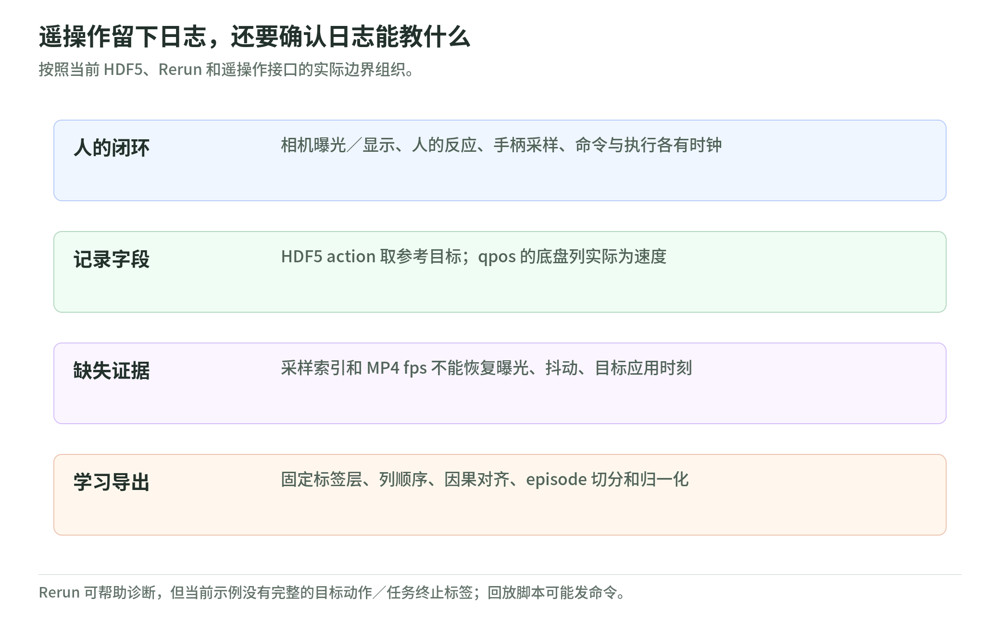

# 02 遥操作与日志：从人的反馈闭环到训练样本

研究日期：2026-11-03。[生态导读](README.md) · [固定源码与范围](sources.md)。这里只核对源码结构、字段及依赖，没有运行遥操作、采集、回放或训练；README 的设备支持仍是上游声明，实际频率和时延未知。下文的数据契约建议是教学分析，不冒充仓库已实现的功能。

## 视频、控制和状态是不同路径

旧 `ReachyTeleoperation` 面向 Reachy 2021+：控制代码调用旧 gRPC 关节及全身笛卡尔服务，视频代码逐次请求图像并更新纹理。当前 `Reachy2Teleoperation` 面向 Reachy 2，README 推荐 Unity 2022.3，manifest 引用 GStreamer/WebRTC 插件；不能仅替换机器人名称便认为两代兼容。[旧控制][old-data]、[旧视频][old-video]、[当前说明][teleop-readme]、[manifest][teleop-manifest]

当前代手柄跟踪先把相对头显的位置转换成机器人轴：`(x,y,z) → (z,-x,y)`，旋转也作基变换，再逐行填入位姿矩阵；这是坐标转换，不是人手姿态直接等于关节命令。[手柄映射][hands]

`DataMessageManager.Update()` 按 Unity 更新周期合并普通动作，发往 lossy 通道后清空；电机开关、速度和力矩限额另走 reliable 通道。插件握手请求状态 60 Hz、审计 1 Hz，并分别接收图像纹理、状态和审计。这些都是实现中的请求或调用位置，不是实测吞吐，更不保证动作在期限前到达。[命令通道][data]、[插件连接][plugin]

人的闭环包含机器人曝光、编码传输、解码显示、人的反应、手柄采样、重定向、命令传输及执行。视频到显示、手柄到命令、命令到执行应分别计时，并记录时钟映射、抖动和丢帧；ping、帧率或“可靠”都不是整链延迟。原理见[运行接口与延迟](../advanced/chapters/12_runtime.md)。

源码中的 `OnEmergencyStop` 先转成软件暂停事件，关节侧暂停还启动平滑顺应过程；不能从名称推断它是立即切断能源的独立硬件急停。[暂停入口][teleop-manager]、[关节暂停][teleop-joints]

## HDF5 的 action 究竟是什么

<!-- illustration: pollen-teleop-ledger-b19bff9115 -->

*图：遥操作留下日志，还要确认日志能教什么。按照当前 HDF5、Rerun 和遥操作接口的实际边界组织。*
<!-- /illustration: pollen-teleop-ledger-b19bff9115 -->

Reachy 2 采集器默认请求 30 Hz、10 秒一段，按循环耗时补睡眠；超预算时打印警告，不会补齐缺失时间。依赖锁定 `reachy2-sdk==1.0.5`；下述解释只对应这份脚本，不能假定它兼容所读的较新 SDK。[采集实现][hdf5]、[requirements][hdf5-deps]

源码创建的核心字段如下。两张 22 维数组以字典插入顺序写入，文件没有单独保存列名。

| 字段 | 静态可见语义 |
| --- | --- |
| `/action`，N×22 | 左臂7＋左夹爪1＋右臂7＋右夹爪1＋底盘速度3＋头3 |
| `/observations/qpos`，N×22 | 相同排列的反馈；其中底盘三列也是速度，不是位置 |
| `/observations/images_ids/cam_trunk`、`cam_teleop` | 整数采样索引，对应各自独立 MP4 的帧序列 |

手臂和头的 action 来自反馈 `goal_position`，不是原始手柄输入；底盘来自 `last_cmd_vel`。qpos 则读 `present_position` 和里程计速度。角度转弧度、底盘线速度保留原值，夹爪使用私有内部字段，不能直接认作百分比开度。`cam_trunk` 实际取深度相机的彩色帧，未记录深度数组；遥操作相机使用默认视图，也不是双眼视频。[采集与列顺序][hdf5]

版本风险可进一步定位：脚本索引底盘 `x/y/theta`，所读新 SDK 实际返回 `vx/vy/vtheta`；新夹爪类通过 `_joints` 管理缓存，也未见脚本所用的两个私有位置字段。因此直接混用存在静态兼容风险，不能声称已运行成功或已复现异常。[底盘返回值][mobile]、[夹爪缓存][gripper]

因此文件名 `action` 表示脚本选择的机器人参考信号，并未保存“人产生了什么输入、何时发送、是否应用”的完整链；同一行目标和反馈相近也不能倒推因果。字段名 `qpos` 同样不能覆盖混入的底盘速度。

## 时间戳存在于接口，却丢在文件外

采集器拿到了两个相机时间戳，源码还留有待实现的时间戳处理注释，但最终只写采样索引与数组；循环计算的本地时间也未保存。随后按请求 fps 编码 MP4，不能借此恢复抖动或曝光时间。[时间处理][hdf5]

教学例：一轮取帧和反馈读取耗时 45 毫秒，已超过 30 Hz 约 33 毫秒预算；补睡眠只能降到零，不能消除这一轮延迟。这不是机器人性能实测。

SDK 相机接口返回纳秒时间，server 转发图像 ROS header 的 stamp；整机状态 timestamp 却由 server 在构造回复时读取 ROS clock。来源不同，即使数值接近也不是同一采样事件，曝光语义与设备时钟误差还需另查驱动。[图像转发][video-server]、[状态构造][state-server]、[时钟函数][clock]

`add_time_modality_to_existing_recording.py` 只向 action 追加舍入后的 `i/N`，变成 23 维；这是轨迹进度，不是秒或纳秒，且只保留 trunk 图像索引。不能称作修复时间对齐，导出时须说明标签维度和相机变化。[追加进度][add-time]

## Rerun 保存了什么，没保存什么

Rerun 示例读取 URDF 并记录关节变换、夹爪开度曲线；可选相机记录 JPEG、深度图和 K/D/R/P 等标定参数，光学显示轴采用 RDF。`reachy_ROS_time` 对机器人使用 SDK 更新时间，对图像使用各自 frame 时间；深度显示用 `meter=1000.0`。这有助于诊断，但不证明来源时钟已校准。[记录器][rerun]

该循环默认 5 Hz，采集工作后再睡完整周期，因此实际周期还含工作耗时；只在提供保存选项时调用持久化。此示例未记录目标动作、底盘命令或任务终止标签，不是现成 imitation dataset。manifest 还固定 SDK 1.0.9、Rerun 0.21.0，不能把调用直接套到任意新版。[记录循环][rerun]、[依赖][rerun-deps]

Mini 自带 `start_recording/stop_recording` 也不是上述 HDF5 格式：`set_target` 可追加本地 `time.time()` 与头、天线、身体目标，停止后由 daemon 返回记录列表；这不能自动补成 RGB＋编码器反馈训练集。[Mini 记录入口][mini]

## 从日志导出训练集，还缺哪些契约

训练导出应先明确预测哪层信号：人的输入、转换后的机器人目标、还是控制参考。建议独立保存采集、可用、发送和应用时间及其证据，列顺序、单位、参考系、相机标定、缺失掩码与终止原因；未知应用时间必须标记未知，不从反馈倒填。

随后按“决策时刻已经可用”做因果对齐，保留重复帧、超时和动作持续时间；混合位置与速度不能统一作差分。先按完整 episode／会话分组拆分，再生成历史窗口或 action chunk，只用训练组统计归一化参数。这是[数据工程](../advanced/chapters/10_data_pipeline.md)的契约应用，不是脚本已提供的导出器。

普通人类视频没有机器人动作标签；需要标定、姿态估计、重定向与执行检验，伪标签应另标来源。机器人参考目标、观测回放和训练可执行性也要分别评估，参见[评测与诊断](../advanced/chapters/13_evaluation.md)。

## 自测

1. 相邻两行能否推定相隔 1/30 秒？答：不能，HDF5 没保存实际采样时间。
2. `qpos` 的底盘列能否当位置？答：不能，此脚本写的是速度。
3. Rerun 能显示机器人，是否足够训练策略？答：不够，还缺动作契约、因果对齐及任务标签。

## 读代码地图

- 代际与传输：旧版 [gRPCDataController.cs][old-data]、[gRPCVideoController.cs][old-video]；当前代 [Packages/manifest.json][teleop-manifest] → [HandsTracker.cs][hands] → [DataMessageManager.cs][data] → [GstreamerPluginCustom.cs][plugin]。
- 时间来源：`reachy2_sdk_server` 的 [grpc_server/video_server.py][video-server]、[grpc_server/reachy.py][state-server]、[utils.py][clock]。
- HDF5：`reachy2_hdf5_recorder` 的 [requirements.txt][hdf5-deps] → [reachy2_record_episodes_hdf5.py][hdf5] → [add_time_modality_to_existing_recording.py][add-time]；[replay_hdf5.py][replay] 会发机器人命令，不是只读查看器，本次未运行。
- Rerun：`reachy2-sdk-rerun` 的 [setup.cfg][rerun-deps] → [src/rerun_recorder.py][rerun]；Mini 记录入口另见 [reachy_mini.py][mini]。

[old-data]: https://github.com/pollen-robotics/ReachyTeleoperation/blob/9934da67628c0b41398d0a2fd33316494ada39db/Assets/Scripts/gRPC/gRPCDataController.cs
[old-video]: https://github.com/pollen-robotics/ReachyTeleoperation/blob/9934da67628c0b41398d0a2fd33316494ada39db/Assets/Scripts/gRPC/gRPCVideoController.cs
[teleop-readme]: https://github.com/pollen-robotics/Reachy2Teleoperation/blob/1612347e3b1b06a612f5dd79c333090c1d0bd335/README.md
[teleop-manifest]: https://github.com/pollen-robotics/Reachy2Teleoperation/blob/1612347e3b1b06a612f5dd79c333090c1d0bd335/Packages/manifest.json
[hands]: https://github.com/pollen-robotics/Reachy2Teleoperation/blob/1612347e3b1b06a612f5dd79c333090c1d0bd335/Assets/Scripts/Tracking/HandsTracker.cs
[data]: https://github.com/pollen-robotics/Reachy2Teleoperation/blob/1612347e3b1b06a612f5dd79c333090c1d0bd335/Assets/Scripts/WebRTC/DataMessageManager.cs
[plugin]: https://github.com/pollen-robotics/Reachy2Teleoperation/blob/1612347e3b1b06a612f5dd79c333090c1d0bd335/Assets/Scripts/WebRTC/GStreamer/Scripts/GstreamerPluginCustom.cs
[teleop-manager]: https://github.com/pollen-robotics/Reachy2Teleoperation/blob/1612347e3b1b06a612f5dd79c333090c1d0bd335/Assets/Scripts/Manager/ScenesManager/TeleoperationManager.cs
[teleop-joints]: https://github.com/pollen-robotics/Reachy2Teleoperation/blob/1612347e3b1b06a612f5dd79c333090c1d0bd335/Assets/Scripts/Robot/RobotJointCommands.cs
[hdf5]: https://github.com/pollen-robotics/reachy2_hdf5_recorder/blob/feead2b81acdc92ab632f9dc53badf7a450ba19e/reachy2_record_episodes_hdf5.py
[hdf5-deps]: https://github.com/pollen-robotics/reachy2_hdf5_recorder/blob/feead2b81acdc92ab632f9dc53badf7a450ba19e/requirements.txt
[add-time]: https://github.com/pollen-robotics/reachy2_hdf5_recorder/blob/feead2b81acdc92ab632f9dc53badf7a450ba19e/add_time_modality_to_existing_recording.py
[replay]: https://github.com/pollen-robotics/reachy2_hdf5_recorder/blob/feead2b81acdc92ab632f9dc53badf7a450ba19e/replay_hdf5.py
[video-server]: https://github.com/pollen-robotics/reachy2_sdk_server/blob/2bb56b676f235a8d6774474cf053ef4bd8585476/reachy_sdk_server/reachy_sdk_server/grpc_server/video_server.py
[state-server]: https://github.com/pollen-robotics/reachy2_sdk_server/blob/2bb56b676f235a8d6774474cf053ef4bd8585476/reachy_sdk_server/reachy_sdk_server/grpc_server/reachy.py
[clock]: https://github.com/pollen-robotics/reachy2_sdk_server/blob/2bb56b676f235a8d6774474cf053ef4bd8585476/reachy_sdk_server/reachy_sdk_server/utils.py
[rerun]: https://github.com/pollen-robotics/reachy2-sdk-rerun/blob/538b296209cc91d114b8e923c43df9912f5d0559/src/rerun_recorder.py
[rerun-deps]: https://github.com/pollen-robotics/reachy2-sdk-rerun/blob/538b296209cc91d114b8e923c43df9912f5d0559/setup.cfg
[mini]: https://github.com/pollen-robotics/reachy_mini/blob/e26c6c30e723d80b1ecdaa3ace80f7e84f4d15f2/src/reachy_mini/reachy_mini.py
[mobile]: https://github.com/pollen-robotics/reachy2-sdk/blob/eb42d1f08cf32244443dc46930ff2e17cf5852da/src/reachy2_sdk/parts/mobile_base.py
[gripper]: https://github.com/pollen-robotics/reachy2-sdk/blob/eb42d1f08cf32244443dc46930ff2e17cf5852da/src/reachy2_sdk/grippers/parallel_gripper.py
