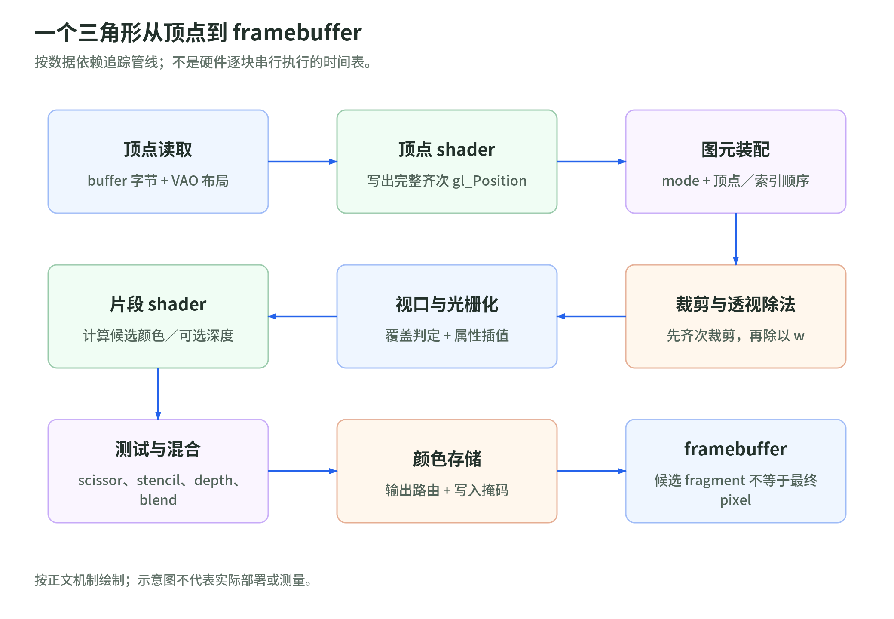
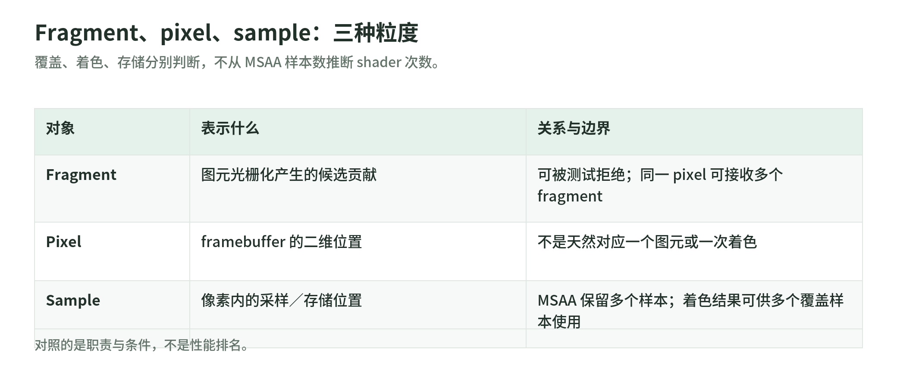

# GPU 渲染管线与着色器：一个三角形怎样成为图像

核验日期：2026-10-29。范围：WebGL 2、OpenGL ES 3.0、GLSL ES 3.00；不把桌面 OpenGL 或 Vulkan 的特性直接搬过来。
专题入口：[Shader 与 Web 渲染](README.md)。下一章：[坐标、投影与采样](02-coordinates-and-sampling.md)。
依据为 OpenGL ES 3.0.6（2019-11-01）与 GLSL ES 3.00 revision 6（2016-01-29）。
WebGL 2 同时核对 2017-04-11 的 2.0.0 归档页面与 2026-06-30 编辑草案；两页的状态声明均为 editor's draft，不将它们称作新的正式发布。[S1][S2][S3][S4]

阅读约定：**规范事实**是可移植契约；**教学推导**是为了理解而展开的数学或实验；**实现惯例**只说明常见硬件与优化，不保证所有浏览器都如此。
先跟随一个三角形，再看代码；不要先背完全部 API。文末编号给出官方 URL，正文标出相关章节。

## 1. CPU 提交任务，GPU 处理大量数据

在通常的硬件加速实现中，CPU 侧的 JavaScript 处理输入、组织场景、准备资源和调用 WebGL；GPU 运行 shader、光栅化并处理 framebuffer。
CPU 擅长低延迟控制，GPU 擅长高吞吐并行处理，这是设计倾向，不是“CPU 不能并行、GPU 什么都更快”。[S5] 教程导言；[S10] §1.1。
WebGL 规定接口与结果，并不承诺特定 GPU 架构；ES 规范甚至讨论了主要在 CPU 上实现的可能性。[S1] §§1.3–1.4。

draw call 通常指 `drawArrays`、`drawElements` 及其实例化变体等绘制命令。
它按当前 program、顶点配置、uniform、framebuffer 和测试状态提交图元；不是“调用一次就画一个物体或一个三角形”。[S1] §2.9.3；[S3] Drawing commands。
绑定 buffer、上传数据、设置 uniform 也属于 API 调用，但不等于 draw call。
命令提交与 GPU 完成是两件事；在 JavaScript 中计时一个调用，不能直接得到对应 GPU 工作耗时。[S7] Avoid blocking API calls；[S9] Overview、Sample Code。

教学推导：同样一个 draw call，画小三角形和覆盖全屏的复杂材质，GPU 负担可能完全不同。
减少调用与批处理通常有助于降低提交成本，但几何量、覆盖面积、重复覆盖、shader 运算和访存也会影响性能。
因此“调用数少一半，GPU 时间就少一半”不是有效结论。[S7] Batch draw calls、Consider rendering to a smaller back buffer。
若支持 `EXT_disjoint_timer_query_webgl2`，可异步测量 GPU 时间；等待结果可用，并在 `GPU_DISJOINT_EXT` 为真时丢弃受影响测量。扩展不是必有。[S9] New Tokens、Sample Code；[S12] Overview。

## 2. 数据怎样进入顶点 shader

buffer 保存数据字节；vertex attribute 配置说明如何把字节解释成 shader 的输入。
例如每个顶点连续保存 `x, y, r, g, b`，位置与颜色分别从不同偏移读取。[S1] §§2.9、2.10.6。

| GLSL ES 3.00 声明 | 当前阶段的意思 |
| --- | --- |
| 顶点 `in vec2 a_position` | 顶点属性输入，可由启用的属性数组提供 |
| 顶点 `out vec3 v_color` | 交给后续插值阶段的逐顶点输出 |
| 片段 `in vec3 v_color` | 光栅化后得到的逐片段输入 |
| `uniform mat4 u_mvp` | 由宿主设置、shader 只读的统一参数 |
| 片段 `out vec4 outColor` | 送入后续 framebuffer 操作的颜色输出 |

这不是 JavaScript 的参数列表；`in` / `out` 的意义取决于阶段。[S2] §§4.3.4–4.3.6。
同一 draw 使用的普通 uniform 不是逐顶点数组；不同顶点的差异通常来自属性数据。uniform 在链接后初始化为零，矩阵不是自动单位矩阵。[S2] §4.3.5。

VAO（vertex array object）保存读取配置与 buffer 引用，不保存一份复制的 vertex data。
属性启用、格式、stride、offset、属性来源 buffer 和 divisor 等属于 VAO 状态。[S1] §2.11、表 6.2。
`vertexAttribPointer` 会记录当时绑定的 `ARRAY_BUFFER`；后来只换 `ARRAY_BUFFER` 不会改掉这个记录。
当前 `ARRAY_BUFFER` 绑定本身不是 VAO 状态，但 `ELEMENT_ARRAY_BUFFER` 绑定是：换 VAO 会恢复它的索引 buffer。[S1] §§2.9、2.10.6–2.11、表 6.2–6.3。
所以在某 VAO 绑定时“顺手解绑索引 buffer”，会修改那个 VAO；修改被引用 buffer 的内容，则会改变之后读取的数据。

## 3. 从图元装配到屏幕覆盖

<!-- illustration: gpu-pipeline-b8781ca2f5 -->


*图：一个三角形从顶点到 framebuffer。按数据依赖追踪管线；不是硬件逐块串行执行的时间表。*
<!-- /illustration: gpu-pipeline-b8781ca2f5 -->

规范的教学主线如下；这描述数据依赖，不规定硬件必须逐块串行执行。[S1] §2.4、图 2.1、§1.4。

```text
顶点读取 → 顶点 shader → primitive assembly（图元装配）
→ 齐次裁剪 → 透视除法 → 视口变换
→ 三角形覆盖与插值 → 片段 shader → 逐片段/逐样本操作 → framebuffer
```

图元装配根据 mode 与顶点/索引顺序形成点、线或三角形；`TRIANGLES` 每三个顶点组成一个三角形。
索引能表达顶点复用，但不要由索引数推断物理 shader 调用次数；实现允许复用顶点计算结果。[S1] §§2.7.1、2.9.3、2.12.9。

顶点 shader 写出的 `gl_Position = (x_c, y_c, z_c, w_c)` 是**齐次裁剪坐标**，不是像素坐标，也不是已经除过 w 的 NDC。
`w_c` 是投影输出的第四个分量；常见透视矩阵下它与观察空间深度相关，但规范不保证它总是距离或 `-z`。[S2] §7.1；[S1] §2.13。
三角形的标准裁剪体满足 `-w_c ≤ x_c,y_c,z_c ≤ w_c`；裁剪可能产生新顶点，不是简单丢掉所有越界顶点。[S1] §§2.18–2.18.1。

通过裁剪后，透视除法得到 `x_ndc=x_c/w_c`、`y_ndc=y_c/w_c`、`z_ndc=z_c/w_c`。
若视口为 `(x₀,y₀,W,H)`，则 `x_win=x₀+(x_ndc+1)W/2`，`y_win=y₀+(y_ndc+1)H/2`。
深度范围为 `(n,f)` 时，`z_win=(f-n)z_ndc/2+(f+n)/2`；默认范围是 `[0,1]`。[S1] §§2.13–2.13.1。

viewport 是坐标映射，不是 scissor：后者在启用 `SCISSOR_TEST` 时按矩形拒绝片段，也能限制 clear。
仅设置 viewport 不能代替 scissor 来限制清屏范围。[S1] §§4.1.2、4.2.3。

光栅化根据投影后三角形的覆盖规则决定哪些位置产生片段。
单样本时按片段中心进行点采样；共享边界的规则要求一致的相邻三角形不重复覆盖或留下裂缝。
背面剔除是另一项可配置操作；“看到一个三角形”并不表示其每个包围盒像素都要着色。[S1] §3.6.1。

## 4. 透视校正插值：为什么不能直接平均颜色或 UV

规范事实：浮点接口默认是 `smooth`，按透视校正方式插值；`flat` 不插值，而取 provoking vertex 的值。
这里的 provoking vertex 由图元类型确定，不是“最近顶点”或“三个顶点的平均值”。
有符号/无符号整数及整数向量跨顶点—片段接口必须声明 `flat`。[S2] §§4.3.4、4.3.9；[S1] §2.17、表 2.12。

设裁剪后参与光栅化的三角形顶点属性为 `a₀,a₁,a₂`，clip w 为 `w₀,w₁,w₂`。
某屏幕位置的二维重心坐标为 `λ₀,λ₁,λ₂`，且 `Σλᵢ=1`。`smooth` 插值为：

```text
q = λ₀/w₀ + λ₁/w₁ + λ₂/w₂
a = (λ₀a₀/w₀ + λ₁a₁/w₁ + λ₂a₂/w₂) / q
```

这是 [S1] §3.6.1 公式 (3.7) 的改写；向量属性逐分量应用。
教学解释：先在屏幕上插值 `a/w` 与 `1/w`，再相除，补偿透视投影对比例的改变。
若三个 w 相同，它退化为 `Σλᵢaᵢ`；不同 w 时，直接屏幕线性插值一般不正确。
例如 `λ=(1/3,1/3,1/3)`、`w=(1,2,4)`、`a=(0,1,0)`，正确结果为 `2/7`，不是 `1/3`。

`gl_FragCoord.xy` 是窗口坐标，`.z` 是固定功能产生的窗口深度，`.w` 是片段位置的 **reciprocal clip w**。
教学推导：在上述插值位置，`gl_FragCoord.w=q=Σλᵢ/wᵢ`，而重建的 clip w 是 `1/q`。
它既不是某个顶点的 `wᵢ`，也不是 `Σλᵢwᵢ`；绝不能把 `gl_FragCoord.w` 当作 clip w 本身。[S1] §3.9.2.2；[S2] §7.2。
MSAA 时内建坐标与接口插值位置须遵守各自规则，不保证任意两个量总是在同一个样本位置求值。[S2] §§4.3.9、7.2。
另一个例外是窗口深度：它按窗口顶点深度线性插值，不能把它当普通属性再套一次上述公式。[S1] 公式 (3.8)。

## 5. fragment、pixel 与 sample 不是同一回事

<!-- illustration: fragment-pixel-sample-c5800752b1 -->


*图：Fragment、pixel、sample：三种粒度。覆盖、着色、存储分别判断，不从 MSAA 样本数推断 shader 次数。*
<!-- /illustration: fragment-pixel-sample-c5800752b1 -->

pixel 是 framebuffer 的二维位置；sample 是其中的采样与存储位置；fragment 是图元光栅化产生的候选贡献及其关联数据。
同一 pixel 可接收多个图元的 fragment，之后可能拒绝、覆盖或混合；fragment 不等于最终显示像素。[S1] 第 3 章导言、§4.1。

MSAA 为每个 pixel 保存多个颜色、深度、模板 sample，并使用覆盖掩码表示该图元覆盖了哪些 sample。
这不等于“开 4× MSAA 就必须每 pixel 执行四次片段 shader”；一次着色结果可供多个覆盖样本使用。
逐 sample 覆盖/测试与逐 sample shader 求值必须分开理解，不能从样本数直接算 shader 次数。[S1] §§3.3、3.6.3、4.1.3；[S2] §7.2。
MSAA 的 `gl_FragCoord` 可对应像素内某位置或某样本，不应一概解释成固定像素中心。
单样本的默认中心可理解为半整数坐标，如左下角 pixel 的中心 `(0.5,0.5)`；单位是绘制缓冲区坐标，不是 CSS 像素。[S1] §3.6.1；[S2] §7.2；[S7] devicePixelRatio and high-dpi rendering。

## 6. 深度、模板、混合：逻辑顺序与 early testing

规范事实：片段 shader 在逻辑上先产生颜色及可选深度；之后才应用 framebuffer 端操作。
关注本课的简化顺序是：`片段 shader → scissor/coverage → stencil → depth → blending → 颜色写掩码/颜色存储`。
完整流程还有其他步骤，见 [S1] §§3.9、4.1、图 4.1；不要把简化图当完整硬件执行表。
深度/模板写掩码约束其各自更新，不是都等到 blending 之后才应用。[S1] §§4.1.4–4.1.5、4.2.2。

stencil test 根据模板值决定是否继续；模板操作还区分模板失败、深度失败与两者通过。
depth test 比较片段深度与已存深度；失败的样本不贡献颜色。没有相应附件就没有通常所期待的遮挡效果。
关闭 `DEPTH_TEST` 也会跳过深度更新；仅把 `depthMask(true)` 打开并不能使关闭的测试写入深度。[S1] §§4.1.4–4.1.5、4.2.2。

blending 把 shader 的源颜色与 framebuffer 的目标颜色组合；shader 输出不一定原样存入颜色附件。
教学例子：普通非预乘透明色的 RGB 可用 `C_out=α_src C_src+(1-α_src)C_dst`，对应常见源/目标因子。
这是特定混合方程与因子的例子，不是所有 blending 的定义；alpha 通道也需要选择合适策略。[S1] §4.1.7。

实现惯例：early depth/stencil testing、分层深度等可在着色前拒绝确定不可见的贡献，避免无用着色。
规范允许不同执行方式，但可观察结果必须符合规定语义；因此 early testing 是**语义保持优化**，不是本课逻辑顺序的改写。[S1] §1.4。
“提前做拒绝判断”与“提前提交 depth/stencil 更新”也不是一件事；Arm 的计数器文档明确区分 early ZS tested 与 updated。[S11] Early ZS tested/updated quads。

执行 `discard` 后该片段不写最终颜色，输出值失去意义；它可能已执行 shader 中前面的计算，不能当作免费剔除。
实现若提前提交深度/模板写入，必须避免违背 `discard` 的逻辑效果。[S2] §§6.4、7.2；[S11] Early ZS updated quads。
写 `gl_FragDepth` 会让最终深度依赖 shader，并常限制普通 early depth 优化，但不能断言禁止**所有**提前优化。
最终比较必须使用 shader 深度；哪些安全拒绝仍能提前做取决于状态与实现，不是 WebGL 的性能保证。[S1] §§1.4、4.1.5；[S11] Early ZS updated quads、ZS Unit Test Rate。
一旦 shader 静态包含 `gl_FragDepth` 写入，应给所有未 discard 的路径赋值；未赋值路径在 GLSL ES 3.00 中深度未定义。[S2] §7.2。
WebGL 2 额外规定这种未赋值路径使用深度 0，而不是回退到 `gl_FragCoord.z`；不能把 ES 的未定义规则直接当作 WebGL 规则。[S3][S4] gl_FragDepth。
WebGL 2 的 GLSL ES 3.00 不支持 `layout(early_fragment_tests) in;`；不要从其他版本复制它。[S2] §4.3.8；[S3] GLSL ES 3.00 support。

## 7. 并行、分歧、精度与导数

实现惯例：很多 GPU 以 SIMD/SIMT 风格成组执行 shader 工作；每个逻辑调用有自己的输入与局部变量。
NVIDIA 文档用 warp 解释 SIMT 与分歧，但这里借它理解硬件，不意味着 WebGL 暴露 CUDA 或承诺固定组宽。
同组调用走不同分支时，可能分路径执行并屏蔽部分通道，降低利用率；uniform 条件通常更容易保持一致。
“任何 if 都很慢”与“每个 pixel 有一颗专用核心”都是错误模型。[S10] §4.1；[S1] §1.4。

规范事实：precision 约束数值能力，不承诺某个吞吐率或寄存器位宽映射。
下表是 GLSL ES 3.00 的存储格式/能力要求，**不是所有表达式和内建函数的统一误差上界**。[S2] §§4.5.1–4.5.3。

| 限定符 | 浮点保障 | 整数保障 |
| --- | --- | --- |
| `highp` | IEEE 754 单精度存储；表中正规量级 `(2^-126,2^127)`，相对精度 `2^-24` | signed 32-bit、unsigned 32-bit |
| `mediump` | 至少范围 `(-2^14,2^14)`；非零量级 `(2^-14,2^14)`，相对精度 `2^-10` | signed 至少 `[-2^15,2^15-1]`；unsigned 至少 `[0,2^16-1]` |

`mediump` 不是“保证 float16”；实现可以提供更高精度。`highp` 也不等于所有运算都严格按 CPU 的 IEEE 模式运行。
例如次正规数允许冲为零，舍入模式受规范限制但不可由应用设置，不同函数有不同精度规定。[S2] §§4.5.1–4.5.2。
WebGL 2 / GLSL ES 3.00 的片段阶段支持 `highp`，不要套用 WebGL 1 中其可选的旧限制。
片段 shader 没有预声明的 float 默认精度，应显式限定或声明 `precision highp float;`。[S2] §§4.5.2、4.5.4；[S3] GLSL ES 3.00 support。
可用 `getShaderPrecisionFormat` 查询范围与精度，但它不是性能测试；`mediump` 是否更快必须实测。[S8] Return value；[S7] Be precise with GLSL precision annotations。

规范事实：片段中的 `dFdx`、`dFdy`、`fwidth` 使用实现允许的近似导数；它们在非一致控制流中结果未定义。
这里的非一致是不同 fragment 走不同路径，不是“源码中只要有 if 就禁止导数”。隐式纹理导数也受此约束。[S2] §§3.10.2、8.8–8.9。

以下是放在片段 `main()` 内的教学片段，使用第 8 节的接口声明：

```glsl
float width = fwidth(v_color.r); // 先在一致控制流求值
if (v_color.r > 0.5) {
    outColor = vec4(vec3(width), 1.0);
} else {
    outColor = vec4(v_color, 1.0);
}
```

教学例子：把 `fwidth(...)` 移进上述数据相关分支并不具备可移植结果；条件式 discard 后的导数也要审查。
若纹理采样需要梯度，可先在一致路径计算，再用 `textureGrad` 显式传入；这要求梯度本身有效，不是绕过约束。[S2] §§6.4、8.8–8.9。

## 8. 最小成对 shader 与 WebGL 2 宿主前提

下面两段是独立源文件/字符串；各自第一行必须是版本指令，模板字符串开头不要多一个换行。
两阶段都用 GLSL ES 3.00；不能把 1.00 与 3.00 链接为一对。[S2] §3.4。

顶点 shader：

```glsl
#version 300 es
precision highp float;
layout(location = 0) in highp vec2 a_position;
layout(location = 1) in highp vec3 a_color;
uniform highp mat4 u_mvp;
smooth out highp vec3 v_color;
void main() {
    gl_Position = u_mvp * vec4(a_position, 0.0, 1.0);
    v_color = a_color;
}
```

片段 shader：

```glsl
#version 300 es
precision highp float;
smooth in highp vec3 v_color;
layout(location = 0) out highp vec4 outColor;
void main() {
    outColor = vec4(v_color, 1.0);
}
```

接口契约：被片段阶段静态读取的 `v_color`，须有同名、同类型及匹配插值限定的顶点输出。
此例显式保持两侧 `highp vec3` 一致；规范并不要求 out/in 的 precision 相同。跨阶段同名 uniform 则要求类型与精度都匹配。[S2] §§4.3.5、4.3.9–4.3.10。
位置 0/1 是顶点属性槽；片段输出位置 0 是颜色输出槽，不是同一个命名空间。
片段输出仍经过测试与混合；GLSL ES 3.00 不使用旧式 `gl_FragColor`。[S2] §§4.3.8、7.2；[S1] §3.9.2.3。

宿主必须取得 `canvas.getContext("webgl2")` 并检查非空，编译两段、检查 `COMPILE_STATUS`、链接并检查 `LINK_STATUS`。
MDN 教程展示资源与 shader 配合的基本方法，但其中 `attribute` / `varying` 的旧示例不能原样混入此 3.00 示例。[S5][S6]；[S1] §§2.12.1、2.12.3；[S3] Context Creation。
以下宿主片段假定 `gl` 已取得且 `program` 已成功链接上述两段；不是包含 canvas 与编译助手的独立网页。

```js
const vao = gl.createVertexArray();
gl.bindVertexArray(vao);
const buffer = gl.createBuffer();
gl.bindBuffer(gl.ARRAY_BUFFER, buffer);
gl.bufferData(gl.ARRAY_BUFFER, new Float32Array([
  -0.7, -0.6, 1, 0, 0,
   0.7, -0.6, 0, 1, 0,
   0.0,  0.7, 0, 0, 1,
]), gl.STATIC_DRAW);
gl.enableVertexAttribArray(0);
gl.vertexAttribPointer(0, 2, gl.FLOAT, false, 20, 0);
gl.enableVertexAttribArray(1);
gl.vertexAttribPointer(1, 3, gl.FLOAT, false, 20, 8);
gl.useProgram(program);
gl.uniformMatrix4fv(gl.getUniformLocation(program, "u_mvp"), false,
  new Float32Array([1,0,0,0, 0,1,0,0, 0,0,1,0, 0,0,0,1]));
gl.viewport(0, 0, gl.drawingBufferWidth, gl.drawingBufferHeight);
gl.clearColor(0, 0, 0, 1);
gl.clear(gl.COLOR_BUFFER_BIT);
gl.drawArrays(gl.TRIANGLES, 0, 3);
```

每顶点 5 个 float，stride 为 `5×4=20` 字节，颜色 offset 为 `2×4=8`；所有单位别混成元素个数。
假定全新上下文的默认测试状态与默认 framebuffer；复用现有场景时应管理 scissor、blend、depth、cull 等状态。
单位矩阵使本例 clip w 为 1，适合先验证颜色梯度；它尚未展示不同深度带来的透视效果。[S1] §§2.9、2.13、4.1；[S6] Drawing using the colors。

## 9. 易错对照：先纠正模型，再查代码

| 常见误解 | 正确检查方向 |
| --- | --- |
| draw call 次数就是 GPU 时间 | 区分提交、工作量与异步 GPU 计时。[S7][S9] |
| VAO 就是顶点数据 | VAO 存配置/引用；buffer 存字节，索引绑定属于 VAO。[S1] 表 6.2 |
| `gl_Position` 已是屏幕坐标 | 它是齐次 clip 坐标；后面还有裁剪、除 w、viewport。[S1] §2.13 |
| `gl_FragCoord.w` 就是 clip w | 它是插值后的 reciprocal clip w。[S1] §3.9.2.2 |
| `flat` 是一种特殊渐变 | 不插值，取 provoking vertex；整数接口需 flat。[S2] §4.3.9 |
| viewport 会限制 clear | 启用 scissor 才是矩形限制。[S1] §§4.1.2、4.2.3 |
| fragment 与最终 pixel 一一对应 | 同 pixel 可收到多个 fragment，也可有多个 sample。[S1] §§3.3、4.1 |
| MSAA 保证每 sample 运行 shader | 覆盖/存储 sample 数不等于 shader 求值次数。[S1] §3.6.3 |
| shader 后总会写颜色 | discard、测试失败、输出路由或写掩码都可能阻止写入。[S1] §§4.1–4.2 |
| 写深度就禁用一切 early 优化 | 它限制可提前做的工作；安全优化与具体实现有关。[S11] |
| `mediump` 必定省一半时间 | 数值保障不是性能承诺；查询精度与计时分开。[S2] §4.5 |

## 10. 五个小实验：一次只改变一个因素

以下是教学实验方案与预期，**本次未执行浏览器渲染、截图或 GPU 性能测试**。

1. **接口实验**：将片段 `v_color` 改成 `vec2`，输出改为 `vec4(v_color,0.0,1.0)`；确认各阶段编译成功后检查链接日志，再恢复。
   简答：跨阶段类型不匹配会链接失败，不是由运行时自动截断。[S2] §4.3.10。
2. **w 实验**：在本例顶点 shader 中用 `float w=exp2(float(gl_VertexID));` 得到 `w=(1,2,4)`，将位置赋值替换为 `gl_Position=vec4(a_position*w,0.0,w)`。
   简答：NDC 轮廓不变，颜色插值改变；乘 x/y 是为了只改变 w 而保持屏幕位置。依据第 4 节公式。[S1] §§2.13、3.6.1。
3. **flat 实验**：同时把两侧 `smooth` 换为 `flat`，再改变最后一个顶点颜色。
   简答：本例独立三角形取第三个顶点颜色，全三角形不再渐变。[S1] §2.17、表 2.12。
4. **viewport/scissor 实验**：缩小 viewport 后 clear；再启用一小块 scissor 后 clear。
   简答：前者不限制 clear，后者限制；实验结束恢复状态，避免下一次绘制被意外截断。[S1] §§4.1.2、4.2.3。
5. **工作量实验**：保持一个 draw，改变覆盖面积或片段计算量；另比较相同图像的批处理方案。
   简答：调用数不能单独预测 GPU 时间。分别记录 CPU 提交耗时与有效异步 GPU 查询，不支持扩展就明确缺失 GPU 数据。[S7][S9][S12]。

## 11. 自测：能解释就比能背 API 更重要

1. 顶点在 clip 体外就要丢掉整个三角形吗？
   简答：不一定；穿越边界的三角形可被裁剪并生成新顶点。[S1] §2.18。
2. 三个 w 相等时，透视校正属性插值变成什么？
   简答：普通重心线性插值 `Σλᵢaᵢ`；由公式约去公共 `1/w`。
3. `λ=(1/3,1/3,1/3)`、`w=(1,2,4)` 时 `gl_FragCoord.w` 是多少？
   简答：`7/12`；对应重建 clip w 是 `12/7`，不是三个 w 的算术平均。见第 4 节。
4. 输出 alpha 为 0 是否等于 discard？
   简答：不等于；颜色效果取决于混合，且通过测试时仍可能更新深度/模板。[S1] §§4.1.4–4.1.7；[S2] §6.4。
5. 为什么不能在按 `v_color.r` 分支的内部直接依赖 `dFdx`？
   简答：fragment 可能分歧，非一致控制流中的导数未定义；可在分支前的一致路径求值。[S2] §8.9。
6. 同名 out/in 精度必须一致吗？同名 uniform 呢？
   简答：前者不必，示例主动保持一致；同一 program 跨阶段同名 uniform 的类型与精度必须一致。[S2] §§4.3.5、4.3.10。

## 12. 已核验的一手来源

以下均于 2026-10-29 实际在线检索并读取；规范章节号优先于网页摘要或二手解释。
PDF 的正文页码与阅读器页序不同，引用按章节、表号与公式号定位。

- [S1] Khronos，[OpenGL ES 3.0.6 Specification](https://registry.khronos.org/OpenGL/specs/es/3.0/es_spec_3.0.pdf)，2019-11-01；核验：2026-10-29。
- [S2] Khronos，[The OpenGL ES Shading Language 3.00, revision 6](https://registry.khronos.org/OpenGL/specs/es/3.0/GLSL_ES_Specification_3.00.pdf)，2016-01-29；核验：2026-10-29。
- [S3] Khronos，[WebGL 2 Specification, Version 2.0.0](https://registry.khronos.org/webgl/specs/2.0.0/)，2017-04-11 归档页面，Status 声明为 editor's draft；核验：2026-10-29。
- [S4] Khronos，[WebGL 2.0 Specification — Editor's Draft](https://registry.khronos.org/webgl/specs/latest/2.0/)，页面标示 2026-06-30 工作稿；核验：2026-10-29。
- [S5] MDN，[Getting started with WebGL](https://developer.mozilla.org/en-US/docs/Web/API/WebGL_API/Tutorial/Getting_started_with_WebGL)，教程导言与上下文创建；核验：2026-10-29。
- [S6] MDN，[Using shaders to apply color in WebGL](https://developer.mozilla.org/en-US/docs/Web/API/WebGL_API/Tutorial/Using_shaders_to_apply_color_in_WebGL)，顶点颜色、片段着色、绘制；核验：2026-10-29。
- [S7] MDN，[WebGL best practices](https://developer.mozilla.org/en-US/docs/Web/API/WebGL_API/WebGL_best_practices)，调用、批处理、精度与高 DPI 各节；核验：2026-10-29。
- [S8] MDN，[WebGLRenderingContext: getShaderPrecisionFormat()](https://developer.mozilla.org/en-US/docs/Web/API/WebGLRenderingContext/getShaderPrecisionFormat)，Parameters、Return value；核验：2026-10-29。
- [S9] Khronos，[EXT_disjoint_timer_query_webgl2](https://registry.khronos.org/webgl/extensions/EXT_disjoint_timer_query_webgl2/)，revision 4，2023-06-01；核验：2026-10-29。
- [S10] NVIDIA，[CUDA C++ Programming Guide 12.6](https://docs.nvidia.com/cuda/archive/12.6.0/cuda-c-programming-guide/index.html#simt-architecture)，§§1.1、4.1；仅作硬件实现说明；核验：2026-10-29。
- [S11] Arm，[Mali-G615 Performance Counter Reference Guide](https://arm-software.github.io/libGPUCounters/mali-g615_counter_reference.html)，Early ZS tested/updated/killed quads、ZS Unit Test Rate；仅作实现说明；核验：2026-10-29。
- [S12] Khronos，[EXT_disjoint_timer_query](https://registry.khronos.org/webgl/extensions/EXT_disjoint_timer_query/)，revision 12，2024-04-19，计时与 disjoint 的基础语义；核验：2026-10-29。
