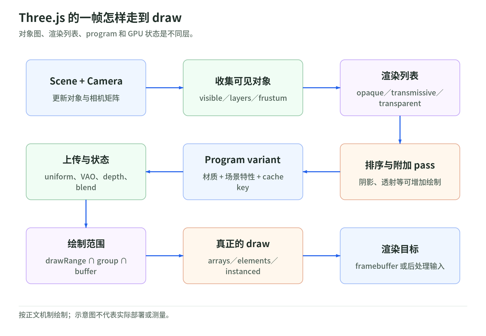
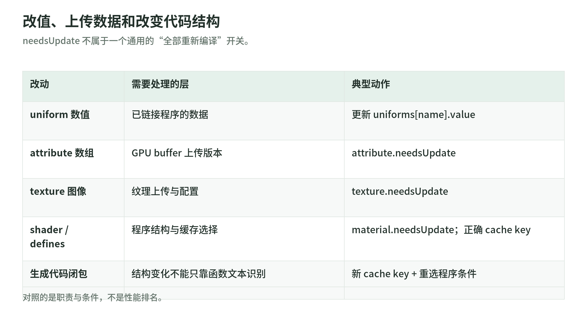

# Three.js 与相关框架：从场景对象到 GPU 绘制

- 核验日期：2026-10-29。
- 主线：对象数据如何经 `WebGLRenderer` 变成 shader、GPU 状态与 draw；框架分别接管哪一层。
- 版本基线：当日 npm `three` 的 `latest` 为 `0.186.1`，`gitHead` 为 `9b4a2ac29c63ccb43fd51c5661f2f873ac2c39b8`。
- Three.js 源码链接冻结到该 commit；其他框架采用当日访问的第一方文档，不推断未核实的包版本。
- 文中 `[Sxx]` 对应本节末的来源；机制解释是对文档与实现的归纳，不是官方原文摘录。
- 范围边界：坐标数学、PBR/颜色/后期、性能诊断、WebGPU 深入分别交给其他章节，这里只保留接口边界。

前置：[WebGL 资源模型](03-webgl2-api-and-resource-model.md)。下一章：[光照、颜色与后处理](05-lighting-color-and-postprocessing.md)。返回[专题入口](README.md)。

先建立一个判断方法：`Mesh`、材质、React 组件、GPU program 是不同层的对象。一个 React 组件可以创建许多 Mesh；许多 Mesh 可以共享一个材质；不同材质可以共享同一 GPU program；一个 Mesh 又可能在多个 pass 中被绘制多次。不要用它们的数量互相替代。[S01][S03][S04][S11][S14]

[S00] 版本来源：[npm three 元数据](https://registry.npmjs.org/three/0.186.1)；[冻结 commit](https://github.com/mrdoob/three.js/commit/9b4a2ac29c63ccb43fd51c5661f2f873ac2c39b8)。

## 1. 六个对象的职责

| 对象 | 描述什么 | 不负责什么 |
| --- | --- | --- |
| `BufferGeometry` | 顶点 attributes、index、groups、绘制范围 | 不决定光照模型，也不决定世界位置 |
| `Material` | 着色参数与渲染状态，如贴图、透明、深度、面朝向 | 不直接等同于一个已编译 program |
| `Mesh` | 把 geometry 与 material 组合成可渲染的 `Object3D` | 不保证只产生一次 draw |
| `Scene` | 对象层级及 background、environment、fog 等场景信息 | 不是 GPU framebuffer |
| `Camera` | 观察变换与投影，影响可见性和投影结果 | 不执行渲染、不提供材质光照 |
| `Renderer` | 将场景与相机解释为后端资源、状态和绘制操作 | 不替应用确定所有资源的寿命 |

Geometry 中的 `position` 通常是对象局部坐标。移动 Mesh 是改变对象变换，不是必须重写顶点数组；其世界变换经父子层级传播。变换矩阵怎样相乘由坐标章节展开。[S01]

`Scene.add(mesh)` 只是加入对象图；GPU buffer、纹理或 program 通常在需要使用时由 renderer 建立。应用持有的 JS 对象与 renderer 持有的后端资源不是同一种东西。[S01][S02][S04][S09]

一个相机可以观察同一 Scene 的不同区域，同一 geometry/material 可以供多个 Mesh 引用。共享能减少重复资源，但意味着释放者不能仅凭“这个 Mesh 被移除”判断资源已经无人使用。[S01][S09]

核心调用仍是 `renderer.render(scene, camera)`。框架即使隐藏这行代码，也必须在某个时机完成等价的渲染提交。[S03][S14]

[S01] 官方对象文档：[Mesh](https://github.com/mrdoob/three.js/blob/9b4a2ac29c63ccb43fd51c5661f2f873ac2c39b8/docs/pages/Mesh.html.md)、[Object3D](https://github.com/mrdoob/three.js/blob/9b4a2ac29c63ccb43fd51c5661f2f873ac2c39b8/docs/pages/Object3D.html.md)、[Scene](https://github.com/mrdoob/three.js/blob/9b4a2ac29c63ccb43fd51c5661f2f873ac2c39b8/docs/pages/Scene.html.md)、[Camera](https://github.com/mrdoob/three.js/blob/9b4a2ac29c63ccb43fd51c5661f2f873ac2c39b8/docs/pages/Camera.html.md)。

## 2. BufferGeometry 是数据布局，不是绘制命令

`attributes` 按名字关联 `BufferAttribute`。常见名字为 `position`、`normal`、`uv`、`color`；自定义 shader 可以读取应用定义的 attribute。`itemSize` 是每个顶点的分量数，`count = array.length / itemSize`；`Float32Array` 是 CPU 数据载体。[S02]

索引引用的是整套顶点 attribute，而不只是位置。两个顶点即使 position 相同，只要需要不同 normal 或 UV，就不能简单合并为同一个索引顶点。[S02]

| 数据或操作 | 实际含义 |
| --- | --- |
| 无 index 的三角形 | 连续三个顶点组成一个三角形 |
| 有 index 的三角形 | 三个索引引用顶点记录，允许复用 |
| `setDrawRange(start, count)` | 非索引时按顶点计数；索引时按索引项计数，不按三角形或字节计数 |
| `addGroup(start, count, materialIndex)` | 给材质数组划分绘制区间，通常每个有效 group 一次 draw |
| `attribute.needsUpdate = true` | 增加数据版本，通知 renderer 上传变更 |
| `attribute.addUpdateRange(start, count)` | 指定 TypedArray 分量区间；这里的单位不是顶点 |

多材质 Mesh 的 `material[group.materialIndex]` 决定 group 使用哪种材质。不能把 groups 当成“合并后必然只剩一次 draw”的优化；单材质的普通路径也不会凭空逐组选择不同材质。[S02][S03]

在冻结源码中，`WebGLAttributes` 首次用 `bufferData` 建 buffer，后续比较 attribute 版本，用 `bufferSubData` 更新。局部 update ranges 会合并后上传，完成后清空；动态 usage 应在首次上传前设置。[S02]

CPU 顶点数组改动后还可能需要重新计算 bounding sphere/box。纯 vertex shader 位移不会自动告诉 CPU 新的范围；包围体不覆盖位移结果时，视锥裁剪可能错误地丢弃仍应可见的物体。[S02][S03]

[S02] 官方文档：[BufferGeometry](https://github.com/mrdoob/three.js/blob/9b4a2ac29c63ccb43fd51c5661f2f873ac2c39b8/docs/pages/BufferGeometry.html.md)、[BufferAttribute](https://github.com/mrdoob/three.js/blob/9b4a2ac29c63ccb43fd51c5661f2f873ac2c39b8/docs/pages/BufferAttribute.html.md)；上传实现：[WebGLAttributes.js](https://github.com/mrdoob/three.js/blob/9b4a2ac29c63ccb43fd51c5661f2f873ac2c39b8/src/renderers/webgl/WebGLAttributes.js)。

## 3. render 内部：遍历、裁剪与排序

<!-- illustration: three-render-8c31957b0d -->


*图：Three.js 的一帧怎样走到 draw。对象图、渲染列表、program 和 GPU 状态是不同层。*
<!-- /illustration: three-render-8c31957b0d -->

下面是理解普通渲染路径的简图，不是声称所有 pass 只有一次遍历：

```text
render(scene, camera)
  -> 更新对象/相机矩阵，准备投影视锥
  -> projectObject：遍历、visible/layers、frustum culling、收集 lights
  -> 构造 opaque / transmissive / transparent render lists
  -> 排序；准备阴影、透射等附加 pass
  -> renderScene -> renderObjects -> renderObject
  -> renderBufferDirect
       -> setProgram：variant/cache、uniforms、useProgram
       -> setMaterial：深度、混合、面朝向等状态
       -> bindingStates.setup：顶点输入与 index
       -> drawArrays / drawElements / instanced draw
```

`projectObject()` 对 `visible === false` 直接返回，整个子树不再递归；layers 不匹配只跳过该对象的收集，仍会继续检查其子节点。这两种过滤不能互相替代。[S03]

可渲染对象通过视锥测试才进入列表；包围体测试是 CPU 侧粗筛，不是逐三角形的 GPU clipping，也不是自动遮挡剔除。关闭 `frustumCulled` 是跳过这道粗筛，不是关闭 GPU 裁剪。[S03]

冻结版本的 opaque 默认排序比较 `groupOrder`、`renderOrder`、`material.id`、实例/蒙皮类别、投影深度和对象 id。它不是简单“所有物体严格近到远”，也不应描述为全局按 GPU program id 排序。[S03]

transmissive 与 transparent 使用反向深度排序，且 `renderOrder` 等字段优先。排序粒度是 render item/对象，不是每个像素；相交透明面无法仅靠对象排序保证正确。[S03][S10]

阴影、透射预渲染、背景、XR 多视图、后处理都可能增加绘制。`render()` 不是“遍历一次 Scene 后每个 Mesh 画一次”的承诺。[S03][S11]

[S03] 渲染主线：[WebGLRenderer.js](https://github.com/mrdoob/three.js/blob/9b4a2ac29c63ccb43fd51c5661f2f873ac2c39b8/src/renderers/WebGLRenderer.js)；分类与排序：[WebGLRenderLists.js](https://github.com/mrdoob/three.js/blob/9b4a2ac29c63ccb43fd51c5661f2f873ac2c39b8/src/renderers/webgl/WebGLRenderLists.js)。

## 4. Material 如何变成 program variant

内置 Material 是着色模型的参数接口。`MeshStandardMaterial` 使用 metallic-roughness PBR；`MeshPhysicalMaterial` 扩展 clearcoat、transmission、sheen、anisotropy 等能力。光照与 BRDF 实现由内置 shader 体系提供，不需要应用为每个灯重写 GLSL。[S04]

`ShaderMaterial` 则提供自定义顶点/片元代码。`lights: true` 只开启灯光数据接入，不会自动为任意片元代码补出 PBR；仍须匹配 uniforms 并自行实现或组合光照计算。[S06]

`WebGLPrograms.getParameters()` 综合材质、geometry/object 特征、lights、shadows、fog、环境、输出条件等生成编译参数。相同材质可以因 instancing、skinning 或输出目标不同而需要不同 program。[S04]

变体通常涉及：哪些贴图/着色特性启用、attribute 存在情况、灯的类型和数量、阴影、clipping、defines、tone mapping 与输出色彩空间。变体不是只由 `material.type` 或 `material.id` 决定。[S04]

`getProgramCacheKey()` 将相关参数、defines、自定义 shader 标识及 `customProgramCacheKey()` 组合成 key。renderer 内有共享 program cache，单个材质也保存它使用过的 programs；两层缓存不是一回事。[S03][S04]

缓存命中可以复用已链接 program；未命中才经过源码组装、shader 编译和 program 链接。缓存不会把每次 uniform 数值变更都变成编译，也不会自动推断用户闭包中改变的生成逻辑。[S04][S08]

首帧或首次启用某个特性时出现编译停顿，不等于该材质每帧都在重新编译。`compileAsync(scene, camera)` 可预热当前灯光/环境配置需要的程序，但不是预编译未来所有可能的 variant。[S03]

[S04] PBR 接口：[MeshStandardMaterial](https://github.com/mrdoob/three.js/blob/9b4a2ac29c63ccb43fd51c5661f2f873ac2c39b8/docs/pages/MeshStandardMaterial.html.md)、[MeshPhysicalMaterial](https://github.com/mrdoob/three.js/blob/9b4a2ac29c63ccb43fd51c5661f2f873ac2c39b8/docs/pages/MeshPhysicalMaterial.html.md)；参数、缓存与引用计数：[WebGLPrograms.js](https://github.com/mrdoob/three.js/blob/9b4a2ac29c63ccb43fd51c5661f2f873ac2c39b8/src/renderers/webgl/WebGLPrograms.js)。

## 5. uniform、状态缓存与真正的 draw

`WebGLProgram` 在链接后取得 active uniforms/attributes 与 location；`WebGLUniforms` 把 uniform 结构解析为上传器。未被 shader 使用而优化掉的变量，不会因为 JS 中存在同名属性就占用有效 location。[S05]

`setProgram()` 选择 program，用 `WebGLState.useProgram()` 避免重复切换；根据相机、材质与灯光刷新条件上传数据。每个对象的 model/modelView/normal 矩阵仍需对应当前对象，不能因共享材质而共享变换。[S03][S05]

uniform 更新不是编译。标量、向量、矩阵等上传器有值缓存，部分相同数据不会再次触发 GL uniform 调用；这不意味着所有 uniform 类型、纹理绑定与 GPU 工作都可被完全跳过。[S05]

`state.setMaterial()` 设置 face culling、front face、blending、depth test/write、color mask、stencil、polygon offset 等。GPU program 管着着色代码，depthWrite 等固定功能状态是另外一条通道。[S05]

`WebGLBindingStates` 管 VAO 与 attribute/index 绑定，依据 geometry、program、wireframe 和实例对象等缓存输入布局。它解决“这个 program 从哪些 buffer、哪个 location、何种布局读取顶点”。[S05]

`renderBufferDirect()` 取 drawRange、group 与实际 buffer 范围的交集；无 index 走 `drawArrays`，有 index 走 `drawElements`，后者把起始索引换算为字节偏移。实例化使用对应 instanced draw。[S03][S05]

因此优化要知道减少的是哪一步：共享 geometry 减少资源重复；共享材质可能改善 program/state 局部性；实例化才可能把许多相同网格实例放进一次 draw。不能把这三个效果混写。[S03][S04][S05]

直接在 `renderer.getContext()` 上改 GL 状态会绕过缓存。多个库共享一个 context 时，需遵守各自的状态交接协议；Three 提供 `resetState()`，而不是保证能察觉所有外部 GL 操作。[S03]

[S05] 程序与上传：[WebGLProgram.js](https://github.com/mrdoob/three.js/blob/9b4a2ac29c63ccb43fd51c5661f2f873ac2c39b8/src/renderers/webgl/WebGLProgram.js)、[WebGLUniforms.js](https://github.com/mrdoob/three.js/blob/9b4a2ac29c63ccb43fd51c5661f2f873ac2c39b8/src/renderers/webgl/WebGLUniforms.js)。
[S05] 状态与顶点输入：[WebGLState.js](https://github.com/mrdoob/three.js/blob/9b4a2ac29c63ccb43fd51c5661f2f873ac2c39b8/src/renderers/webgl/WebGLState.js)、[WebGLBindingStates.js](https://github.com/mrdoob/three.js/blob/9b4a2ac29c63ccb43fd51c5661f2f873ac2c39b8/src/renderers/webgl/WebGLBindingStates.js)。
[S05] draw 实现：[WebGLBufferRenderer.js](https://github.com/mrdoob/three.js/blob/9b4a2ac29c63ccb43fd51c5661f2f873ac2c39b8/src/renderers/webgl/WebGLBufferRenderer.js)、[WebGLIndexedBufferRenderer.js](https://github.com/mrdoob/three.js/blob/9b4a2ac29c63ccb43fd51c5661f2f873ac2c39b8/src/renderers/webgl/WebGLIndexedBufferRenderer.js)。

## 6. ShaderMaterial、RawShaderMaterial 与 GLSL3

| 接口 | Three 自动提供的内容 | 应用仍需负责 |
| --- | --- | --- |
| `ShaderMaterial` | precision、内置 attribute/uniform 声明及相关前缀；内置矩阵数据 | 着色算法、自定义变量声明、需要执行的 shader chunks |
| `RawShaderMaterial` | 不自动前置内置 attribute/uniform 声明 | precision、输入输出、矩阵声明、着色与输出转换 |

Raw 不是“只把字符串原封不动交给驱动”：冻结实现仍处理 defines、版本配置、`#include` 等。它保留 Three 的对象、资源和绘制路径，不等于应用直接调用 WebGL API。[S06][S05]

当前 `WebGLRenderer` 使用 WebGL2；官方文档与构造器均明确自 **r163 起不支持 WebGL1**。看到 `attribute`、`varying`、`gl_FragColor` 的旧式 ShaderMaterial 示例，不代表 renderer 回退到了 WebGL1。[S06]

非 Raw 路径会组装 `#version 300 es` 并提供兼容宏。若显式设置 `glslVersion: THREE.GLSL3`，源码应使用 GLSL3 的 `in/out`、`texture()`，并自声明片元输出变量。[S05][S06]

**不要同时配置 `glslVersion` 又在 shader 字符串中手写 `#version`。** 版本行由 Three 放在最终源码最前面；重复或被前缀挤到错误位置都会造成编译错误。Raw 使用 GLSL3 时也应通过该属性声明版本。[S05]

ShaderMaterial 的内置输入，如 `position`、`uv`、`projectionMatrix`、`modelViewMatrix`，不应在代码中重复声明。Raw 才需要自己声明这些接口；其他自定义 attributes/uniforms 仍须声明。[S05][S06]

[S06] 官方材质文档：[ShaderMaterial](https://github.com/mrdoob/three.js/blob/9b4a2ac29c63ccb43fd51c5661f2f873ac2c39b8/docs/pages/ShaderMaterial.html.md)、[RawShaderMaterial](https://github.com/mrdoob/three.js/blob/9b4a2ac29c63ccb43fd51c5661f2f873ac2c39b8/docs/pages/RawShaderMaterial.html.md)；WebGL1 限制：[WebGLRenderer](https://github.com/mrdoob/three.js/blob/9b4a2ac29c63ccb43fd51c5661f2f873ac2c39b8/docs/pages/WebGLRenderer.html.md)。

## 7. 一个短且符合当前注入规则的 shader

下面是绑定到普通带 UV geometry 的无光照材质片段；假定工程已有 scene、camera、WebGLRenderer 与帧循环。它不会因为 Scene 里有灯就自动受光。[S06][S07]

```js
import * as THREE from 'three';

const material = new THREE.ShaderMaterial({
  glslVersion: THREE.GLSL3,
  uniforms: { uTime: { value: 0 } },
  vertexShader: `
    out vec2 vUv;
    void main() {
      vUv = uv;
      gl_Position = projectionMatrix * modelViewMatrix * vec4(position, 1.0);
    }
  `,
  fragmentShader: `
    uniform float uTime;
    in vec2 vUv;
    out vec4 fragColor;
    #define gl_FragColor fragColor
    void main() {
      float pulse = 0.5 + 0.5 * sin(uTime);
      fragColor = vec4(vUv, pulse, 1.0);
      #include <tonemapping_fragment>
      #include <colorspace_fragment>
    }
  `
});
const mesh = new THREE.Mesh(new THREE.PlaneGeometry(1, 1), material);
scene.add(mesh);
// 在已有帧循环中、render 前更新；无需 material.needsUpdate。
material.uniforms.uTime.value = elapsedSeconds;
```

代码没有 `#version`，也没有重复声明内置矩阵或 uv。`gl_FragColor` 宏仅用于衔接目前仍以这个名字读写结果的两个输出 chunks；实际 GLSL3 输出是 `fragColor`。[S05][S07]

自定义片元结果这里视为线性工作空间颜色；tone mapping 之后再输出转换。内置前缀提供函数，不等于替你调用函数；所以仍需这些执行 chunks。Raw 不能直接照搬这个前缀假设。[S07]

这段代码经接口与冻结源码核对，不作为完整应用或浏览器运行测试记录；相机朝向、尺寸、帧循环与光照实验由工程自行配置。

[S07] 输出要求：[Color Management](https://github.com/mrdoob/three.js/blob/9b4a2ac29c63ccb43fd51c5661f2f873ac2c39b8/manual/pages/color-management.html)；实际 chunks：[tonemapping_fragment](https://github.com/mrdoob/three.js/blob/9b4a2ac29c63ccb43fd51c5661f2f873ac2c39b8/src/renderers/shaders/ShaderChunk/tonemapping_fragment.glsl.js)、[colorspace_fragment](https://github.com/mrdoob/three.js/blob/9b4a2ac29c63ccb43fd51c5661f2f873ac2c39b8/src/renderers/shaders/ShaderChunk/colorspace_fragment.glsl.js)。

## 8. onBeforeCompile 与 needsUpdate：两个独立条件

<!-- illustration: three-updates-3a042f61a9 -->


*图：改值、上传数据和改变代码结构。needsUpdate 不属于一个通用的“全部重新编译”开关。*
<!-- /illustration: three-updates-3a042f61a9 -->

`onBeforeCompile(shader, renderer)` 可改内置 shader 源码及 uniforms，从而保留原有 PBR 等模型的一部分实现。它不是每帧执行的动画 hook；冻结路径在为材质取得未缓存的 program 时调用它。[S08][S03]

默认 `customProgramCacheKey()` 返回 `onBeforeCompile.toString()`。若同一函数文本读取外部闭包变量，并据此生成不同代码，默认 key 不会因为闭包值变了而变。[S08]

必须同时处理两件事：**生成的源码不同，cache key 就要不同；已使用的材质需要重新选择程序时，设置 `material.needsUpdate = true`。** 只改 key 未必触发检查；只标 needsUpdate 而 key 不变，仍可能取回旧 program。[S03][S04][S08]

例如生成逻辑分为 x/y 两种 warp，可用稳定 key `warp-v1:axis=x`、`warp-v1:axis=y`；切换 axis 后标 needsUpdate。仅振幅、时间变化应尽量走 uniform，不把每个浮点值编码成新 key。[S08]

| 改动 | 通常所需动作 |
| --- | --- |
| 修改 `uniforms.uTime.value` | 更新值，不标材质 needsUpdate |
| 改内置材质 color、现有特性的 roughness 数值 | 通常是 uniform 更新，不重新编译 |
| 替换 shader 字符串、改 defines、改生成代码结构 | 标材质 needsUpdate；自定义结构变化还需正确 key |
| 内置贴图从无到有、启用影响代码的材质特性 | 需要重选 variant，按相应 API 标 needsUpdate |
| 已上传的 attribute 数组改内容 | 标 attribute.needsUpdate，不是 material.needsUpdate |
| 已上传 texture 改图片数据或上传相关配置 | 按 texture API 标 texture.needsUpdate |

某些对象/场景条件由 `setProgram()` 自动检测，不要求用户为每种变化都标材质更新。`needsUpdate` 是材质 version 增量，不是“无论缓存如何都强制销毁再编译”的按钮。[S03][S08]

共用 ShaderMaterial 且在 `onBeforeRender` 为不同对象改 uniforms 时，必要时用 `uniformsNeedUpdate` 强制上传；这仍不需要编译 shader。内置 chunk 的字符串替换点属于版本敏感接口，升级应核对最终源码。[S06][S08]

[S08] 回调、key 与版本：[Material.js](https://github.com/mrdoob/three.js/blob/9b4a2ac29c63ccb43fd51c5661f2f873ac2c39b8/src/materials/Material.js)、[Material 文档](https://github.com/mrdoob/three.js/blob/9b4a2ac29c63ccb43fd51c5661f2f873ac2c39b8/docs/pages/Material.html.md)；texture 更新：[Texture 文档](https://github.com/mrdoob/three.js/blob/9b4a2ac29c63ccb43fd51c5661f2f873ac2c39b8/docs/pages/Texture.html.md)。

## 9. 资源寿命与颜色接口的最低边界

`scene.remove(mesh)` 只断开场景关系，不释放 geometry/material/texture。分别调用 `geometry.dispose()`、`material.dispose()`、`texture.dispose()`；material dispose 不递归销毁贴图，因为贴图可能共享。[S09]

program cache 有引用计数，最后一个使用者释放后才删除 program。JS 垃圾回收不能代替这些显式 GPU 释放 API；重新使用已释放但可重建的资源可能再次产生上传/编译。[S04][S09]

完整退出还需停止 `setAnimationLoop` 或自建 RAF，移除 resize/输入监听，调用 controls 与 render targets 的 dispose，最后处理 renderer。只有确认没有共享使用者，才关闭底层 `ImageBitmap` 等 CPU 资源。[S09]

颜色只记四个接口：颜色贴图一般标 `SRGBColorSpace`；normal/roughness 等数据贴图用 `NoColorSpace`；光照在 Linear-sRGB 工作空间计算；当前 WebGLRenderer 的 `outputColorSpace` 默认为 `SRGBColorSpace`。[S07][S06]

`toneMapping` 是显示映射，不是颜色贴图输入解码；其默认是 `NoToneMapping`。旧教程的 `outputEncoding`/`texture.encoding` 不应与当前 colorSpace 接口混用。后处理输出只做一次正确的转换，具体链路留给颜色章节。[S07][S06]

[S09] 官方清理指南：[How to dispose of Objects](https://github.com/mrdoob/three.js/blob/9b4a2ac29c63ccb43fd51c5661f2f873ac2c39b8/manual/pages/how-to-dispose-of-objects.html)；对象、循环、监听的清理实例：[Cleanup](https://github.com/mrdoob/three.js/blob/9b4a2ac29c63ccb43fd51c5661f2f873ac2c39b8/manual/pages/cleanup.html)。

## 10. 透明度不是只改 opacity

常规混合透明需要 `transparent: true`；仅改 opacity 不能完整表达“进入透明混合路径”。`depthTest` 控制深度比较，`depthWrite` 控制是否写深度，两者不是同一个开关。[S10]

透明叠层常保留 depthTest、关闭 depthWrite，以免前面的半透明物体把后续层完全挡掉；这不是所有透明材质的统一规则，也不解决相交、内部面或物体中心排序问题。[S10][S03]

opaque、transmissive、transparent 是不同列表。Physical 的 transmission 可增加用于折射采样的预渲染，并不是普通 opacity 混合换了一个名字。[S03][S04]

双面透明且 `forceSinglePass === false` 时可产生背面、正面两次 draw；ShaderMaterial 当前默认 `forceSinglePass` 为 true，不能说所有双面透明材质默认都画两次。[S10][S06]

透明 overdraw 指同一屏幕区域经历多层片元计算/混合。draw 数相同，屏幕覆盖面积或 shader 成本也可能差很多；宽高不变时 DPR 翻倍，像素数约增至四倍。这里只解释为什么“draw 少”不等于“GPU 快”。[S03][S04][S11]

[S10] 透明、深度与双面规则：[Material 文档](https://github.com/mrdoob/three.js/blob/9b4a2ac29c63ccb43fd51c5661f2f873ac2c39b8/docs/pages/Material.html.md)；列表和附加 pass 见 [S03]，ShaderMaterial 默认见 [S06]。

## 11. renderer.info 是计数，不是 GPU 耗时

`renderer.info.render.calls` 在 draw 包装器调用 `info.update()` 时递增；triangles/lines/points 按提交的数量统计，实例化三角形数还乘以 instance count。它不是屏幕最终可见三角形数。[S11]

在冻结实现中，一次 multi-draw 扩展调用只增加一次 calls，可能包含多个子绘制；未获扩展而降级成循环时计数不同。因此 calls 也不总等于模型级“逻辑 draw 数”。[S11][S03]

`info.memory.geometries/textures` 是活跃后端资源数量，`info.programs` 是程序列表；这些不提供精确显存字节数。内部缓存资源使清理后计数未必归零，需看反复进入/退出是否持续增长。[S11][S09]

默认统计在每次 render 内重置。要观察整帧多 pass，总体设置 `info.autoReset = false`，在自己定义的帧边界 reset；不要把最后一次 render 的局部结果当整帧成本。[S11][S06]

在 render 前后用 `performance.now()` 得到的是 CPU 调用/提交区间，可能含驱动停顿，不是纯 GPU 执行时间。WebGL2 GPU 计时需支持 `EXT_disjoint_timer_query_webgl2`，异步读取结果并检查 `GPU_DISJOINT_EXT`。[S11]

[S11] 计数实现：[WebGLInfo.js](https://github.com/mrdoob/three.js/blob/9b4a2ac29c63ccb43fd51c5661f2f873ac2c39b8/src/renderers/webgl/WebGLInfo.js)；实际递增位置见 [S05]；GPU 计时：[Khronos 扩展规范](https://registry.khronos.org/webgl/extensions/EXT_disjoint_timer_query_webgl2/)。

## 12. 两条路线：GLSL 与 TSL

| 路线 | 可维护的心智模型 | 主要迁移边界 |
| --- | --- | --- |
| GLSL + `WebGLRenderer` | 材质接口/GLSL 字符串 -> program -> WebGL2 state/draw | 自定义 GLSL、onBeforeCompile 与既有 WebGL 工具链 |
| TSL + `WebGPURenderer` | JS/TS 构造节点逻辑 -> backend builder -> 后端 shader/资源/提交 | nodes/TSL、自定义材质和后处理需按新体系组织 |

`WebGPURenderer` 默认尝试 WebGPU，不可用时回退 **WebGL2 backend**；`forceWebGL: true` 可用于测试该后端。fallback 是 `webgl-fallback/WebGLBackend.js`，不是内部改调用旧 `WebGLRenderer`。[S12]

TSL 描述可编译的着色节点逻辑，按后端生成 WGSL 或 GLSL；写在 JS 中不意味着每个像素由 JS 执行。旧 ShaderMaterial GLSL 字符串不会因为切换 renderer 自动变成 WGSL。[S12]

官方迁移说明：`ShaderMaterial`、`RawShaderMaterial`、`onBeforeCompile()` 的自定义逻辑不能原样用于 WebGPURenderer，应改为节点材质/TSL。`forceWebGL` 也不会解除这个 renderer 级接口限制。[S12]

两条路线不是绝对互斥：冻结版本已有 `WebGLRenderer.setNodesHandler()` 和 `three/addons/tsl/WebGLNodesHandler.js`，可为旧 renderer 接入有限节点材质支持；源码明确列出 transmission、MRT 等限制。[S12]

因此“TSL 只能用 WebGPU”和“WebGPU renderer 能直接跑所有旧 GLSL”都错误。初始化、pipeline、compute、WGSL 和 fallback 功能差异留给 WebGPU 专章。[S12]

[S12] 官方迁移说明：[WebGPURenderer manual](https://github.com/mrdoob/three.js/blob/9b4a2ac29c63ccb43fd51c5661f2f873ac2c39b8/manual/pages/webgpurenderer.html)、[API](https://github.com/mrdoob/three.js/blob/9b4a2ac29c63ccb43fd51c5661f2f873ac2c39b8/docs/pages/WebGPURenderer.html.md)。
[S12] backend 选择：[WebGPURenderer.js](https://github.com/mrdoob/three.js/blob/9b4a2ac29c63ccb43fd51c5661f2f873ac2c39b8/src/renderers/webgpu/WebGPURenderer.js)；有限兼容入口：[WebGLNodesHandler.js](https://github.com/mrdoob/three.js/blob/9b4a2ac29c63ccb43fd51c5661f2f873ac2c39b8/examples/jsm/tsl/WebGLNodesHandler.js)。

## 13. 框架比较：谁拥有哪一层

以下是职责比较，不是性能排名；第一方定义归纳出的“缺省责任”不代表应用无需参与资源所有权。

| 项目 | 主要抽象 | 谁提交 GPU 资源/状态/draw | 谁管理 React 场景生命周期 |
| --- | --- | --- | --- |
| Three.js | Object3D、geometry、material、camera、scene | Three renderer/backend | 原生 Three 不提供 React reconciliation |
| Babylon.js | Scene、mesh、camera、PBRMaterial 等引擎对象 | Engine / WebGPUEngine 及引擎渲染系统 | 核心引擎不是 React renderer |
| PixiJS | 2D Container、Sprite、Texture、Application | Pixi renderer 的 texture/pipeline 等系统 | 核心 renderer 不负责 React reconciliation |
| React Three Fiber | 把 JSX 协调为真实 Three 对象 | 仍由配置的 Three renderer 执行 | R3F 创建、更新、挂接、卸载对象与订阅 |
| Drei | R3F helpers、controls、环境等现成组件 | 复用 Three/R3F，有些 helper 还发起额外 pass | R3F 生命周期及 helper 自身 cleanup |
| regl | 描述 WebGL draw state 的 command、resource | regl 编译/执行 command，应用决定绘制组织 | 不内建 React scene reconciliation |

Babylon 的 Scene 承载 meshes/cameras/lights 等，PBRMaterial 提供着色模型，Engine 是下层后端入口；WebGPUEngine 初始化是异步的。不能把它简化成“Three 的 React wrapper”，也不把其兼容政策套到 Three。[S13a]

具体到其 WebGL 路径，`ThinEngine.drawElementsType()` 先 `applyStates()`，再调用 `gl.drawElements` 或实例化版本。这与 R3F 协调对象的职责不同，是实际的 GPU 状态/绘制封装。[S13a]

Pixi 主要组织二维内容，但同样使用 GPU。Application 集成 renderer 与 ticker，Container 表达层级，Sprite 使用 Texture；Texture 是 TextureSource 的视图，不必独占一张 GPU 纹理。[S13b]

regl command 描述一次 draw 所需的状态，并编译成执行代码；buffer/texture/FBO 等资源显式管理，销毁用 `.destroy()`，frame 订阅可 `.cancel()`。它没有替应用建立 Three 风格 Scene/Camera/PBR 模型。[S13c]

[S13a] Babylon 官方：[Scene](https://doc.babylonjs.com/features/featuresDeepDive/scene)、[PBRMaterial](https://doc.babylonjs.com/features/featuresDeepDive/materials/using/introToPBR)、[WebGPU 初始化](https://doc.babylonjs.com/setup/support/webGPU)、[ThinEngine draw/state 源码](https://github.com/BabylonJS/Babylon.js/blob/master/packages/dev/core/src/Engines/thinEngine.pure.ts)。
[S13b] Pixi 官方：[Renderers](https://pixijs.com/8.x/guides/components/renderers)、[Application](https://pixijs.com/8.x/guides/components/application)、[Container](https://pixijs.com/8.x/guides/components/scene-objects/container)、[Sprite](https://pixijs.com/8.x/guides/components/scene-objects/sprite)、[Textures](https://pixijs.com/8.x/guides/components/textures)。
[S13c] regl 官方：[README 的 command/resource 定义](https://github.com/regl-project/regl/blob/main/README.md)、[API 的资源与生命周期](https://github.com/regl-project/regl/blob/main/API.md)；Three 见 [S01]-[S12]，R3F/Drei 见 [S14]。

## 14. R3F/Drei：声明式不等于另一个 GPU API

R3F 所说的 React renderer 是 React 协调层：`<mesh>` 对应真实 Three Mesh，geometry/material 子元素挂到它的属性。它与 `THREE.WebGLRenderer` 中的 renderer 不是同一层概念。[S14]

`args` 是构造参数，改变它可能重建对象；普通 props 更新则映射到对象属性。React 组件 render 是对象协调，不等于 GPU draw，组件数量不决定 calls。[S14][S11]

Canvas 管 scene/camera/renderer 与帧循环配置；`useThree` 访问根状态，`useFrame` 在帧循环里运行，并随组件卸载退订。每帧动画通常直接改 ref 对象或实际材质 uniforms，不把每帧变化都变成 React state。[S14]

R3F 会尝试对卸载对象调用 dispose，但 `<primitive object={...}>` 携带对象不自动释放；`dispose={null}` 可关闭子树自动释放。共享 loader/cache 资产仍需明确所有权，不能将 React 卸载等同于“所有 GPU 资源已清空”。[S14]

当前 Canvas 文档区分：默认/factory 创建的 renderer 由 R3F 负责释放，直接传入的 renderer 实例由用户负责；文档又特别注明 v9 卸载仍可能释放实例的 WebGL context。应核对实际安装版本，而非仅看滚动文档。[S14]

Drei 是 R3F helpers，不是新 GPU renderer。Controls helper 管自己的更新与卸载；环境、反射等 helper 可能增加 render target/pass，是否便捷与是否便宜是两个问题。[S14][S03]

即使通过 Canvas 配置 WebGPURenderer，GPU API、着色语言和材质兼容性仍由 Three backend 决定；R3F 只是接入与协调这一 renderer，不提供 GLSL 自动迁移。[S14][S12]

[S14] R3F 官方：[Introduction](https://r3f.docs.pmnd.rs/getting-started/introduction)、[Canvas / ownership](https://r3f.docs.pmnd.rs/api/canvas)、[Objects / disposal](https://r3f.docs.pmnd.rs/api/objects)、[Hooks](https://r3f.docs.pmnd.rs/api/hooks)。
[S14] Drei 官方：[Introduction](https://drei.docs.pmnd.rs/getting-started/introduction)、[Controls lifecycle](https://drei.docs.pmnd.rs/controls/introduction)。

## 15. 源码阅读与版本风险

按以下问题读冻结 commit 的文件；相对路径均是 Three.js 仓库路径，链接在对应 `[S]` 中：

| 顺序 | 文件路径 | 要追踪的问题 |
| --- | --- | --- |
| 1 | `src/renderers/WebGLRenderer.js` [S03] | render -> projectObject -> renderObject -> renderBufferDirect -> setProgram |
| 2 | `src/renderers/webgl/WebGLRenderLists.js` [S03] | 分类、groupOrder/renderOrder、排序粒度 |
| 3 | `src/renderers/webgl/WebGLPrograms.js` [S04] | 参数如何构成 cache key，如何 acquire/release |
| 4 | `src/renderers/webgl/WebGLProgram.js` [S05] | prefix/version/include 与 compile/link |
| 5 | `src/renderers/webgl/WebGLUniforms.js` [S05] | active location、上传与值缓存 |
| 6 | `src/renderers/webgl/WebGLState.js`、`WebGLBindingStates.js` [S05] | 固定功能状态缓存与 VAO/input 绑定 |
| 7 | `src/renderers/webgl/WebGLBufferRenderer.js`、`WebGLIndexedBufferRenderer.js`、`WebGLInfo.js` [S05][S11] | 最终 GL draw 和统计增长的位置 |
| 8 | `src/renderers/webgpu/WebGPURenderer.js` [S12] | 为什么 renderer 名称不能直接说明当前 backend |

阅读时做三个小验证：多材质 groups 如何增加 calls；改 uniform 为什么不增加 program 数；关闭 transparent depthWrite 为什么不等于关闭 depthTest。它们分别对应数据分组、编译缓存、固定功能状态。[S02][S04][S10][S11]

升级重点复核：r163 后 WebGL1 已移除；GLSL3 注入和 shader chunk 名称；onBeforeCompile/key/needsUpdate 的配合；有限 WebGLNodesHandler 支持；WebGPURenderer 自定义材质限制；R3F 文档与包版本、React 主版本匹配。[S05][S06][S08][S12][S14]

不要从今天的 `dev/master` 或滚动网页反推旧包行为。本章发布版源码基线固定为 `0.186.1`；当日其他第一方网页是核验快照而非永久 API 保证。HTTP 200 的“Redirecting”页面也不算正文核验，Three 引用以实际读到内容的冻结路径为准。[S00]

[S15] 本节是阅读与复核清单，证据复用上述各节冻结源码及第一方文档，不另引二手教程。
