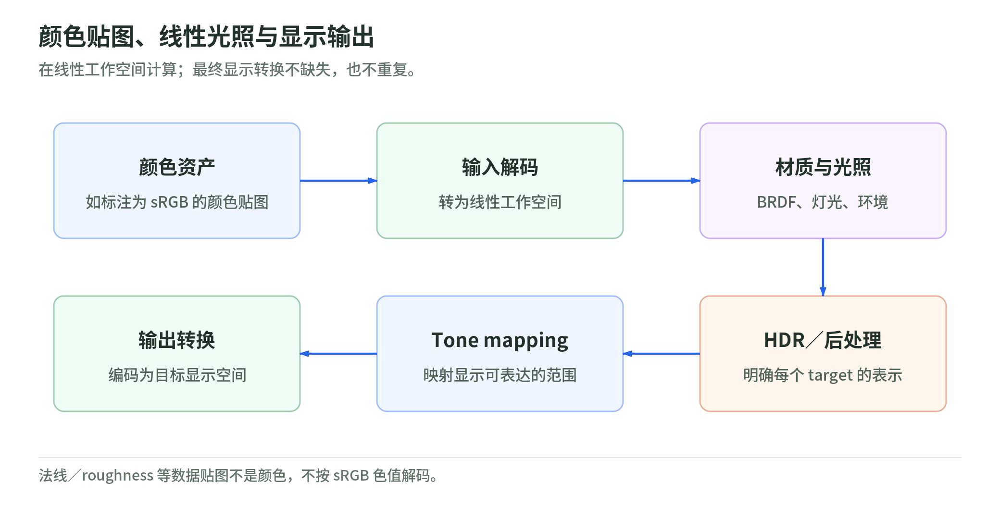
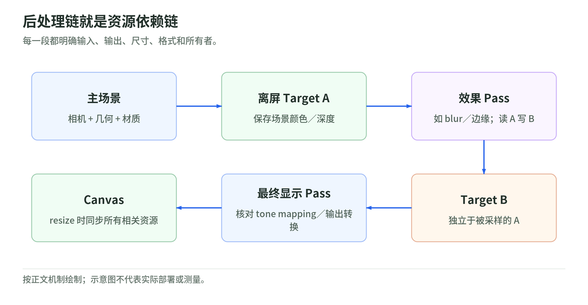

# 05 光照、PBR、颜色与后处理

研究日期：2026-10-29。前置：[坐标与采样](02-coordinates-and-sampling.md)、[Three.js](04-threejs-and-frameworks.md)。

## 1. Shader、材质与渲染算法不是同义词

Shader 是 GPU 程序；材质定义表面怎样响应光以及相关参数；渲染算法决定怎样组织可见性、光照和 pass。

同一套 PBR 表面响应，可以放在 forward 或 deferred 的渲染组织里。一个自写 fragment shader 只输出颜色，也可以完全不响应任何场景灯光。添加灯光对象不会自动改变任意自定义程序。

本章用 Filament 的开发者文档解释通用 PBR 方程，用 glTF 规范解释资产数据契约，用固定版本 Three.js 文档与 ShaderChunk 解释框架行为。不能因为 Filament 采用某模型，就宣称所有 Three.js 材质一字不差使用该实现。[L1][L2][L3]

## 2. 从 Lambert 到微表面模型

先实现简化的方向光：

```glsl
vec3 N = normalize(vNormal);
vec3 L = normalize(uLightDirection);
float NoL = max(dot(N, L), 0.0);
vec3 result = uBaseColor * uLightColor * NoL;
```

这是便于观察方向变化的教学模型，省略 BRDF 归一化、阴影、距离衰减、曝光和色彩输出。`N`、`L` 必须处于同一坐标空间。`uLightDirection` 的方向约定应明确为从表面指向光。

一般的反射关系可写成：

$$L_o(\omega_o)=L_e+\int_\Omega f_r(\omega_i,\omega_o)L_i(\omega_i)\max(n\cdot\omega_i,0)d\omega_i.$$

要分清入射光 `L_i`、表面反射函数 `f_r` 和出射光 `L_o`。实时渲染用直接光、环境光预积分等近似计算，并不是每个片元完整求解所有光线。[L1]

常用微表面高光写成：

$$f_s=\frac{D(h)F(v,h)G(l,v,h)}{4(n\cdot l)(n\cdot v)}.$$

| 项 | 问题 | 常见解释 |
| --- | --- | --- |
| D | 微表面法线怎样分布 | GGX 等分布函数 |
| F | 入射角改变反射比例吗 | Fresnel，常用 Schlick 近似 |
| G | 微表面会互相遮蔽吗 | 几何遮蔽与掩蔽 |
| diffuse | 非金属的散射能量怎样处理 | Lambert 或其他漫反射近似 |

这些项和 roughness 的重映射、能量补偿共同组成实际模型。不能把一个公式标签当成完整材质实现。[L1]

## 3. Metallic-roughness 参数究竟控制什么

glTF 的核心材质模型定义 base color、metalness 和 roughness。非金属的 base color 主要表达漫反射颜色；纯金属的 base color 表达有色的正入射反射率，不能继续赋予同样的漫反射解释。[L2]

几个应重点理解的关系：

- roughness 增大一般使高光变宽，不能解释成“把镜面反射直接关闭”。
- metalness 不是强度旋钮。中间值可用于覆盖混合等建模，但不要为了亮一点随意把塑料改成金属。
- 能量守恒要求漫反射与镜面贡献协调；不是简单把两个任意颜色相加。
- Fresnel 会使掠射角反射增强，不能用常数高光覆盖所有视角。
- 资产、灯光、曝光和显示转换共同决定观察到的颜色。

Three.js `MeshStandardMaterial` 和 `MeshPhysicalMaterial` 的响应与自写无光照 Shader 不同。Physical 的额外层也有计算成本，不能默认给所有对象打开所有参数。[L3]

## 4. 把“贴图”当成资产契约

| 数据 | 典型语义 | 编码注意 |
| --- | --- | --- |
| base color / emissive RGB | 颜色 | PNG/JPEG 通常需要 sRGB 解码 |
| normal RGB | 切线空间方向 | 非颜色数据；不做 sRGB 解码 |
| roughness / metallic | 参数 | 非颜色数据；通道约定要核对 |
| ambient occlusion | 间接光遮蔽近似 | 不能无条件乘到所有直接光上 |
| depth | 深度 | 必须知道投影、比较及格式约定 |
| HDR environment | 入射环境光 | 常见为线性 HDR；不是普通 LDR 颜色图 |

glTF metallic-roughness 使用 G 通道存 roughness、B 通道存 metallic；occlusion 使用 R 通道。法线贴图通常把 RGB 映射到方向后归一化，并通过切线空间转换到着色使用的空间。图片扩展名无法替你确定这些语义。[L2]

在 Three.js 手动加载普通颜色和数据贴图时：

```js
baseColorMap.colorSpace = THREE.SRGBColorSpace;
normalMap.colorSpace = THREE.NoColorSpace;
roughnessMap.colorSpace = THREE.NoColorSpace;
```

这段只说明标记方式；不代表所有 HDR、视频、压缩或导入器加载结果都应这样覆盖。优先尊重 loader 和资产规范已经设置的编码。[L4]

## 5. 为什么必须在线性空间计算光照

<!-- illustration: linear-color-79acad31a6 -->


*图：颜色贴图、线性光照与显示输出。在线性工作空间计算；最终显示转换不缺失，也不重复。*
<!-- /illustration: linear-color-79acad31a6 -->

以 `[0,1]` 标量为例，sRGB 解码到线性值：

$$
C_l=
\begin{cases}
C_s/12.92 & C_s\le0.04045\\
((C_s+0.055)/1.055)^{2.4} & \text{otherwise}.
\end{cases}
$$

`C_s=0.5` 对应 `C_l≈0.214`，不是一半的物理光强。黑白图在线性空间混合成 `0.5` 再编码到 sRGB，约为 `0.735`。这个数值例子用于解释为什么直接混合编码后的值会偏暗。[L2][L4]

一条典型显示链：

```text
sRGB 颜色贴图 --解码--> 线性工作空间
                            |
                        光照 / 混合 / HDR 效果
                            |
                        曝光与 tone mapping
                            |
                        输出颜色空间编码 --显示
```

tone mapping 处理 HDR 强度与显示范围；sRGB 编码处理线性值到非线性编码的映射。它们不能互相替代。[L4]

Three.js 的标准工作空间是 Linear-sRGB；`ColorManagement` 默认开启。十六进制或 CSS 颜色构造路径和直接改 `color.r` 的路径有不同转换契约。复制旧教程中的 `outputEncoding`、`gammaFactor` 等配置前，必须看匹配版本的 API，而不是把旧属性与新 `outputColorSpace` 混用。[L4]

自定义 `ShaderMaterial` 的最终输出需要实现适当的颜色转换。直接输出到显示 canvas 与输出到线性中间 render target 是不同场景，不应该在每一个后处理 pass 中重复显示转换。[L4]

## 6. Shadow map 的成本与常见错误

基本机制是从光源视角记录深度，再把接收阴影的表面投影到光源空间，比较是否被更靠近光源的表面遮挡。Three.js 的 shadow shader 和 shadow-map renderer 可以用来追踪实际实现。[L5]

```text
shadow pass：可投影物体 -> 光相机 -> 深度纹理
main pass：表面位置 -> 光空间 -> 深度比较 -> 光照可见性
```

需要分别理解：

- shadow acne：精度、采样和表面方向导致自己遮挡自己。
- bias / normal bias：缓解问题，但过大可能使影子脱离物体。
- PCF 等过滤：对多次比较结果过滤，不是把一张普通颜色图 blur 后等价比较。
- 阴影相机范围与分辨率：纹理很大而有效覆盖很差，仍会模糊。
- 每个光、每次更新与立方体的多个面都可能增加渲染工作。

测性能时先停用阴影做对照，再讨论是否提高 `shadow.mapSize`。不能仅凭主场景只有一次 `render()` 推断只有一个 GPU pass。

## 7. Forward、deferred 和 clustered 怎样选择

这是一组设计比较，不是 Three.js 默认自动选择这些算法的声明。[L1]

| 组织 | 主要工作 | 常见代价 |
| --- | --- | --- |
| Forward | 绘物体时评估相关光 | 光与物体组合可能增加着色成本 |
| Deferred | 先写 G-buffer，再做光照 | 多附件带宽、透明物体、MSAA 与材质表达 |
| Forward+ / clustered | 为屏幕区域或视锥分区筛选光 | 构建光列表、索引访问和后端能力 |

G-buffer 往往包含法线、深度、材质参数等，不意味着存下所有几何或解决了所有可见性问题。WebGL 2 的 MRT 是构建多附件流程的能力，不等于已有完整 deferred renderer。

## 8. 后处理就是纹理之间的依赖图

<!-- illustration: postprocessing-98c37214be -->


*图：后处理链就是资源依赖链。每一段都明确输入、输出、尺寸、格式和所有者。*
<!-- /illustration: postprocessing-98c37214be -->

典型 WebGLRenderer 路线：

```text
scene -> linear scene target
      -> bloom / blur / other selected effects
      -> composition
      -> OutputPass -> canvas
```

`EffectComposer` 管理 render target 和 pass 的读写关系。中间 pass 常采用 A/B 交换避免读写同一附件。最后通常由 `OutputPass` 做输出转换及可选 tone mapping；不应同时在多个地方重复转换。[L6]

为什么需要理解 pass 顺序：

- HDR bloom 提取和显示后的 LDR 提取不等价。
- 边缘抗锯齿应根据具体算法约定决定输入编码与顺序。
- SSAO、SSR 等屏幕空间方法看不到屏幕外或已被遮挡的数据。
- TAA 使用历史帧，涉及抖动、重投影、运动信息与 disocclusion，不能只用一张 blur 贴图概括。
- 默认 canvas MSAA 不会自动替所有离屏 FBO 提供同样的抗锯齿。

WebGPURenderer 使用独立的节点后处理路线；不能原样把旧 `EffectComposer` 当通用后端接口。[L7]

## 9. 实验与自测

1. 在不改变光线和曝光时，对比 metalness=0/1，说明 base color 的解释变化。
2. 对比法线贴图标记为 `NoColorSpace` 与错误的 sRGB，记录表面响应变化。
3. 比较线性与编码空间的黑白混合；数值依据见[离线实验](examples/pipeline-math.mjs)。
4. 添加一个 blur pass，写清楚输入、输出、尺寸、格式和是否执行输出编码。
5. 关闭阴影和后处理，分别测帧时间变化，不直接声称某一个材质是瓶颈。

下一章：[性能与调试](06-performance-and-debugging.md)。

## 一手来源

核验日期：2026-10-29。glTF 与 Filament 页面是可更新文档；Three.js 链接冻结版本。

[L1]: https://google.github.io/filament/main/filament.html "Google Filament: PBR and imaging pipeline"
[L2]: https://github.com/KhronosGroup/glTF/blob/main/specification/2.0/Specification.adoc "Khronos glTF 2.0: materials and texture encodings"
[L3]: https://github.com/mrdoob/three.js/blob/9b4a2ac29c63ccb43fd51c5661f2f873ac2c39b8/src/materials/MeshPhysicalMaterial.js "Three.js: MeshPhysicalMaterial"
[L4]: https://github.com/mrdoob/three.js/blob/9b4a2ac29c63ccb43fd51c5661f2f873ac2c39b8/manual/pages/color-management.html "Three.js: Color Management"
[L5]: https://github.com/mrdoob/three.js/blob/9b4a2ac29c63ccb43fd51c5661f2f873ac2c39b8/src/renderers/webgl/WebGLShadowMap.js "Three.js: WebGLShadowMap"
[L6]: https://github.com/mrdoob/three.js/blob/9b4a2ac29c63ccb43fd51c5661f2f873ac2c39b8/manual/pages/post-processing.html "Three.js: Post Processing"
[L7]: https://github.com/mrdoob/three.js/blob/9b4a2ac29c63ccb43fd51c5661f2f873ac2c39b8/manual/pages/webgpurenderer.html "Three.js: WebGPURenderer migration"
