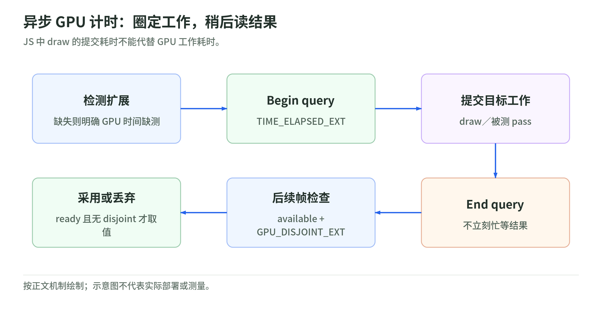

# 06 性能、调试与资源生命周期

研究日期：2026-10-29。前置：[WebGL](03-webgl2-api-and-resource-model.md)、[光照与后处理](05-lighting-color-and-postprocessing.md)。

## 1. 从帧预算开始，不从“减少面数”开始

理论预算：60 Hz 约 `16.67 ms`，120 Hz 约 `8.33 ms`。这只是每帧时间间隔，不是你可以全部用掉的 Shader 时间。

CPU 构建下一帧、驱动处理命令、GPU 执行前一帧可能重叠，遇到上传、读回或其他依赖又可能等待。因此：

```text
JS performance.now() 围住 render()
    != GPU 完整执行时间
    != 屏幕呈现延迟

renderer.info.render.calls
    = 绘制调用统计，不是毫秒
```

WebGL 的命令提交与 GPU 结果查询应分别理解。同步查询和读回可能形成等待，改变被测任务本身。[P1][P2]

## 2. 用最小对照识别瓶颈

下表是诊断假设，不是对任意设备保证成立的规律。

| 对照操作 | 若明显改善，优先怀疑 | 不能直接证明 |
| --- | --- | --- |
| 降低 drawing buffer 分辨率 | fragment、采样、后处理、带宽 | 一定是某一行 GLSL 慢 |
| 合批或 instancing | CPU 提交、状态变更 | 三角形数量一定无关 |
| 换成简单 unlit 材质 | 着色、光照或材质变体 | 所有原材质都应该删掉 |
| 关闭阴影 | 附加 pass、深度绘制、采样 | 主 pass 没有瓶颈 |
| 减少纹理尺寸和 pass | 带宽、内存压力 | 下载大小就是显存大小 |
| 停止每帧资源上传 | 数据上传、同步 | `bufferSubData` 总是慢 |
| 降低对象更新频率 | 场景遍历、动画、React 更新 | GPU 没有问题 |

一次只改一个变量，固定相机、场景、分辨率和测试时段，记录预热后的分位数而不只记录单次 FPS。首次 Shader 编译与稳定运行应单独统计。[P1]

## 3. 分辨率和 overdraw 会怎样放大成本

CSS 画布宽高为 `W,H`，实际使用像素比为 `r` 时，像素数近似 `WHr^2`。

因此将 DPR 从 1 改成 2，是约四倍像素，不是两倍。再叠加多次透明覆盖和全屏后处理，片元工作和目标读写可能继续放大。可根据质量需求限制像素比，记录实际 drawing buffer 尺寸，不只记录 CSS 尺寸。[P1]

透明、alpha test、双面材质的行为不同：

- 透明混合通常还依赖排序，难以直接像不透明物体一样写入深度。
- alpha test 会丢弃片元，但相关片元程序工作不一定因此免费。
- 双面绘制增加潜在覆盖，也可能有不同的法线和 pass 处理。
- 不透明 front-to-back 排序可能减少隐藏片元，但实际 early testing 行为受 Shader 与硬件实现影响。

不能把“加了 discard”写成“GPU 永远不再运行这个像素的 Shader”。

## 4. WebGL 2 的 GPU timer query

<!-- illustration: gpu-profiling-380bbcac01 -->


*图：异步 GPU 计时：圈定工作，稍后读结果。JS 中 draw 的提交耗时不能代替 GPU 工作耗时。*
<!-- /illustration: gpu-profiling-380bbcac01 -->

先检测 `EXT_disjoint_timer_query_webgl2`。它不是所有目标浏览器必然提供的能力。[P2]

下面是可嵌入已有 context 的诊断片段，不是完整应用：

```js
const ext = gl.getExtension('EXT_disjoint_timer_query_webgl2');
let pending = null;

function beginTimedDraw() {
  if (!ext || pending) return false;
  pending = gl.createQuery();
  if (!pending) return false;
  gl.beginQuery(ext.TIME_ELAPSED_EXT, pending);
  return true;
}

function endTimedDraw() {
  gl.endQuery(ext.TIME_ELAPSED_EXT);
}

function pollTiming() {
  if (!pending) return null;
  const ready = gl.getQueryParameter(pending, gl.QUERY_RESULT_AVAILABLE);
  const disjoint = gl.getParameter(ext.GPU_DISJOINT_EXT);
  if (!ready && !disjoint) return null;
  const ms = ready && !disjoint
    ? gl.getQueryParameter(pending, gl.QUERY_RESULT) / 1e6
    : null;
  gl.deleteQuery(pending);
  pending = null;
  return ms;
}

// 在已有帧循环里：
// const timed = beginTimedDraw();
// drawTheWorkBeingMeasured();
// if (timed) endTimedDraw();
// 后续帧调用 pollTiming()，不要同一 JS 任务里循环忙等。
```

`endTimedDraw()` 只在成功 begin 后调用，避免结束不存在的 query。计时器失真时放弃结果。查询到的是所圈定的 GPU 工作区间，不是完整用户交互延迟。

此片段仅允许一个待处理 query，用来说明异步读取；生产 profiling 可管理多个 query、资源释放和 context loss。不要把 `getParameter` 等查询放进所有绘制的热路径。[P1][P2]

## 5. Frame capture 看什么

Spector.js 是可捕获、检查 WebGL 帧的工具。它帮助查看实际命令、绑定的纹理、程序和状态，不把截图的视觉复杂度当成 draw call 统计。[P3]

建议按以下顺序读一个 capture：

1. 哪个 framebuffer 接收这一次绘制？
2. viewport、scissor、clear 值是否正确？
3. 使用哪个 shader program，编译后的源代码是否是你以为的那个？
4. attribute 布局、索引类型和 draw 数量是否合理？
5. sampler 指向哪个 texture unit，纹理完整、编码正确吗？
6. depth test/write、cull、blend 状态是否符合目标？
7. 是否存在重复 pass、未必要的目标切换或大量材质变体？

capture 有自身开销；它用于解释结构，不代替无捕获状态下的性能基线。WebGPU 诊断需使用相应后端的验证与开发者工具，不能假设所有 WebGL 捕获工具都同样适用。

## 6. 黑屏排查表

| 现象 | 先检查 |
| --- | --- |
| 完全没有绘制 | context、compile/link、program、draw count |
| 有 draw，没有覆盖 | attribute 数据、index、MVP、裁剪、cull |
| 被遮挡或残影 | clear、depth test/write、目标选择 |
| 纹理全黑 | texture unit、sampler、完整性、格式、加载与 CORS |
| FBO 无输出 | completeness、attachments、尺寸与格式 |
| 只有换设备才错 | precision、extension、limits、浮点格式能力 |
| 颜色发灰或异常暗 | 贴图编码、线性工作空间、重复/缺失输出转换 |
| 改材质后停顿 | program variants、首次编译、缓存 key |

这些是排查顺序，不是看到一个症状就可以直接断言原因。[P1]

## 7. 资源什么时候真正释放

JS 对象不再可达，不等于你已经及时释放了底层 GPU 资源。Three.js 需要有明确的 ownership：

```text
geometry owner -> geometry.dispose()
material owner -> material.dispose()
texture owner -> texture.dispose()
render target owner -> target.dispose()
controls / event listeners / animation -> 对应清理
```

删除一个 mesh 不会自动处理全部共享资源。材质也可能共享 texture；如果一个组件销毁时把共享贴图 dispose，其他组件会受影响。反过来，只 dispose 材质也不能保证释放它引用的所有贴图。[P4]

切换场景时建议记录：

- 哪些资源独占，哪些来自共享缓存。
- 是否停止帧循环及事件监听。
- 是否有未完成加载继续把资源挂回旧场景。
- 是否需要清理 render target、后处理 pass 和附属资源。
- 是否在反复进入/退出后出现资源增长，而不只是某一瞬间数字不为零。

浏览器 context lost 与 WebGPU device lost 都要能恢复或降级；不能只刷新业务状态而继续使用已经失效的 GPU 对象。[P5]

## 8. 纹理内存与网络大小

理论示例：

```text
4096^2 RGBA8 = 64 MiB
加完整 square mip 链约85.33 MiB
1920x1080 RGBA16F 单附件约15.82 MiB
同尺寸两个颜色目标 + 深度 + MSAA + 多pass资源会继续叠加
```

这是布局估算，不是测得的驱动分配值。JPG 的 `500 KB` 下载大小不能直接当成 GPU 的纹理占用；GPU 压缩格式、mip、像素格式、对齐都改变结果。[P1]

若静态画面不需要持续运动，可考虑按需渲染。是否收益明显取决于交互、动画、视频、控制器和实际引擎更新方式，不能只把 RAF 删除而漏掉状态变化。

## 9. 实验记录字段

记录日期、设备/GPU/浏览器、库版本、后端、CSS 和 buffer 尺寸、DPR、资产、Shader 变体、预热、CPU 测量、GPU query 是否可用、disjoint、帧时间分位数、画质差异与改动。

下一章：[WebGPU 与 TSL](07-webgpu-wgsl-and-tsl.md)。

## 一手来源

核验日期：2026-10-29。

[P1]: https://developer.mozilla.org/en-US/docs/Web/API/WebGL_API/WebGL_best_practices "MDN: WebGL best practices"
[P2]: https://github.com/KhronosGroup/WebGL/blob/main/extensions/EXT_disjoint_timer_query_webgl2/extension.xml "Khronos: timer query semantics"
[P3]: https://spector.babylonjs.com/ "Spector.js: WebGL frame inspection"
[P4]: https://github.com/mrdoob/three.js/blob/9b4a2ac29c63ccb43fd51c5661f2f873ac2c39b8/manual/pages/how-to-dispose-of-objects.html "Three.js: resource disposal"
[P5]: https://developer.mozilla.org/en-US/docs/Web/API/WEBGL_lose_context "MDN: WEBGL_lose_context"
