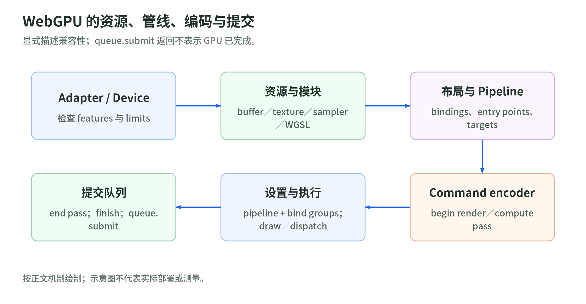
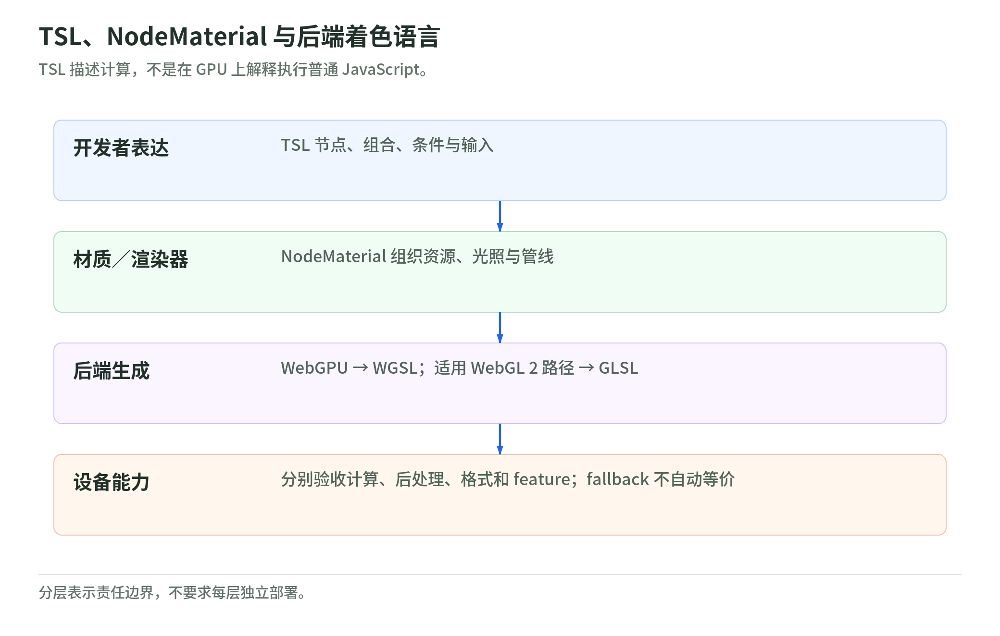

# 07 WebGPU、WGSL 与 TSL

研究日期：2026-10-29。前置：[WebGL 资源模型](03-webgl2-api-and-resource-model.md)、[Three.js](04-threejs-and-frameworks.md)。

## 1. WebGPU 不是“WebGL 3”

WebGPU 定义图形与通用计算 API；WGSL 定义对应着色语言。核验时 WebGPU 发布文档为 2026-09-15 的 Candidate Recommendation Draft，WGSL 为 2026-10-26 的 Candidate Recommendation Draft；不能把“草案标准状态”“某浏览器实现了多少”和“某框架是否成熟”混成一个结论。[W1][W2]

| 关注点 | WebGL 2 | WebGPU |
| --- | --- | --- |
| 调用组织 | context 中大量可变绑定与状态 | pipeline、bind group、command encoder |
| Shader | GLSL ES | WGSL |
| 主要阶段 | vertex / fragment，部分额外数据流程 | vertex / fragment / compute |
| 数据绑定 | attribute、uniform、texture unit、UBO 等 | 描述布局的 bindings 和 bind groups |
| 资源用途 | 受具体绑定/API 规则约束 | 创建时声明 usage，按规范验证兼容用途 |
| 提交 | draw 等调用提交到实现 | 编码 command buffer 后向 queue 提交 |
| 失效处理 | context lost / restored | device lost 与资源重建 |

这是概念映射，不表示每项一一替换，也不是性能保证。WebGL 2 的 transform feedback 或 FBO 计算技巧，不等于原生的通用 compute pipeline。[W1]

## 2. 显式 pipeline 与 bind group

<!-- illustration: webgpu-command-469bf172bc -->


*图：WebGPU 的资源、管线、编码与提交。显式描述兼容性；queue.submit 返回不表示 GPU 已完成。*
<!-- /illustration: webgpu-command-469bf172bc -->

一份 render pipeline 联结 Shader entry point、顶点布局、图元、颜色目标、混合、深度/模板和多重采样设置。资源绑定布局约束各个 binding 的类型、阶段可见性与其他属性。[W1]

```text
adapter / device
    -> resource creation (buffer / texture / sampler)
    -> shader module
    -> bind group layout / pipeline layout
    -> render or compute pipeline
    -> command encoder
        -> begin pass
        -> set pipeline / bind groups
        -> draw or dispatch
        -> end
    -> queue.submit(command buffers)
```

理解收益在于把状态兼容性显式化，并给批量编码与资源组织提供结构；实际成本仍来自场景、编译、验证、驱动、数据传输和 GPU 工作。

不要在每帧无条件重建 pipeline；也不要把所有不同资源组合都做成无法管理的缓存。缓存契约要包含会改变布局、Shader 或目标兼容性的因素。

## 3. WGSL 最小结构

以下是仅定义 GPU 模块的示例，不包含 host 创建与绑定代码：

```wgsl
struct VertexInput {
  @location(0) position: vec3<f32>,
};

struct VertexOutput {
  @builtin(position) clipPosition: vec4<f32>,
  @location(0) color: vec3<f32>,
};

@vertex
fn vsMain(input: VertexInput) -> VertexOutput {
  var output: VertexOutput;
  output.clipPosition = vec4<f32>(input.position, 1.0);
  output.color = input.position * 0.5 + vec3<f32>(0.5);
  return output;
}

@fragment
fn fsMain(input: VertexOutput) -> @location(0) vec4<f32> {
  return vec4<f32>(input.color, 1.0);
}
```

`@location` 定义用户接口，`@builtin(position)` 定义管线位置语义。两者不是仅供阅读的注释。host 的 vertex format、offset、stride 和 pipeline 的 entry point 必须匹配。[W2]

需要新学的部分：

- `@group` / `@binding` 的资源接口。
- uniform、storage、workgroup 等 address space。
- host-shareable 数据的 alignment、size、stride。
- uniformity 分析与导数、barrier 等调用要求。
- compute 的 workgroup 大小、越界访问与数据竞争。

例如 `vec3<f32>` 的 size 和 alignment 不是同一个值；不能把 JS 中紧密排列的三个数字默认当成所有 buffer 布局都兼容。[W2]

## 4. Compute 增加了什么，又没有增加什么

compute pipeline 可以读写适当的 storage 数据并按 workgroup 调度。应用需要显式设计输入、输出、dispatch 大小、边界检查和数据依赖。[W1][W2]

需要避免的误解：

1. 工作组同步不意味着所有工作组在任意 Shader 位置都有全局 barrier。
2. GPU 算完不意味着 CPU 已立即得到结果；映射和读回有异步与 usage 约束。
3. 算法能在 WebGPU 实现，不表示低能力 WebGL 后端自动具备完全相同能力。
4. 队列提交不是随意共享 JS 对象给 GPU；布局和资源生命期仍需明确。
5. 不能把一次 CPU 等待 GPU 的测试，当成长期流水线吞吐表现。

典型后续方向是粒子更新、光列表构建、图像计算等；本次未执行这些 GPU 实验，不提供虚构的加速比。

## 5. Three.js 为什么引入 TSL

<!-- illustration: tsl-backends-9b275d041a -->


*图：TSL、NodeMaterial 与后端着色语言。TSL 描述计算，不是在 GPU 上解释执行普通 JavaScript。*
<!-- /illustration: tsl-backends-9b275d041a -->

TSL 用 JavaScript 的节点表达组织着色计算，由后端构建成 WGSL 或 GLSL。它不是在 GPU 上解释执行普通 JS，也不是任意 JS 都可无约束编译。[W3]

区分三层：

```text
TSL：开发者表达着色计算、节点、组合和控制结构
NodeMaterial / Renderer：组合材质、资源、光照和管线
WGSL / GLSL：最终后端着色程序
```

一个简单片段：

```js
import { MeshBasicNodeMaterial } from 'three/webgpu';
import { vec3, sin, time } from 'three/tsl';

const material = new MeshBasicNodeMaterial();
material.colorNode = vec3(
  sin(time).mul(0.5).add(0.5),
  0.25,
  0.7
);
```

这是材质节点片段，不是完整场景。`time` 是节点输入，`sin(time)` 描述 GPU 计算；不要改写成 JS `Math.sin(time)` 后期待相同节点语义。
示例使用的 `sin`、`time`、`vec3` 出口已在固定版本的 `Three.TSL.js` 中核对。[W6]

使用节点表达不免除对坐标、颜色、导数、资源与性能的理解。即使表达相同，两个后端实际生成的程序和硬件成本仍可能不同。

## 6. WebGPURenderer 的后端与迁移边界

固定版本的官方指南和构造源码表明：默认尝试 WebGPU，不可用时可以选择 WebGL 2 后端；`forceWebGL: true` 可用于明确测试 fallback。[W3][W4]

关键边界：

- 不直接支持旧 `ShaderMaterial` / `RawShaderMaterial` 与 `onBeforeCompile` 定制路线，需要迁移到 NodeMaterial/TSL。
- 不直接复用旧 `EffectComposer` 效果链，使用新的节点后处理组织。
- WebGPU 初始化异步。`setAnimationLoop` 可以帮助管理首帧初始化；需要手动在初始化阶段使用 renderer 时核对 `await renderer.init()`。
- fallback 不等于新后端与旧 `WebGLRenderer` 完全同一实现。
- 官方指南在核验版本仍提示实验状态、缺失功能和场景性能差异；不要从名字推断“必然更快”。[W3]

另一个版本敏感的补充：固定源码已包含 `WebGLNodesHandler`，可为旧 `WebGLRenderer` 接入有限的节点材质支持。文件明确列出 VSM、MRT、transmission、storage textures 和新后处理栈等限制。官方指南对这一过渡方向的概述与具体版本源码的进度不完全同步，判断可用入口时应查锁定版本源码。[W5]

因此“TSL 只属于原生 WebGPU”与“所有旧 ShaderMaterial 自动迁移”都不准确。节点描述层、renderer 接口与 backend 能力要分别判断。

推荐迁移顺序：

1. 固定 Three.js 与 addons 的同一版本。
2. 列出自定义 GLSL、内部 ShaderChunk patch、后处理与特定 extension 的依赖。
3. 用最小场景验证材质、颜色、阴影、加载器和交互。
4. 分别运行 WebGPU 与强制 WebGL 2 后端，按能力选择或降级。
5. 迁移自定义材质，再迁移后处理。
6. 测目标设备，保留迁移前的可对比基线。

## 7. 还必须改变哪些习惯

WebGPU NDC Z 为 `[0,1]`，framebuffer 的 Y 原点约定与常规 WebGL 不同；不要把自己写的 WebGL 投影、拾取或屏幕空间 Shader 不经审查就复用。[W1]

WebGPU 的 secure context、adapter/device 获取、feature 与 limits 应按目标环境核对，不能只查是否存在 `navigator.gpu` 就认定所有功能可用。设备丢失时重新建立资源和状态，不重复使用旧 device 的对象。[W1]

## 8. 自测

1. bind group 为什么不只是一个改名的 texture unit？
2. `queue.submit()` 返回时，GPU 是否已经把结果呈现在屏幕上？
3. 为什么 compute 的 barrier 不能等同于 CPU 多线程的全局等待？
4. TSL 转换后端程序，为什么不代表旧 GLSL 字符串会自动迁移？
5. 若 fallback 跑通了基础材质，怎样证明你的自定义计算和后处理也兼容？

返回[学习路线](learning-roadmap.md)选择下一次实际实验。

## 一手来源

核验日期：2026-10-29。

[W1]: https://www.w3.org/TR/2026/CRD-webgpu-20260915/ "W3C: WebGPU CRD 2026-09-15"
[W2]: https://www.w3.org/TR/2026/CRD-WGSL-20261026/ "W3C: WGSL CRD 2026-10-26"
[W3]: https://github.com/mrdoob/three.js/blob/9b4a2ac29c63ccb43fd51c5661f2f873ac2c39b8/manual/pages/webgpurenderer.html "Three.js: WebGPURenderer and TSL migration guide"
[W4]: https://github.com/mrdoob/three.js/blob/9b4a2ac29c63ccb43fd51c5661f2f873ac2c39b8/src/renderers/webgpu/WebGPURenderer.js "Three.js: backend and fallback selection"
[W5]: https://github.com/mrdoob/three.js/blob/9b4a2ac29c63ccb43fd51c5661f2f873ac2c39b8/examples/jsm/tsl/WebGLNodesHandler.js "Three.js: limited node compatibility for WebGLRenderer"
[W6]: https://github.com/mrdoob/three.js/blob/9b4a2ac29c63ccb43fd51c5661f2f873ac2c39b8/src/Three.TSL.js "Three.js: TSL public exports"
