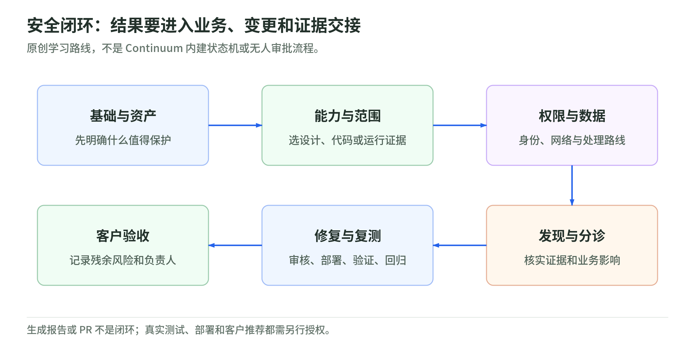

# AWS Continuum 与安全方案 L200：从发现问题到可验收的修复

研究核验：2026-11-03。面向了解云基本概念、希望讲清应用安全与客户价值的读者。L200 是本 Wiki 的学习标尺，不是官方认证。本文只使用公开资料，不记录内部讨论、人员或未确认的活动安排。

## 1. 先抓住主线

<!-- illustration: sec-study-map-ceb65dffb6 -->

*图：安全闭环：结果要进入业务、变更和证据交接。原创学习路线，不是 Continuum 内建状态机或无人审批流程。*
<!-- /illustration: sec-study-map-ceb65dffb6 -->

安全团队不只需要更多告警，还需要知道：问题影响什么业务、是否可被利用、谁来修、修后是否仍成立。AWS 将 Continuum 定位为贯穿软件生命周期的发现、排序、验证和修复服务；原 AWS Security Agent 是其中的 frontier agent，不是整个 Continuum 的同义词。[产品定位][overview]

可以把工作想成检查一栋房子：设计评审看哪里可能出问题，代码评审看施工实现，运行验证检查在当前条件下能否真的进入，修复与复测检查改动有没有解决选定问题。这个比喻是教学简化；几类证据不互相替代。[威胁建模][threat] [代码评审][code] [Pentest][pentest]

真正的闭环不止在“报告生成”结束。报告还须关联业务判断、负责人、变更审批、部署版本和复测；这条人工治理链是本 Wiki 的建议，不是声称 AWS 自动接管客户安全责任。[共同责任][responsibility] [复测边界][revalidate]

## 2. 九页读本与一条学习路线

| 页面 | 读完应能回答 |
| --- | --- |
| [01 安全基础](security-foundations.md) | 资产、暴露、漏洞、威胁与业务风险怎样区分？哪些服务做哪种工作？ |
| [02 Continuum 能力与成本](continuum-l200.md) | 四类能力何时用？哪些是 preview？task-hours 和 CIU 怎么理解？ |
| [03 权限与数据](permissions-and-data.md) | Agent Space、角色、凭据和跨区推理有哪些边界？ |
| [04 验证与修复](validation-and-remediation.md) | finding、PR、复测、风险接受怎样交接？哪些绿色状态会误导？ |
| [05 客户方案](customer-solutions.md) | 能包装什么服务？前提、交付、验收、费用和 no-go 是什么？ |
| [06 学习路线](learning-roadmap.md) | 如何准备 workshop、完成案例讲解和自测？ |
| [桌面实验](lab.md) | 怎样用虚构记录识别“通过但未测试”，验算累计工作费用？ |
| [来源与核验](sources.md) | 文档冲突怎样处理？哪些事这次没有做？ |
| 本页导读 | 把以上内容串成可复述的体系 |

第一次阅读建议按 01→02→03→04。准备客户对话再读 05；06 和实验用于检验是否真的理解。不是按产品按钮顺序背操作。

## 3. 一个贯穿全书的虚构案例

假设订单服务准备上线。团队已有 Config 和 GuardDuty，却还不知道订单接口是否检查用户归属。云配置与运行异常检测不替代应用逻辑验证。[服务职责][config] [运行检测][guardduty]

先梳理架构、身份与数据流，把“普通用户只能读取自己的订单”写成安全要求；再结合代码证据、明确授权的代表性测试环境评估它是否成立。发现问题后，修复建议进入 PR 审核，部署到对应环境，再做选定问题复测与业务回归。[安全要求][requirements] [修复][repair] [单项复测][revalidate]

以下是本 Wiki 的案例验收口径，不是服务承诺：

- 范围：明确环境、版本、入口、测试用户和禁止动作；未覆盖的部分单独列出。
- 证据：区分设计威胁、代码弱点和运行复现；不能用同一“高风险”标签抹掉区别。
- 变更：写清 PR 由谁审、谁能合并、谁部署、谁回滚；提 PR 不等于获准部署。
- 关闭：正确版本已部署、选定验证未复现、业务回归通过；残余风险仍有负责人。
- 成本：预览准入、计费单位和其他 AWS 资源费用分别核对，不给出未经测量的固定报价。

## 4. 先记住六个不能省略的限制

1. 四类能力开放状态不同：code vulnerabilities 已于 2026-10-22 GA，公告列北弗吉尼亚与俄勒冈；概览仍有 gated preview 旧标记。code scanning、threat modeling 仍标 preview；pentest 主能力与 CI/CD continuous pentest 的 preview 要分开。[GA 公告][ga] [产品概览][overview] [CI/CD][cicd]
2. 新代码漏洞工作流使用 environments／integrations；frontier agent 使用 Agent Spaces 等资源。相似 UI 名称不证明 IAM、权限和数据规则相同。[新工作流][cv] [资源层级][hierarchy]
3. 数据存储 Region 不必等于推理处理 Region；新旧数据保护页有适用范围差异。[Continuum 数据][data] [Agent 数据][agent-data]
4. 默认筛选、未登录、预算提前结束和 scope conflict 都可能造成错误的“绿色印象”。无 finding 不等于没有漏洞。[结果][findings] [CI/CD][cicd]
5. 自动生成 patch／PR 仍需客户自己的审核、回归和变更治理。[修复交付][repair]
6. 预览不收费、配额或试用额度都不是完整项目零成本；累计任务时间也不是等待时间。[定价][pricing] [计费口径][billing]

## 5. 这次研究做了什么，没做什么

已做：阅读官方产品、定价与两套操作文档，补充 AWS 安全职责以及 OWASP、NIST、FIRST 基础资料；整理能力边界；重画教学图；提供无网络的原创练习与自动测试。

未做：登录 AWS、创建环境或 Space、申请 preview、扫描仓库或目标、运行 pentest、下载或执行验证脚本、接触客户数据、创建角色或密钥、部署服务、发送客户建议。Workshop 的准备问题只是一份通用问题卡，不证明任何具体活动已排期。

接下来可用[06 学习路线](learning-roadmap.md)自测，再用[客户方案模板](customer-solutions.md)做纸面演练。若进入真实 PoC，应先重新核验产品状态、范围、权限、数据处理和费用，并取得对应环境所有者的授权。

[overview]: https://aws.amazon.com/continuum/
[features]: https://aws.amazon.com/continuum/features/
[threat]: https://docs.aws.amazon.com/securityagent/latest/userguide/perform-threat-model.html
[code]: https://docs.aws.amazon.com/securityagent/latest/userguide/perform-code-review-scan.html
[pentest]: https://docs.aws.amazon.com/securityagent/latest/userguide/perform-penetration-test.html
[responsibility]: https://aws.amazon.com/compliance/shared-responsibility-model/
[revalidate]: https://docs.aws.amazon.com/securityagent/latest/userguide/revalidate-findings.html
[config]: https://docs.aws.amazon.com/config/latest/developerguide/WhatIsConfig.html
[guardduty]: https://docs.aws.amazon.com/guardduty/latest/ug/what-is-guardduty.html
[requirements]: https://docs.aws.amazon.com/securityagent/latest/userguide/security-requirements.html
[repair]: https://docs.aws.amazon.com/securityagent/latest/userguide/remediate-code-scan-findings.html
[cicd]: https://docs.aws.amazon.com/securityagent/latest/userguide/cicd-pentest.html
[cv]: https://docs.aws.amazon.com/continuum/latest/userguide/code-vulnerabilities.html
[hierarchy]: https://docs.aws.amazon.com/securityagent/latest/userguide/understand-lifecycle.html
[data]: https://docs.aws.amazon.com/continuum/latest/userguide/data-protection.html
[agent-data]: https://docs.aws.amazon.com/securityagent/latest/userguide/data-protection.html
[findings]: https://docs.aws.amazon.com/securityagent/latest/userguide/review-penetration-findings.html
[pricing]: https://aws.amazon.com/continuum/pricing/
[billing]: https://docs.aws.amazon.com/securityagent/latest/userguide/pricing.html
[ga]: https://aws.amazon.com/blogs/aws/aws-continuum-for-code-vulnerabilities-is-now-generally-available/
