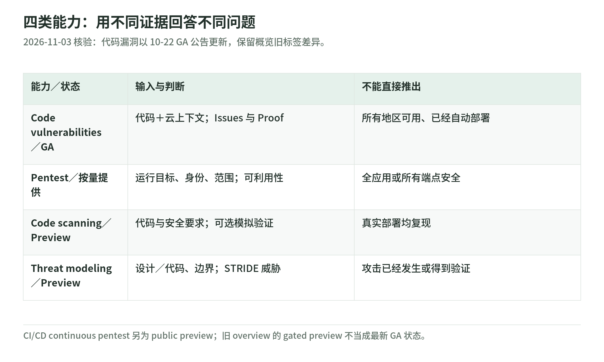
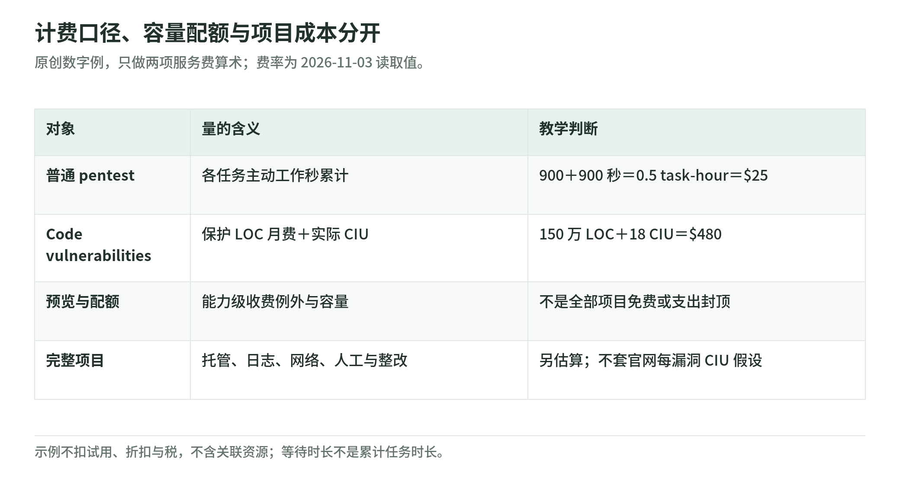

# 02 Continuum L200：能力、资源模型与成本

研究核验：2026-11-03。下面是公开文档读取时的产品状态，不是客户账户可用性保证。开始真实 PoC 前，要逐项核对能力、账户准入、Region 和当前文档。

## 四类能力，不是一种扫描

<!-- illustration: sec-capability-status-ca10ee1c17 -->

*图：四类能力：用不同证据回答不同问题。2026-11-03 核验：代码漏洞以 10-22 GA 公告更新，保留概览旧标签差异。*
<!-- /illustration: sec-capability-status-ca10ee1c17 -->

产品整体定位是发现、排序、验证和修复。原 AWS Security Agent 现是其中的 frontier agent；部分操作文档和 API 保留 `securityagent` 命名，不能据此把整个 Continuum 缩成一次改名。[定位][overview]

| 产品能力 | 读取时状态 | 主要问题 | 不应误读 |
| --- | --- | --- | --- |
| Code vulnerabilities | 2026-10-22 GA；公告列北弗吉尼亚、俄勒冈 | 结合代码、云配置和业务上下文，验证与修复代码漏洞 | 不等于所有 Region／分区可用；不是依赖 CVE 清单的同义词 |
| Penetration testing | 产品页未标 preview；有按量定价 | 评估已部署应用在约定条件下的可利用性 | 不意味着任何目标都可测、没有运行影响 |
| Code scanning | Preview | 扫描／评审代码，定位问题并建议修复 | 不保证在真实部署复现全部 finding |
| Threat modeling | Preview | 从架构、仓库和上下文识别威胁、边界与成立前提 | 威胁不是已发生攻击，也不是完成修复的证明 |

状态须对照有日期的[GA 公告][ga]与[产品概览][overview]：概览仍保留 code vulnerabilities 的 gated preview 旧标记，本页以 10 月 22 日公告更新，不把旧标签当最新状态。其他两项 preview 还可对照[文档历史][history]和[计费表][billing]。Design review 仍在 frontier-agent 文档与预览计费表中，不因首页强调四项能力就认定它消失。

## 两套资源模型，要分开读

新 code vulnerabilities 文档通过 **integrations** 连接 GitHub 或 S3，通过 **environments** 组织扫描与结果。它使用 AWS 上下文帮助解释第一方代码风险。[工作流][cv] [开始前][start]

原始 **findings** 与经过证据整合、排序的 **issues** 要分开；Proof 可能是 source analysis／静态证明，不保证每项都有可执行复现或单元测试。界面搜索与计数还只包括已加载结果。Patch 显示 Delivered 只证明交付，不证明客户已合并、部署或完成整改。[Issues 语义][issues] [GA 示例与人工审批][ga]

frontier-agent 文档则通过 **Agent Space** 组织应用或项目，再关联安全要求、设计评审、code review／threat model 项目、pentest 配置与运行。一个应用的上下文可以复用，但每次结果仍受输入、版本、范围和凭据影响。[层级][hierarchy] [运行方式][how]

因此不能把 environment 改叫 Space 后直接套用同一 IAM 策略、区域表或数据处理结论。尤其要区分“管理者调用服务的权限”“服务读取代码／secret 的权限”“测试用户进入目标应用的权限”；详见[03 权限与数据](permissions-and-data.md)。

### 一个会产生副作用的“初始化”

创建 code vulnerabilities environment 就会开始第一次 scan，**即使选择 Manual only**。默认日扫描；Manual only 控制的是后续自动扫描。手动排队后不能取消；scan 状态 Succeeded 后还可能继续生成 issues 和 patches。[扫描触发与状态][trigger]

所以“只是创建配置看看”不一定是只读动作。本专题没有执行初始化，更没有把创建环境当作零风险练习。

## 与 CI/CD 连接：先合并前，再部署后

PR code review 针对合并前的代码变化；CI/CD pentest 是部署到运行环境后的门禁，针对部署的 commit range，不是同一检查。continuous pentest 集成目前是 **public preview**，要求预先配置测试、验证域名、凭据、网络范围、CI/CD mode 和仓库集成。[CI/CD 专页][cicd]

流水线只负责启动、等待和报告；测试运行在服务端。取消流水线不一定停止服务端任务。集成使用 OIDC 临时凭据，但角色信任、可覆盖变量、超时和取消清理仍由客户治理。[CI/CD 认证与取消][cicd]

“通过”至少要分三种：真实运行后未达到阻断阈值、scoped out 无需测试、因基础设施错误 fail-open。官方默认基础设施错误 **fail-open**；后者甚至可能推进某些提供商的 baseline，随后收紧阈值不会自动补测旧范围。依赖安全签核时，要验证门禁行为，不能只看一个绿色勾。[默认值与 baseline][cicd]

## 成本单位：不拿等待时间乘单价

<!-- illustration: sec-cost-units-9aaef5f33d -->

*图：计费口径、容量配额与项目成本分开。原创数字例，只做两项服务费算术；费率为 2026-11-03 读取值。*
<!-- /illustration: sec-cost-units-9aaef5f33d -->

读取时普通 pentest 为 **50 USD/task-hour**，按任务秒计量。task-hours 是各并发任务累计的主动工作时间，不是 wall-clock 等待时间。每个 finding 前三次 revalidation 不收服务费；之后按 task-hours。[官方定价][pricing] [计费定义][billing]

原创小例：两个任务各工作 900 秒，假设并行等待约 900 秒，累计为 1,800 秒，即 0.5 task-hour。按上述普通费率服务费为 **25 美元**，不是按 0.25 小时算出的 12.50 美元。数字是教学假设，不是运行实测；也未扣试用或计入其他资源。

新 pentest 客户试用从首次运行起两个月，每个试用月最多 400 task-hours，超出和试用后收费。不能把它读成任意客户、无限期或全部资源免费。[试用][pricing]

code vulnerabilities 则按保护代码的月度 context fee 加 **Continuum inference units（CIU）** 收费：前 1,000 万 LOC 每百万行每月 200 美元，CIU 每单位 10 美元；更高 LOC 分阶梯。官网示例中的每漏洞 CIU 是假设，不是固定换算。[代码费用][pricing]

原创例：假设计费保护代码为 150 万 LOC、当月实际用了 18 CIU，得到 context 300 美元 + inference 180 美元 = **480 美元**。这是两项服务费算术，不是客户报价；代码行数口径、计费期、折扣、税和关联资源须单独确认。

## 预览、配额与预算不是一回事

frontier-agent 的 code／design review、threat modeling 在 preview 期间不收对应服务费；continuous pentest runs 在 preview 期间也不收该项费，普通 pentest 仍计量。目标托管、网络、日志、存储等其他资源照常可能收费。[预览计费][billing] [CI/CD][cicd]

详细配额页列 design reviews 每账户每 Region 每月 200、**PR** code reviews 1,000、continuous pentest runs 500。这是服务容量限制，不是财务预算，不可改写为“每月 1,000 次任意全量代码扫描免费”。提高配额不改变费率。[配额口径][quotas]

客户方案应分开记录：服务计量、目标环境、日志／证据、网络与密钥、集成工程、人工 triage 和整改。task-hour 运行上限、费用告警和人工停止各解决不同问题；AWS Budgets 的通知不能被当成精确同步停机开关。[运行选项][pentest] [预算动作限制][budgets]

## 文档冲突怎么处理

读取时 how-it-works 和 full code review 操作页仍主要写 GitHub，但 what-is 与 threat modeling 专页列更多源代码提供商；不同页面的 Region 列表也不完全一致。不要拼出一张“所有能力全部可用”的万能表。使用 **能力 + 集成方式 + 账户 + Region + 阅读日期** 的检查表，并在签约前通过当前控制台和正式文档确认。[概览][how] [代码专页][code] [能力总述][agent] [威胁专页][threat] [可用性][resilience]

自测：①创建 Manual only environment 会不会第一次扫描？会。②连续 preview 与普通 pentest 的收费相同吗？不相同。③一小时等待是否等于一个 task-hour？不等于。④PR 可用性是否证明目标 Region pentest 可用？不能。⑤空报告足够放行吗？先核对实际覆盖、认证、过滤与运行结果。

[overview]: https://aws.amazon.com/continuum/
[features]: https://aws.amazon.com/continuum/features/
[cv]: https://docs.aws.amazon.com/continuum/latest/userguide/code-vulnerabilities.html
[start]: https://docs.aws.amazon.com/continuum/latest/userguide/cv-getting-started.html
[trigger]: https://docs.aws.amazon.com/continuum/latest/userguide/cv-triggering-scan.html
[pentest]: https://docs.aws.amazon.com/securityagent/latest/userguide/perform-penetration-test.html
[code]: https://docs.aws.amazon.com/securityagent/latest/userguide/perform-code-review-scan.html
[threat]: https://docs.aws.amazon.com/securityagent/latest/userguide/perform-threat-model.html
[hierarchy]: https://docs.aws.amazon.com/securityagent/latest/userguide/understand-lifecycle.html
[how]: https://docs.aws.amazon.com/securityagent/latest/userguide/how-it-works.html
[billing]: https://docs.aws.amazon.com/securityagent/latest/userguide/pricing.html
[pricing]: https://aws.amazon.com/continuum/pricing/
[quotas]: https://docs.aws.amazon.com/securityagent/latest/userguide/quotas.html
[cicd]: https://docs.aws.amazon.com/securityagent/latest/userguide/cicd-pentest.html
[budgets]: https://docs.aws.amazon.com/cost-management/latest/userguide/budgets-controls.html
[resilience]: https://docs.aws.amazon.com/securityagent/latest/userguide/resilience.html
[ga]: https://aws.amazon.com/blogs/aws/aws-continuum-for-code-vulnerabilities-is-now-generally-available/
[history]: https://docs.aws.amazon.com/securityagent/latest/userguide/doc-history.html
[agent]: https://docs.aws.amazon.com/securityagent/latest/userguide/what-is.html
[issues]: https://docs.aws.amazon.com/continuum/latest/userguide/cv-viewing-issues.html
