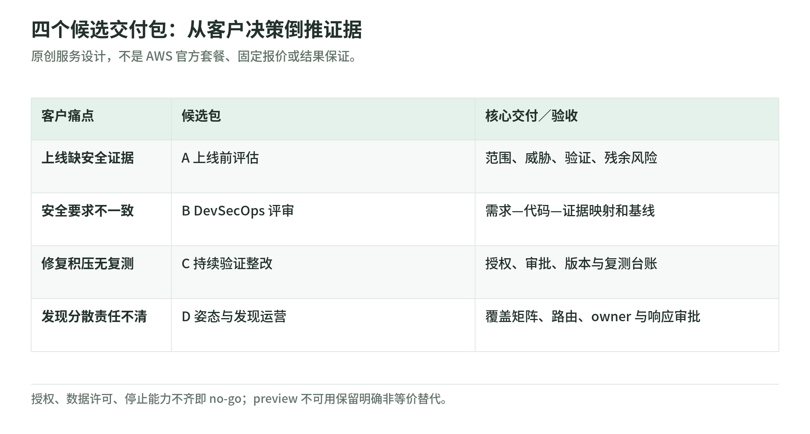
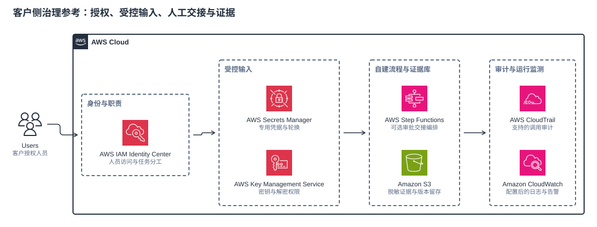

# 05 客户方案设计候选：把安全能力变成可验收交付

- 日期：2026-11-03
- 状态：公开资料研究／方案候选，尚未授权向客户推荐或发送
- 边界：只设计，不连接客户、不调用 AWS CLI／STS、不扫描、部署、申请资格、发送消息或付费；不提供攻击 payload。

## 1. 先分开价值、可用性与客户资格

**官方事实。** 2026-06-17 公告的组合是 code vulnerabilities **gated preview**、penetration testing、code scanning **preview**、threat modeling **preview**；原 AWS Security Agent 能力并入 Continuum，其文档仍称它为 frontier agent，而非与 Continuum 并列的另一平台。[发布公告][launch] [能力说明][capabilities]

**日期校正。** 2026-10-22 官方另行公告 code vulnerabilities **GA**，列出北弗吉尼亚、俄勒冈两个 Region，修复先由人审批；自主执行被表述为未来能力。[GA 公告][ga] 因此不能把六月的 gated preview 写成 2026-11-03 的最新状态，也不能把这一项 GA 外推到所有预览能力。六月的渐进自动化愿景不是可销售的成熟统一自动 SOC 承诺。

**交付建议。** 按能力逐项建立“公告状态—客户可用—获准使用”台账：客户所在地不等于服务 Region；核对商业区／中国区／GovCloud 分区、账号、接入资格、IAM／仓库权限、目标所有权及数据处理约束。Security Agent 文档说明跨 Region 推理不能退出，存储地域不等于全部处理地域；不得假设 SCP 就能阻止该处理，也不将此规则直接外推到另一项产品。[安全实践][best] code vulnerabilities 的 S3 来源另有同账号、同 Region 条件，云环境上下文 collector 也需要授权。[GA 接入前提][ga]

以下四包及验收指标均为**原创建议，不是 AWS 保证**。商机价值看减少人工分诊、上线返工或修复等待；有价值不意味着客户已具备资格。

## 2. 四类候选包

<!-- illustration: sec-customer-packages-d2fa5e0ead -->

*图：四个候选交付包：从客户决策倒推证据。原创服务设计，不是 AWS 官方套餐、固定报价或结果保证。*
<!-- /illustration: sec-customer-packages-d2fa5e0ead -->

共同合同：固定应用、版本、账号／Region、数据边界和证据访问人；单次授权不等于持续授权。客户批准 scope 与残余风险，交付方保存执行与中止记录。验收前签定样本、覆盖率、复核比例、误报分母及阈值；零发现不等于安全。渗透测试优先使用与生产相似、无真实客户数据且不持有生产凭证的隔离环境。[安全实践][best]

依赖白名单不是第三方攻击授权；凭证连通性测试不受 pentest 相同网络限制，可能把自定义 header 发往未列端点，因此也须单独批准和脱敏。[安全实践][best]

### A. 应用上线前安全评估

以威胁建模、设计／代码评审、授权 pentest 组成一次发布评估；STRIDE 是分析结构，不是审计证书。[能力说明][capabilities]

| 项目 | 候选合同 |
| --- | --- |
| 适配痛点 | 新应用缺上线安全证据，人工评审排队。 |
| 前置条件 | 冻结版本、架构与数据流、隔离目标；域名验证、测试账号和网络边界获批。 |
| 范围／排除 | 一应用关键路径；本方案排除第三方攻击、DoS、生产数据及合规认证；实际还须核对 [AWS 政策][policy]。 |
| 交付物 | 威胁清单、覆盖／未测项、风险证据、修复建议与残余风险签认。 |
| PoC 验收 | 约定路径逐项有结论；抽样人工核验证据；至少一项修复完成回归，或明确记录无法验证。 |
| stop／人审批 | 越界、性能恶化或敏感数据暴露即停；安全负责人批准重启，发布负责人批准上线。 |
| 双方责任 | 客户保环境、授权及发布决策；交付方控范围、验证发现并保密。 |
| 成本／替代 | pentest 累计 task-hours、环境、复测与专家工时；预览不可用改人工建模、既有扫描和授权评估。 |

### B. DevSecOps 需求驱动代码评审

把客户可检查的授权、日志、数据访问要求映射到代码评审；不是对所有开发语言或法规的完整覆盖承诺。[能力说明][capabilities]

| 项目 | 候选合同 |
| --- | --- |
| 适配痛点 | 多团队安全要求不一致，PR 评审反馈迟。 |
| 前置条件 | 需求有 owner 与正反例；私有仓库、集成权限、分支审批和预览资格核验。[安全实践][best] |
| 范围／排除 | 一仓库全量基线及选定变更；排除 runtime 检测、自动合并和无限历史治理。 |
| 交付物 | 需求—检查—证据映射、评论样例、误报台账、例外及门禁草案。 |
| PoC 验收 | 同一脱敏样本比较人工／工具结论；测评审时间、误报复核量与约定规则命中，不只数发现。 |
| stop／人审批 | 代码泄露、阻塞不可解释或误报超约定阈值即暂停门禁；开发 owner 审核修复。 |
| 双方责任 | 客户定义需求与例外；交付方校准规则和基线；客户维护分支保护并决定合并。 |
| 成本／替代 | 仓库／变更规模、频次、工具与人工复核；预览不可用用既有 SAST／SCA 和人工需求清单，不声称等价。 |

### C. 授权持续验证与修复

分清三条路线：code vulnerabilities 的计划扫描与候选修复；管理员启用后的计划 pentest；仍标为 public preview 的部署后 CI/CD pentest 门禁。后者不是合并前 PR 扫描。[GA 工作流][ga] [计划任务][schedule] [CI/CD][cicd]

| 项目 | 候选合同 |
| --- | --- |
| 适配痛点 | 发现积压、修复缺复测，发布后变更缺验证。 |
| 前置条件 | 持续授权有期限；目标、凭证、调度与停止责任明确；云上下文权限及资格可用。 |
| 范围／排除 | 一应用、限定频次／变更集；排除任意资产探索、自动生产处置和全天候 SOC。 |
| 交付物 | 分诊队列、证据等级、候选 PR、测试／复测记录、风险接受与撤销授权流程。 |
| PoC 验收 | 同版本记录发现→审批→修复→复测；PR 生成不算关闭；缺证据留待核验，不虚构复现。[GA 修复边界][ga] |
| stop／人审批 | 预算、范围或稳定性越线即停；取消流水线不等于服务端停止，删除调度不等于终止在跑任务。[CI/CD][cicd] [调度][schedule] |
| 双方责任 | 客户批准期限、修复合并及部署；交付方监控任务、验证停止、复核证据并追踪未关闭项。 |
| 成本／替代 | 保护代码行数／月、推理用量、task-hours、复测和环境；预览缺席改审批后手动复测、既有流水线工具。 |

建议先报告、再决定门禁；授权失败、未测范围及基础设施失败不能当成“安全通过”。不沿用未经验证的 fail-open 默认行为。[CI/CD 默认值][cicd]

### D. 安全姿态与发现处理集成

GuardDuty 检测受支持数据源中的威胁，Runtime Monitoring 有独立覆盖要求；Inspector 管理受支持工作负载的软件漏洞与非预期网络暴露；Security Hub CSPM 检查姿态，Security Hub 关联、优先级排序及响应工作流。[GuardDuty][guardduty] [Security Hub][hub] [Inspector][inspector] Continuum 的 SDLC 评估不替代 runtime 检测；“协同”也不证明任意发现都能原生导入并自动修复。

| 项目 | 候选合同 |
| --- | --- |
| 适配痛点 | 发现分散、重复派单，应用与云资源责任脱节。 |
| 前置条件 | 服务逐项可用；账号／Region、启用状态、覆盖资产、路由权限和工单 owner 清晰。 |
| 范围／排除 | 有文档支持的发现路由与人工关联；排除全网检测、未知连接器和无人审批生产隔离。 |
| 交付物 | 职责／覆盖矩阵、路由映射、分诊手册、响应审批与未覆盖清单。 |
| PoC 验收 | 经另行授权用官方样本或脱敏历史发现，验证归属、去重、派单及状态回写；不制造真实攻击。 |
| stop／人审批 | 错路由、权限扩大或数据跨界即停；生产响应由客户事件负责人批准。 |
| 双方责任 | 客户启用服务、接受数据处理并值守；交付方验证映射与交接，不承包未约定 SOC。 |
| 成本／替代 | 各服务覆盖／用量、日志、存储、工单与运维；预览缺席保留成熟服务及人工关联，不假装统一自治。 |

成本仅列维度：task-hours 是并行任务累计时长，不等于墙钟时长；资格和试用限制逐项核验，环境及其他服务另计，不宣称大范围免费。[计费口径][pricing]

### 客户侧治理示例：不画成产品内部部署

*图：原创逻辑参考，箭头是治理关系，不是服务运行调用序列；不是 Continuum 内部架构、原生连接器清单或已部署方案。*

这张图说明可另外设计的客户侧配套：身份管理明确人和职责，Secrets Manager／KMS 管理专用凭据与密钥，S3 留存受控证据；Step Functions 只表示**客户自建的可选流程编排**，不声称 Continuum 自带该审批集成。CloudTrail／CloudWatch 的审计、日志与指标也需核对服务支持和实际配置，不能默认每项结果已留存。[AWS 安全参考架构](https://docs.aws.amazon.com/prescriptive-guidance/latest/security-reference-architecture/application.html) [Step Functions 回调模式](https://docs.aws.amazon.com/step-functions/latest/dg/connect-to-resource.html)

图使用 [AWS 官方 Architecture Icons](https://aws.amazon.com/architecture/icons/)，提供 [SVG 原图](../images/sec-aws-governance.svg)；下载后可拖进 [diagrams.net](https://app.diagrams.net/) 编辑内嵌模型，不必从位图重画。图中没放 Continuum 服务图标，以免用旧图标或自造图标暗示一份未经核验的产品部署。

## 3. Discovery 与简单决策树

首次 discovery 要问：

1. 买方要缩短上线、评审、分诊还是修复时间？基线、目标、验收人与预算 owner 是谁？
2. 应用／版本／域名属于谁？有哪些第三方依赖、登录角色及不可测试动作？
3. 客户地域、AWS 分区／账号／Region、预览资格和 IAM／仓库权限能否书面确认？
4. 源码、提示、结果允许在哪里处理和保存？跨 Region 推理是否可接受？
5. 是否有隔离环境、合成数据、回滚及停止任务的责任人？
6. 发现谁接、补丁谁审、部署谁批？未修复如何接受风险？能否提供脱敏历史样本？

决策树（方案选择建议）：

- 无所有权授权、数据许可或停止能力 → **no-go**。
- 条件可满足但资格未核验 → 仅 discovery／替代设计，不承诺执行日期。
- 条件通过 → 上线证据选 A；需求一致性选 B；修复闭环选 C；发现运营选 D。
- 预览不可用 → 走对应替代；仍不能满足验收 → 不给执行型 PoC。

## 4. 2—4 周示例与商机资格

**原创假设，非 AWS 工期承诺，也非客户执行授权：**一个应用、一个仓库、隔离环境、客户有修复人员且资格已满足；只有客户另行批准后才可采用。

| 示例日期 | 计划与退出条件 |
| --- | --- |
| 2026-11-09—2026-11-13 | 定义问题、基线、范围与责任，审核资格／数据／停止条件；不通过则不执行。 |
| 2026-11-16—2026-11-20 | 限定评估和人工复核，提交覆盖与优先级；两周版到此只交基线，不冒称闭环。 |
| 2026-11-23—2026-11-27 | 客户审修复，隔离环境回归／复测；无修复窗口则缩范围或延期。 |
| 2026-11-30—2026-12-04 | 对照验收、签残余风险，交接并停止任务、撤销约定访问。 |

**值得给 PoC：**痛点可量化，有买方／应用／安全 owner、可控样本、修复窗口和续用意愿；PoC 能验证一个采购决策，而非仅展示发现数量。扩展前比较人工成本、证据质量、修复周期及持续运营负担。

**只做 discovery，不给执行 PoC：**只因工具新颖、没有基线或无人接修复。**No-go：**缺授权、仅愿测生产且无法隔离、跨区处理不被允许、依赖未经证实的资格／接口、要求保证合规或无人审批处置。未满足条件不以“先连上试试”绕过。

## 5. 固定官方主来源

以下为截至 2026-11-03 实读来源；官方能力描述与上述原创交付建议分开，未复跑任何演示。

1. [2026-06-17 Continuum 公告](https://aws.amazon.com/about-aws/whats-new/2026/06/aws-continuum/)：命名及 gated／preview 发布基线。
2. [2026-10-22 code vulnerabilities GA](https://aws.amazon.com/blogs/aws/aws-continuum-for-code-vulnerabilities-is-now-generally-available/)：地域、接入条件、证据与人工修复审批。
3. [Security Agent／Continuum 能力说明](https://docs.aws.amazon.com/securityagent/latest/userguide/what-is.html)：需求评审、威胁建模与 pentest。
4. [Security Agent 安全最佳实践](https://docs.aws.amazon.com/securityagent/latest/userguide/security-best-practices.html)：非生产、人工验证、仓库及跨区边界。
5. [AWS 渗透测试政策](https://aws.amazon.com/security/penetration-testing/)：允许范围、禁止活动及客户责任；允许服务不免除资产方授权。
6. [计划 pentest](https://docs.aws.amazon.com/securityagent/latest/userguide/schedule-penetration-test.html)／[CI/CD pentest](https://docs.aws.amazon.com/securityagent/latest/userguide/cicd-pentest.html)：调度前提、public preview、门禁失败及停止语义。
7. [Continuum 定价](https://aws.amazon.com/continuum/pricing/)：只采用计费维度，不复制价格／报价。
8. [GuardDuty 职责](https://docs.aws.amazon.com/guardduty/latest/ug/what-is-guardduty.html)：威胁检测与保护计划。
9. [Security Hub 与 CSPM 分工](https://docs.aws.amazon.com/securityhub/latest/userguide/)：姿态、关联与工作流。
10. [Inspector 职责](https://docs.aws.amazon.com/inspector/latest/user/what-is-inspector.html)：工作负载漏洞及网络暴露，不等于攻击检测。

[launch]: https://aws.amazon.com/about-aws/whats-new/2026/06/aws-continuum/
[ga]: https://aws.amazon.com/blogs/aws/aws-continuum-for-code-vulnerabilities-is-now-generally-available/
[capabilities]: https://docs.aws.amazon.com/securityagent/latest/userguide/what-is.html
[best]: https://docs.aws.amazon.com/securityagent/latest/userguide/security-best-practices.html
[policy]: https://aws.amazon.com/security/penetration-testing/
[schedule]: https://docs.aws.amazon.com/securityagent/latest/userguide/schedule-penetration-test.html
[cicd]: https://docs.aws.amazon.com/securityagent/latest/userguide/cicd-pentest.html
[pricing]: https://aws.amazon.com/continuum/pricing/
[guardduty]: https://docs.aws.amazon.com/guardduty/latest/ug/what-is-guardduty.html
[hub]: https://docs.aws.amazon.com/securityhub/latest/userguide/
[inspector]: https://docs.aws.amazon.com/inspector/latest/user/what-is-inspector.html
