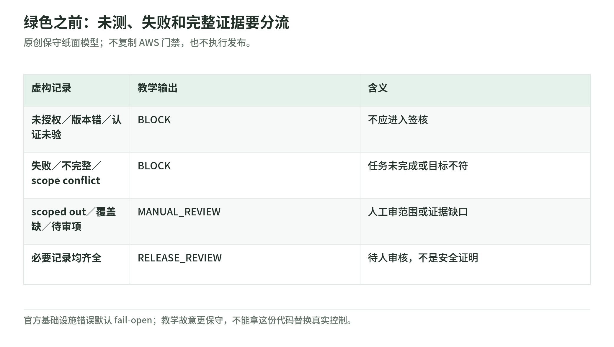

# 桌面实验：识别假绿色，验算任务费用

研究核验：2026-11-03。原创 Python 标准库教学；不发网络请求，不使用 AWS SDK 或凭据，不扫描目标，不执行攻击、IAM 策略、真实门禁或生产变更。它不能证明安全，也不能授予测试或发布权限。

## A. 一张绿色面板能说明什么

<!-- illustration: sec-tabletop-gate-951b0d5c13 -->


*图：绿色之前：未测、失败和完整证据要分流。原创保守纸面模型；不复制 AWS 门禁，也不执行发布。*
<!-- /illustration: sec-tabletop-gate-951b0d5c13 -->

官方 CI/CD pentest 文档区分 findings 阈值、scope conflict 和基础设施错误三类结果；基础设施错误默认 fail-open，scoped out 也可通过。因此流水线绿色并不必然表示一次有效攻击验证完成。[门禁语义][cicd]

本实验**不是复制 AWS 集成实现**。我们设计更保守的“纸面证据分流”：缺少授权、版本不符、未确认认证、运行不完整、scope conflict 或达到选定严重性阈值，都标为 `BLOCK`；scoped out、覆盖记录缺失或未验证 finding 待审，标为 `MANUAL_REVIEW`；证据完整则标为 `RELEASE_REVIEW`，含义只是“交给人审核”，不是“允许上线”。

这里 `coverage_recorded` 只说明覆盖记录存在，不宣称覆盖全部。`unverified_count` 指虚构记录里尚未人工判定的项，不推断产品 API 必然有这个字段。没有把 HTTP 响应、PR 状态、CVSS 或域名验证当成完整授权。

## B. 五条虚构记录，先猜再跑

| 情境 | 看似可以得出的结论 | 教学输出与原因 |
| --- | --- | --- |
| 授权、版本、认证、范围和结果记录齐全 | “可以正式发布” | `RELEASE_REVIEW`：仍等人工批准，不是安全证明 |
| 门禁绿色，但实际 run failed | “工具没有发现问题” | `BLOCK`：任务未完成 |
| scoped out | “该功能安全” | `MANUAL_REVIEW`：没有动态测试，应审查为何无需测试 |
| 原计划 demo-v2，实际部署 demo-v1 | “修复没被复现” | `BLOCK`：测错版本 |
| 可见结果为空，还有未验证项被隐藏 | “零漏洞” | `MANUAL_REVIEW`：仍有待审证据 |

这五条是假想账本，不是 AWS 输出样本。判断版控与认证只是案例的先决条件检查；不模拟真实应用行为或产品内部模型。

## C. 运行方式

代码：[security_tabletop_lab.py](https://github.com/IanLiYi1996/learning-wiki/blob/main/scripts/security_tabletop_lab.py)。测试：[test_security_tabletop_lab.py](https://github.com/IanLiYi1996/learning-wiki/blob/main/tests/test_security_tabletop_lab.py)。

在已下载的 learning-wiki 仓库根目录：

```bash
python -B scripts/security_tabletop_lab.py
python -B -m unittest discover -s tests -p 'test_security_tabletop_lab.py'
```

不需要云账号、GPU、pip 安装或服务准入。输出只有虚构记录、决策理由和两个金额；不读取真实日志，不写入评估结果，不自动创建任何资源。

建议修改的只有虚构值：例如把 run 改为 incomplete、版本改为 demo-v1、scope 改为 scope_conflict。未知状态、非法严重性、负数待审数量或用字符串冒充布尔值应直接报错，不能被静默当成绿色。

## D. 费用练习：累计主动工作，不是墙上时钟

普通 pentest 的服务计量是 task-hours，按秒累计各任务主动工作；读取时费率 50 USD/task-hour。本例排除试用、折扣、税和任何其他 AWS 费用。[定义与定价][billing] [费率][pricing]

虚构两个并发任务各 900 秒：

$$
T_{\rm task}=(900+900)/3600=0.5,\qquad C=0.5\times 50=25.
$$

即使假设墙上时钟仅过 900 秒，也不能拿 0.25 小时来计费。代码返回精确 Decimal `25.0`，不是实测账单，不逐 finding 猜费用。空任务数组算术返回零，也不代表服务或项目免费。

第二题：假设保护代码 150 万行、实际计量 18 CIU，均落在第一档，按读取时 200 美元/百万行/月与 10 美元/CIU：

$$
C_{\rm code}=1.5\times 200+18\times 10=480.
$$

实验只支持最多 1,000 万行的第一档，超过就报错，避免误用平价公式跨阶梯。18 CIU 是假设的使用量，不是 18 个漏洞；代码不根据 finding 数预测 CIU。[两项计费][pricing]

## E. 测试怎样防止误导

测试包含所有阻断条件、范围与待审项、边界严重性、非法枚举与类型，以及并发时间、零输入、非有限数字、负金额和 LOC 上限。还检查脚本只导入标准库、不引入网络或 SDK。这种静态检查是练习的约束，不是通用沙箱或安全扫描器。

题目延伸：若 `MEDIUM` finding 低于 `HIGH` 阈值，函数不会因为它单独阻断；但人工审核还需判断业务影响、组合风险和残余风险。数字阈值不是业务风险接受授权。[安全判断与覆盖限制][guidance]

## F. 为什么没有“真实 AWS 练习一键运行”

新 code vulnerabilities environment 即使选 Manual only，也会触发首次扫描；手动 scan 排队后不能取消。CI/CD 默认 dry-run 为 false 会启动真正工作；取消流水线也不可靠地取消所有提供商下的服务端任务。[扫描副作用][trigger] [CI/CD 默认与清理][cicd]

这正是桌面练习的价值：先把证据、权限、计量和失败边界讲清。真实 PoC 要重新确认准入、范围、第三方授权、网络、专用身份、数据处理、预算、停止、清理和负责人；它不在本实验授权范围内。

答案记忆法：**“没测”不等于“测过安全”，“修复建议”不等于“正确部署”，“记录齐全”不等于“风险消失”。** 完成实验后返回[学习路线](learning-roadmap.md)，再把这些边界写进[客户方案](customer-solutions.md)的验收条款。

[cicd]: https://docs.aws.amazon.com/securityagent/latest/userguide/cicd-pentest.html
[billing]: https://docs.aws.amazon.com/securityagent/latest/userguide/pricing.html
[pricing]: https://aws.amazon.com/continuum/pricing/
[guidance]: https://docs.aws.amazon.com/securityagent/latest/userguide/security-guidance.html
[trigger]: https://docs.aws.amazon.com/continuum/latest/userguide/cv-triggering-scan.html
