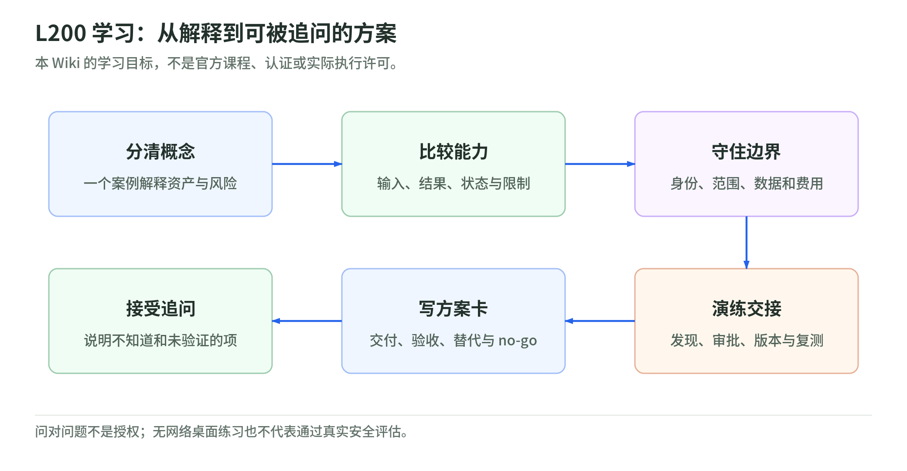

# 06 学习路线：怎样达到可讲解、可判断的 L200

研究核验：2026-11-03。本页是原创课程设计，不是 AWS 认证要求或官方培训时间。Workshop 只作为一种学习形式，不推断具体活动的日期、讲师、名额或准入。

## L200 的验收不是记住十个服务名

本 Wiki 定义的目标是：能在一个明确范围的案例中解释机制、比较选项、识别副作用、提出方案并说明证据缺口。产品知识依据[官方能力页][features]、[操作文档][guide]和[计费文档][billing]，学习产物与评分由本页自行设计。

| 能力 | 应交出的纸面证据 | 尚未达到的表现 |
| --- | --- | --- |
| 解释安全对象 | 用同一案例分开资产、暴露、威胁、漏洞、影响与控制 | 把 CVSS 当成业务风险排名 |
| 选择评估方法 | 比较 threat model、code review 和 pentest 的输入、输出及不足 | 认为一种检查替代所有安全工作 |
| 划定授权 | 区分账户权限、服务角色、目标身份、网络与法律授权 | DNS 验证后就认为可测第三方 |
| 解释数据路线 | 分开存储、推理、内容用途与密钥权限 | “选这个 Region，所以绝不出区” |
| 验收闭环 | 记录 finding、PR、部署版本、复测、回归与残余风险 | 自动 PR 或 Completed 就关闭问题 |
| 客户方案 | 给出适用客户、前提、交付、no-go、费用和退出方案 | 承诺全自动、零漏洞、自动合规 |

其中的数据边界须同时看[新 Continuum][data]和[frontier agent][agent-data]文档。它们适用范围不一样；能解释差异比背一张区域表更重要。

## 一条分四段的学习路线

<!-- illustration: sec-learning-evidence-79a14d7bf9 -->


*图：L200 学习：从解释到可被追问的方案。本 Wiki 的学习目标，不是官方课程、认证或实际执行许可。*
<!-- /illustration: sec-learning-evidence-79a14d7bf9 -->

时间为个人学习建议，可按熟悉程度调整；不是产品完成测试的耗时或 SLA。

**第一段：基础，约 60–90 分钟。** 读[01](security-foundations.md)，画一张自己的资产与信任边界图。挑一条订单 API，把公网可达、缺少归属检查、泄露损失分别归类。再说明 IAM、Config、Inspector、GuardDuty、Security Hub 和 Continuum 的职责区别。

**第二段：产品，约 60–90 分钟。** 读[02](continuum-l200.md)和[03](permissions-and-data.md)。写四项能力的当前状态，分清 environments 与 Agent Spaces；用自己的话解释 task-hours、CIU、预览费用和区域处理。列三种“看似只是配置，实际上会产生行动”的情况。[首次扫描][trigger] [CI/CD 真运行默认值][cicd]

**第三段：案例，约 90–120 分钟。** 读[04](validation-and-remediation.md)，用虚构订单服务整理整改台账。跑[桌面实验](lab.md)：为什么错误版本、基础设施失败、scope conflict、仅限单项复测会改变判断？这是无网络学习，不是云操作资格训练。

**第四段：客户对话，约 60–90 分钟。** 从[四种候选方案](customer-solutions.md)中挑一种，写一页方案卡。找人追问：“preview 拿不到怎么办？谁能停？谁批准变更？跨区处理能否接受？怎样证明价值？”无法回答的项保留为前提，不用营销措辞补齐。

## Workshop 前的问题卡

可先准备一份不含客户信息的虚构架构：用户、Web 入口、订单服务、存储、身份、仓库和 CI/CD。学习时只讨论脱敏结构，不把真实密钥、账号、生产 URL、订单或日志提交到演示环境。

建议问题：

1. 本次演示用哪一项能力？是 GA、preview 还是尚未获得相应接入资格？账户与 Region 有何前提？
2. 演示的 environment／Space 由谁控制，服务与测试身份各有什么权限？
3. 创建配置会不会触发首次扫描、周期任务或自动修复交付？
4. 目标的授权、域名验证、允许访问依赖、禁止动作和停止条件是什么？
5. 未登录、范围冲突、基础设施失败、task-hour 上限分别在报告里怎样体现？
6. 推理路由和数据用途适用哪套文档？涉及 code remediation 的例外吗？
7. 哪些 finding 做了真实验证，哪些仅模拟、未复现或未验证？默认过滤隐藏了什么？
8. PR 生成、合并、部署、单项复测和完整重测由谁负责？
9. CI/CD preview 与普通 pentest 怎样区分计费？取消流水线后任务会不会继续？
10. 哪些演示结果可泛化，哪些仅适用于这份代码、凭据、范围和版本？

这些问题依据[扫描行为][trigger]、[安全运行指导][guidance]、[代码结果][code-results]、[CI/CD][cicd]和[复测][revalidate]提出。问得到具体证据，才知道展示的是机制还是一个理想路径。

## 十道判断题

先回答，再对照下面的答案；每题需解释理由，不只选“对／错”。

1. SCP 允许，角色就获得该动作权限。
2. 同一账户两个 Space 就等于两个客户的完整隔离。
3. Code vulnerabilities 和 PR code review 采用相同费用单位。
4. Manual only 意味着新 environment 完全不会主动扫描。
5. 预览服务不收费意味着整个 PoC 免费。
6. DNS 验证通过等于对所有子域、身份提供商和依赖的测试授权。
7. CMK 和 Region 限制就能保证 agent 所有推理不出区。
8. 门禁绿色且无高严重性 finding 就说明实际测试成功。
9. 选定问题 revalidation 为 Resolved 就证明全应用安全。
10. 自动生成 PR 可以直接授权自动合并生产变更。

答案全为“不能这样推出”。对应理由：①权限上限不是授权；②应用组织边界不等于客户隔离；③context／CIU 与 preview review 不同；④仍触发第一次 scan；⑤还有资源与人工；⑥技术证明不代替许可；⑦存储、密钥和推理路线独立；⑧可能 fail-open、scoped out 或覆盖不足；⑨只验证选定问题；⑩生成与生产变更是不同权限。[SCP][scp] [层级][hierarchy] [定价][pricing] [数据][agent-data] [门禁][cicd] [复测][revalidate]

本页建议通过标准：十题至少八题能解释；涉及授权、跨区数据和未经测试放行的题必须答对；再完成一页案例卡。即使通过，仍不是对真实目标执行测试的授权。

## 一页复盘卡

```text
本次核验日期与官方来源：
目标业务、资产、身份、数据流：
所选能力／状态／账户与 Region 前提：
范围、授权、凭据、网络依赖与禁止动作：
数据处理路线、保留与传播边界：
结果证据、覆盖／过滤／失败与版本：
修复负责人、审批、部署、回滚、复测：
计费单位、预算、停止和退出条件：
客户价值、交付物、验收和未解决问题：
```

复盘时最值得记录的是“哪里不能下结论”。产品能力与客户责任在不断变化；保留读到的日期、差异和未覆盖项，胜过写一份永不更新的标准答案。

[features]: https://aws.amazon.com/continuum/features/
[guide]: https://docs.aws.amazon.com/continuum/latest/userguide/what-is-continuum.html
[billing]: https://docs.aws.amazon.com/securityagent/latest/userguide/pricing.html
[data]: https://docs.aws.amazon.com/continuum/latest/userguide/data-protection.html
[agent-data]: https://docs.aws.amazon.com/securityagent/latest/userguide/security-best-practices.html
[trigger]: https://docs.aws.amazon.com/continuum/latest/userguide/cv-triggering-scan.html
[cicd]: https://docs.aws.amazon.com/securityagent/latest/userguide/cicd-pentest.html
[guidance]: https://docs.aws.amazon.com/securityagent/latest/userguide/security-guidance.html
[code-results]: https://docs.aws.amazon.com/securityagent/latest/userguide/review-code-scan-findings.html
[revalidate]: https://docs.aws.amazon.com/securityagent/latest/userguide/revalidate-findings.html
[scp]: https://docs.aws.amazon.com/organizations/latest/userguide/orgs_manage_policies_scps.html
[hierarchy]: https://docs.aws.amazon.com/securityagent/latest/userguide/understand-lifecycle.html
[pricing]: https://aws.amazon.com/continuum/pricing/
