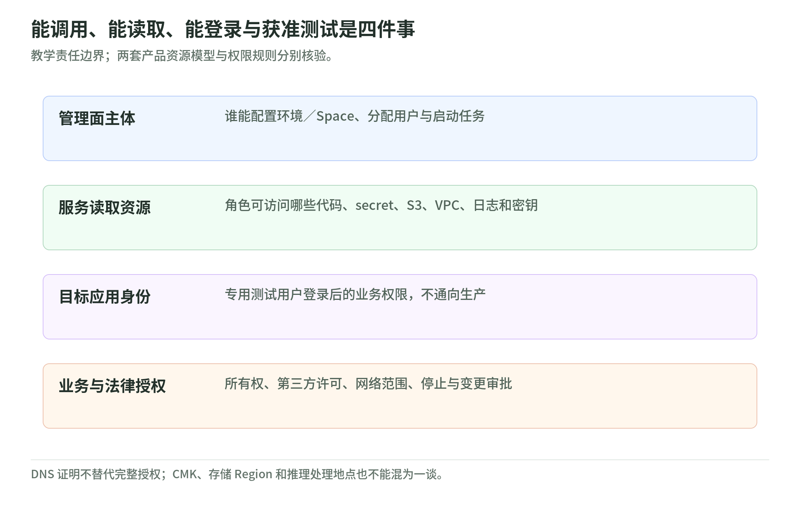

# 03 权限与数据：代理拿到的不是一把万能钥匙

读取日期：2026-11-03。只整理 AWS 官方公开资料，未访问账户或执行测试；不是法律建议。后续见[验证与修复闭环](validation-and-remediation.md)。

## 1. 先分产品，再分权限

<!-- illustration: sec-authority-boundaries-0444bd0825 -->

*图：能调用、能读取、能登录与获准测试是四件事。教学责任边界；两套产品资源模型与权限规则分别核验。*
<!-- /illustration: sec-authority-boundaries-0444bd0825 -->

产品概览仍将 code vulnerabilities 标为 gated preview，但有日期的 2026-10-22 公告已说明该项 GA；code scanning、threat modeling 仍标 preview。原 AWS Security Agent 已成为 Continuum 的 frontier agent，但其文档与服务标识仍保留旧命名空间。不能把某项能力的可用范围或默认值推广到全部产品。[概览旧标记][product] [GA 公告][ga]

权限直觉是三道门：谁能操作服务，服务能读取哪些资源，代理登录目标后能做什么。域名验证、IAM 授权、变更审批分别回答不同问题；“角色能调用”不代表“业务允许执行”。

## 2. Agent Space 是应用边界，不是独立客户账户

层级文档把安全要求、GitHub 注册和 Identity Center 配置放在 tenant 级共享层；测试配置、评估、用户分配及仓库用途放在 Agent Space 内。官方建议每个应用或项目一个 Space；同一仓库也能连接多个 Space。共享安全要求的修改影响未来评审，不追改已有评审。[资源层级][hierarchy]

基础设施文档另说明：服务为多租户，评审、finding 与客户数据隔离到各 AWS 账户。两种边界不能混为一谈：Space 组织应用权限，账户隔离区分服务客户；创建两个 Space 不等于自动获得两个客户的独立治理边界。[账户隔离][isolation]

### 角色核验表

| 身份／角色 | 实际用途 | 应核验什么 |
| --- | --- | --- |
| 管理面用户 | 配置资源及访问 | 谁可改配置、分配用户 |
| Application role | 代表 Web 应用用户调用服务 API | 不能误当目标登录身份 |
| Agent Space service role | 访问关联的 VPC、secret、S3、Lambda、日志 | 资源范围及各能力共享的权限 |
| Scheduler execution role | 仅启用调度时创建，由 EventBridge Scheduler 使用 | 调度权限及所属 Space |
| Actor／认证角色 | pentest 登录目标应用 | 与服务访问角色分别审计 |

Application、Space、Scheduler 三类服务角色由控制台按配置生成；actor 的用途另列。Application 与 Space 角色的信任策略使用 `aws:SourceAccount`、`aws:SourceArn`；Space service role 不使用 external ID。改动其权限会影响 Space 中多项能力，不能仅凭角色名称认定最小权限。[角色与信任策略][roles]

核验时把信任策略和权限策略并排看：前者决定谁能扮演角色，后者决定扮演后能做什么。Space 角色按关联资源追加 secret 读取、Lambda 调用、S3 读取等权限；未关联某类资源时，不为该类追加权限。控制台自动生成也不等于免审计。[生成策略范围][roles]

新 Continuum 文档另有 `AWSServiceRoleForContinuumCollector`，信任 `collector.continuum.amazonaws.com`。它不只是读取 finding：还可创建、启动及删除受标签、账户条件约束的 Network Insights 资源；服务关联角色权限不能随意编辑。它不是旧 Space service role 的新名字。[Collector 角色][collector]

## 3. 凭据和域名验证，各自只解决一部分问题

未提供凭据时只能测公开页面和 API。认证可采用直接输入、IAM role、Secrets Manager 或 Lambda；secret 和 Lambda 必须与 Security Agent 设置处于同一账户，文档目前不支持跨账户凭据。应使用有代表性权限的专用测试账户，不用个人、管理员或可访问生产的账户。[认证与限制][credentials]

教学建议：把登录说明和秘密分开管理；说明描述流程，secret 保存敏感值。按测试角色分别限权、轮换与撤销，并核对 secret 读取、Lambda 调用和密钥解密权限，不能因“已加密”忽略可访问它的身份。

Target domain 支持 DNS TXT、HTTP route、Private VPC 三种验证。前两种覆盖已验证域名的子域；Private VPC 要求目标的完整域名匹配。无法验证但有测试授权时，官方提供支持工单申请人工验证的途径。[域名验证][domain]

安全直觉：技术验证证明的是控制或满足服务验证条件，不是对所有相关系统的合法测试许可。第三方登录、共享服务与子域的测试授权应独立确认；更详细的运行边界见[下一章](validation-and-remediation.md)。

## 4. 加密、驻留、数据用途是三张不同的清单

旧命名空间的数据保护页说明默认使用 AWS 托管密钥进行静态加密，传输使用 TLS 1.2 或更高版本；客户管理 KMS key 是可选项。CMK 可覆盖 Agent Space／integration 及子资源，包括 finding、执行详情与截图。服务内数据加密和读取客户已加密资源需要分别配置权限；encryption context 可收窄密钥使用范围，但不是秘密容器。[默认加密][agent-data] [CMK 范围][kms]

加密也不等于私网连接：托管源码平台通常经公网通信，pentest 默认经公网访问应用，可选 VPC 连接。PrivateLink 接口端点保护的是服务 API 访问路径，不能代替目标应用的网络范围配置。[连接路径][agent-data] [接口端点][isolation]

“数据存储在请求来源 Region”不等于“所有推理在该 Region”。frontier agent 跨区推理始终启用，不能退出；最佳实践页还明确，客户限制内容 Region 的 SCP／Control Tower 策略不改变该推理路由。[跨区说明][agent-data] [逐功能路由][best]

下表仅摘录处理目的地，**不是服务可用 Region 清单**。应把能力准入、资源创建 Region、存储位置、推理目的地分别核验，不能据此推断四项能力同区可用。[逐功能路由][best]

| 请求来源 Region | 除 Code Remediation 外 | Code Remediation |
| --- | --- | --- |
| `us-east-1`、`us-east-2`、`us-west-2` | 美国 | 美国 |
| `ca-central-1` | 美国及加拿大中部 | 欧盟 |
| `eu-west-1`、`eu-central-1`、`eu-west-3`、`eu-north-1` | 欧盟 | 欧盟 |
| `eu-west-2` | 欧盟及伦敦 | 欧盟 |
| `ap-southeast-2`／`ap-northeast-1` | 分别澳大利亚／日本 | 欧盟 |
| `ap-northeast-2` | 任一商业 AWS Region | 欧盟 |
| `ap-south-1`、`ap-southeast-1`、`sa-east-1` | 任一商业 AWS Region | 任一商业 AWS Region |

数据用途也须分能力：产品 FAQ 说明 pentest 不用客户数据训练模型、不向第三方共享客户数据；这不是“测试网络不会接触第三方”的承诺，accessible URL 可能收到测试数据和凭据。[Pentest 数据用途][faq] [依赖端点风险][best]

新 Continuum 数据保护页明确不覆盖原 Security Agent pentest；其读取时状态为“不为服务改进收集或存储 Continuum Content”，同时允许未来变更，并提供 AWS Organizations opt-out。不能改写成整个产品永远不使用任何客户数据。[适用范围与 opt-out][continuum-data]

删除同样有边界：旧数据保护页写明，删除后服务不可再访问该数据，服务系统内删除在 30 天内完成；不要把它解释成客户账户日志或另存报告同时消失。教学建议为这些副本另定保存期、访问权限和脱敏流程，名称、标签及 URL 不携带秘密。[服务删除范围][agent-data]

## 5. 小案例：两个 Space，共用一个仓库

原创教学例：两个应用使用同一仓库，分别建 Space。配置检查不能止于“互相看不到报告”：还应检查仓库能力是否在两个 Space 都启用、共享要求改动影响哪些未来评审、各 Space 的 secret 是否仅供对应测试使用。这是依据资源层级提出的核验方法，不是新增内建隔离功能。[层级依据][hierarchy]

若从日本 Region 发起 code remediation，仅选日本存储和 CMK 仍不足以得出“内容不离开日本”；官方路由表写明该功能在欧盟处理。[路由依据][best]

## 6. 三题自测

1. 两个 Agent Space 是否等于两个独立客户账户？
2. DNS 验证通过，是否自动授权测试所有子域和第三方依赖？
3. CMK 加日本存储，是否保证 code remediation 只在日本推理？

答案：①不是，应用层级与账户隔离不同。②不是，技术验证与合法授权须分开。③不是，应独立核验跨区处理规则。

## 读取范围与文档边界

共引用 13 个实读官方源，含 GA 公告。产品页读取 Features、frontier agent、Stay in control；FAQ 读取 Security。其余通过公开 `.md` 读取资源层级、角色及策略、认证、账户隔离、域名验证、两套数据保护、最佳实践与 Collector 说明；CMK 聚焦默认加密、资源范围、encryption context、Required KMS permissions。

命名空间未统一不代表功能消失；新旧数据保护页有明确适用范围差异。跨区总述须与逐功能表一起读，尤其不能遗漏 Code Remediation 的例外。

[product]: https://aws.amazon.com/continuum/
[faq]: https://aws.amazon.com/continuum/faqs/
[hierarchy]: https://docs.aws.amazon.com/securityagent/latest/userguide/understand-lifecycle.md
[isolation]: https://docs.aws.amazon.com/securityagent/latest/userguide/infrastructure-security.md
[roles]: https://docs.aws.amazon.com/securityagent/latest/userguide/create-iam-role.md
[collector]: https://docs.aws.amazon.com/continuum/latest/userguide/using-service-linked-roles.md
[credentials]: https://docs.aws.amazon.com/securityagent/latest/userguide/provide-testing-credentials.md
[domain]: https://docs.aws.amazon.com/securityagent/latest/userguide/enable-test-domain.md
[agent-data]: https://docs.aws.amazon.com/securityagent/latest/userguide/data-protection.md
[kms]: https://docs.aws.amazon.com/securityagent/latest/userguide/customer-managed-keys.md
[best]: https://docs.aws.amazon.com/securityagent/latest/userguide/security-best-practices.md
[continuum-data]: https://docs.aws.amazon.com/continuum/latest/userguide/data-protection.md
[ga]: https://aws.amazon.com/blogs/aws/aws-continuum-for-code-vulnerabilities-is-now-generally-available/
