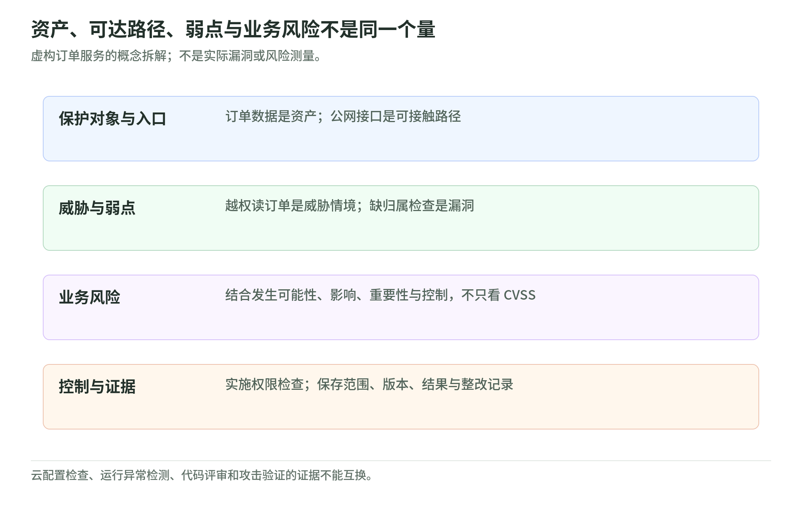

# 01 安全基础：以 Continuum 为入口，分清问题与责任

研究核验：2026-11-03。级别：云／应用安全 L200。

本页建立概念地图，不是产品功能全集。Continuum 只作学习入口：资料出现其名称，不足以证明某项能力稳定可用；具体产品状态、开放范围与限制由产品状态页另行核验。本页不承诺全自动安全运营中心（SOC）或自动合规。

## 七个词，不是一件事

<!-- illustration: sec-risk-layers-cdf88f3b7e -->

*图：资产、可达路径、弱点与业务风险不是同一个量。虚构订单服务的概念拆解；不是实际漏洞或风险测量。*
<!-- /illustration: sec-risk-layers-cdf88f3b7e -->

下面是白话教学拆解，不替代正式定义。NIST 将威胁、漏洞、发生可能性和影响分别纳入风险评估。[NIST 风险评估][n30]

设想一个虚构订单网站：

- 资产：值得保护的东西，包括订单数据、应用代码、云资源和身份；不仅是服务器。[NIST 资产管理][n61]
- 暴露：入口或访问路径让资产可被接触，例如公网订单接口；“能访问”不等于“有漏洞”。
- 威胁：可能造成损害的情形，例如有人试图越权读取订单；不是某个软件缺陷的名字。
- 漏洞：系统或控制中的弱点，例如接口没有检查订单归属；威胁可能利用它。
- 业务风险：结合发生可能性与损失，判断订单泄露、交易中断会有多严重；不是漏洞数量。

上述暴露路径是本页的教学用法；产品里的 exposure finding 可能还关联配置、漏洞和威胁信号，不能直接当同义词。[AWS Security Hub][a6]

控制是降低风险的措施，如权限检查、入口保护、备份；证据是支持判断的记录，如配置历史、审计事件、测试范围和结果。有控制名称不等于控制有效，有告警也不等于已经确认入侵；事件分析还须核实数据及其来源。[NIST 事件分析][n61]

## 共同责任与权限规则

事实：shared responsibility 区分云本身与云中使用的安全。AWS 保护底层基础设施；客户责任随所选服务变化。使用 EC2 时，客户负责来宾操作系统及其补丁、应用和相关配置；使用托管存储，也仍需负责数据、权限与适用的加密选择。[AWS 共同责任][a1]

AWS 建议：人员与工作负载优先采用角色和临时凭据，权限只覆盖任务需要的动作、资源及条件。角色不是“管理员”的同义词，最小权限也不是把所有人都变成只读。[IAM 最佳实践][a2]

规则：SCP 是组织层权限上限，不授予权限；成员账户里的角色仍需相应授权。“SCP 允许”不能读成“角色已经获权”。SCP 不约束管理账户中的主体，也不约束服务关联角色，不能把它理解成万能边界。[SCP][a3]

## 服务职责对照

这是核心分工，不是能力全集。每项覆盖范围仍取决于支持对象、区域、启用状态和配置。“学习边界”是基于职责的教学判断，不是 AWS 功能禁用清单。

| 服务 | 核心职责与来源 | 学习边界 |
| --- | --- | --- |
| IAM | 管理身份与权限，角色支持临时凭据。[AWS][a2] | 不审查订单归属等应用代码逻辑 |
| IAM Access Analyzer | 分析支持对象的外部、内部或未使用访问，并校验策略。[AWS][a4] | 权限分析不是攻击验证 |
| Config | 记录支持资源的配置与历史，按规则评估配置。[AWS][a5] | 规则符合不等于代码安全 |
| Security Hub | 关联、丰富安全信号，帮助风险排序。[AWS][a6] CSPM 承担标准／控制检查。[AWS CSPM][a7] | 检查结果不是合规证书 |
| GuardDuty | 分析日志与事件识别可疑活动；Runtime Monitoring 观察支持环境的操作系统级事件。[AWS][a8] | 不等于漏洞扫描或完整 IR |
| Inspector | 检查符合条件的工作负载的软件漏洞及意外网络暴露。[AWS][a9] | 不代表覆盖全部应用逻辑 |
| CloudTrail | 记录 AWS 活动，支持“谁在何时做了什么”的审计。[AWS 对照][a10] | 不能默认所有事件都已留存 |
| CloudWatch | 收集指标、日志并支持告警。[AWS 对照][a10] | 指标异常不自动证明攻击 |
| KMS | 管理加密密钥及其使用权限。[AWS SRA][a11] | 密钥管理不替代业务授权 |
| Secrets Manager | 管理凭据的存储、获取与轮换。[AWS SRA][a11] | 不意味着凭据永不泄露 |
| WAF | 用策略为受保护 Web 入口增加防护。[AWS SRA][a11] | 入口防护不替代代码修复 |
| Backup | 集中管理支持资源的备份与恢复活动。[AWS][a12] | 有备份不等于恢复已验证 |

## 五类工作，证据不能互换

云姿态看“资源配置与权限是否符合预期”，应用代码安全看“实现有没有弱点”，攻击验证看“弱点在约定环境中是否可被利用”。它们针对不同对象，不能用配置检查通过替代应用测试。[AWS Config][a5] [OWASP 测试][o1]

SAST 静态分析代码中的不安全模式；DAST 测试运行中的应用行为；SCA 检查第三方依赖中的已知漏洞。白话说，分别像查施工图、检查建成后的房子、核对采购零件，互不包办。[OWASP 测试][o1]

威胁建模从设计、数据流和信任边界问“哪里可能出事、怎样应对”。STRIDE 用冒充、篡改、抵赖、信息泄露、拒绝服务、权限提升六类提示寻找威胁；它是方法，不是 Compliance 证书，也不是已完成验证的证明。[OWASP 威胁建模][o2]

渗透测试则从攻击者视角检验可利用性，结论受对象、时间和范围限制。[OWASP WSTG][o3] 本页建议：任何实际验证都必须另行明确授权与范围；这里不提供攻击步骤。

runtime 威胁检测看系统运行时是否出现可疑行为，不是在重做设计评审。[AWS GuardDuty][a8] IR（事件响应）还包括确认事件、保存证据、遏制、根除、恢复和沟通。NIST 建议组织明确负责人、决策权限及第三方分工；不能把“启用了检测服务”当作责任转交。[NIST IR][n61]

## 风险排序：分数之外还要问什么

事实：CVSS Base 衡量漏洞严重性，不宜单独当业务风险；Threat、Environmental 指标可以补充威胁与环境因素。[FIRST][f1]

教学建议：再问资产是否关键、路径是否可达、有无实际利用迹象、控制是否有效、业务能否承受影响。虚构例子：公网订单接口的较低分越权问题，可能比隔离测试环境中的较高分缺陷更急；这是情境判断，不是固定排序公式。[OWASP 风险因素][o1]

无 finding 不等于无漏洞。工具与测试有覆盖限制；结果为空，只说明在该范围和条件下没有检出，不能证明系统绝对安全。[OWASP WSTG][o3] 建议把“检查了什么、没检查什么、何时检查、谁负责后续”与结果一起记录，而不是只展示绿色面板。

## 自测三题

1. 公网接口、缺少订单归属检查、订单泄露，分别属于哪一层？
2. SCP 允许某动作，是否意味着角色已获得权限？
3. Config 检查通过且 GuardDuty 无告警，是否足以证明无漏洞、无需 IR？

参考答案：① 暴露、漏洞、业务影响；还需可能性才能评估风险。② 否，权限上限不是授权。③ 否，检查对象与覆盖不同，事件响应责任仍需明确。

## 实际阅读的一手来源

以下 URL 于 2026-11-03 阅读；正文邻近引用用于逐项追溯，不代表客户环境已经核验。

- AWS：[共同责任][a1]、[IAM][a2]、[SCP][a3]、[Access Analyzer][a4]、[Config][a5]、[Security Hub][a6]、[CSPM][a7]、[GuardDuty][a8]、[Inspector][a9]、[CloudTrail／CloudWatch][a10]、[SRA 应用账户][a11]、[Backup][a12]。
- OWASP：[安全测试][o1]、[威胁建模][o2]、[WSTG 4.2 引言][o3]。
- NIST：[SP 800-30r1 风险定义][n30]、[SP 800-61r3 资产与事件响应][n61]；FIRST：[CVSS 4.0 用户指南][f1]。

[a1]: https://aws.amazon.com/compliance/shared-responsibility-model/
[a2]: https://docs.aws.amazon.com/IAM/latest/UserGuide/best-practices.html
[a3]: https://docs.aws.amazon.com/organizations/latest/userguide/orgs_manage_policies_scps.html
[a4]: https://docs.aws.amazon.com/IAM/latest/UserGuide/what-is-access-analyzer.html
[a5]: https://docs.aws.amazon.com/config/latest/developerguide/WhatIsConfig.html
[a6]: https://docs.aws.amazon.com/securityhub/latest/userguide/what-is-securityhub-v2.html
[a7]: https://docs.aws.amazon.com/securityhub/latest/userguide/what-is-securityhub.html
[a8]: https://docs.aws.amazon.com/guardduty/latest/ug/what-is-guardduty.html
[a9]: https://docs.aws.amazon.com/inspector/latest/user/what-is-inspector.html
[a10]: https://docs.aws.amazon.com/decision-guides/latest/decision-guides/cloudtrail-or-cloudwatch.html
[a11]: https://docs.aws.amazon.com/prescriptive-guidance/latest/security-reference-architecture/application.html
[a12]: https://docs.aws.amazon.com/aws-backup/latest/devguide/whatisbackup.html
[o1]: https://owasp.org/www-project-security-culture/v11/7-Security_Testing/
[o2]: https://cheatsheetseries.owasp.org/cheatsheets/Threat_Modeling_Cheat_Sheet.html
[o3]: https://owasp.org/www-project-web-security-testing-guide/v42/2-Introduction/
[n30]: https://nvlpubs.nist.gov/nistpubs/Legacy/SP/nistspecialpublication800-30r1.pdf
[n61]: https://nvlpubs.nist.gov/nistpubs/SpecialPublications/NIST.SP.800-61r3.pdf
[f1]: https://www.first.org/cvss/v4.0/user-guide
