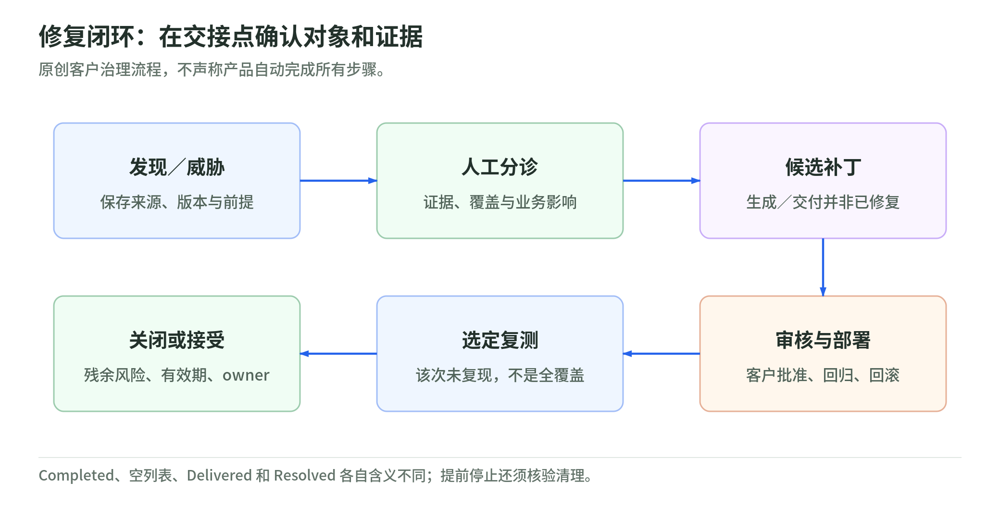

# 04 验证与修复：报告不是闭环，复测不是免检证明

读取日期：2026-11-03。只整理 AWS 官方公开资料，未运行扫描、攻击、部署或付费操作；不提供 exploit payload，不是法律建议。权限边界见[权限与数据](permissions-and-data.md)。

## 1. 三种输入，不是同一种证据

code vulnerabilities 已于 2026-10-22 GA，概览还保留 gated preview 旧标记；code scanning 和 threat modeling 仍标 preview。原 Security Agent 是 Continuum 的 frontier agent，操作文档仍使用旧命名空间。GA 公告明确代码漏洞修复需要人工批准，自主执行属于未来能力；不能推广成每一步 pentest 都有人工审批按钮。[概览与控制][product] [GA 与审批][ga]

| 评估 | finding／threat 的依据 | 不能直接推出什么 |
| --- | --- | --- |
| Pentest | 运行目标的请求、响应、验证动作及影响分析 | 未访问的功能安全 |
| Code scanning／review | 代码位置、证据、要求违反及修复建议；模拟验证可选 | 所有问题均在真实部署复现 |
| Threat modeling | 系统概览、信任边界、STRIDE、资产及成立前提 | 架构威胁已经被利用 |

上表分别依据三类结果专页；把它们映射到统一整改台账是教学流程，不是声称产品提供统一自动状态机。[Pentest 证据][pentest-findings] [Code 证据][code-findings] [Threat 证据][threats]

## 2. 开始前先守住目标、身份与动作

安全考虑页明确：客户负责取得所有可能受测试影响系统的适当授权；域名验证不能替代该责任。代理行动计划随探索动态变化，不能预先查看完整行动路线；可观察日志，发现不当轨迹时停止运行。[授权与运行监督][guidance]

护栏降低风险，不消除业务副作用：测试可能创建账户或记录，增加目标流量、触发告警，甚至出现未预料的业务交互。官方建议使用预生产环境；隔离与代表性要同时满足，不能拿连着生产权限的“测试环境”替代。[运行风险][guidance] [测试创建资源][pentest]

### 运行前核验表

| 边界 | 核验问题 |
| --- | --- |
| 环境 | 是否为隔离生产、无真实客户数据的代表性测试环境？ |
| 网络 | Target 可测；Accessible 仅可访问；Out of scope 不可访问，是否逐项确认？ |
| 身份 | 测试用户与认证角色是否仅有所需权限，不通向生产或共享管理面？ |
| 动作 | 破坏性及敏感管理路径是否排除，异常流量是否有人能停止？ |
| 输入 | 代码、网页、设计文档是否经过来源检查和脱敏？ |

网络分类是内建配置：正式 pentest 默认只有 target URL 可达，Out of scope 优先于 Accessible。**凭据预检是例外**：它不应用该网络范围，甚至可访问之后标为 Out of scope 的域；自定义 HTTP header 也随请求发送。跳过预检并自行分类是文档提供的选择，但需自行补齐依赖。[网络范围与凭据预检][pentest]

教学防线：把网页或文档中的内容当证据，不把其要求扩大权限、传送秘密或关闭控制的文字当授权。Gen AI 测试范围覆盖 prompt injection、excessive agency 等风险，不等于 AWS 保证评估代理不会受任何内容注入影响。[Gen AI 风险范围][guidance]

“sandbox”只是隔离执行环境的泛称，不保证与生产等价、扫描有效或覆盖完整。模拟验证是可选阶段，不应推断默认启用；`Not reproduced`、`Validation failed`、`Not validated` 分别是未复现、错误／超时导致不确定、未验证，均不能冒充已证安全。[模拟验证语义][code-findings]

## 3. Triage：先问证据，再看严重性

Pentest 和 code finding 专页都写默认仅显示 High confidence；可关闭 **Hiding unverified findings** 查看其他置信度及误报。严重性衡量影响，置信度衡量证据把握，两者不是一个分数。先核对已发现端点、登录结果、日志和部署版本，再判断暴露面与业务影响。[默认过滤与证据][pentest-findings] [Code 默认过滤][code-findings]

教学推论：漏报排查要同时看“是否进入功能、是否实际测试、是否被界面隐藏”。补充 API 文档、代表性角色及人工发现，可帮助核对覆盖缺口，但不产生覆盖保证；重跑结果变动也不自动证明前一次误报。[覆盖依据][guidance]

建议台账分别保存“待验证、已确认、误报、待修复、待复测、风险接受”及理由。误报要记录前提为何不成立；风险接受要记录影响、补偿控制、有效期和复查条件，不能把不修复改称误报。低严重性问题也可能组合成更高风险。[人工判断与风险记录依据][pentest-findings]

Threat 的系统概览若误解边界，应修正来源后重跑；可补充人工威胁。其内建状态为 Open（默认）、Resolved、Dismissed，不能把 Dismissed 自动解释成经批准的风险接受，更不能给每条 threat 假定一个 repair PR。[Threat 的人工复核][threats]

## 4. 修复 PR 是提案，不是部署许可

<!-- illustration: sec-remediation-evidence-6d31562df0 -->

*图：修复闭环：在交接点确认对象和证据。原创客户治理流程，不声称产品自动完成所有步骤。*
<!-- /illustration: sec-remediation-evidence-6d31562df0 -->

仓库修复许可按 Agent Space 内每个仓库启用，pentest 与 code review 共用这一仓库设置。测试／评审配置中的自动修复选项则决定何时尝试生成修复，两层授权不能混淆。[仓库许可][enable-remediation] [Pentest 自动与手动][pentest-repair] [Code 自动与手动][code-repair]

连接的私有仓库可获得 PR／MR；S3 来源提供可下载 diff。公开仓库交付受提供商限制，不能统称“都会开 PR”。PR 可被仓库所有有读取权限者看到，应保护敏感发现。[修复交付与可见性][code-repair]

code vulnerabilities 的另一条工作流，在选中自动交付时向 GitHub 创建 PR、向 S3 交付 patch；要分别核对生成和交付状态。交付成功不证明合并、部署或修复正确。[Continuum patches][patches]

教学审批链：审核差异及新增权限，测试业务行为与安全回归，批准合并和测试环境部署，保留回滚依据，再复测。授权代理提 PR 不等于授权它改生产 IAM、自动合并或部署；不要把这条参考流程写成内建审批功能或 SLA。

## 5. 复测、风险接受与证据保护

单项 revalidation 重跑选定 finding 的验证步骤，不发现新漏洞、不测试其他区域；补丁须先部署到原目标。它生成独立作业，不改原 finding：`Active` 表示复现，`Resolved` 表示该次未复现。大范围变更仍需完整 pentest；code 修复后重跑 code review，架构变化后重跑 threat model。[单项复测边界][revalidate] [Code 重跑][code-repair] [Threat 重跑][threats]

建议保留受控原始证据、脱敏摘要、运行标识、配置、代码版本和审批记录；限制请求、响应、截图与生成脚本的传播。官方要求先审查验证脚本，只在获授权目标执行；本章不执行。Finding 编辑后可查看 Original，不应因人工标记已解决而丢失原判断。[证据与脚本安全][pentest-findings]

官方说明探索具有随机性，不保证发现全部关键端点；无 finding 不等于无漏洞。甚至达到 task-hours 上限仍可能显示 Completed；默认启用的资源清理仅为 best effort，提前停止不会执行最终清理。完成状态既不是全覆盖，也不是目标恢复证明。[覆盖限制][guidance] [预算与清理][pentest]

## 6. 小案例：账面通过，实际上没测

原创教学例：测试环境补丁已合并，流水线显示通过。不能据此关闭 finding：CI/CD pentest 专页的默认基础设施错误处理为 fail-open，可能仅警告便通过；scope decision 也须检查。它是 public preview 的部署后门禁，不是 PR 静态检查。[CI/CD 默认值][cicd]

应核对作业实际完成、正确版本已部署、身份与范围有效，再关联单项复测及业务回归证据；无法处理的残余风险应明确接受和安排复查，而非宣称“零漏洞”。

## 7. 三题自测

1. `Resolved` 单项复测是否证明全应用没有漏洞？
2. Finding 列表为空、run 为 Completed，是否足以放行？
3. Agent 能提交 repair PR，是否也获准合并和改生产权限？

答案：①只说明这次选定验证未复现。②还须查过滤、覆盖、认证、预算与失败状态。③不是，修复生成和变更审批分开。

## 读取范围与官方不同步

共引用 13 个实读官方源，含 GA 公告。产品页读取 Features、frontier agent、Stay in control；文档使用公开 `.md`，覆盖三类结果、网络及运行选项、修复许可与交付、单项复测、patches；CI/CD 读取门禁定位、范围、OIDC 和默认值，安全考虑页读取授权、覆盖、验证与运行影响。

安全 FAQ 说报告 High／Medium confidence，finding 专页却写默认仅 High；以专页说明过滤。FAQ 还写无 CI/CD、无公开 API／调度，但 CI/CD 专页已提供 preview 集成，配置与角色文档已描述调度；不能沿用其旧结论。FAQ 的护栏描述不是无生产风险承诺，本文也不把耗时描述当 SLA。[FAQ][guidance] [CI/CD 专页][cicd] [调度角色说明](permissions-and-data.md)

[product]: https://aws.amazon.com/continuum/
[pentest-findings]: https://docs.aws.amazon.com/securityagent/latest/userguide/review-penetration-findings.md
[code-findings]: https://docs.aws.amazon.com/securityagent/latest/userguide/review-code-scan-findings.md
[threats]: https://docs.aws.amazon.com/securityagent/latest/userguide/review-threat-model-findings.md
[guidance]: https://docs.aws.amazon.com/securityagent/latest/userguide/security-guidance.md
[pentest]: https://docs.aws.amazon.com/securityagent/latest/userguide/perform-penetration-test.md
[enable-remediation]: https://docs.aws.amazon.com/securityagent/latest/userguide/enable-remediate-findings.md
[pentest-repair]: https://docs.aws.amazon.com/securityagent/latest/userguide/remediate-finding.md
[code-repair]: https://docs.aws.amazon.com/securityagent/latest/userguide/remediate-code-scan-findings.md
[patches]: https://docs.aws.amazon.com/continuum/latest/userguide/cv-viewing-patches.md
[revalidate]: https://docs.aws.amazon.com/securityagent/latest/userguide/revalidate-findings.md
[cicd]: https://docs.aws.amazon.com/securityagent/latest/userguide/cicd-pentest.md
[ga]: https://aws.amazon.com/blogs/aws/aws-continuum-for-code-vulnerabilities-is-now-generally-available/
