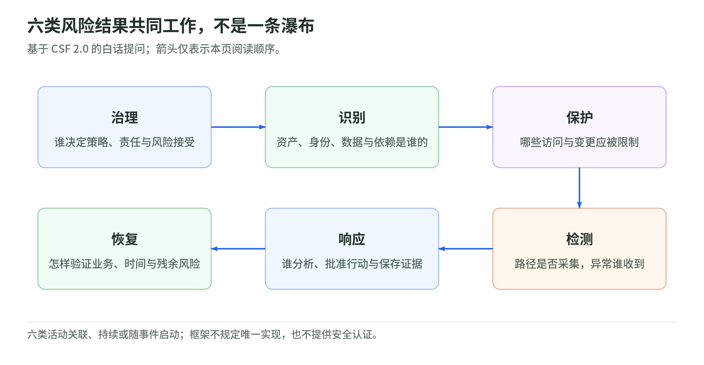

# 01 风险与治理：先决定保护什么，再决定买什么

研究核验：2026-11-03。安全体系 101 → L200。本章用公开框架组织问题，不做客户风险评级、法律解释或合规认证。

## 1. 先决定损失，再挑工具

虚构订单服务发生事故，可能泄露个人数据、让订单金额被篡改，或让客户无法下单。这分别关联保密性、完整性与可用性；安全不只等于“别被看见”。[NIST 安全目标][cia]

风险判断要把资产、威胁情境、弱点、发生可能性和损失连起来。一个孤立漏洞分数不包含全部业务背景；相同技术问题在测试站与关键交易系统里，优先级可能不同。[NIST 风险评估][risk] [CVSS 口径][cvss]

原创判断卡：**谁通过什么路径，利用什么前提，可能造成什么损失；现有控制和证据能否降低不确定性？** 不把它变成一个伪精确乘法公式，也不把“公网可达”直接称为已被攻破。

## 2. 六类工作，不是一条瀑布

<!-- illustration: safe-governance-functions-c17d1b884a -->

*图：六类风险结果共同工作，不是一条瀑布。基于 CSF 2.0 的白话提问；箭头仅表示本页阅读顺序。*
<!-- /illustration: safe-governance-functions-c17d1b884a -->

NIST CSF 2.0 的六个 Functions 是治理、识别、保护、检测、响应、恢复；它们共同描述风险管理结果，不规定唯一实现方式。Govern 将风险策略、职责、政策和监督放进组织决策，而不是仅在事故后找负责人。[CSF 正文][csf] [发布说明][release]

本页的白话对应是：

| 类别 | 订单服务要回答的问题 |
| --- | --- |
| 治理 | 谁批准上线、接受风险、购买服务、承担中断与沟通责任？ |
| 识别 | 有哪些身份、代码、数据、工作负载、第三方与关键依赖？ |
| 保护 | 怎样限权、分段、加密、审查变更，降低事故机会与影响？ |
| 检测 | 哪些路径有证据，什么异常会被发现，谁收到通知？ |
| 响应 | 谁分析、批准遏制、保全证据，并记录决策？ |
| 恢复 | 怎样回到可验证的业务状态，如何确认威胁没有回来？ |

这是原创案例拆解，不是复制官方控制清单。响应中的观察会反过来改变资产台账、策略和保护措施；图示阅读顺序不代表这些工作必须串行。

## 3. 资产清单要包括“能影响资产的人和链”

只列 EC2 数量，无法解释谁有权改订单。建议台账同时记录业务 owner、数据分类、身份与授权、代码及制品版本、网络依赖、关键第三方、日志和恢复依赖。这是按 CSF 的资产与依赖管理结果提出的实施建议。[CSF][csf]

再加两个维度：资产是否真实受控制覆盖，证据是否新鲜。已退役实例、忘记接入的账户、无人认领的仓库、只在生产有权限的服务账号，会使纸面清单与现实脱节。

AWS Security Reference Architecture 用不同账户与职责组织安全、日志和工作负载；这是可借鉴的设计模式，不是每个客户都必须照抄同一拓扑。[AWS SRA][sra] 共同责任随服务变化，托管控制面不代表客户的数据、应用与身份责任一起被外包。[共同责任][shared]

## 4. 控制需要证据，例外需要到期

控制可以防止某些行为、发现异常或支持恢复，但“功能已经开启”与“目标路径上控制有效”是两回事。AWS Well-Architected 用工作负载评估识别改进点，而不是提供零风险保证。[Security Pillar][pillar]

原创验收表：

| 控制建议 | 证据建议 | 常见失效 |
| --- | --- | --- |
| 关键访问采用受控身份 | 角色归属、访问复核、正反授权结果 | 权限长期无人认领 |
| 发布经过审查 | 仓库、制品、部署版本及审批链 | 审批对应的是旧制品 |
| 关键动作可追溯 | 日志来源、范围、时间与留存核验 | 只留管理事件，缺少业务路径 |
| 保留恢复能力 | 已验证恢复点、业务检查与实测时长 | 仅看到备份任务成功 |
| 风险例外有期限 | 原因、影响、补偿控制、批准者、复查日期 | 临时放行变成永久默认 |

工具未检出不是接受风险的签字。风险接受应由有相应业务权限的人作出，不能由发现问题的代理或一次低分评级替代；具体风险响应应结合组织策略。[NIST 风险管理框架][rmf]

## 5. 合规、成熟度与真实安全要分开

CSF Organizational Profile 用于表达当前与目标结果，帮助沟通差距；Tiers 描述风险治理与管理实践的严谨程度，不是对每个应用发证。框架映射、云服务取得认证、生成审计证据，也不等于客户整个系统完成合规或安全评估。[Profiles／Tiers][csf] [AWS 合规与责任][shared]

对于法规、合同与行业要求，要由负责的法务、隐私或合规人员确定适用范围；本读本不把某项技术控制写成自动满足全部要求。尤其不要把数据留存、不可变备份和删除义务凭直觉拼在一起。

客户价值也不只数 finding。可以在明确基线与范围后观察 owner 覆盖、授权复查时效、证据完整性、整改周期和恢复演练；这些是本 Wiki 的指标建议，不是官方采购评分或固定商业收益。

## 6. 小案例与三题自测

原创案例：隔离开发工具有高严重性弱点，公网订单 API 有较低技术分的跨租户读取问题。应核查可达性、权限、真实数据、利用证据和控制后再排序，不能机械按分数，也不能因为第二项低分就放过。

1. “启用了六种服务”能代替 CSF 六类结果吗？
2. “有备份成功日志”属于完整恢复证据吗？
3. 临时例外没有 owner 和到期，是否可以用“业务认可”概括？

参考答案：①不能，服务是手段，结果需要范围与证据。②不是，还要验证恢复点、业务状态和时间。③不能，应记录有权批准的人、理由、补偿控制和复查条件。

本章实读范围：CSF 2.0 概述、Core、Profiles/Tiers 与治理结果；SP 800-30r1 风险因素；FIPS 199 安全目标；RMF 概述；AWS 共同责任、Security Pillar 与 SRA；FIRST CVSS 用户指南。未执行真实评估。

[cia]: https://csrc.nist.gov/pubs/fips/199/final
[risk]: https://nvlpubs.nist.gov/nistpubs/Legacy/SP/nistspecialpublication800-30r1.pdf
[cvss]: https://www.first.org/cvss/v4.0/user-guide
[csf]: https://nvlpubs.nist.gov/nistpubs/CSWP/NIST.CSWP.29.pdf
[release]: https://www.nist.gov/news-events/news/2024/02/nist-releases-version-20-landmark-cybersecurity-framework
[sra]: https://docs.aws.amazon.com/prescriptive-guidance/latest/security-reference-architecture/introduction.html
[shared]: https://aws.amazon.com/compliance/shared-responsibility-model/
[pillar]: https://docs.aws.amazon.com/wellarchitected/latest/security-pillar/welcome.html
[rmf]: https://csrc.nist.gov/projects/risk-management/about-rmf
