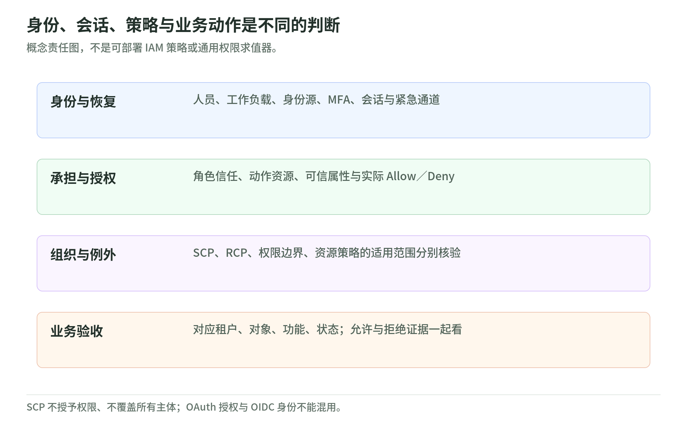

# 02 身份、权限与组织治理：谁能对什么做什么

阅读核验：2026-11-03。级别：101 → L200。

本章是公开资料的通用指南，不是对真实客户环境的安全断言；案例与控制表均为虚构设计，不含账户操作或实验步骤。

## 1. 身份链与授权链

<!-- illustration: safe-identity-permissions-440990f52b -->

*图：身份、会话、策略与业务动作是不同的判断。概念责任图，不是可部署 IAM 策略或通用权限求值器。*
<!-- /illustration: safe-identity-permissions-440990f52b -->

认证问“你是谁”，授权问“你能对哪个资源做什么、在什么条件下做”。登录成功不代表获得管理员权限；分析访问时，要同时看身份来源、会话和适用策略。[IAM 请求评估][iam-evaluation]

人员身份属于员工、管理员等自然人；工作负载身份属于应用、后台任务等。AWS 建议人员通过身份提供商联合登录，工作负载使用 IAM 角色，两者优先采用临时凭据。临时意味着有到期时间，不意味着权限小或不会泄露。[IAM 安全最佳实践][iam-best-practices]

IAM Identity Center 集中管理人员访问；权限集描述工作所需权限，并与用户／组、目标账户关联。角色不是某个员工，也不等于管理员：信任策略限定谁能承担角色，权限策略限定承担后能做什么。[登陆区身份治理][landing-auth] [IAM 请求评估][iam-evaluation]

OAuth 2.0 是授权框架，让应用取得有限的资源访问能力；流程可能包含认证，但不能仅凭“有访问令牌”认定完成了标准化用户登录。OIDC 在 OAuth 上增加身份层，通过 ID Token 传达认证信息。ID Token 与访问令牌用途不同，应用仍须核对签发者、受众、有效期等，不能把令牌存在当作授权结论。[RFC 6749 §1、§1.4][oauth-rfc] [OIDC Core §1、§2、§3.1.3.7][oidc-core]

## 2. 根用户：保护入口，也保护恢复链

根用户用于少数必须以根身份完成的任务，不宜承担日常运维。AWS 建议不创建根访问密钥，并保护密码、MFA 与恢复机制；邮箱和联系电话也是安全边界，不能把恢复全部寄托在单个员工身上。[根用户最佳实践][root-best-practices]

MFA 增加认证因素，但不同方式的抗钓鱼能力不同。AWS 推荐条件允许时采用基于 FIDO 的通行密钥或安全密钥；TOTP 验证码不等同于抗钓鱼认证。给根用户配置 MFA，也不会自动覆盖其他身份。[IAM MFA][iam-mfa]

恢复设计应保留备用 MFA，明确邮箱、电话的保管责任与交接，采用多人审批，并记录根身份使用。备用材料不能只放在“必须登录该账户才能打开”的保险箱里。对于采用集中根访问并移除根凭据的 Organizations 成员账户，成员不能自行根登录或密码恢复；不要照搬仍保留根凭据的账户清单。[根用户最佳实践][root-best-practices]

## 3. 最小权限：岗位与属性都要有边界

最小权限不是“人人只读”，而是只授予完成任务所需的动作、资源和条件，并定期复核不用的权限。[IAM 安全最佳实践][iam-best-practices]

RBAC 按工作职能分配权限，如发布员、审计员；这里的“角色”是岗位概念，不必与 IAM 角色一一对应。ABAC 按属性作判断，例如主体与资源的项目标签一致才允许指定动作。两者可配合使用；标签不会自己产生权限，仍需策略且受服务支持范围限制。[IAM ABAC 与 RBAC][abac-guide]

教学建议：把属性来源及修改权纳入审批。若使用者能任意修改决定授权的项目标签，设计中的项目隔离就缺乏可靠基础；审阅权限时也要审阅“谁能改标签”。

## 4. L200：策略评估不是万能交集

先确认主体、动作、资源、条件及账户关系。普通 IAM 主体没有匹配的 Allow 是隐式拒绝；适用策略中匹配的 Deny 是显式拒绝，优先于 Allow。权限边界和 SCP 都不单独授予权限。[IAM 请求评估][iam-evaluation] [权限边界][permission-boundaries] [Organizations SCP][scp-guide]

身份策略授予的权限，会受适用权限边界、会话策略及组织上限收紧。但同账户资源策略可以成为另一条授权路径，不能把所有策略机械求交集：[权限边界：有效权限评估][permission-boundaries]

- 直接授予 IAM 用户 ARN 的权限，不受身份策略或权限边界中隐式拒绝的限制。
- 在 Principal 中直接授予角色 ARN 的权限，仍受权限边界及会话策略中的隐式拒绝限制。
- 直接授予角色会话 ARN 的权限，不受身份策略、权限边界、会话策略中隐式拒绝的限制。

这些例外不消除适用的显式 Deny，也不绕过适用组织上限；它们不是扩大授权的建议。Principal 为通配符、通过 aws:PrincipalArn 条件匹配角色等写法另有规则，不能只看到角色名就归类。跨账户请求另按跨账户逻辑评估；角色信任策略、KMS 密钥策略等还有特殊规则，不能套用普通资源策略口诀。[IAM 请求评估][iam-evaluation]

## 5. 组织护栏与紧急通道

Organizations 可按组织单元（OU）组织多个账户。SCP 限制成员账户主体的最大权限，包含成员根用户；管理账户主体和服务关联角色（service-linked role，非所有服务角色）不受 SCP 约束。委派管理员所在的成员账户仍受约束。SCP 也不会直接限制外部账户主体经资源策略取得的访问，因此它不是覆盖一切的防火墙。[Organizations SCP][scp-guide]

教学建议：生产、开发与治理职责分账户，管理账户保持精简并严控高权限访问；不能因“组织启用了 SCP”就认为管理账户已被同样保护。

RCP（Resource Control Policy）补充资源侧的组织权限上限：可约束外部身份对成员账户内**受支持资源**的访问；它同样不授予权限，也不覆盖管理账户资源、服务关联角色调用或 AWS managed KMS keys 等列明例外。需要启用 Organizations 全部功能并按支持服务核验，不能把 SCP 与 RCP 互相替代或直接套用全组织策略。本次没有启用或测试任何组织策略。[Organizations RCP 范围与例外][rcp-guide]

Control Tower 帮助组织实施持续护栏：预防性控制阻止动作，检测性控制识别配置问题，主动性控制在 CloudFormation 资源预置前检查。它们的范围不同，检测不等于阻止，启用控制不等于所有资源均已合规。[Control Tower 控制机制][control-behavior]

日志归档账户与审计职责应同业务写权限分离。文档中旧称 log archive／audit，在登陆区 4.0 起对应 CloudTrail administrator／Config aggregator；日志去向随版本和启用的集成变化，不能默认所有日志都进同一个桶。[Control Tower 服务集成账户][control-accounts]

break-glass 是经批准的紧急访问，不是共享管理员密码。它应针对身份平台故障等场景预先设计。教学建议：明确审批人、期限、告警、留痕与事后收回；若备用入口仍依赖已经故障的身份提供商，就没有覆盖该故障。[登陆区紧急访问设计][landing-auth]

## 6. 虚构案例：星桥书店的治理证据

星桥把开发、生产、日志治理分开。开发员只能发布本项目资源，订单后台只获得处理订单所需权限；值班员遇到登录平台故障时走批准的紧急通道。这是教学方案，不代表已经验证控制有效。

| 控制 | 应留下的证据 | 典型失败 |
| --- | --- | --- |
| 根入口与恢复分权 | 保管人、备用认证器、审批及使用记录 | 根 MFA 完整，恢复邮箱却由离职员工控制 |
| 人员／工作负载分离 | 用户组与账户授权、角色信任及权限清单 | 后台借用员工长期凭据 |
| RBAC／ABAC 最小权限 | 岗位授权、属性来源与变更记录 | 项目标签可随意修改 |
| 组织护栏与日志隔离 | OU／SCP 适用范围、控制状态及归档覆盖 | 将管理账户误算进 SCP 保护范围 |
| 紧急访问 | 批准、时限、使用记录与收回记录 | 备用入口依赖同一故障身份源 |

表中证据是审阅建议；策略边界和服务职责依据前文来源，清单本身不构成安全或合规证明。

## 自测三题

1. 有 OAuth 访问令牌是否证明用户已经正确登录？根 MFA 是否覆盖恢复邮箱？
   答：都不能。登录要按 OIDC 等适用协议验证认证信息；恢复邮箱需独立保护。
2. 同账户资源策略直接授权给角色会话，边界未写 Allow，是否必然拒绝？
   答：不必然。该路径不受边界隐式拒绝限制；适用的显式 Deny 和组织上限仍有效。
3. SCP 是否限制管理账户和服务关联角色？备用登录仍依赖故障身份源能否救急？
   答：前两者不受 SCP 约束；后一方案未覆盖该身份源故障。

## 实际阅读的一手来源

以下 13 项于 2026-11-03 实际阅读相关正文：AWS IAM 的身份、根恢复、MFA、属性授权与评估规则，Organizations 的 SCP／RCP 范围，Control Tower 的控制及账户分工，登陆区紧急访问指导；另读 RFC 6749 与 OIDC Core 上文指定章节。仅核对公开文档，未访问任何账户或客户数据。

[iam-evaluation]: https://docs.aws.amazon.com/IAM/latest/UserGuide/reference_policies_evaluation-logic_policy-eval-denyallow.html
[iam-best-practices]: https://docs.aws.amazon.com/IAM/latest/UserGuide/best-practices.html
[landing-auth]: https://docs.aws.amazon.com/prescriptive-guidance/latest/designing-control-tower-landing-zone/authentication.html
[oauth-rfc]: https://www.rfc-editor.org/rfc/rfc6749
[oidc-core]: https://openid.net/specs/openid-connect-core-1_0.html
[root-best-practices]: https://docs.aws.amazon.com/IAM/latest/UserGuide/root-user-best-practices.html
[iam-mfa]: https://docs.aws.amazon.com/IAM/latest/UserGuide/id_credentials_mfa.html
[abac-guide]: https://docs.aws.amazon.com/IAM/latest/UserGuide/introduction_attribute-based-access-control.html
[permission-boundaries]: https://docs.aws.amazon.com/IAM/latest/UserGuide/access_policies_boundaries.html
[scp-guide]: https://docs.aws.amazon.com/organizations/latest/userguide/orgs_manage_policies_scps.html
[control-behavior]: https://docs.aws.amazon.com/controltower/latest/userguide/how-controls-work.html
[control-accounts]: https://docs.aws.amazon.com/controltower/latest/userguide/special-accounts.html
[rcp-guide]: https://docs.aws.amazon.com/organizations/latest/userguide/orgs_manage_policies_rcps.html
