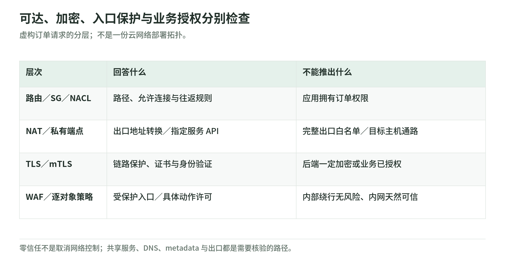

# 03 网络、边界与零信任：内网不是通行证

阅读日期：2026-11-03。仅依据公开一手资料作概念教学；订单服务、路径及证据均为虚构，不代表已执行环境验证。

## 1. 画路径，不只画边界

<!-- illustration: safe-network-controls-563ee08745 -->


*图：可达、加密、入口保护与业务授权分别检查。虚构订单请求的分层；不是一份云网络部署拓扑。*
<!-- /illustration: safe-network-controls-563ee08745 -->

设想订单服务部署在私有子网，入口经过负载均衡器。先画请求及依赖，再给每条箭头标明调用者、目的资源、协议、控制点与证据：

```text
用户 → 受 WAF 保护的 HTTPS 入口 → 订单服务 → 订单数据库
                                    ├→ 出口控制 → NAT → 外部物流接口
                                    ├→ 接口端点 → AWS 服务 API
                                    └→ 共享服务（DNS、日志、运维）
```

这是逻辑路径，不表示 WAF 是独立网关。还应追问返回流量怎么走、内部调用是否绕过入口、共享服务是否连通另一业务域。NIST 将资源与请求作为保护中心，而不是默认信任边界内的所有对象。[NIST 零信任基础 §2][zt]

## 2. 可达性、安全组与子网控制

安全组关联实例等资源，按来源、目的、协议和端口控制允许的流量；它有状态：获准连接的响应不必再由反向规则单独放行。NACL 关联子网，支持允许和拒绝，按规则编号从小到大匹配；它无状态，往返方向必须分别考虑，包括响应使用的临时端口。NACL 在进出子网时评估，不检查同子网内部流量。把两者理解为“相同规则复制两份”容易制造断路，也容易漏掉横向路径。[AWS 安全组][sg] [AWS NACL][nacl]

路由决定下一跳，不作业务授权。公有子网的含义是路由表有通往 Internet Gateway 的路由；以实例直接经该网关访问 IPv4 互联网为例，还需要公网 IPv4、网关连接及允许通信的网络规则。“放进公有子网”并不自动赋予公网可达性。[AWS Internet Gateway][igw]

公网 NAT 可让私有子网实例发起互联网连接，并不接受互联网未经请求的新入站连接；但地址转换不等于目的地白名单或内容检查。路线与 NAT 可以影响能否通信，却不能回答“这次物流调用是否应被允许”，不能把它们当作完整防火墙策略。[AWS NAT gateways][nat]

## 3. 私有端点不是到目标主机的隧道

PrivateLink 接口端点提供到指定服务的私有连接。具体到 EC2，端点连接的是 EC2 API，实例无需公网地址即可调用；据此不能推断已经打通目标实例的 SSH 或订单端口。API 授权与目标网络路径必须分开评估，端点策略也有自己的主体、动作和资源范围。[AWS EC2 接口端点][vpce]

虚构例子：订单服务经端点查询实例信息，获得 API 响应，不证明它能连接另一实例。反过来，网络连接成功也不证明拥有 AWS API 权限。证据应分别记录“服务 API 请求”和“目标连接路径”，不要用其中一项替另一项背书。[AWS EC2 接口端点][vpce]

## 4. DNS、TLS、入口防护与授权各管一层

DNS 解析回答地址问题，不是业务身份认证。TLS 保护通信并支持验证对端；服务端证书包含身份、有效期和公钥，证书域名须匹配客户端请求的主机名。解析成功不代表证书有效，握手成功也不代表可以读取任意订单。[NIST 网络要求 §3.4.1][zt] [AWS ALB 证书][cert]

ALB 的 HTTPS 监听器终止前端 TLS，所以浏览器到入口加密，不等于后端链路也已加密。mTLS 再增加客户端证书认证，但仍需应用把身份映射到允许的动作和订单归属。ALB 的 verify 模式验证客户端证书；passthrough 模式只把证书链传给目标，由目标验证，不能误读成已经验过。[AWS HTTPS 监听器][https] [AWS ALB mTLS][mtls]

WAF 对受保护资源收到的 HTTP/HTTPS 请求按条件允许、阻断、计数或挑战；Shield 的 DDoS 防护主要针对可用性风险。这些入口控制不替代业务授权：即使请求通过入口，订单服务仍应检查调用者能否访问这笔订单；内部绕行路径也需要控制。[AWS WAF／Shield 概览][edge] [NIST 逐资源授权 §2.1][zt]

## 5. 出口、元数据与共享服务

SSRF 是应用被诱导发出未经授权请求的问题：服务器能访问的内部资源，未必是外部调用者应能访问的资源。因此“服务在内网”不能作为安全结论。[AWS SSRF 纵深防御][ssrf]

本章的分层设计建议是：物流调用仅允许必要目的地和协议，对解析结果及重定向后的目标重新校验；网络出口控制与应用校验配合。元数据边界另行处理：不需要 IMDS 时考虑关闭，需要时要求 IMDSv2、限制不必要的本机访问并收窄实例角色权限。这些是防御推导，不是某个配置能够消除全部 SSRF 的承诺。[AWS SSRF 纵深防御][ssrf]

IMDSv2 要求会话令牌；响应 hop limit 约束令牌响应可经过的网络跳数，容器环境不能机械套用为 1。安全组和 NACL 均不能过滤 IMDS 流量，NACL 也不能阻断 Route 53 Resolver 的 DNS 请求；不要把“子网拒绝规则已存在”当作这些特殊路径已受控。[AWS IMDS 选项][imds] [AWS 安全组限制][sg] [AWS NACL 限制][nacl]

分段还要检查共享 DNS、日志、运维与代理的依赖。虚构订单域和库存域即使分在不同子网，共享运维服务若同时拥有广泛网络连接和凭据，仍可能形成横向访问路径。L3/L4 控制限制地址、协议与端口；L7 控制可处理请求语义和应用身份，但启用某种 L7 检查不自动产生订单归属授权。应把网络分段与逐资源授权结合，而不是只数子网数量。[AWS 安全组][sg] [NIST 微分段 §3.1.2][zt]

## 6. 从控制名称走向证据

以下是教学对照，不是本章已取得的检查结果：

| 控制 | 应寻找的证据 | 常见失效／不能证明 |
| --- | --- | --- |
| 安全组、NACL、路由 | 关联对象、双向规则、完整路径 | 只看入站；漏掉同子网路径。[安全组][sg] [NACL][nacl] [网关路由][igw] |
| TLS、mTLS | 证书、验证模式、身份映射 | TLS 成功被当作订单授权。[ALB mTLS][mtls] |
| WAF、应用授权 | 入口覆盖及规则动作、逐订单决策 | 计数不阻断；入口放行不等于授权。[WAF][edge] [逐资源授权][zt] |
| 出口、IMDS | 目的地策略、实例实际元数据选项 | NAT 被当白名单；默认值被当实例状态。[NAT][nat] [IMDS 选项][imds] |
| 零信任策略 | 身份、设备状态、资源动作、决策记录 | 只验登录；状态变化后仍沿用旧权限。[NIST 动态策略][zt] |

零信任不是一款产品，也不是取消网络控制。它不因内网位置或企业所有权而隐含信任，把身份、设备状态、资源敏感性和行为上下文纳入动态策略，并持续监测、按策略重新认证或撤销访问；“持续”不等于每个数据包都要求用户重新登录。[NIST 原则 §1、§2.1 与策略组件 §3][zt]

## 7. 自测三题

1. 私有子网经 NAT 能访问物流接口，是否证明出口已按业务白名单限制？
2. EC2 私有 API 调用成功且 mTLS 通过，是否能断定目标订单可读取？
3. 订单、库存已分段，但共用高权限运维服务，是否可以省略横向路径评审？

参考答案：① 否，NAT 负责转换，目的地及内容控制另行证明。[AWS NAT][nat] ② 否，API 路径、目标网络可达、证书身份、业务授权是不同判断。[AWS 端点][vpce] [AWS mTLS][mtls] ③ 否，共享依赖仍须逐资源评估，分段不授予授权。[NIST 微分段][zt]

## 实际阅读的一手来源与范围

以下 12 份均于 2026-11-03 阅读，按正文命名链接追溯：AWS 安全组的 basics／best practices；NACL 的 associations／rules／limitations；Internet Gateway 的 routing／IP addresses；NAT 的连接类型及 considerations；EC2 接口端点的 API 范围与端点策略；ALB HTTPS 的前端终止说明、证书的身份／域名／续期、mTLS 的两种验证模式；WAF／Shield 概览的请求控制与 DDoS 职责；IMDS 的配置项及优先级；2019 年 AWS 安全博客的 SSRF 与纵深防御机制（不沿用历史默认值）；NIST SP 800-207 的 §1 引言、§2 基础定义、§2.1 原则、§2.2 网络观、§3 策略组件片段、§3.1.2 微分段与 §3.4.1 网络要求片段。未核验账户、部署、日志或实际连通性。

[sg]: https://docs.aws.amazon.com/vpc/latest/userguide/vpc-security-groups.html
[nacl]: https://docs.aws.amazon.com/vpc/latest/userguide/vpc-network-acls.html
[igw]: https://docs.aws.amazon.com/vpc/latest/userguide/VPC_Internet_Gateway.html
[nat]: https://docs.aws.amazon.com/vpc/latest/userguide/vpc-nat-gateway.html
[vpce]: https://docs.aws.amazon.com/AWSEC2/latest/UserGuide/interface-vpc-endpoints.html
[https]: https://docs.aws.amazon.com/elasticloadbalancing/latest/application/create-https-listener.html
[cert]: https://docs.aws.amazon.com/elasticloadbalancing/latest/application/https-listener-certificates.html
[mtls]: https://docs.aws.amazon.com/elasticloadbalancing/latest/application/mutual-authentication.html
[edge]: https://docs.aws.amazon.com/waf/latest/developerguide/what-is-aws-waf.html
[imds]: https://docs.aws.amazon.com/AWSEC2/latest/UserGuide/configuring-instance-metadata-options.html
[ssrf]: https://aws.amazon.com/blogs/security/defense-in-depth-open-firewalls-reverse-proxies-ssrf-vulnerabilities-ec2-instance-metadata-service/
[zt]: https://nvlpubs.nist.gov/nistpubs/SpecialPublications/NIST.SP.800-207.pdf
