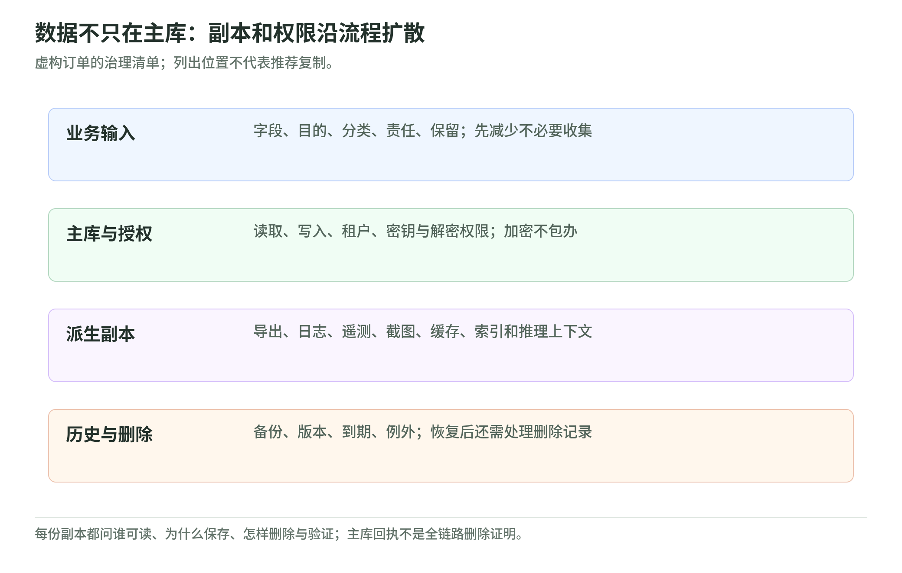

# 04 数据、密钥与隐私：加密之外还要管访问和流动

研究日期：2026-11-03。本文只讨论公开资料和虚构订单，不涉及真实账户、凭证或客户信息。

保密性回答“谁能看”，完整性回答“是否被不当修改或销毁”，可用性回答“需要时能否可靠使用”。订单地址泄露、金额被改、恢复失败是三种不同问题；加密不能包办全部。[NIST FIPS 199，§3][cia] 认证加密能检测密文篡改，却不能阻止已获写权限的应用提交错误订单。[OWASP 加密存储，Cipher Modes／Defense in Depth][crypto]

## 1. 沿着数据流找副本

<!-- illustration: safe-data-copies-efec52d9b9 -->

*图：数据不只在主库：副本和权限沿流程扩散。虚构订单的治理清单；列出位置不代表推荐复制。*
<!-- /illustration: safe-data-copies-efec52d9b9 -->

虚构商店“青禾”收集姓名、配送地址、订单号和金额，订单服务查询主库，客服查看导出报表，助手检索订单摘要。图中箭头代表需要审查的数据流，不代表推荐把所有数据复制过去。生命周期包括收集、存储、使用、共享、归档和删除；盘点须记录字段、目的、责任人、处理者、位置和去向。[NIST 隐私框架，§3.4／ID.IM-P][privacy]

每条支线都要能回答：谁读取、为何需要、保存多久、怎样删除、怎样证明。不能只画主库而忽略导出、备份和人工副本。

## 2. 先少收，再分类，最后验证删除

本例采用自定义分类：商品目录公开，订单状态内部使用，姓名地址敏感，服务凭证严格限制。分类同时评估泄露、错误修改和不可用的影响，不能只按“有没有个人信息”分级；这不是照搬联邦系统的分类义务。[NIST FIPS 199，§2–3][cia]

最小化应发生在收集和复制之前：配送需要地址，销售统计只需聚合金额，检索摘要不应默认包含姓名地址；不需要的敏感信息最好不存，而非先全量保存再加密。[OWASP 加密存储，Minimize the Storage][crypto]

本例给每类副本设用途、期限、到期动作和例外审批。删除任务要覆盖主库、导出、历史版本、索引和缓存；不能把主库删除回执当作全链路完成。无法立即逐条删除的备份，应限制访问、明确到期清理，并设计恢复后重放删除记录，避免旧数据复活；这些是本例控制设计，不是平台自动承诺。[NIST 隐私框架，CT.PO-P2／CT.DM-P4–5][privacy]

## 3. 密钥保护密文，授权决定谁能解密

信封加密用数据密钥加密订单，再用 KMS 密钥保护数据密钥；加密后的数据密钥可与密文一起保存。KMS 顶层密钥与应用使用的数据密钥不是同一个东西。[AWS KMS，Key hierarchy][keys] [OWASP 加密存储，Encrypting Stored Keys][crypto] 明文数据密钥只在必要时使用并尽快清除。[OWASP Secrets，§2.5][secrets]

KMS 授权须合看 key policy、IAM policy、grants 和其他适用策略。IAM 中写了 `kms:Decrypt`，不代表该密钥一定允许；密钥策略向账户开放 IAM 委派后，还需给调用身份相应权限。同账户直接密钥策略授权或适用 grant 是其他授权路径，不能概括成“一律双重 Allow”；跨账户经 key policy 委派的路径还需调用账户的 IAM 允许。grant 也应纳入授权及撤销审查，显式 Deny 不能靠 grant 绕过。[AWS KMS 权限求值，流程图／Examples 1–2][auth]

所以“拿到密文”不等于获准解密，“能解密”也不等于有权查看任意客户订单：应用仍须检查租户、订单归属和业务目的。密文格式不是访问控制。[OWASP 加密存储，Defense in Depth][crypto]

## 4. Secret 轮换必须协调消费者

Secrets Manager 管理服务密码等 secret，不等同于 KMS 加密密钥。使用 Lambda 的轮换流程依次创建待定版本、更新目标数据库或服务、测试新凭证、再切换 `AWSCURRENT`；仅修改保存的字符串不能完成目标服务轮换。[AWS Secrets Manager，Four steps][rotation]

本例还要求应用刷新凭证缓存、更新连接池、测试重连并准备失败恢复。旧版本标签不说明旧凭证已被目标服务撤销；应按方案验证新凭证可用、旧凭证何时失效及存量连接如何处理。泄露事件需要撤销，不应只等待定期轮换；删掉 secret 存储副本或重启消费者，都不能代替目标服务的失效处理。[OWASP Secrets，§2.4／2.7／9.2][secrets]

## 5. S3：私有桶也能经授权链接流出数据

本例订单导出应启用 Block Public Access 并审查访问策略。Object Ownership 的 `Bucket owner enforced` 禁用 ACL，让桶主拥有对象并以策略管理访问，但不自动授予或撤销所有策略权限。[AWS S3 安全最佳实践，Disable ACLs／Public access][s3] 这些控制不替代对合法授权及链接分享的审查。[AWS 预签名 URL][signed]

预签名 URL 是持有者凭证：可转交、在有效期内重复使用，不是一次性链接，也不验证收件人的订单归属。其能力受签发者权限限制，有效期还受底层凭证期限约束；可用签名年龄和网络条件进一步限制。请求开始时检查过期，已开始的下载可能继续；链接过期也不能收回已下载副本。[AWS S3 预签名 URL，Expiration／Limiting capabilities][signed]

Access Point 是附着于数据资源的命名入口，便于分开管理访问；跨账户入口仍须桶主授权。不能把“有专用入口”当成桶策略已经收紧的证据。[AWS S3 Access Point，Restrictions][points]

## 6. 证据、控制与失效要一起看

以下是虚构流程的验收设计，不表示已执行任何账户检查。

| 环节与证据 | 控制 | 常见失效 |
| --- | --- | --- |
| 字段清单、用途审批 | 按需收集与复制 | 调试时全量导出 |
| 授权清单、允许与拒绝样例 | 对象权限与用钥权限分审 | 把加密当租户隔离 |
| 轮换与重连记录 | 缓存刷新、目标服务撤销 | 新版本上线，旧凭证仍可用 |
| 删除回执、恢复演练记录 | 副本清理、恢复后重放删除 | 备份恢复让数据复活 |
| 检索与输出验收记录 | 身份过滤、最少上下文 | 跨客户摘要进入回答 |

日志、遥测、截图、备份和索引都是敏感表面。本例要求日志不记录密码、令牌或完整签名链接，截图先裁剪脱敏，遥测不默认收集请求正文；审计记录只保留必要元数据，并限定读者和保留期。[OWASP Logging，Data to exclude／Protection／Disposal][logs]

本例把 RAG 的片段、索引元数据、上下文和输出一起分类治理：检索时按身份限制来源，进入上下文前再最小化；不能只靠系统提示词要求模型保密。[OWASP LLM02:2025，Access Controls／Mitigation][llm]

存储本地性与推理上下文的处理位置是两条边界，应追踪实际流向，而非由桶位置推断；概念见 [AWS Continuum 权限与数据](../aws-continuum/permissions-and-data.md)，这里不重复地域表。[NIST 隐私框架，ID.IM-P7–8][privacy]

业务负责人确定目的与期限，工程和安全人员落实控制与证据，隐私／法务人员评估适用义务；控制者、处理者等法律角色须按实际关系认定，不能直接等同于 IAM role。服务认证、加密或采用框架都不是法律合规保证；合规与隐私风险也不等价。[NIST 隐私框架，§1.2.2／3.2／3.5][privacy]

## 7. 自测与答案

1. 桶私有且已加密，客服转发导出链接安全吗？答：仍可能泄露；预签名 URL 可转交复用，应限制权限和期限，另管下载副本。[AWS 预签名 URL][signed]
2. `AWSCURRENT` 已切换，旧密码必然失效吗？答：不能这样推断；检查目标服务撤销、缓存刷新和重连结果。[AWS 轮换][rotation] [OWASP Secrets][secrets]
3. 主库删除成功就算完成吗？答：还要核验导出、版本、备份、截图、索引和恢复流程；有例外须说明期限和责任人。[NIST 隐私框架，CT.DM-P][privacy]

## 一手来源与核读范围

以下 12 份资料均实际核读；引用范围列于正文，设计建议不冒充服务保证。Privacy Framework 1.0 是本文选定的历史概念基线，不宣称它是最新版本或当前完整义务清单。

- NIST：Privacy Framework 1.0 的生命周期、盘点、删除与角色；FIPS 199 §2–3 的适用范围与三个安全目标。
- AWS：KMS 密钥层级及权限求值；Secrets Manager 的 Lambda 四步轮换；S3 安全最佳实践、预签名 URL、Access Point 限制。
- OWASP：加密存储的最小化和纵深防御；Secrets 生命周期；日志排除与处置；LLM02:2025 的敏感信息披露与访问限制。

[privacy]: https://nvlpubs.nist.gov/nistpubs/CSWP/NIST.CSWP.01162020.pdf "NIST Privacy Framework 1.0"
[cia]: https://nvlpubs.nist.gov/nistpubs/FIPS/NIST.FIPS.199.pdf "NIST FIPS 199"
[crypto]: https://cheatsheetseries.owasp.org/cheatsheets/Cryptographic_Storage_Cheat_Sheet.html "OWASP Cryptographic Storage Cheat Sheet"
[keys]: https://docs.aws.amazon.com/kms/latest/developerguide/concepts.html "AWS KMS keys — Key hierarchy"
[auth]: https://docs.aws.amazon.com/kms/latest/developerguide/policy-evaluation.html "AWS KMS — Troubleshooting permissions"
[rotation]: https://docs.aws.amazon.com/secretsmanager/latest/userguide/rotate-secrets_lambda-functions.html "AWS Secrets Manager — Lambda rotation functions"
[secrets]: https://cheatsheetseries.owasp.org/cheatsheets/Secrets_Management_Cheat_Sheet.html "OWASP Secrets Management Cheat Sheet"
[s3]: https://docs.aws.amazon.com/AmazonS3/latest/userguide/security-best-practices.html "AWS S3 — Security best practices"
[signed]: https://docs.aws.amazon.com/AmazonS3/latest/userguide/using-presigned-url.html "AWS S3 — Presigned URLs"
[points]: https://docs.aws.amazon.com/AmazonS3/latest/userguide/access-points-restrictions-limitations.html "AWS S3 — Access point restrictions"
[logs]: https://cheatsheetseries.owasp.org/cheatsheets/Logging_Cheat_Sheet.html "OWASP Logging Cheat Sheet"
[llm]: https://genai.owasp.org/llmrisk/llm022025-sensitive-information-disclosure/ "OWASP LLM02:2025 Sensitive Information Disclosure"
