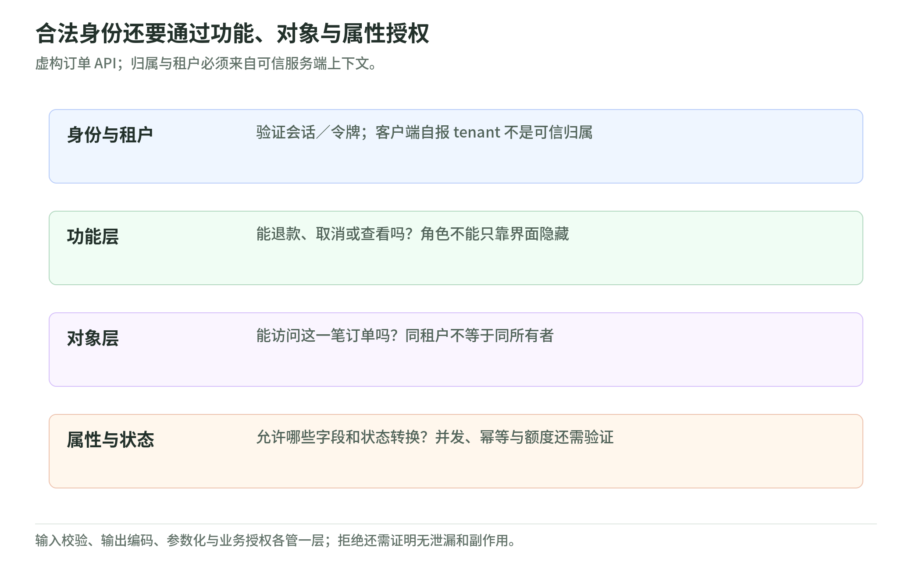

# 05 应用与 API 安全：合法登录不等于合法操作

阅读日期：2026-11-03。采用 OWASP API Security 2023 分类、NIST SP 800-63B-4（2025）；编号不是当年风险排名。持续维护资料按本次阅读内容引用。

## 1. 三层授权，不能只检查登录

<!-- illustration: safe-api-authority-a95212710a -->

*图：合法身份还要通过功能、对象与属性授权。虚构订单 API；归属与租户必须来自可信服务端上下文。*
<!-- /illustration: safe-api-authority-a95212710a -->

认证回答“谁”，授权回答“能对什么做什么”。认证成功证明调用者控制了关联认证器，不自动赋予订单操作权；会话把认证结果延续到后续请求。[认证与会话][1] [授权][3]

虚构订单 API 有甲、乙租户，订单记录租户、所有者和状态。买家只能查看自己的订单、取消未发货订单；审核员可在本租户执行授权退款。每次服务端请求检查三层：

- 功能层：允许使用退款功能吗？普通买家不能执行审核员功能；遗漏属于 BFLA（功能级授权缺陷）。
- 对象层：允许访问这一张订单吗？同租户也不等于同所有者；遗漏属于 BOLA（对象级授权缺陷）。
- 属性层：允许读写这些字段吗？返回值按权限筛选，输入只绑定许可字段；归属、金额、退款状态不能任由买家改写。遗漏属于 BOPLA（对象属性级授权缺陷）。[API 分类][2]

属性授权约束读和写，不能返回整条记录再靠界面隐藏。随机编号不能代替权限检查。规则默认拒绝，租户上下文缺失或策略失败也不放行。[API 分类][2] [授权][3]

本例租户身份来自已验证身份与服务端成员关系，客户端租户值仅是待核验选择。查单、列表、批量操作、附件和缓存均带租户范围；管理员也无默认跨租户权。所有者、角色和业务状态共同决定权限。[授权][3]

## 2. 校验、编码和参数化各守一条边界

输入校验判断数据是否符合约定：类型、长度、范围、必填项、未知字段及字段间关系都在服务端检查。格式合法的订单号仍可能指向无权访问的订单，校验不替代授权。[输入校验][4]

输出编码让文本在目标上下文中保持为数据：HTML 文本、属性、脚本等不能套用同一种转义。数据库参数化把查询结构与数据值分开，防止数据改变查询语义。“删除特殊字符”不能替代两者；三个控制分别验收。[输入校验][4]

订单备注可含正常标点，但要限长、按展示上下文编码、以绑定参数存储；读取前仍须检查归属。[授权][3] [输入校验][4]

## 3. 业务逻辑与资源成本也是安全需求

取消、发货、退款由服务端验证状态转换，不能依赖按钮顺序。本例退款累计额不超过实付额，并发请求不能因两次检查同时通过而超额退款；这是业务不变量，不是认证问题。[REST 安全][10]

幂等性使同一意图的重试不产生额外副作用。AWS 强调调用者提供请求标识、去重记录与业务写入保持原子性，同一标识但参数不同应拒绝。本例把幂等范围限定为租户、调用者、操作与请求标识，并约定保留期限；幂等键不是授权凭据。[幂等重试][5]

限流不能只数请求：批量请求可能占用大量计算。按调用者、租户、操作设置配额，限制并发、批量条数、分页、执行时间、上传与处理后大小；外部依赖还需成本上限或告警。阈值由业务预算决定，登录用户也可能耗尽资源。正常功能被过量自动使用，也属滥用需求。[API 分类][2] [资源限制][6]

## 4. 不可信地址与文件不能继承服务端信任

SSRF 是服务端受不可信输入影响，访问了不应访问的目的地。优先取消任意地址抓取，改为业务必需的目的地白名单；统一解析、核验解析后的连接地址，禁用不必要重定向，并以出站隔离补强。只判断地址“长得合法”不够，也不应让抓取组件携带不需要的凭据。[SSRF 防护][7]

上传涉及存储、解析和展示边界。扩展名和客户端声明类型不足以证明安全；需类型白名单、内容检查、大小与处理资源限制、服务端生成存储名、隔离处理和不可执行存储。上传、下载各自检查租户与对象权限，不能因通过上传检查就公开。[文件上传][8]

## 5. 浏览器隔离不是业务授权

会话要有服务端失效机制：登录或权限变化时更新标识，退出与超时后拒绝旧会话。Cookie 使用 Secure、HttpOnly，并按业务选择明确的 SameSite 策略；HttpOnly 限制脚本读取凭据，却不能阻止脚本借当前会话发起操作。[会话管理][9]

Cookie 自动附带时，改状态操作需框架提供的 CSRF 防护、服务端令牌验证及来源核验；SameSite 通常只是补强，而且同站不等于同源。CORS 决定浏览器脚本可否跨源读取响应，不授予用户订单权限，也不能单独防止所有跨站状态改变。来源白名单要精确，服务端授权仍必须独立执行。[REST 安全][10] [CSRF 防护][11]

JWT 解码不等于验证。使用维护中的标准库，以服务端允许的算法和可信密钥验签，再验证签发者、受众、到期时间及适用的生效时间；不能让令牌自己决定算法或信任关系，也不自行设计密码机制。验证通过后仍做三层授权，并设计撤销与退出语义。[会话管理][9] [REST 安全][10]

浏览器不是秘密保险箱：服务端密钥不进前端，令牌与会话标识不进 localStorage、sessionStorage。优先由后端持有服务凭据，浏览器用受保护会话；凭据不进地址、日志或缓存。同源按协议、主机、端口区分，同源恶意脚本仍能读取这些存储。[会话管理][9] [REST 安全][10]

## 6. 把威胁模型变成反例与证据

先列资产、数据流、信任边界和操作者，再问“哪里可能出错、如何缓解、怎样证明”。除正常路径外，把跨所有者、跨租户、越角色、字段越权、乱序、重复、并发和超额资源使用写成可验收的滥用需求。[授权][3] [威胁建模][12]

下表是待验证矩阵，不是已执行报告；仅用虚构数据与隔离替身，不连接真实系统。

| 条件与业务动作 | 预期 | 应保留的证据 |
| --- | --- | --- |
| 甲买家读自己的订单 | 允许，仅许可字段 | 响应字段集合 |
| 甲买家读同租户其他人的订单 | 拒绝 | 无订单内容，拒绝决策 |
| 甲买家读乙租户同编号订单 | 拒绝 | 查询租户范围，无数据泄露 |
| 甲买家取消自己未发货订单 | 允许一次转换 | 状态前后快照 |
| 甲买家取消自己已发货订单 | 拒绝 | 状态与副作用不变 |
| 买家退款；甲审核员退款乙订单 | 均拒绝 | 功能、租户决策分别命中 |
| 甲审核员在甲租户额度内退款 | 允许 | 状态、账目一致 |
| 买家写金额、归属或退款状态 | 拒绝 | 字段拒绝，记录不变 |
| 重试同意图；同键不同参数 | 前者无新增副作用，后者拒绝 | 幂等记录、业务计数 |
| 并发退款；超预算操作 | 不超额；超额拒绝 | 金额不变量、资源计数 |
| 旧会话；JWT 错签名、签发者、受众或过期；缺 CSRF 证明 | 分别拒绝 | 验证失败且无状态变化 |

拒绝用例不能只断言状态码，还要证明未泄露字段、未写入、未触发异步副作用。审计证据保留主体、租户、对象、动作、决策与关联标识，排除原始令牌和完整请求体；功能成功不等于安全要求通过。[授权][3] [输入校验][4] [会话管理][9]

## 7. 三道自测

1. 同租户买家能查看别人的订单吗？答案：本例不能；租户隔离之外还要验证所有者，这是对象授权。
2. 已有参数化数据库查询，还需输出编码吗？答案：需要；前者保护查询结构，后者保护展示上下文。
3. JWT 验签成功且 CORS 来源获准，能退款吗？答案：不能据此判断；还需功能、对象、属性权限及退款状态、额度检查。

## 实际阅读来源与范围

以下十二项均实际阅读，范围如下，不代表系统已验证安全。速查表与 AWS 文章无固定标准版本，阅读日期同上。

- [认证与会话][1]  NIST SP 800-63B-4：认证定义、§5 会话。
- [API 分类][2]  OWASP API Security 2023 总览：对象、功能、属性授权及业务流分类。
- [授权][3]  OWASP Authorization：默认拒绝、逐请求授权、属性关系模型与测试。
- [输入校验][4]  OWASP Input Validation：语法语义、编码和参数化的职责区分。
- [幂等重试][5]  AWS Builders’ Library：重试副作用、请求标识、原子性、参数不匹配。
- [资源限制][6]  OWASP API4:2023：资源限制、限流与成本边界。
- [SSRF 防护][7]  OWASP SSRF Prevention：应用与网络层防御、解析与连接一致性。
- [文件上传][8]  OWASP File Upload：类型、存储、权限及处理资源限制。
- [会话管理][9]  OWASP Session Management：生命周期、Cookie、浏览器存储与日志。
- [REST 安全][10]  OWASP REST Security：JWT、流程状态、CORS 与凭据泄露。
- [CSRF 防护][11]  OWASP CSRF Prevention：框架防护、令牌、来源与 SameSite 限制。
- [威胁建模][12]  OWASP Threat Modeling：信任边界、滥用场景、需求与验证。

[1]: https://pages.nist.gov/800-63-4/sp800-63b.html
[2]: https://owasp.org/API-Security/editions/2023/en/0x11-t10/
[3]: https://cheatsheetseries.owasp.org/cheatsheets/Authorization_Cheat_Sheet.html
[4]: https://cheatsheetseries.owasp.org/cheatsheets/Input_Validation_Cheat_Sheet.html
[5]: https://aws.amazon.com/builders-library/making-retries-safe-with-idempotent-APIs/
[6]: https://owasp.org/API-Security/editions/2023/en/0xa4-unrestricted-resource-consumption/
[7]: https://cheatsheetseries.owasp.org/cheatsheets/Server_Side_Request_Forgery_Prevention_Cheat_Sheet.html
[8]: https://cheatsheetseries.owasp.org/cheatsheets/File_Upload_Cheat_Sheet.html
[9]: https://cheatsheetseries.owasp.org/cheatsheets/Session_Management_Cheat_Sheet.html
[10]: https://cheatsheetseries.owasp.org/cheatsheets/REST_Security_Cheat_Sheet.html
[11]: https://cheatsheetseries.owasp.org/cheatsheets/Cross-Site_Request_Forgery_Prevention_Cheat_Sheet.html
[12]: https://cheatsheetseries.owasp.org/cheatsheets/Threat_Modeling_Cheat_Sheet.html
