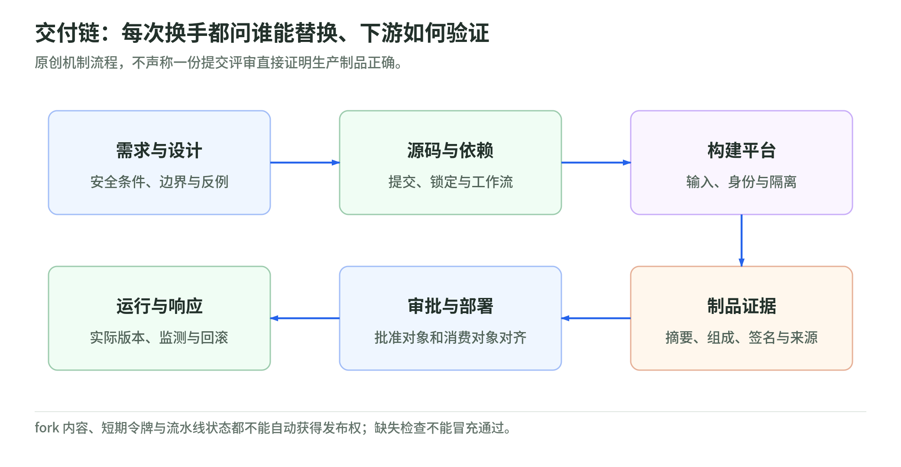
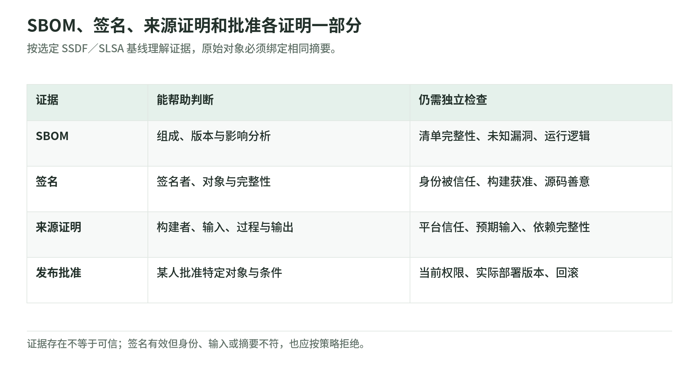

# 06 DevSecOps 与供应链：信任的不只是代码

研究日期：2026-11-03。版本基线固定为 [NIST SSDF 1.1（SP 800-218，2022）][nist] 与 [SLSA v1.2][slsa-overview]；构建来源证明采用其 [provenance/v1 格式][slsa-build]。这是本文选定的基线，不声称是最新版本，也不把草案或滚动产品文档当成标准更新。

DevSecOps 要把安全需求、检查证据和责任嵌入交付过程。代码之外，依赖、工作流、构建平台和制品仓库同样会影响最终运行的软件；其中一个环节失守，就可能沿供应链传递。[OWASP 供应链安全][owasp-supply]

## 1. 从源代码到部署，哪里换了一次手

<!-- illustration: safe-delivery-chain-e3a08bc937 -->


*图：交付链：每次换手都问谁能替换、下游如何验证。原创机制流程，不声称一份提交评审直接证明生产制品正确。*
<!-- /illustration: safe-delivery-chain-e3a08bc937 -->

```text
设计：安全需求、威胁模型、验收条件
  ↓ 交给开发与评审
源代码：提交、依赖锁定、工作流配置
  ↓ 交给受信构建平台
构建：确定输入、隔离执行、生成来源记录
  ↓ 交给制品仓库
制品：内容摘要、SBOM、签名、来源证明
  ↓ 交给验证策略与发布审批
部署：消费已批准的摘要，保留回滚与响应记录
```

这张图是教学归纳，不是标准规定的流水线。设计阶段先识别资产和信任边界；源代码阶段评审业务代码及发布配置；构建阶段控制工具、输入和执行环境；制品阶段保存完整性证据；部署阶段重新验证所消费的对象。SSDF 的 PW.1、PS.1、PO.5、PS.2/PS.3 分别提供这些实践依据。[NIST SSDF 1.1][nist]

每次交接都问：谁能替换输入？谁声明结果？下游如何独立验真？例如“评审过提交”与“部署了这个提交生成的制品”之间，还隔着构建者和仓库，不能直接画等号。

## 2. 扫描回答的是不同问题

OWASP 将静态、动态、组件及基础设施检查分开；下面进一步按证据对象归纳，并非某款工具的能力保证。[OWASP DevSecOps Guideline v0.2][owasp-pipeline] 静态代码分析和运行测试的区别也见 [NIST SSDF 1.1，PW.7/PW.8][nist]。

| 检查 | 输入与留下的证据 | 不能据此断言 |
|---|---|---|
| SAST 静态检查 | 源代码及规则；代码位置、可疑数据流 | 运行环境和所有业务权限正确 |
| DAST 动态检查 | 运行应用与测试请求；响应、复现条件 | 未访问路径没有漏洞 |
| SCA 组件分析 | 清单、锁文件或制品组成；版本与已知漏洞匹配 | 没有未知漏洞，或每项告警都可利用 |
| Secrets 检查 | 代码、历史、日志或制品；疑似凭据位置 | 没有漏检，或被发现凭据已失效 |
| IaC 配置检查 | 基础设施代码及策略；违规配置位置 | 实际环境没有漂移 |

因此，“通过”必须附带提交或摘要、范围、规则与漏洞库版本、时间以及跳过项；未运行不能算无问题。静态检查可能误报、漏报，自动化也不能替代人工判断。[OWASP 供应链安全][owasp-supply] 发现凭据后应按响应流程撤销或轮换，不能只删除代码；日志脱敏也不保证覆盖所有变形。[GitHub Secure use][gh-secure]

## 3. SBOM、签名与来源证明各证明什么

<!-- illustration: safe-artifact-evidence-c2b34d2ce8 -->


*图：SBOM、签名、来源证明和批准各证明一部分。按选定 SSDF／SLSA 基线理解证据，原始对象必须绑定相同摘要。*
<!-- /illustration: safe-artifact-evidence-c2b34d2ce8 -->

```text
SBOM     → 组成清单 ─────────┐
签名     → 内容完整性、签名身份 ├→ 对齐同一制品摘要 → 策略判断
来源证明 → 构建者、过程及输入 ─┘                 ↓
                                           人工发布决定
```

SBOM 是软件物料清单，帮助回答“有哪些组件和版本”，再结合漏洞情报分析影响。它不是 SLSA 构建来源证明，更不是“无漏洞证书”；清单本身也需要范围与完整性校验。[OWASP 供应链安全][owasp-supply]

签名经验证后，支持判断内容是否与签名对象一致、签名身份是否符合预期。它不证明源代码善意，也不证明构建任务获准发布；攻击者控制的任务同样可能产生有效签名。[Sigstore Verifying Signatures][sigstore]

来源证明把输出 `subject` 与构建定义、`builder.id`、外部参数及解析后的依赖关联起来。验证者要信任特定“签名者—构建者”组合，并核对输入、提交与输出摘要；真实性依赖构建平台及证明生成机制，不能只相信一份自述 JSON。`resolvedDependencies` 至 Build L3 仍是尽力收集，不代表所有依赖完整列出。[SLSA v1.2 Build provenance][slsa-build]

## 4. 验证身份，也验证授权

无密钥验签不能仅检查“有证书”：应限定信任根、OIDC 签发者与签名身份，确认摘要匹配。[Sigstore Verifying Signatures][sigstore] 再核对预期仓库、工作流、允许的 ref 及其实际提交；分支和标签名字不是不可变内容标识。[SLSA v1.2 Build provenance][slsa-build]

依赖锁文件应记录确定版本并在支持时校验内容哈希。[OWASP 供应链安全][owasp-supply] Actions 固定完整提交 SHA，核对来自预期仓库，可用工作流依赖锁文件覆盖传递引用，更新仍需评审。[GitHub Secure use][gh-secure] 本章发布策略要求镜像消费固定 digest，而非只用 tag。ECR 可限制标签覆盖，但需检查排除规则；该设置不代替摘要校验、验签或漏洞检查。[AWS ECR 标签不可变性][aws-ecr]

fork PR 的代码、标题及上传制品属于不可信输入，应与拥有发布权限的任务隔离；尤其不能在有特权的 `pull_request_target` 或 `workflow_run` 中执行未信任的 PR 内容。[GitHub Secure use][gh-secure]

OIDC 用短期令牌减少长期凭据，却不会让不可信任务自动获得授权。云端仍应校验签发者、受众和 subject，并按提供方支持的 claim 或 subject 模板约束仓库、工作流、ref／环境；任务只获取必要权限。不能把“来自 GitHub”当成整个授权条件。[GitHub OpenID Connect][gh-oidc]

## 5. 虚构发布：证据齐了，还要能拒绝

纸上案例：“纸舟”服务发布 R，C 是批准的提交，D 是候选制品摘要；均为虚构符号，不连接账户或运行工具。

| 发布证据矩阵 | 需要核对 | 拒绝条件 |
|---|---|---|
| 源码评审、扫描报告 | 对应 C，范围、结果与缺项明确 | 复用旧报告或关键检查缺失 |
| SBOM、签名、来源证明 | 绑定 D；身份、构建者、输入符合策略 | 文件齐全但身份或摘要不符 |
| 发布审批、消费记录 | 批准和部署对象都是 D | 审批后换制品或绕过审批 |

做三次负向检查：签名有效，但仓库或工作流不在允许范围，拒绝；标签从 D 指向另一摘要，拒绝消费新对象；fork 任务拿到了短期身份令牌，但不满足发布信任条件，拒绝授权。这些是案例策略推演，不是已执行测试。

合并前启用必要评审和状态检查，明确管理员绕过权限；GitHub 必需状态检查允许部分 skipped／neutral 结果，所以仍要核对检查是否真正覆盖目标。[GitHub Protected branches][gh-branches] 发布审批可配置禁止自批，也应明确其绕过规则。[GitHub Reviewing deployments][gh-deploy]

失败由负责人分诊；例外要记录理由、批准人、补偿措施和到期复查，不能让自动化自行接受风险。[NIST SSDF 1.1，PO.4/PW.1.2][nist] 漏洞先走私密报告或安全政策指定渠道，协调修复与披露；公开漏洞 PR 的补丁及讨论可能提前暴露细节，不应作为默认入口。[GitHub Private vulnerability reporting][gh-private]

## 6. 自测与答案

1. SBOM 没匹配到漏洞，可以发布吗？答：不足以决定；还需检查清单范围、情报时效、其他测试与发布证据。
2. 签名有效，来源证明存在，仍会被拒绝吗？答：会；身份、构建者、输入或摘要不符合策略都应拒绝。
3. OIDC 令牌很快过期，fork PR 就能发布吗？答：不能；寿命只限制暴露时间，授权仍取决于信任条件与审批。

## 已阅读的官方资料与范围

以下 12 项仅用于文献研究；产品文档按研究日读取，不宣称功能在所有套餐或提供方可用。

1. [NIST SSDF 1.1][nist]：安全需求、环境隔离、检查、完整性、例外与漏洞响应。
2. [SLSA v1.2 Provenance][slsa-overview]：来源证明概念及构建／源码证明区分。
3. [SLSA v1.2 Build provenance][slsa-build]：格式、输入、构建者信任与完整性边界。
4. [Sigstore Verifying Signatures][sigstore]：身份、签发者及摘要验证。
5. [GitHub Secure use][gh-secure]：不可信输入、凭据、Actions 固定与工作流隔离。
6. [GitHub OpenID Connect][gh-oidc]：短期身份、声明及云端信任条件。
7. [GitHub Protected branches][gh-branches]：评审、检查与绕过规则。
8. [GitHub Reviewing deployments][gh-deploy]：批准、拒绝、自批与绕过。
9. [GitHub Private vulnerability reporting][gh-private]：私密报告、安全政策与私密修复。
10. [AWS ECR 标签不可变性][aws-ecr]：覆盖限制及排除配置。
11. [OWASP DevSecOps Guideline v0.2][owasp-pipeline]：流水线概述与检查分类目录。
12. [OWASP 供应链安全][owasp-supply]：扫描局限、SBOM、依赖锁定、签名与来源。

[nist]: https://nvlpubs.nist.gov/nistpubs/SpecialPublications/NIST.SP.800-218.pdf
[slsa-overview]: https://slsa.dev/spec/v1.2/provenance
[slsa-build]: https://slsa.dev/spec/v1.2/build-provenance
[sigstore]: https://docs.sigstore.dev/cosign/verifying/verify/
[gh-secure]: https://docs.github.com/en/actions/reference/security/secure-use
[gh-oidc]: https://docs.github.com/en/actions/concepts/security/openid-connect
[gh-branches]: https://docs.github.com/en/repositories/configuring-branches-and-merges-in-your-repository/managing-protected-branches/about-protected-branches
[gh-deploy]: https://docs.github.com/en/actions/managing-workflow-runs-and-deployments/managing-deployments/reviewing-deployments
[gh-private]: https://docs.github.com/en/code-security/security-advisories/guidance-on-reporting-and-writing/privately-reporting-a-security-vulnerability
[aws-ecr]: https://docs.aws.amazon.com/AmazonECR/latest/userguide/image-tag-mutability.html
[owasp-pipeline]: https://owasp.org/www-project-devsecops-guideline/latest/
[owasp-supply]: https://cheatsheetseries.owasp.org/cheatsheets/Software_Supply_Chain_Security_Cheat_Sheet.html
