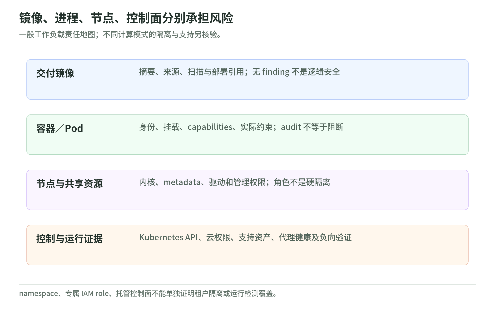

# 07 工作负载与容器：镜像、进程、节点与云角色分别检查

研究核验：2026-11-03。安全体系 101 → L200。本文是公开文档与原创检查思路，不安装工具、不修改集群、不运行容器或测试隔离逃逸。

## 1. 四层对象，不要只盯镜像

<!-- illustration: safe-workload-boundaries-6de8e74bd5 -->

*图：镜像、进程、节点、控制面分别承担风险。一般工作负载责任地图；不同计算模式的隔离与支持另核验。*
<!-- /illustration: safe-workload-boundaries-6de8e74bd5 -->

虚构订单应用的镜像没有已知漏洞，不代表它的进程、挂载卷、节点身份或数据库权限安全。至少分开：交付的镜像，实际运行的容器／Pod，共享的宿主节点，能够影响部署的控制面与身份。[EKS 共同责任][eks] [ECS 角色边界][ecs]

Linux 容器通过 namespaces、cgroups 等机制组织和限制进程，但常共享宿主内核。root、特权容器、host network／PID 或宿主目录挂载会削弱隔离。AWS 文档也明确：采用 task role 或 Pod Identity 不会把普通容器变成独立安全边界。[EKS][eks] [Pod Identity][podid]

“托管 EKS”不能一概等于“客户不管节点和应用”。要按实际计算模式分配责任，不把常规节点、Fargate 或其他托管模式的边界互相推广。客户仍需处理相应身份、数据、网络、容器配置和应用问题。

## 2. 云权限与 Kubernetes 权限不是同一张表

ECS **task role**供应用访问 AWS 服务；**task execution role**支持平台拉取镜像和其他启动工作。为了让应用读一个存储对象，不应把整台宿主节点或部署流水线的管理角色交给它。[task role][ecs] [execution role][execution]

EKS Pod Identity 将指定集群、namespace 的 service account 与 IAM role 关联，用于 AWS 服务访问；Kubernetes RBAC 则控制 Kubernetes API 行为。拥有其中一个，不会自动获得另一个。[Pod Identity][podid] [Kubernetes RBAC][rbac]

还要检查进程是否能接触节点的 metadata 凭据。Pod Identity 文档区分 IMDS 已限制与未限制，并说明 hostNetwork 的例外；“SDK 默认选了正确角色”不证明进程没有其他访问路径。[Pod Identity 例外][podid] EC2 user data 也不是存放密码或长期密钥的安全容器。[metadata][metadata]

## 3. 配置约束、隔离与应用授权三道不同的门

Pod Security Standards（PSS）描述 Privileged、Baseline、Restricted 三类策略；Pod Security Admission（PSA）可通过 enforce、audit、warn 等模式处理违反要求的 Pod。**audit／warn 不是阻断**，规范名字也不等于集群已经启用对应执行。[PSS][pss] [PSA][psa]

学习时可从非 root、减少 capabilities、限制宿主资源、合适 seccomp、只读文件系统和资源配额理解“少给进程能力”。真正实施要验证工作负载需要、平台支持和兼容性，不从本页复制一套 YAML 就认为安全。

namespace 是组织与逻辑隔离机制，不是对不互信租户的完整硬边界。RBAC、网络策略、配额、存储与 service account 配置要一起评估；较强隔离需求还要考虑节点、集群或账户的设计。独立集群也不自动解决共享凭据与应用跨租户授权。[EKS 租户隔离][tenant]

本页不提供“部署到同 namespace 就能访问”的测试命令；把租户业务授权留在服务端应用层，参见[05 API 安全](05-app-and-api-security.md)。

## 4. 镜像漏洞、配置与运行检测的覆盖不相同

Inspector 对符合条件的 EC2、ECR 镜像和 Lambda 进行漏洞管理；支持对象、扫描方式与覆盖状态仍需核验。镜像 finding 无法证明实际部署的 digest 与扫描对象一致，也不能替代应用逻辑测试。[Inspector][inspector]

GuardDuty Runtime Monitoring 分析受支持工作负载的操作系统、网络和文件事件。读取时支持对象包含 EKS、ECS on Fargate 和 EC2，但**不支持 EKS on Fargate**；安全代理是否安装、运行和健康是覆盖前提，不能从“组织已开启 GuardDuty”推断全部容器被监控。[Runtime Monitoring][runtime]

原创覆盖表：

| 对象 | 要保存的证据 | 不能替代的证据 |
| --- | --- | --- |
| 制品 | digest、来源、扫描对象、部署引用 | 当前进程行为与业务授权 |
| Pod／任务 | 实际配置、身份、挂载、约束执行结果 | 节点未被影响的证明 |
| 节点与平台 | 补丁、权限、metadata 与管理面配置 | 多租户应用数据隔离 |
| 运行检测 | eligible 清单、代理健康、日志链、演练结果 | 所有攻击都会检出的保证 |

## 5. 原创案例：扫描很绿，角色却太大

订单应用部署了正确镜像，镜像扫描没有高严重性问题；但应用拥有与本任务无关的存储读取权限，并能接触共享节点的 metadata。此时提高镜像扫描频率不能解决授权范围和共用节点路径，应分别限制角色、检查可达性与隔离，再进行授权验证。

再假设节点出现异常。未经批准立刻删除节点，可能既中断业务又丢失易失证据。需要事先定义隔离、证据采集、替换与恢复的权限和手册，而不是把容器重启当作事件根除；见[08 响应](08-detection-and-incident-response.md)。

## 6. 三题自测与来源范围

1. Pod 有专属 IAM role，是否意味着容器具备硬隔离？
2. PSA 的 audit 模式记录违反要求，是否已经禁止该 Pod？
3. EKS on Fargate 是否可以直接套用 ECS on Fargate 的 Runtime Monitoring 支持结论？

答案：①不是，身份与计算隔离不同。②不是，模式决定是否阻断。③不能，官方明确区分。

实读来源覆盖：EKS 安全责任、Pod Identity 凭据例外、ECS 两类角色、metadata、PSS／PSA／RBAC、租户隔离、Inspector 与 Runtime Monitoring。Kubernetes 链接是可更新文档，不声称某个客户集群符合最新版本；EKS Pod Security 页仍有 PSP 迁移时期措辞，应以当前 Kubernetes 正式资料核对，不沿用旧 PSP 配置。

[eks]: https://docs.aws.amazon.com/eks/latest/userguide/security.html
[ecs]: https://docs.aws.amazon.com/AmazonECS/latest/developerguide/task-iam-roles.html
[execution]: https://docs.aws.amazon.com/AmazonECS/latest/developerguide/task_execution_IAM_role.html
[podid]: https://docs.aws.amazon.com/eks/latest/userguide/pod-identities.html
[rbac]: https://kubernetes.io/docs/reference/access-authn-authz/rbac/
[metadata]: https://docs.aws.amazon.com/AWSEC2/latest/UserGuide/ec2-instance-metadata.html
[pss]: https://kubernetes.io/docs/concepts/security/pod-security-standards/
[psa]: https://kubernetes.io/docs/concepts/security/pod-security-admission/
[tenant]: https://docs.aws.amazon.com/eks/latest/best-practices/tenant-isolation.html
[inspector]: https://docs.aws.amazon.com/inspector/latest/user/what-is-inspector.html
[runtime]: https://docs.aws.amazon.com/guardduty/latest/ug/runtime-monitoring.html
