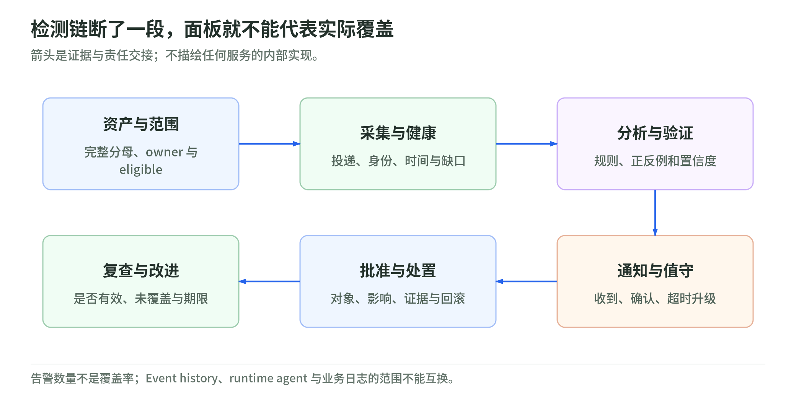
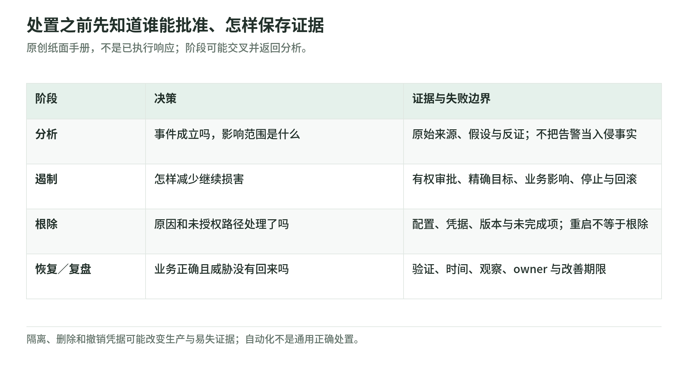

# 08 检测与事件响应：收到告警以后，谁判断、谁能动手

研究核验：2026-11-03。安全体系 101 → L200。本文不调查真实事件，不连接日志，不执行隔离、删除、凭据撤销或客户沟通。

## 1. 从信号到事件，不是从红灯到删机器

<!-- illustration: safe-detection-coverage-790f55bbd8 -->

*图：检测链断了一段，面板就不能代表实际覆盖。箭头是证据与责任交接；不描绘任何服务的内部实现。*
<!-- /illustration: safe-detection-coverage-790f55bbd8 -->

虚构订单服务出现短时间大量读取。它可能是业务批处理、错误重试，也可能是凭据被滥用。信号是可观察记录，finding 是检测器对记录的判断；事件是否成立以及影响多大，仍要结合上下文分析。[AWS 响应操作][operations]

检测的价值依赖一条完整链：数据源、收集、时间与身份关联、分析、通知、负责人的处置、后续验证。任何一段缺失，面板即使存在，也不证明关键路径会被及时发现。

NIST SP 800-61r3（2025 年正式版）把事件响应嵌入 CSF 2.0 的风险管理；不是把安全团队只安排在“最后处理故障”。AWS 的准备指导同样同时覆盖人、流程、技术：需要负责人、访问权限、日志、工具、手册和练习。[NIST 61r3][nist-ir] [AWS 准备][prepare]

## 2. 服务分工与“看得到什么”

| 能力 | 看什么 | 别误读成什么 |
| --- | --- | --- |
| CloudTrail | 受支持的 AWS 活动与身份、动作、资源 | 所有应用请求和数据访问均默认留存 |
| CloudWatch | 配置后的指标、日志、告警与可观测性 | 指标异常自动证明已经入侵 |
| GuardDuty | 支持数据源的可疑行为与威胁 | 全面漏洞扫描或所有运行环境都覆盖 |
| Security Hub／CSPM | 安全信号关联、排序及姿态控制检查 | 一项检查通过就完成合规认证 |
| SIEM／SOAR 类工作 | 关联分析／响应编排的能力类别 | 买到工具就等于有完整值守 SOC |

前三行依据 [CloudTrail][trail]、[CloudWatch][watch]和[GuardDuty][gd]；第四行见 [Security Hub][hub]与[CSPM][cspm]。最后一行是教学职责区分：事件准备必须有人、流程和技术配合，编排动作的执行与授权也需明确。[准备][prepare] [Security Tooling][tooling]

CloudTrail Event history 是按账户、Region 查看过去 90 天的管理事件，不显示 data、Insights 或 network activity events，也不提供组织级聚合。不能用它的默认存在证明 S3 对象读取、应用订单访问或长期审计已经覆盖。[Event history 限制][trail]

Security Hub 当前指南区分统一安全分析与 CSPM 姿态检查，也描述 OCSF finding；不要把旧接口格式和当前产品表述直接拼接。连接具体工单或下游分析平台时，核对功能、schema、账户、Region 与实际配置，不声称任意 finding 都可自动处理。[Security Hub][hub]

## 3. 分母比告警数量重要

“一天产生了很多告警”无法说明未接入账户、未安装代理或缺失业务日志有没有被覆盖。建议分别记录：资产是否 eligible、是否启用、采集是否健康、策略是否匹配，以及最近一次验证时间。

GuardDuty Runtime Monitoring 需要受支持资源和安全代理的实际覆盖；它与打开基本服务是两层条件，具体支持区别见[07 工作负载](07-workload-and-container-security.md)。[Runtime Monitoring][runtime]

原创证据清单：

- 资产清单及 owner：不能只统计监测系统里“恰好已接入”的对象。
- 数据来源与保留：时间同步、投递状态、访问权限、缺失区间和费用边界。
- 检测逻辑：预期正例与负例，什么情况下会误报或漏报。
- 通知与交接：谁在收到告警后确认，超时怎样升级，怎样跟踪到结束。
- 演练结论：是否检测、是否通知、是否有效处置，分别记录。

必要时将安全日志与工作负载权限分离，限制删改和读取；但证据也可能包含秘密、个人信息和敏感请求，不能因为是安全用途就无限收集或公开传播。[Log Archive 参考][archive]

## 4. 处置要有审批、证据与回滚

<!-- illustration: safe-incident-handoff-b839500753 -->

*图：处置之前先知道谁能批准、怎样保存证据。原创纸面手册，不是已执行响应；阶段可能交叉并返回分析。*
<!-- /illustration: safe-incident-handoff-b839500753 -->

AWS 描述的操作阶段包括检测、分析、遏制、根除、恢复，并明确这些阶段不一定严格顺序发生。比如遏制之后还可能返回分析，检查行动是否有效。[操作阶段][operations]

下表是原创纸面手册，不是本次已执行动作：

| 阶段 | 要作出的判断 | 交接证据 |
| --- | --- | --- |
| 检测／分析 | 事件是否成立？身份、资源和时间范围是什么？ | 来源、原始记录、假设与反证 |
| 遏制 | 怎样降低继续损害，并控制业务中断？ | 有权批准的人、对象、限制、停止与回滚条件 |
| 根除 | 问题原因、权限或持久化路径是否已处理？ | 修复版本、凭据与配置变化、未完成项 |
| 恢复 | 是否回到已验证的业务状态？ | 数据与应用检查、时间、持续观察 |
| 复盘 | 哪些控制或职责需要改变？ | 时间线、决策依据、改进 owner 与期限 |

凭据撤销、节点隔离、账号停用、删除恶意资源都可能影响生产并改变证据。计划中应提前分配权限，评估易失数据与业务影响，不把“一键清理”当成普遍正确手法。[预备取证与 playbook][prepare] [NIST 事件分析与恢复][nist-ir]

## 5. 管理报告与技术证据分开

面向业务的报告应说明已确认影响、尚未确认部分、当前控制、下一次更新和责任人；技术附件保留受控的时间线、版本、请求／响应和分析依据。没有证据时写“未知”，不要把工具推断变成对外确认事实。[NIST 61r3][nist-ir]

MTTD／MTTR 等平均指标须注明起止点和样本；发现变快、恢复变快不等于每类事件都更容易处理。也应关注演练失败、未覆盖路径和未完成整改，而不是为了面板好看提前关闭事件。

采用托管响应服务也需要核对合约、可访问的数据和客户授予的处置权限。本页的一般响应流程不意味着已经订阅 AWS Security Incident Response 产品或将责任完全转交给服务。

## 6. 三题自测与来源范围

1. CloudTrail Event history 能证明所有订单读取都已审计吗？
2. GuardDuty 无告警，能排除未覆盖资产上的威胁吗？
3. 自动隔离节点是否总比人工判断安全，也不会损坏证据？

答案：①不能，事件种类与应用日志覆盖不同。②不能，先看 eligible、采集与健康状态。③不能，授权、业务影响、证据与回滚需要预先设计。

实读范围：NIST 61r3 摘要及事件响应项目说明；AWS Well-Architected 准备／操作；CloudTrail Event history 限制、CloudWatch 概览、GuardDuty／Runtime Monitoring、Security Hub／CSPM、SRA 安全工具与日志账户。没有核验任何真实日志、值守或告警。

[operations]: https://docs.aws.amazon.com/wellarchitected/latest/security-pillar/operations.html
[nist-ir]: https://csrc.nist.gov/pubs/sp/800/61/r3/final
[prepare]: https://docs.aws.amazon.com/wellarchitected/latest/security-pillar/preparation.html
[trail]: https://docs.aws.amazon.com/awscloudtrail/latest/userguide/view-cloudtrail-events.html
[watch]: https://docs.aws.amazon.com/AmazonCloudWatch/latest/monitoring/WhatIsCloudWatch.html
[gd]: https://docs.aws.amazon.com/guardduty/latest/ug/what-is-guardduty.html
[hub]: https://docs.aws.amazon.com/securityhub/latest/userguide/what-is-securityhub-v2.html
[cspm]: https://docs.aws.amazon.com/securityhub/latest/userguide/what-is-securityhub.html
[tooling]: https://docs.aws.amazon.com/prescriptive-guidance/latest/security-reference-architecture/security-tooling.html
[runtime]: https://docs.aws.amazon.com/guardduty/latest/ug/runtime-monitoring.html
[archive]: https://docs.aws.amazon.com/prescriptive-guidance/latest/security-reference-architecture/log-archive.html
