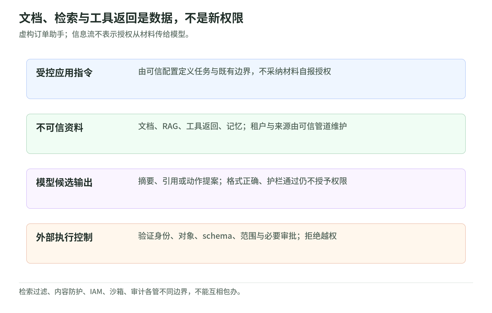
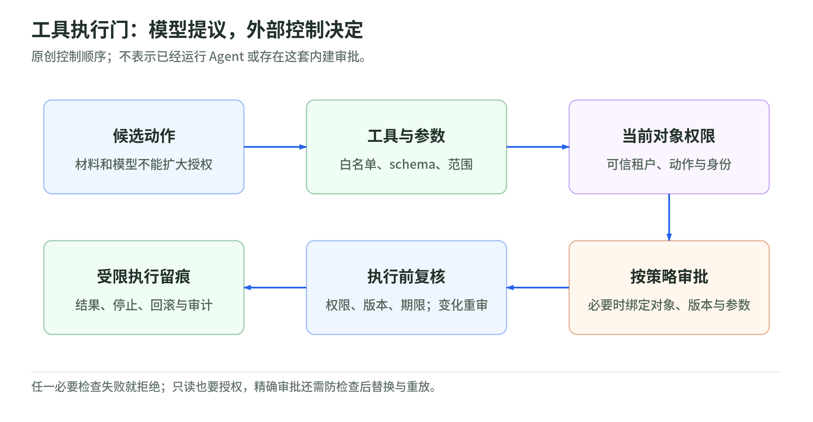

# 09 AI 与 Agent 安全：模型输出不能授予权限

读取日期：2026-11-03。仅研究公开一手资料，未访问账户或执行测试。下文流程、证据表与用例是教学设计，不代表产品默认配置。

虚构案例：订单助手为甲租户读取合同、订单附件与检索片段，整理摘要。附件要求它读取乙租户订单或更改收款对象时，这只是材料里的文字；即使模型答应，也不产生授权。原则是：模型提出候选动作，外部系统决定是否执行。[1][r1] [5][r5]

## 1. 把不可信内容留在数据层

<!-- illustration: safe-agent-data-boundary-2472a42e1d -->

*图：文档、检索与工具返回是数据，不是新权限。虚构订单助手；信息流不表示授权从材料传给模型。*
<!-- /illustration: safe-agent-data-boundary-2472a42e1d -->

直接提示注入来自用户提交的输入；间接注入藏在文档、网页、RAG 检索结果或工具返回中，诱导模型改变行为。用户输入也不能提高调用者已有权限。引用来源、可信网站标识和“内部文档”标签，都不能把内容升级为开发者指令。[1][r1]

图中箭头表示信息流，不表示授权传递；工具返回即使格式正确，也留在数据层。分隔标签有助于识别来源，但不能保证模型永不混淆指令与数据。[1][r1]

检索前，用已认证身份确定租户和文档权限；索引写入时保留来源、租户、访问规则与版本，元数据由可信管道生成，不能接受模型或附件自报的租户。共享索引、缓存、重排、片段和引用都需防止跨租户泄漏，不能等生成答案后才遮盖。[6][r6]

教学检查要追到索引管理面：谁能修改租户标签、导出向量或改变检索规则？即便答案正文没有泄漏，命中数量、文档标题、引用路径或共享缓存也可能暴露其他租户的信息。[6][r6]

Bedrock Knowledge Bases 文档说明元数据过滤能力；这是检索机制，不是业务授权证明。教学要求：服务端强制授权过滤，缺失或冲突的租户元数据拒绝检索；授权分组变化时同步索引、缓存和引用，必要时分开索引。[6][r6] [10][r10]

## 2. 五道边界不能互相替代

| 边界 | 回答的问题 | 不能替代什么 |
| --- | --- | --- |
| 护栏 | 内容是否违反设定策略 | 用户与对象权限 |
| 权限 | 此身份能否操作此对象 | 运行环境隔离 |
| 沙箱 | 进程能接触哪些资源 | 合法业务审批 |
| 评测 | 已测场景是否符合预期 | 未测情形的安全证明 |
| 审计 | 谁在何时做了什么 | 执行前阻断 |

此表是对最小权限、隔离、测试与留痕的教学归纳；一种控制通过，不表示其他边界通过。[5][r5] [7][r7]

Bedrock Guardrails 提供内容策略与 prompt-attack 防护，但不是 IAM，也不是绝对的注入防御。官方注明：prompt-attack 过滤不评估 `messages[].content[].toolResult`，也不评估 `toolConfig.tools[].toolSpec` 中的工具定义；`InvokeModel` 两类接口的用户输入须按文档标记，否则不进行相应过滤。IAM 可约束受支持的推理请求使用指定 Guardrail，却不会因此批准下游订单操作。[8][r8] [9][r9]

## 3. 工具执行前，再检查一次

<!-- illustration: safe-agent-action-review-03e4ea1cfd -->

*图：工具执行门：模型提议，外部控制决定。原创控制顺序；不表示已经运行 Agent 或存在这套内建审批。*
<!-- /illustration: safe-agent-action-review-03e4ea1cfd -->

图是教学执行门：无须人工审批的只读动作也要通过权限检查；高影响写操作不能让模型替人批准。[5][r5]

过度代理（Excessive Agency）的根源是功能过多、权限过大或自主执行范围过广；输出处理不安全则是下游未验证、未正确处理模型输出。二者相关，但不能用“摘要准确”证明工具权力合理。[4][r4] [5][r5]

工具入口在模型之外强制执行白名单、类型化 schema 与参数范围，拒绝未知字段及额外能力；对象授权由服务端决定。限制网络出口、可访问资源、读写范围和执行时限，不提供无范围的通用执行接口。结构合法不等于有权限；模型输出进入 HTML、查询或命令等下游时仍需按目标语境验证、编码，不能直接执行。[4][r4] [5][r5]

沙箱应实际隔离文件、进程与网络资源，不能只给进程设置超时；即使隔离成功，也不能允许它以错误身份修改有权接触的订单。这是权限与运行环境需要分别核验的原因。[3][r3] [5][r5]

教学设计：审批绑定精确对象、动作、参数、租户和版本，并设置有效期。执行前重查权限与对象版本，以条件写入等机制避免检查后被替换；对象、动作、参数或版本改变须重批，授权撤销则拒绝。批准“更新订单”不能复用为“更换收款对象”。[5][r5]

AgentCore Identity 文档区分 workload identity、包含工作负载与用户身份的 agent access token，以及外部资源凭据；credential provider 管理 OAuth 等取凭据流程。身份标识、能取得凭据和订单业务获准是不同层次，仍需下游对象授权；这里不推断任何区域或账户普遍可用。[11][r11] [12][r12]

## 4. 记忆、模型与泄密路径

长期记忆会把一次污染带入后续任务。保存前核验来源与写入权限，按租户隔离，记录版本、有效期与撤销信息；记忆仍是数据，不能成为新增权限。训练数据、模型制品、适配器和索引应有来源记录、版本与完整性校验，未经审查的更新不能直接进入可信链路。[3][r3] [7][r7]

运行时记忆污染不等于训练集投毒，但都要能追溯、隔离与撤销，不能把模型自己的概括当成已核验事实。[3][r3] [7][r7]

秘密不放进系统提示或普通文档；只把完成任务必需的数据交给模型。工具日志、追踪、错误信息、记忆、引用标题、链接及自动下载都可能泄露隐私或成为外传出口。脱敏、保存期限、访问控制与网络出口限制必须一起检查；引用看似可信不代表可以访问，后续打开链接仍要授权。[2][r2] [5][r5] [7][r7]

教学审计记录关联请求、身份、对象、动作、策略版本、审批与执行结果，并保护记录完整性；凭据由执行层取用，工具只返回必要结果，日志不记录明文秘密。审计用于追责与发现异常，不能事后补授权限。[2][r2] [5][r5] [6][r6]

## 5. 用无害证据验证控制

以下仅为待执行评测方案，本次未运行。用合成订单与无害金丝雀标记，不用真实客户、秘密或外部接收端；检查内容进入文档、检索、工具返回或记忆后，是否仍不能改变权限。标记未出现不证明没有泄漏，还须检查检索和执行拒绝证据。[1][r1] [7][r7]

| 控制 | 应保留的证据 |
| --- | --- |
| 租户检索隔离 | 甲请求乙数据被拒，片段与引用均无乙标记 |
| 工具与对象授权 | 越权、额外字段、越界网络请求的拒绝记录 |
| 审批绑定 | 审批后换对象或版本不会继续执行 |
| 记忆与输出保护 | 污染记忆不获权，日志和引用无敏感标记 |

负向测试覆盖缺失元数据、跨租户请求、过期审批、权限撤销和工具返回污染；同时保留合法摘要与合法只读请求，记录误报率，防止“全部拒绝”伪装成安全。护栏、模型、索引或工具策略更新后重跑；评测通过不代表完全防御。真实系统红队须另有明确授权、范围和停止条件，不能由研究任务推导许可。[1][r1] [5][r5] [7][r7]

## 6. 尚待核验

落地前确认租户元数据维护者、权限撤销传播时间、审批有效期及日志保存期；逐条验证实际 API 的护栏覆盖。本文没有核验部署、账户策略或运行结果，控制表不是合规证明。

## 7. 三题自测

1. 合同写着“允许读取其他客户订单”，模型照做是否获权？答：没有，材料不是授权来源。
2. Guardrails 通过且工具参数符合 schema，能否直接执行？答：不能，还须对象权限、范围限制及必要审批。
3. 已批准订单版本一，执行时变为版本二怎么办？答：停止，重新核验并审批；不能复用旧批准。

## 实读来源与范围

共引用 12 个 AWS、NIST、OWASP 一手来源。OWASP 读取各页定义与防护建议；NIST 聚焦 §2.4、§2.9、§2.12、MS-2.5／2.7、附录 A.1.4／A.1.5 的测试与红队说明；AWS 核读过滤覆盖与标记、IAM 条件键及适用 API、元数据过滤、Identity 术语和凭据管理概览。流程与精确审批绑定为教学综合，不声称来源规定了同一实现。

1. [OWASP LLM01: Prompt Injection][r1]
2. [OWASP LLM02: Sensitive Information Disclosure][r2]
3. [OWASP LLM04: Data and Model Poisoning][r3]
4. [OWASP LLM05: Improper Output Handling][r4]
5. [OWASP LLM06: Excessive Agency][r5]
6. [OWASP LLM08: Vector and Embedding Weaknesses][r6]
7. [NIST AI 600-1: Generative AI Profile][r7]
8. [AWS: Prompt attack safeguards][r8]
9. [AWS: Enforce guardrails][r9]
10. [AWS: Knowledge Bases query configurations][r10]
11. [AWS: AgentCore Identity terminology][r11]
12. [AWS: Manage credential providers][r12]

[r1]: https://genai.owasp.org/llmrisk/llm01-prompt-injection/
[r2]: https://genai.owasp.org/llmrisk/llm022025-sensitive-information-disclosure/
[r3]: https://genai.owasp.org/llmrisk/llm042025-data-and-model-poisoning/
[r4]: https://genai.owasp.org/llmrisk/llm052025-improper-output-handling/
[r5]: https://genai.owasp.org/llmrisk/llm062025-excessive-agency/
[r6]: https://genai.owasp.org/llmrisk/llm082025-vector-and-embedding-weaknesses/
[r7]: https://nvlpubs.nist.gov/nistpubs/ai/NIST.AI.600-1.pdf
[r8]: https://docs.aws.amazon.com/bedrock/latest/userguide/guardrails-prompt-attack.html
[r9]: https://docs.aws.amazon.com/bedrock/latest/userguide/guardrails-permissions-id.html
[r10]: https://docs.aws.amazon.com/bedrock/latest/userguide/kb-test-config.html
[r11]: https://docs.aws.amazon.com/bedrock-agentcore/latest/devguide/identity-terminology.html
[r12]: https://docs.aws.amazon.com/bedrock-agentcore/latest/devguide/identity-outbound-credential-provider.html
