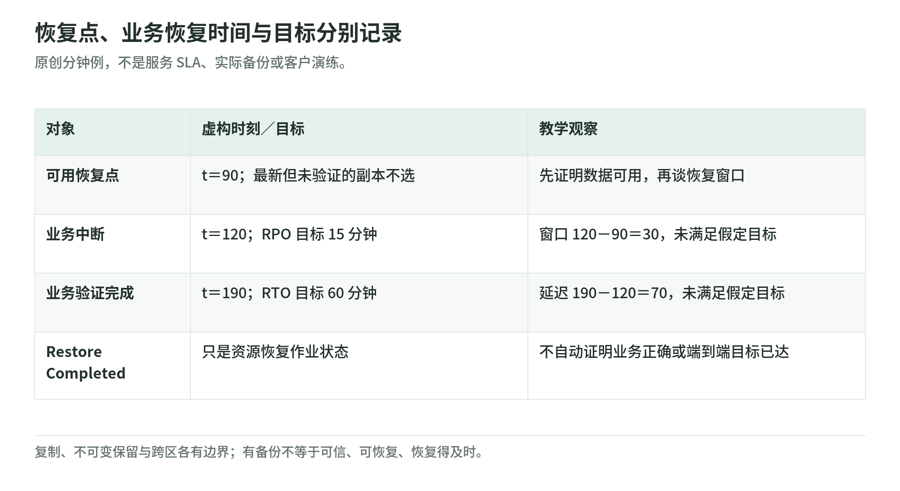

# 10 韧性与恢复：有备份，还要证明恢复得对、恢复得及

研究核验：2026-11-03。安全体系 101 → L200。本文不配置备份、不可变保留、复制、故障注入或生产切换；所有时间与案例为原创假设。

## 1. RPO、RTO 是目标，不是备份按钮的属性

<!-- illustration: safe-recovery-clock-55a09370bb -->

*图：恢复点、业务恢复时间与目标分别记录。原创分钟例，不是服务 SLA、实际备份或客户演练。*
<!-- /illustration: safe-recovery-clock-55a09370bb -->

RPO（恢复点目标）描述中断前可接受的数据回退时间窗口；RTO（恢复时间目标）描述从业务中断到恢复服务可接受的延迟。两者由业务定义，不是某个服务对整个应用自动提供的保证，也不是历史平均 MTTR 的同义词。[AWS DR 目标][objectives]

原创例：事故时刻为 t=120 分钟，最新**已验证可用**的数据恢复点在 t=90，业务验证完成在 t=190。观察到的数据回退窗口为 30 分钟、总恢复延迟为 70 分钟。若目标分别为 15 和 60 分钟，两项都未达标。

这是便于理解的时间线，不声称实际损失恰好是 30 分钟交易；日志回放、部分业务继续工作、数据一致性与污染时间仍可能改变实际结果。关键是恢复点可用、计时边界明确，不能只拿 restore job 耗时替代端到端业务时间。

## 2. 高可用、灾备与安全恢复面对不同失败

多可用区主要降低某些组件或地点故障影响；跨 Region 设计扩大恢复选项，但仍要处理身份、配置、依赖、数据处理与切换条件。数据库复制可能同步错误、删除或污染，不能替代历史恢复点与验证。[DR 方案][strategies]

安全事故还要问：备份是否早于污染？恢复凭据和密钥是否可信？恢复后会不会接回原先被影响的网络或权限？把坏状态复制到另一地点，可能只是更稳定地保存了问题。

NIST 的恢复风险管理不仅是把机器重新开起来，还涉及业务恢复、通信、确认正常状态和持续改进。[CSF 2.0][csf] [NIST 61r3][nist-ir]

## 3. 四种策略，不附带客户 RTO 承诺

AWS 用 backup and restore、pilot light、warm standby、multi-site active/active 分类描述 DR 方案；这里仅比较结构，不复制参考时间量级当作 SLA。[策略解释][strategies]

| 策略 | 常态保持什么 | 演练要证明什么 |
| --- | --- | --- |
| 备份与恢复 | 数据、代码及配置的恢复材料 | 依赖可重建、数据可读、业务可回到正确状态 |
| Pilot light | 必要基础和持续数据机制，其他部分待启动 | 扩容／启动与切换的实际依赖可用 |
| Warm standby | 缩小但可运行的副本 | 扩展能力、接流量、身份和数据正确 |
| 多站点 active/active | 多处服务共同承载业务 | 冲突与一致性、故障隔离、容量与回退 |

成本、复杂度和目标必须一起权衡，不能从名称推断客户一定恢复更快。控制面不可用、供应链依赖、DNS、证书、配额或密钥权限问题都可能影响恢复。[DR 目标][objectives] [方案依赖][strategies]

## 4. 不可变保留保护一种风险，也会带来约束

AWS Backup Vault Lock 区分 governance 与 compliance mode：前者可由有相应权限者移除锁；后者宽限期结束且包含恢复点时，不能任意更改或删除锁和相应保留。错误配置可能造成不可撤销保留与长期存储费用。[Vault Lock][lock]

因此锁之前要核验保留期限、适用数据、删除义务、密钥与恢复权限；本页没有执行任何锁定。不可变不证明备份内容没有被污染，也不证明恢复流程已测试。

跨账户或其他隔离设计是减少同一主体破坏所有副本的办法之一，不是默认获得完全独立的可信边界。账号管理、角色、共享密钥、备份支持对象与访问策略仍需复核。[AWS 跨账户备份][best]

## 5. Restore Completed 与业务验证分别记录

AWS Backup restore testing 可以周期性恢复支持资源并记录恢复时长；额外业务验证是可选步骤，可通过事件驱动验证流程报告结果。恢复资源创建成功，不能自动证明订单数量、业务不变量、服务身份或实际应用已正确恢复。[Restore testing][testing] [验证步骤][validation]

原创恢复证据表：

| 层次 | 检查建议 | 容易漏掉的部分 |
| --- | --- | --- |
| 恢复材料 | 数据点、来源、完整性、代码和配置版本 | 材料来自污染窗口 |
| 环境启动 | 网络、身份、密钥、依赖与容量 | 基础资源好了，应用仍不可用 |
| 业务正确性 | 订单归属、数量、关键状态、抽样核对 | 页面能开但数据不一致 |
| 时间与损失 | 中断、决策、恢复、验证时间和数据窗口 | 仅统计技术作业耗时 |
| 后续观察 | 监测异常是否返回、撤销临时权限、交接 | 切换结束就认为攻击根除 |

测试会创建和删除真实资源，也可能消耗费用；需要环境、数据、执行身份、停止和清理条件。本次没有建立测试计划。生产演练与故障注入还必须另行批准，不能从本读本的学习路线推断授权。

## 6. 原创桌面演练：拒绝“最新但不可信”的恢复点

假设 t=110 的备份虽然最新，但业务校验失败；t=90 的恢复点可用。不能为了满足 15 分钟 RPO 选择坏副本，应记录目标未达标及原因，并安排改进。

实际演练可先做纸面推演，确认关键人员、依赖、通信和决策，再在获授权的隔离环境检验恢复。风险接受和面向客户的恢复说明要区分“目标、历史演练、这次观察”，不把教学数字写进合同。[AWS 事件准备][prepare]

## 7. 三题自测与来源范围

1. 备份每 15 分钟执行一次，是否保证业务 RPO 为 15 分钟？
2. Restore Completed 是否说明应用授权和订单内容已经验证？
3. 跨区复制加 Vault Lock，是否能排除污染与恢复权限失效？

答案：①不能，还要看成功、可用性、复制／回放与污染窗口。②不能，业务验证另行进行。③不能，数据可信度、依赖、身份与密钥仍需检查。

实读范围：AWS DR 目标与四类策略、AWS Backup 跨账户复制／Vault Lock／restore testing／validation、CSF 2.0 恢复结果、NIST 61r3 摘要与 AWS 事件准备。没有真实恢复作业、计费或业务数据。

[objectives]: https://docs.aws.amazon.com/wellarchitected/latest/reliability-pillar/disaster-recovery-dr-objectives.html
[strategies]: https://docs.aws.amazon.com/whitepapers/latest/disaster-recovery-workloads-on-aws/disaster-recovery-options-in-the-cloud.html
[csf]: https://nvlpubs.nist.gov/nistpubs/CSWP/NIST.CSWP.29.pdf
[nist-ir]: https://csrc.nist.gov/pubs/sp/800/61/r3/final
[lock]: https://docs.aws.amazon.com/aws-backup/latest/devguide/vault-lock.html
[best]: https://docs.aws.amazon.com/aws-backup/latest/devguide/create-cross-account-backup.html
[testing]: https://docs.aws.amazon.com/aws-backup/latest/devguide/restore-testing.html
[validation]: https://docs.aws.amazon.com/aws-backup/latest/devguide/restore-testing-validation.html
[prepare]: https://docs.aws.amazon.com/wellarchitected/latest/security-pillar/preparation.html
