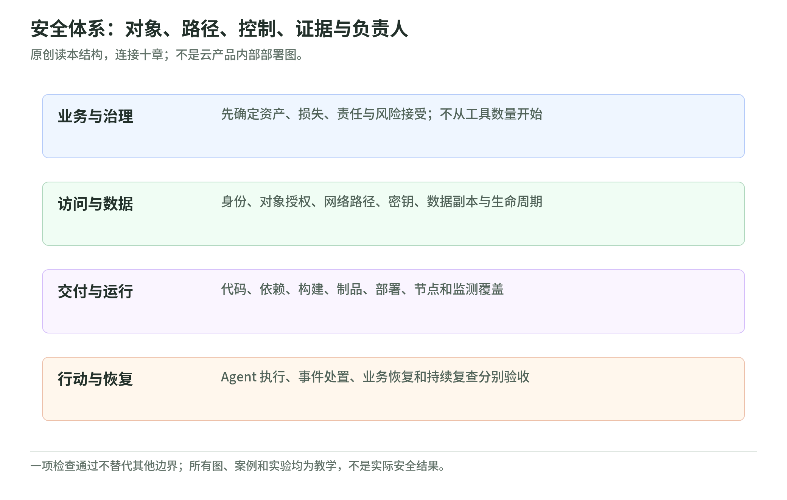

# 云与应用安全体系 101 → L200：从资产到恢复

研究核验：2026-11-03。十章基础读本，连接安全治理、身份、网络、数据、应用、供应链、工作负载、检测响应、AI／Agent 与恢复。配有 16 张原创机制图、学习路线、自测和无网络桌面实验。101 与 L200 是本 Wiki 的教学分层，不是官方认证或执行资格。

## 1. 先有体系，再看产品

<!-- illustration: safe-system-map-57f6a6a8e8 -->

*图：安全体系：对象、路径、控制、证据与负责人。原创读本结构，连接十章；不是云产品内部部署图。*
<!-- /illustration: safe-system-map-57f6a6a8e8 -->

上一套 [AWS Continuum 读本](../aws-continuum/README.md)解释的是一类应用安全评估与整改工作流。本读本补上它不能包办的领域：谁有权访问、数据流向哪里、运行环境怎样隔离、事故谁来判断、系统怎样恢复。

NIST CSF 2.0 把安全风险管理组织为 Govern、Identify、Protect、Detect、Respond、Recover 六类结果；它不是一份规定所有实现方式的产品配置单。[CSF 2.0][csf] AWS 共同责任则提醒：用了托管服务，也仍需区分客户的数据、身份、应用与配置责任。[共同责任][shared]

本书的原创学习方法是“对象—路径—控制—证据—负责人”。先问要保护什么，再问通过哪些身份和依赖能接触它；选控制后，明确怎么证明它生效、什么时候失效，以及谁批准处置。图中箭头表示阅读或证据交接，不声称这些工作只按单一顺序发生。

## 2. 十章内容地图

| 章 | 核心问题 | 学习产物 |
| --- | --- | --- |
| [01 风险与治理](01-risk-and-governance.md) | 哪些损失最重要？谁有权接受残余风险？ | 资产与风险台账 |
| [02 身份与组织](02-identity-and-organization.md) | 谁能对什么做什么？权限上限与实际授权怎样分开？ | 身份、权限与审批地图 |
| [03 网络与零信任](03-network-and-zero-trust.md) | 路由、身份、入口和出口是否一起受控？ | 路径与信任边界图 |
| [04 数据、密钥与隐私](04-data-keys-and-privacy.md) | 数据及其副本流到哪里？谁可读取和解密？ | 数据生命周期台账 |
| [05 应用与 API](05-app-and-api-security.md) | 合法登录的人是否有权操作这条订单？ | 正反授权测试清单 |
| [06 DevSecOps 与供应链](06-devsecops-and-supply-chain.md) | 从源代码到部署，凭什么信任每次交接？ | 制品与来源证据合同 |
| [07 工作负载与容器](07-workload-and-container-security.md) | 镜像、Pod、节点与云角色的边界在哪里？ | 部署与运行覆盖矩阵 |
| [08 检测与事件响应](08-detection-and-incident-response.md) | 谁判断事件、保留证据、批准遏制并跟踪恢复？ | 检测与响应手册 |
| [09 AI 与 Agent](09-ai-and-agent-security.md) | 模型读取了什么？凭什么能执行工具动作？ | 数据／权限／审批合同 |
| [10 韧性与恢复](10-resilience-and-recovery.md) | 什么时间点的数据、多久恢复，怎样验证？ | 恢复演练与残余风险记录 |

建议按 01→02→03→04 建立基础，再读 05→06→07 的开发与部署链，最后读 08→09→10。各章能独立阅读，但不能拿其中一个控制替代其他领域。

## 3. 用一个虚构订单服务贯穿全书

设想一个多租户订单应用：用户登录，API 查询订单，工作负载读取存储；开发者通过流水线交付制品；客服 Agent 检索文档并提出操作建议；运维团队处理告警和恢复。

以下问题是原创案例，不是任何真实客户漏洞：

- 有账号，不代表能读取其他租户的订单。
- 在内网，不代表任意工作负载都可访问数据。
- 有加密，不代表拿到解密角色的进程不会泄露内容。
- 有制品签名，不代表源码安全、构建过程正确或部署版本匹配。
- 有告警，不代表已经完成分析、遏制和沟通。
- 有备份，不代表恢复的业务数据正确，或恢复时间符合目标。
- 有模型 guardrail，不代表工具获得了安全、正确的授权。

这些区别分别在后续章节用一手资料与证据表解释。读完后，应能将一个问题写成“对象、路径、前提、控制、证据、未覆盖项、owner”，而非只贴一个服务名称。

## 4. 怎样与 Continuum 专题交叉阅读

| 基础问题 | 返回 Continuum 时重点检查 |
| --- | --- |
| 身份、数据、网络 | [权限与数据](../aws-continuum/permissions-and-data.md)：管理者、服务角色、目标身份、存储与推理分别核验 |
| 代码、供应链、部署 | [能力与成本](../aws-continuum/continuum-l200.md)：评审与部署后测试、资源模型、计量与预览区别 |
| finding、事件与整改 | [验证修复](../aws-continuum/validation-and-remediation.md)：报告、PR、部署、选定复测不互相替代 |
| 客户价值与治理 | [四种客户方案](../aws-continuum/customer-solutions.md)：范围、许可、交付、验收、停止和替代路线 |

此表是教学对应，不是声称存在原生统一集成。真实产品支持、Region、数据处理、额度和版本要按能力核验。

## 5. 学习与实践边界

先用[学习路线](learning-roadmap.md)检查理解，再运行[离线实验](lab.md)。实验只比较虚构记录和计算恢复目标，不验证 IAM、不测试真实 API、不运行 Agent，也不实际签发审批或执行发布。

本次只读取公开资料，未登录 AWS、建立资源、获取秘密、扫描目标、运行攻击、申请产品、部署、发送客户建议或付费。图文是原创教学；来源与版本见[核验台账](sources.md)。没有收录内部姓名、会议内容、客户资料或未确认排期。

真正进入评估或演练时，应另行明确环境、资产方授权、第三方许可、数据处理、执行身份、预算、停止与恢复条件。知道流程、完成自测或拥有工具，都不是执行授权。

[csf]: https://nvlpubs.nist.gov/nistpubs/CSWP/NIST.CSWP.29.pdf
[shared]: https://aws.amazon.com/compliance/shared-responsibility-model/
