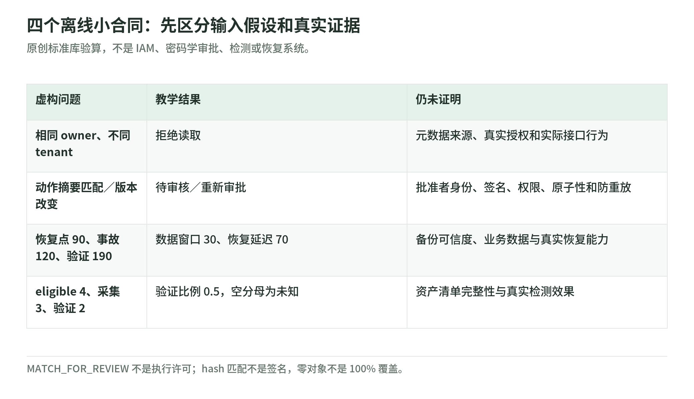

# 离线桌面实验：租户、审批、覆盖与恢复目标

研究核验：2026-11-03。原创 Python 标准库练习，全部输入为虚构符号，不读取账号、密钥、日志或客户数据，不发网络请求，不运行攻击，不执行工具动作、部署或恢复。

## 1. 练的是证据合同，不是安全产品

<!-- illustration: safe-offline-contracts-8434ea67af -->


*图：四个离线小合同：先区分输入假设和真实证据。原创标准库验算，不是 IAM、密码学审批、检测或恢复系统。*
<!-- /illustration: safe-offline-contracts-8434ea67af -->

本实验提出四个独立小问题：请求是否属于同一个租户和所有者；审批对应的对象是否被换掉；恢复时间与数据窗口是否符合假定目标；检测覆盖是否使用完整分母。

它们分别连接[05 API 授权](05-app-and-api-security.md)、[09 Agent 执行](09-ai-and-agent-security.md)、[10 恢复](10-resilience-and-recovery.md)和[08 检测响应](08-detection-and-incident-response.md)。这些章列出一手来源；本页的函数、数据、返回值与测试都是原创教学。

程序**不是 IAM／OAuth／Kubernetes 策略求值器，不是真实审批服务、签名验证器、检测器或恢复工具**。它没有管理员、共享订单或委派访问模型，不能拿去替换应用的生产授权。

## 2. 运行方式与预期结果

代码：[security_foundations_lab.py](https://github.com/IanLiYi1996/learning-wiki/blob/main/scripts/security_foundations_lab.py)；测试：[test_security_foundations_lab.py](https://github.com/IanLiYi1996/learning-wiki/blob/main/tests/test_security_foundations_lab.py)。

在已下载的 learning-wiki 仓库根目录：

```bash
python -B scripts/security_foundations_lab.py
python -B -m unittest discover -s tests -p 'test_security_foundations_lab.py'
```

不需要 AWS 账号、GPU、SDK 或额外包，输出为标准 JSON，程序不保存评估记录。

| 虚构情境 | 应得到的结果 | 不代表什么 |
| --- | --- | --- |
| 租户和所有者都匹配 | `true` | 真实 IAM／应用所有条件已经通过 |
| 所有者名字相同，租户不同 | `false` | 已对真实 API 完成隔离验证 |
| 原审批与当前动作完全一致 | `MATCH_FOR_REVIEW` | 获准自动执行 |
| 版本变为 v2，或审批过期 | `REAPPROVE` | 程序会自动重新找人批准 |
| 恢复窗口 30 分钟、延迟 70 分钟 | 15／60 分钟目标均未满足 | 实际客户的恢复结果 |
| eligible 4、采集 3、验证 2 | 验证覆盖率 0.5 | 两个未验证对象没有风险 |

## 3. 授权：先确定可信元数据

`same_owner_read`只比较四个符号。假设用户、租户来自已经验证的身份，订单 owner 和 tenant 来自服务端可信存储；若改为相信请求正文里的归属字段，函数外的这个前提已经失效。

动手修改虚构值，检查两条拒绝路径：同租户不同 owner，以及同 owner 不同租户。缺失、空白、非字符串等不规范标识报错；它没有“缺失就当默认租户”的后备行为。

现实中还需动作、对象状态、委派规则、角色、属性来源、权限撤销和审计；本实验没有这些能力。详见[身份与组织](02-identity-and-organization.md)及[API 权限](05-app-and-api-security.md)。

## 4. 审批绑定：摘要相同不是批准者可信

虚构动作包含 tenant、verb、object_id、version、destination。程序使用规范 JSON 的 SHA-256 摘要关联一条纸面审批；任一字段变化都须重审，有效期采用开始包含、结束不包含的区间。

**这不是密码学审批。** 没有签名、可信审批者、受保护记录、撤销服务或不可重放机制；可以修改纸面摘要的人也可伪造匹配。`hmac.compare_digest`仅作字符串比较，不表示这里生成或验证了 HMAC。

`MATCH_FOR_REVIEW`只说明这组假想值匹配，仍不允许执行。真实系统应核验有权审批的人和审批渠道、当前权限、对象版本，再用事务或条件更新处理“检查后对象改变”的时间差；单次比较不提供原子性，也不阻止复用。本次没有运行 Agent。[Agent 安全机制说明](09-ai-and-agent-security.md)

## 5. 恢复：目标和观察分开

输入的单位与时钟必须一致。事故为 120 分钟，可用恢复点为 90 分钟，业务验证完成为 190 分钟，得到数据窗口 30、恢复延迟 70；目标设为 15、60，均未满足。[RPO／RTO 定义][dr]

将 restore job 完成时刻改成更早，若业务检查尚未完成，不能据此宣称 RTO 已满足。代码只接受一个“可用恢复点”的外部假设，不会检测备份污染、数据一致性、缺失订单或密钥是否能解密。

恢复点晚于事故、验证完成早于事故，以及负数或非有限数等输入会报错。0 窗口在数学上可成立，但不证明真实系统能做到零数据损失或瞬时恢复。

## 6. 覆盖：把没接入的对象也放进分母

`coverage`用虚构 asset-id 集合检查包含关系：eligible → collected → rule_verified。重复对象只算一次；没有 eligible 对象时返回 `None`，不把未知／无分母说成 100%。

若四个应检查对象中，只有三个采集到记录、两个验证了规则，验证覆盖为 2/4，不是 2/2。对象清单若本来不全，再漂亮的比率仍可能误导；这些集合没有真实收集行为，也不证明健康状态或检测效果。[检测覆盖说明](08-detection-and-incident-response.md)

## 7. 自测、测试范围与后续

自测：①相同用户名为什么仍要检查租户？②审批摘要为什么不能证明批准者身份？③恢复目标为何不能拿备份任务成功替代？④零对象为何不返回 100%？

答案：①身份／归属上下文不同。②缺少可信来源、签名与授权链。③业务数据与端到端时间尚未验证。④没有可评价分母。

测试覆盖对象与租户拒绝、规范标识、全部动作字段、有效期边界、未知动作、非法摘要、非有限时间、恢复顺序、目标等值、覆盖集合与重复对象，还约束程序仅导入标准库。这些测试保证教学例一致，**不验证真实系统安全**。

完成后用[学习路线](learning-roadmap.md)写一页合同：可信输入从哪来，检查由谁执行，失败如何拒绝，什么情况下重新审批或测试，真实执行需要什么授权。

[dr]: https://docs.aws.amazon.com/wellarchitected/latest/reliability-pillar/disaster-recovery-dr-objectives.html
