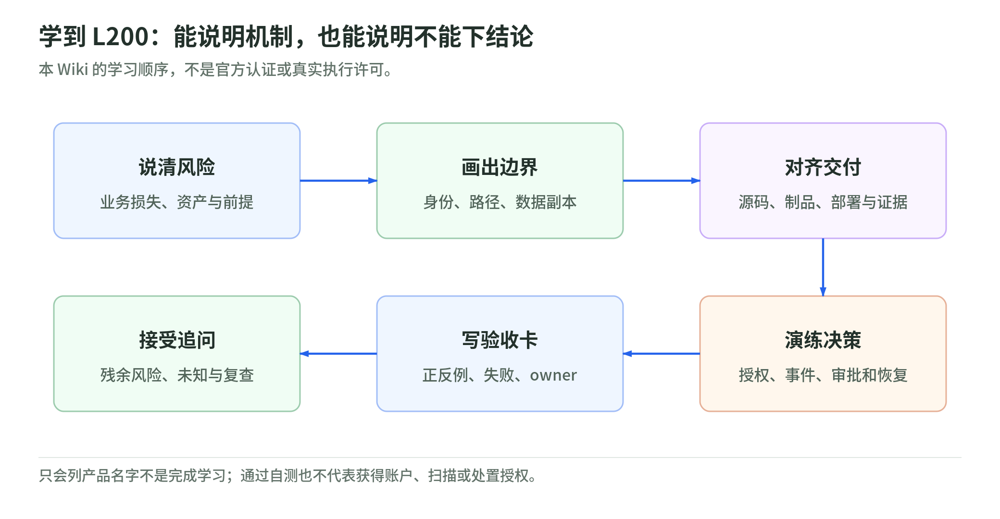

# 学习路线与检查表：把安全知识变成可追问的判断

研究核验：2026-11-03。本页为原创学习设计，101／L200 是本 Wiki 的分层，不是官方认证要求、工作资格或真实系统执行授权。

## 1. 先把十章串成一个案例

<!-- illustration: safe-learning-contract-0c14bb99e1 -->


*图：学到 L200：能说明机制，也能说明不能下结论。本 Wiki 的学习顺序，不是官方认证或真实执行许可。*
<!-- /illustration: safe-learning-contract-0c14bb99e1 -->

以虚构订单服务为主线，不从“开哪些产品”开始。先确定业务损失、资产、身份、路径与数据，再沿代码交付、运行、Agent 工具、事件和恢复寻找证据；最后说明谁拥有决策权。这个学习顺序借鉴 CSF 的风险结果，但不是其强制流程。[CSF 2.0][csf]

| 阶段 | 阅读 | 自己完成的产物 |
| --- | --- | --- |
| 理解风险 | 01 | 一条完整风险情境，不只写漏洞名称 |
| 建立边界 | 02–04 | 身份、网络、数据流及副本清单 |
| 交付与运行 | 05–07 | 正反授权测试、制品来源、部署与监测范围 |
| 执行与恢复 | 08–10 | Agent 权限、响应决策、恢复验证与时间线 |
| 检查理解 | 本地 lab | 解释拒绝、重审、未知分母和未达目标 |
| 面向客户 | 返回 Continuum 方案 | 前提、交付、验收、停止、替代与未覆盖项 |

时间由学习者安排，不附带活动排期、产品测试耗时或客户交付承诺。可以先口述一个简单案例，再逐章加入证据和失败情形。

## 2. 101 与 L200 的可观察差别

本 Wiki 的 101 目标是能分清概念：认证不等于授权、加密不等于访问许可、内网不等于可信、扫描不等于攻击验证、签名不等于代码安全、备份不等于恢复、guardrail 不等于工具权限。

L200 则应能对同一案例提出可验证条件：

- 权限：主体、动作、对象、租户、条件、组织规则与例外分别说明。
- 数据：原始记录、日志、缓存、检索索引、备份与删除边界列出。
- 交付：提交、构建者、制品摘要、扫描与审批对应到相同对象。
- 运行：控制实际状态、支持对象、监测健康与未覆盖资产可追溯。
- 行动：由外部系统核验工具权限；高影响动作有明确审批与停止条件。
- 恢复：业务验证、可信恢复点、RPO／RTO 目标与观察结果分开。

这些是本页的验收建议，不证明能力可直接用于生产。对应机制和一手依据在各章；[标准库练习](lab.md)只检验小型教学合同。

## 3. 术语速查：先说白话，再说缩写

| 术语 | 白话 | 易误读 |
| --- | --- | --- |
| CIA | 保密、完整、可用三类安全目标 | 只重视数据不被看见 |
| RBAC／ABAC | 按职能／按可信属性决定访问 | 标签或角色名称自动授权 |
| Zero Trust | 每次资源访问按策略判断，不暗信位置 | 买一款产品、取消网络控制 |
| SAST／DAST／SCA | 查代码、查运行行为、查组件 | 其中一种包办全部检查 |
| SBOM／provenance | 组成清单／构建来源记录 | 都是无漏洞或可信源码证书 |
| CSPM／runtime detection | 配置姿态／运行威胁检测 | 启用后每个资产都有覆盖 |
| IR | 事件分析、遏制、恢复与复盘的工作 | 收到告警就算完成 |
| RPO／RTO | 允许的数据回退窗口／恢复延迟目标 | 作业完成自动满足业务目标 |
| Guardrail／authorization | 内容与行为护栏／执行权限判断 | 模型或过滤器能授予权限 |

这是对各章术语的教学索引，不替代规范定义；遇到具体策略、接口、标准版本时，返回所在章节的原始来源，而不是套用缩写口诀。

## 4. 十道跨章节自测

每题先答结论，再指出缺少的证据：

1. 组织启用 SCP，是否管理账户、服务关联角色和全部外部主体都被约束？
2. 订单接口接受合法 JWT，是否可以只按请求里的 tenant 查数据？
3. 私有子网有 NAT，是否已经限制了所有出口目的地？
4. 对象加密且 CMK 受控，是否无需再核验能读取和解密的角色？
5. 签名有效，是否可以忽略仓库、构建者、输入及部署摘要？
6. 容器用了专属角色、PSA 为 audit，是否已形成硬隔离并阻断违规 Pod？
7. Event history 有 90 天记录，是否应用数据访问与全组织长期审计齐备？
8. Bedrock 内容检查通过，模型请求工具改订单，是否可以直接执行？
9. 审批对应版本 v1，执行时对象变为 v2，是否只要动作名称相同就可继续？
10. 备份频率 15 分钟、restore job 成功，是否已保证业务 RPO／RTO？

答案都为“不能这样推出”。分别查看 [02](02-identity-and-organization.md)、[05](05-app-and-api-security.md)、[03](03-network-and-zero-trust.md)、[04](04-data-keys-and-privacy.md)、[06](06-devsecops-and-supply-chain.md)、[07](07-workload-and-container-security.md)、[08](08-detection-and-incident-response.md)、[09](09-ai-and-agent-security.md)与[10](10-resilience-and-recovery.md)的范围和例外。

建议通过线：至少八题解释完整，且授权、审批与未测放行相关题必须能说明失败如何被拒绝。这是本页自行设置的学习检查，不是正式安全审核。

## 5. 四张客户候选练习卡

下面是原创纸面服务设计，不是 AWS 官方套餐或向真实客户推荐的授权。执行型 PoC 前需核对资产许可、数据处理、身份、预算、停止能力和负责人。

| 候选方向 | 痛点与交付 | 纸面验收／不能承诺 |
| --- | --- | --- |
| 身份与权限基线 | 身份、角色、组织范围、根恢复及例外台账 | 有 owner、来源与复查；不保证自动最小权限 |
| 软件交付证据链 | 提交、SBOM、签名、来源、制品与部署的映射 | 负例可拒绝；不保证软件无漏洞 |
| Agent 边界评审 | 检索租户、工具范围、审批、输出及日志合同 | 合成越权用例有拒绝证据；不保证永不注入 |
| 检测与恢复桌面演练 | 覆盖矩阵、通知、决策、恢复点与时间线 | 未覆盖与未达目标明确；不证明生产可恢复 |

先用虚构样本推演，不把论文、图示或产品案例当成客户已具备的能力。需要更具体的应用评估与整改服务，再读[Continuum 四种方案](../aws-continuum/customer-solutions.md)，把本读本的边界作为前提。

## 6. 下一次学习或讨论前，准备什么

准备一份不含真实秘密、账号、客户信息或生产地址的简化案例。给每个对象标 owner、每条路径标身份、每份输出标版本；不要把配置截图中的密钥、令牌或个人信息带进演示。

可以追问：谁能改策略与标签？谁能替换制品？数据有哪些副本？日志未到达怎么办？审批后对象变了怎么办？停止行动会不会丢证据？恢复点是否可用？选择的产品功能在该账户与 Region 是否真的支持？

复盘模板：

```text
核验日期／来源与版本：
业务目标、资产、身份、路径、数据副本：
风险前提与已有控制：
需要的证据、正例、反例与未覆盖项：
可信输入、策略维护者、审批者与执行者：
失败拒绝、权限撤销、停止与回滚：
事件、恢复与业务验收条件：
残余风险、owner、复查日期和下一步：
```

复盘最好留下可以被推翻的假设，而不是只列工具名称。安全会随着人员、代码、依赖和数据变化而改变；证据也应带时点与范围。[NIST 风险管理与持续监测][rmf]

[csf]: https://nvlpubs.nist.gov/nistpubs/CSWP/NIST.CSWP.29.pdf
[rmf]: https://csrc.nist.gov/projects/risk-management/about-rmf
